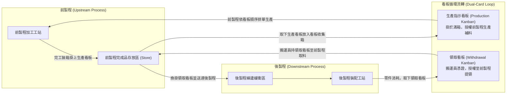
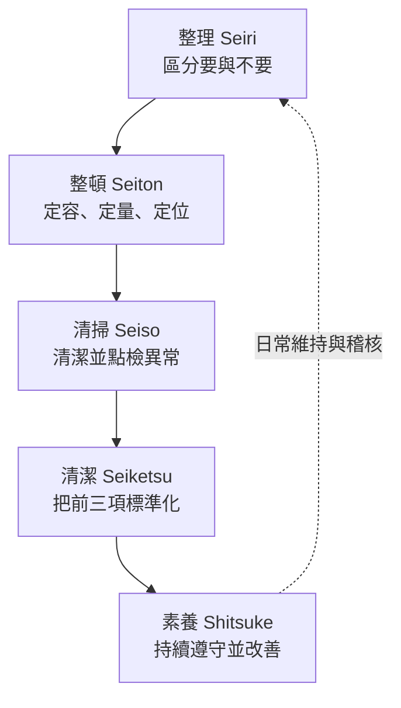
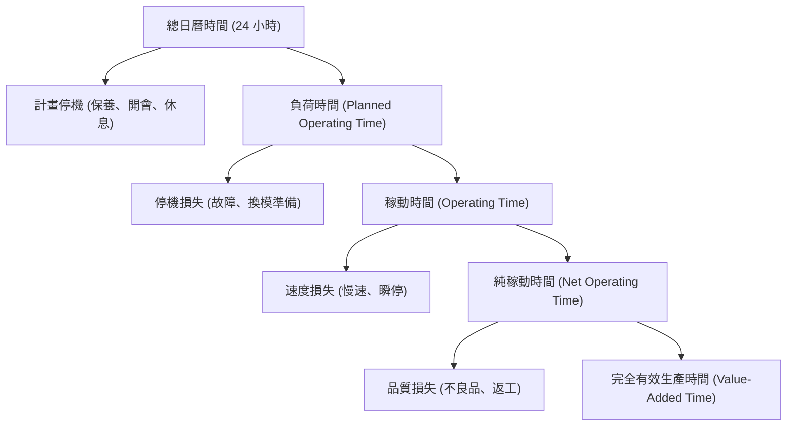

# 單元六：精實生產與現場績效管理

<figure class="unit-visual">
  
  <figcaption>3D 單元總覽<strong>圖解重點：</strong>中央呈現後拉補料、單件流、5S、安燈與防呆；周邊紅色情境提示七大浪費，儀表與維護元素連結 TPM、六大損失與 OEE 三構面。</figcaption>
</figure>

## 1. 豐田生產方式 (TPS) 與七大浪費

豐田生產方式（Toyota Production System, TPS）的核心目標是透過徹底消除浪費（Muda），以最短的製造前置時間、最低成本提供最高品質的產品。

### (1) TPS 兩大支柱
* **及時化（Just-In-Time, JIT）**：「只在必要的時間，按照必要的數量，生產必要的產品」。以看板系統（Kanban）落實後拉式（Pull）排程。
* **自働化（Autonomation / Jidoka / 智慧型自動化）**：設備具備偵測異常並自動停止運轉的能力，不讓不良品流向下一製程，強調「人機分離」，一人能監看多台機台。

### (2) 現場七大浪費 (The 7 Wastes - 英文口訣 TIMWOOD)
大野耐一界定現場製造最常見的七大無效耗費：

| 浪費類型 | 英文名稱 | 現場具體情境 | 嚴重性與改善方向 |
| :--- | :--- | :--- | :--- |
| **過量生產** | Overproduction | 提前生產或生產超出後端需求的數量 | **七大浪費之首**！會掩蓋工站缺料、機台故障與品質不良等深層問題，並衍生額外庫存空間與搬運成本 |
| **等待** | Waiting | 作業員等待機台加工循環、等待前站來料、等待修機 | 平衡線路負荷、落實快速換模（SMED） |
| **搬運** | Transport | 原料、在製品在車間與倉庫之間無目的移動 | 重新規劃車間佈置，改採 U 型單元化配置 |
| **過度加工** | Over-processing | 超出客戶功能規格需求的精密拋光或非必要包裝 | 重新審查產品公差規範與工程標準圖面 |
| **庫存** | Inventory | 原料倉、現場線邊倉及成品倉庫堆積之資產呆滯 | 降低生產批量、改推逐批拉動生產 |
| **動作** | Motion | 作業員轉身找工具、彎腰搬重物、單手無效持住 | 應用動作經濟原則，配置重力進料盒與防呆治具 |
| **不良品** | Defects | 生產出尺寸超差工件，導致返工、修補或報廢 | 實施源頭檢驗、首件檢驗與防呆機構 |

---

## 2. 看板管理 (Kanban System) 與單件流

看板是 JIT 傳遞物料流轉與生產排程指令的物理或電子憑證：

* **生產指示看板（Production Kanban）**：授權特定工作站開始加工下一批標準容器容量（Container Capacity）的零件。
* **領取看板（Withdrawal / Conveyance Kanban）**：授權搬運員至前製程緩衝倉領取固定數量零件補充至後製程線邊。
* **看板數量計算公式**：
  在穩態運作下，維持產線不斷料所需的循環看板張數 $N$：
  $$N = \frac{D \times L \times (1 + \alpha)}{C}$$
  其中：
  * $D$ 為後製程單位時間需求率
  * $L$ 為補料前置時間（包含搬運、準備與加工時間）
  * $\alpha$ 為安全餘量係數（Policy Variable，通常 $\le 10\%$）
  * $C$ 為單一物料容器之標準盛裝容量

---

## 3. 防呆機制 (Poka-Yoke) 與 5S 管理

### (1) 防呆法 (Poka-Yoke / Mistake-Proofing)
新鄉重夫（Shigeo Shingo）提出防呆理念，透過機械結構或電子互鎖（Interlock）使作業員在無意識狀態下也「無法犯錯」或「一旦犯錯機台立即停機」。

* **三大防呆機構類型**：
  1. **接觸式（Contact Method）**：利用形狀引腳、不對稱凹凸槽、定位銷使反向零件根本無法裝入模具（如 USB 接頭方向設計、SIM 卡斜角切口）。
  2. **定值計數式（Fixed-Value Method）**：在工站設置光柵感測器或計數器，若規定鎖附 4 顆螺絲，只鎖了 3 顆時治具夾爪拒絕釋放工件。
  3. **動作步驟式（Motion-Step Method）**：透過條碼槍刷讀防錯，必須依序刷讀作業指導書、原料料號與批次，機台才會解鎖啟動。

### (2) 5S 現場管理原則
5S 是實施智慧製造與精實管理的基礎環境門檻：

**流程記憶：**先清除不需要的物品，再為需要物品定位，清掃時辨識異常，最後用標準與習慣維持成果。

* **整理（Seiri）**：區分「要」與「不要」之物品，不要的物品貼上紅標籤移出車間或報廢。
* **整頓（Seiton）**：將需要的物品「定容、定量、定位（三定原則）」，標籤朝外目視化。
* **清掃（Seiso）**：徹底掃除灰塵油污，在清掃過程中同時檢查機台螺絲有無鬆動或漏油。
* **清潔（Seiketsu）**：將整理、整頓、清掃之成果標準化並維持制度化。
* **素養（Shitsuke / 教養）**：全員養成遵守規範之自主自律文化。

---

## 4. 全面生產保全 (Total Productive Maintenance, TPM) 與整體設備效率 (OEE)

### (1) 設備六大損失 (Six Big Losses)
TPM 的核心在於消滅設備生命週期中的六大隱形損失：
1. **設備故障損失（Breakdowns）**：突發非計畫停機（影響時間稼動率）。
2. **換線與調整損失（Setup and Adjustments）**：換模、校機時間（影響時間稼動率）。
3. **空轉與瞬間停機（Idling and Minor Stops）**：零件卡料、感測器誤報等短暫停頓（通常歸性能損失；微停與停機的時間門檻須事先定義）。
4. **速度降低損失（Reduced Speed）**：機台實際運行速度低於額定銘牌速度（影響性能稼動率）。
5. **啟動製程不良損失（Startup Rejects）**：開機暖機階段產生的廢料（影響良品率）。
6. **生產製程不良損失（Production Rejects）**：正常生產運轉期間產生之瑕疵品（影響良品率）。

### (2) 整體設備效率 (Overall Equipment Effectiveness, OEE) 計算推導
OEE 綜合評估設備的可用性、速度產出效率與品質合格率：

$$\text{OEE} = A \times P \times Q$$

  

    
⚙️

    

      <h3 class="infographic-title">OEE 三大柱解構與設備六大損失</h3>
      
可用率 (Availability) × 表現指數 (Performance) × 良率 (Quality)

    

  

  

    

      

        1. 時間稼動率 (A)
        90.0%
      

      

        

      

      <ul class="oee-losses-list">
        <li>消弭<strong>設備突發故障停機</strong></li>
        <li>壓縮<strong>換模/換線調整時間 (SMED)</strong></li>
        <li>公式: 稼動時間 ÷ 負荷時間</li>
      </ul>
    

    

      

        2. 性能稼動率 (P)
        95.0%
      

      

        

      

      <ul class="oee-losses-list">
        <li>排除<strong>卡料空轉與瞬間微停</strong></li>
        <li>克服<strong>機台降速運轉損失</strong></li>
        <li>公式: (理論CT × 產出數) ÷ 稼動時間</li>
      </ul>
    

    

      

        3. 良品率 (Q)
        99.9%
      

      

        

      

      <ul class="oee-losses-list">
        <li>降低<strong>暖機開機首件試俥報廢</strong></li>
        <li>消滅<strong>正常量產製程瑕疵返工</strong></li>
        <li>公式: 良品總數 ÷ 總生產數</li>
      </ul>
    

    

      

        🏆 綜合標竿 OEE
        85.4%
      

      

        

      

      <ul class="oee-losses-list">
        <li><strong>三因素乘積示例</strong></li>
        <li>$0.90 \times 0.95 \times 0.999 = 85.4\%$</li>
        <li>改善目標須依製程、產品與需求設定</li>
      </ul>
    

  

1. **時間稼動率（Availability, A）**：
   $$A = \frac{\text{稼動時間}}{\text{負荷時間}} = \frac{\text{負荷時間} - \text{停機時間}}{\text{負荷時間}}$$
2. **性能稼動率（Performance, P）**：
   $$P = \frac{\text{理論週期時間 (Ideal Cycle Time)} \times \text{總生產數量}}{\text{稼動時間}}$$
3. **良品率（Quality, Q）**：
   $$Q = \frac{\text{總生產數量} - \text{不良品數量}}{\text{總生產數量}} = \frac{\text{良品數量}}{\text{總生產數量}}$$

*乘積示例*：$A=90\%,\,P=95\%,\,Q=99.9\%$ 時，OEE 約為 85.4%。這組數字可作練習，不是所有製程共用的合格門檻；跨線比較前要先核對時間、產品及良品的定義。

### (3) 設備可靠度指標 (MTBF / MTTR)
* **平均故障間隔時間（Mean Time Between Failures, MTBF）**：
  $$\text{MTBF} = \frac{\text{總有效稼動運轉時間}}{\text{總故障次數}}$$
* **平均修復時間（Mean Time To Repair, MTTR）**：
  $$\text{MTTR} = \frac{\text{總維修停機工時}}{\text{總故障次數}}$$
* **設備固有可用度（Inherent Availability, $A_i$）**：
  $$A_i = \frac{\text{MTBF}}{\text{MTBF} + \text{MTTR}}$$

---

## 職能基準對照與實務解說

## 進階延伸：把浪費辨識轉成可維持的改善

### 拉動系統與補貨訊號

看板是授權生產或搬運的訊號，數量常以需求率、補貨前置時間、容器容量與安全係數估算：N = (需求率 × 補貨時間 × (1 + 安全係數)) ÷ 容器容量。各量的時間單位必須一致。看板不是越少越好；若補貨時間變異大、品質不穩或設備停機，卡片減少可能造成缺料。應先穩定流程，再逐步降低緩衝並觀察缺料、等待與交期。

### OEE 的分母與損失分類

OEE = 可動率 × 性能稼動率 × 良品率。分析前先定義計畫生產時間、休息與停機是否納入、理想週期時間以及返工品如何分類。可動率損失通常來自故障與設定／換線；性能損失包含微停與速度下降；品質損失包含製程不良與啟動不良。不同工廠若口徑不同，OEE 數值不能直接排名比較。OEE 上升也不等同交期或成本必然改善，需結合瓶頸位置與需求檢視。

### TPM 與自主保全

自主保全讓操作人員依標準執行清潔、點檢、潤滑與異常通報；專業維修則負責預防保養、故障分析與設備改良。點檢項目應對應失效模式、判定標準、週期與責任人，並明確區分可由操作員處置與須停機／升級處理的條件。將異常只記錄在紙上、沒有工單閉環，不會形成可靠的設備改善。

### 改善驗證：從現況基線到標準化

改善前先固定時間範圍、產品組合、班別及計算口徑，建立產出、品質、停機、安全與在製品基線；試行後比較相同條件下的結果，確認沒有把損失轉移到下游。有效措施應更新標準作業、看板上限、點檢表或訓練資料，指定稽核週期與負責人。

### 自我檢核

1. 需求率 24 件／小時、補貨時間 1.5 小時、安全係數 20%、每箱 6 件，理論看板數為何？
2. 微停主要會反映在哪一項 OEE 構成因素？

**判讀要點：**N = 24 × 1.5 × 1.2 ÷ 6 = 7.2，實務上需依政策向上取整為 8 箱；微停屬性能損失。

### 深度應用：估算補料看板數量

看板數量常以「補充期間需求 ×（1＋安全係數）÷ 容器容量」估算，結果需向上取整。假設下游每小時使用 120 件，補充前置時間 0.5 小時，安全係數 10%，每箱 20 件，則看板數為 $120 × 0.5 × 1.10 ÷ 20 = 3.3$，至少配置 4 張／箱看板。正式設定還要納入需求波動、搬運路線、補充頻率與現場規則；看板過多會增加在製品，過少則提高缺料風險，應依實際資料逐步調整。

### 延伸應用：用 OEE 找損失位置

某設備負荷時間 480 分鐘、實際運轉 420 分鐘、理論週期 0.5 分鐘／件、總產量 760 件、良品 740 件：可用率 $A=420/480=87.5\%$；性能 $P=(0.5×760)/420≈90.5\%$；品質 $Q=740/760≈97.4\%$；OEE 約為 $0.875×0.905×0.974≈77.1\%$。拆解後可見時間損失、速度損失與不良損失各自不同，改善應回到六大損失及停機紀錄找原因，不能只追單一 OEE 數字。

MTBF 是可運轉時間除以故障次數，反映故障間隔；MTTR 是維修時間除以修復次數，反映平均修復時間。MTBF 上升代表故障較少，MTTR 下降代表修復較快，兩者需搭配產量、品質與安全檢核，才足以判斷設備改善成效。

本章對應 **T4.2 主導生產線改善提案**。依 P4.2.1，改善方案必須可落實執行，目標是提升效率、安全、品質或降低成本。發現浪費後應驗證成效、標準化有效做法並追蹤維持狀況，才符合持續改善。

### 職能任務：把改善提案做成可維持的成果

P4.2.1 的要求是提出可落實、並能提升效率、安全、品質或降低成本的方案。改善提案應從可觀察的現象與資料出發，界定問題範圍、損失機制、目標及驗證指標；提出對策後先在受控範圍試行，再確認對策沒有把浪費、風險或品質問題轉移到其他工序。

可用「現況量測 → 觀察價值流與現場動作 → 找出浪費及根因 → 設計對策 → 試行驗證 → 標準化與橫向展開」的節奏。OEE 可拆解為可用率、性能與品質損失；5S、TPM、SMED、看板與防呆則是處理不同損失的工具，不能把工具名稱本身當作改善成果。

### 改善提案應具備的證據

提案至少應說明基線、改善目標、影響範圍、風險、責任人、執行期限及確認方法。例如縮短換線時間時，要分別量測內部／外部作業、確認首件品質與安全條件，並將新做法納入標準作業；否則數字雖然短暫變好，成果仍可能在下一個班次回退。

### 常見誤區

* 把單純加快速度當成效率改善，卻造成不良、故障或人員負荷上升。
* 只做一次 5S 或 Kaizen 活動，沒有日常稽核、異常回饋與標準化。
* 只以 OEE 總分比較績效，未拆解造成損失的實際原因。

### 115 年第一次公告試題：JIT、WIP 與直通率連動判讀

**對應 L11 第 33、34、37–40 題。**JIT 的小批量與低緩衝會讓停機、換線及供料波動更快暴露。若題目主要線索是設備停機率提高，應先穩定設備並建立預防保養；若資料顯示損失主要來自正常換模與調整，再以 SMED 分離內外部作業、改善換線。不能看到「頻繁換線」便把所有停機都當故障，也不能以增加成品檢查代替設備可靠性改善。

觀察精實成果時，可在相同產品族、相同時間單位下，以期間通過量／平均在製量衡量 WIP 週轉。原創例：穩態每天通過 240 等價件、平均 WIP 為 960 件，週轉為每天 0.25 次；按 Little 定律，平均流程時間為 $960/240=4$ 天。若維持通過量而 WIP 降至 480 件，則每天 0.5 次、流程時間 2 天。這需要系統邊界、等價件口徑與進出量穩定；只把在製品移到統計區外，不算流程改善。

**品質損失檢核：**投入 1,000 件，首次合格 900 件，另有 80 件重工後合格，則直通率／一次良率為 90%，含重工的最終良率為 98%。若只看最終良率，就會漏掉重工占用的工時；OEE 的品質因素應明確記錄採一次合格口徑，避免返工後重複計為新良品。以本章時間階層為例，扣停機後再扣速度損失，最後扣品質損失才是完全有效時間，因此不可把速度損失與品質損失交換相加。

**自我檢核：**有效產能是設計產能的 60%，實際產出又為有效產能的 75%；實際為每天 90 件，設計產能為何？**答案：**$90/(0.60×0.75)=200$ 件／天；效率為 75%，利用率為 45%。若只用 $90/0.75$，算到的是有效產能 120 件／天，還沒回推設計產能。

### 試題判讀與選項辨析：損失不能跨層相加

| 題號／公告答案 | 必要知識與判斷步驟 | 常見誤選理由 |
| :--- | :--- | :--- |
| 33／A | 在題給選項中，停機及產能不穩對應預防性保養；實務再將故障停機、正常換線、調整與微停分開蒐證。 | 用勞資協調、全面自動化或末端檢查取代設備穩定性改善。原題未提供換線／故障損失明細，不能延伸成「所有頻繁換線一律優先保養」。 |
| 34／A | 先畫時間損失階層：扣停機、再扣速度損失、再扣品質損失；價值工時加回品質損失才回到其上一層。 | 把速度與品質損失放在同一層；同題其餘良率式又需分清首次合格和重工後最終合格，不能拿最終良率代表 FPY。 |
| 37／C | 先由實際量除以 0.8 得有效產能 10，再除以 0.5 得設計產能 **20 件／週**；也可用 $8/(0.8×0.5)$。 | 只除一次百分比就停止，或把兩個百分比相加。效率比較實際／有效，利用率比較實際／設計，此題分別為 80% 和 40%。 |
| 40／D | 要看精實流動，優先觀察與 WIP 直接連結的週轉；在通過量穩定且邊界相同時，較高週轉對應較短平均流程時間。 | ROI 屬較廣的財務結果，不能單獨診斷現場流動；只清空緩衝造成缺料、或把 WIP 移出統計範圍，也不能算改善。 |

**第 34 題的名詞處理：**工廠對「負荷、淨作業、有效、價值」工時的命名可能不同，讀題先對照它的損失瀑布。本章 OEE 採「計畫生產時間 → 扣停機後運轉時間 → 扣速度損失後淨運轉時間 → 扣品質損失後完全有效時間」。不能只因別處也叫「有效工時」就跨定義套式；更不能將本題的人工工時命名直接當成所有 OEE 軟體的欄位定義。

## 深度研讀：瓶頸、WIP、看板與改善的經濟比較

### 為何非瓶頸省下的時間未必能增加銷售

串聯流程的穩態通過量受最小有效能力限制。改善非瓶頸可以減少人力、能源或故障風險，但若未改變限制站，不能直接把該站多出的能力當成整線新增銷售。看板則限制指定補料迴圈的授權數量，目的是讓生產與消耗連動，不能替代瓶頸的有效能力。先界定系統邊界，再選「交期、產出、WIP、成本」中需要改善的目標。

在邊界與期間一致、進出量穩定時，Little 定律 $WIP=TH×FT$ 來自「平均每單位時間進入的件數」乘「每件平均停留時間」。它是平均量的關係，不保證把庫存砍半後立刻維持相同通過量。若原庫存是因品質與停機波動而形成，先砍緩衝可能使瓶頸斷料，導致 TH 也下降。看板量的估算式 $N=\lceil DL(1+\alpha)/C\rceil$ 同樣需要穩定的補充時間與明確的容器容量。

Little 定律的系統觀點可參考 [MIT 庫存與排隊模型講義](https://ocw.mit.edu/courses/15-763j-manufacturing-system-and-supply-chain-design-spring-2005/568c857501f6785e7b328a3cf3990705_reviw_of_que_mol.pdf)。此處 FT 指單件在系統內的流程停留時間，與本章用來比較工站速度的 CT 分開；閱讀不同來源時應先核對其「cycle time」用語。

### 整合案例：三個提案，哪個能解除每日缺口

**完整輸入與假設：**A→B→C 串聯，需求每天 110 件。A、C 經驗證的有效能力分別為 168、140 件／天；B 是瓶頸。每天排班 480 分鐘，休息 30 分鐘，B 計畫生產時間為 450 分鐘，其中設定 45、故障 45，實際運轉 360 分鐘。B 每運轉小時可提供 16 件合格品；這是已反映速度與品質的淨產率，不能再重乘一遍良率或性能率。忽略批次啟動差異，各方案不改變 A、C 與合格產率。

一年有 220 個工作日，每多售出一件的邊際貢獻為新臺幣 45 元，已扣新增材料與變動費；需求與供給可維持，以下投資均為一次性，無額外固定維運費。提案甲花 4,000 元提升 A；乙花 6,000 元改善 B 的換線，設定由 45 降至 15 分鐘；丙花 9,000 元改善 B 故障原因，故障停機由 45 降至 15 分鐘。乙、丙的改善已試行驗證，且影響不同損失，合併時可相加。

**第一步，建立基線。**B 每天合格能力為 $360/60×16=96$ 件，整線亦為 96，需求缺口 14。甲即使使 A 更快，B 仍只有 96，單靠新增銷售不能回收其成本；若另有省電或人力效益，應另列證據。

**第二步，逐案算到可銷售數量。**乙、丙各自回收 30 分鐘，B 能力變為 $390/60×16=104$ 件，各增加 8 件，但仍缺 6 件。兩案合併運轉 420 分鐘，能力為 112 件；受需求 110 限制，新增可銷售量只有 14，不是 16 件。

| 方案 | 整線理論能力（件／天） | 新增銷售（件／天） | 年增邊際貢獻（元） | 簡單回收工作日 |
| :--- | ---: | ---: | ---: | ---: |
| 甲 | 96 | 0 | 0 | 本項效益無法計算回收 |
| 乙 | 104 | 8 | 79,200 | 16.67 |
| 丙 | 104 | 8 | 79,200 | 25.00 |
| 乙＋丙 | 112 | 14 | 138,600 | 23.81 |

回收工作日以投資／每日新增邊際貢獻計算，沒有考慮資金時間價值、稅與折舊，不等於完整投資評估。在本例要滿足全部需求，乙＋丙才解除產能缺口；執行後應確認瓶頸未轉移、良品產率維持，並停止為湊 112 件而過量生產。

**第三步，檢查 WIP 與補料。**若穩態平均 WIP 從 72 件降至 36 件，且實際通過量從 96 提升至 110 件／工作日，平均流程時間由 $72/96=0.75$ 工作日降至 $36/110≈0.327$ 工作日。以每件平均庫存價值 60 元、年持有率 25% 計，減少 WIP 可釋出資金 2,160 元，年持有成本約少 540 元；2,160 是一次性資金變化，不能每年重複列節省。

指定補料迴圈以 7 小時平準供應 110 件，D＝110/7 件／小時；補充前置時間 0.6 小時、練習安全係數 20%、每箱 6 件，需 $\lceil(110/7)×0.6×1.2/6\rceil=2$ 張看板，授權上限 12 件。這只是一個迴圈，不等於整線 WIP 都必須是 12；其他迴圈、加工中及必要隔離狀態要另行計算。

### 邊界與敏感度：改善效益要由實際損失驗證

兩案若其實都在處理同一段停機，回收時間就不能相加；若回收的時間只落在無人值守時段，也可能無法形成新增產出。比較前要保留損失事件起訖、原因碼、產率與產品組合。OEE 改善、可用工時增加與可銷售良品增加分屬不同層次，只有客戶需求與上下游資源都支持時，產能增益才會變成案例中的邊際貢獻。

### 進階練習與解析

**練習一：需求降為每天 102 件，乙與乙＋丙的簡單回收期如何改變？**

**解析：**兩者能力都超過 102，最多各比基線 96 多售 6 件，每日新增邊際貢獻均為 $6×45=270$ 元。乙回收為 $6,000/270≈22.22$ 工作日；組合為 $15,000/270≈55.56$ 工作日。若只比較題目給的新增銷售，組合不再增加效益；不能把未售出的多餘能力列收入。其他可靠性或服務價值若要計入，須另給資料。

**練習二：供應延遲使補充前置時間升為 1 小時，看板量及庫存資金如何變？**

**解析：**$N=\lceil(110/7)×1×1.2/6\rceil=4$ 張，上限由 12 增為 24 件；按每件 60 元，多占 720 元資金，若全年維持相應平均增量，年持有成本多約 180 元。看板上限不一定等於平均庫存，因此 180 元是依「平均也增加 12 件」的額外假設估計；應先調查延遲根因與波動，再決定緩衝，不能把加卡視為永久解法。
