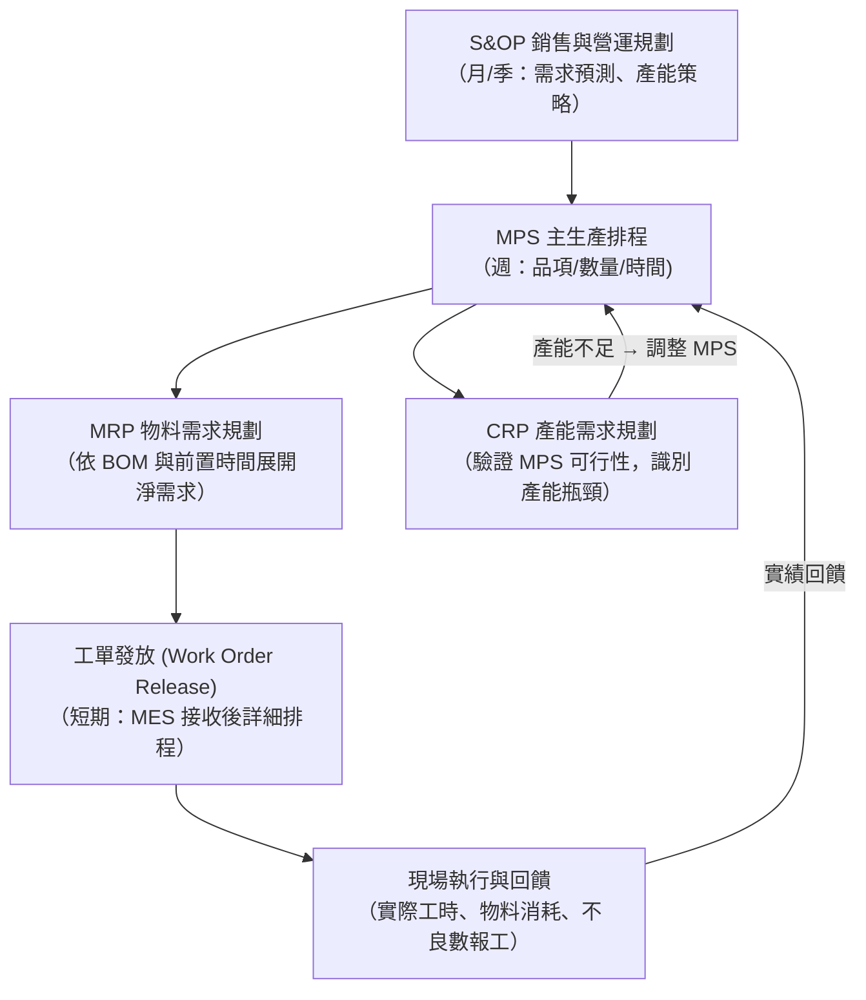
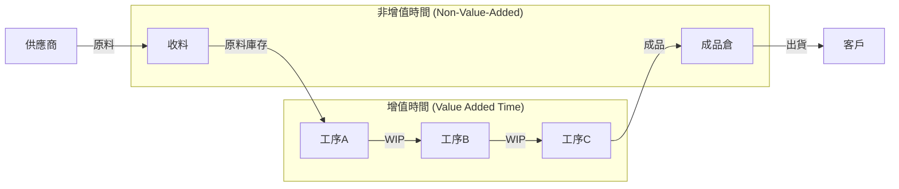
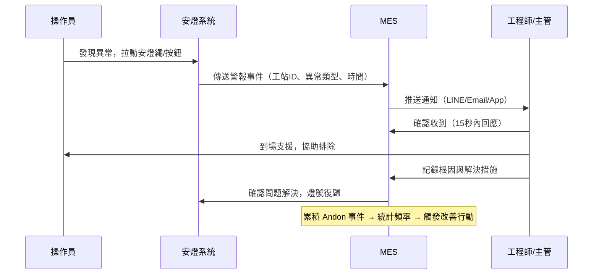
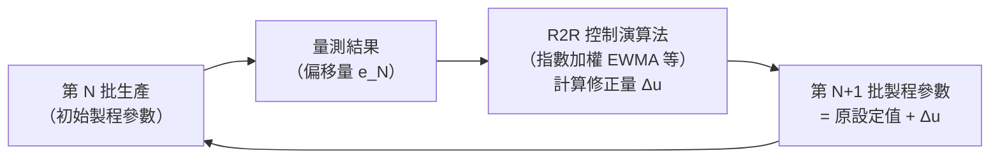

# 中級單元一：智慧製造工廠管理實務與應用（L211）

本單元對應官方評鑑主題 **L211**，涵蓋 L21101–L21105，以「應用整合」為核心，比初級更強調在智慧工廠實務環境中的判斷與決策能力。

---

## 1. 生產管理實務（L21101）

### (1) 生產計畫階層與執行落差管理

中級考試重視「計畫 → 執行 → 回饋」的閉迴路管理，而非只知道 MPS/MRP 定義：

**關鍵判斷點**：若 CRP 顯示某工作中心在第 3 週產能負荷率 > 100%，正確的處理順序是：
1. 確認瓶頸工序（找出負荷最高的工作中心）。
2. 嘗試前後週平滑（Load Leveling）：把部分工單往前提或往後延。
3. 若無法平滑，考慮外包、增班或增設備。
4. 修改 MPS 後重跑 MRP，確認物料需求是否也需調整。

### (2) ATP（可承諾量）的計算與應用

當業務接單時，需要知道「這個交期能否承諾」，依賴 MPS 中的 ATP（Available to Promise）：

$$\text{ATP}_{t} = \text{MPS}_t + \text{在途庫存}_t - \sum{\text{已承諾客戶訂單量（至下次 MPS 生產前）}}$$

> **中級考題特徵**：給定 MPS 表格（包含預計完工量與已接訂單），要求計算特定週期的 ATP，並判斷新訂單能否在指定交期承諾。

---

## 2. 精實管理基本概念（L21102）

### (1) 價值流圖（Value Stream Mapping, VSM）

精實管理最重要的分析工具，用於找出整條供應鏈中的非增值活動（浪費）：

**繪製 VSM 的目的**：找到現況（Current State）中的等待、庫存堆積、搬運浪費，設計未來狀態（Future State），制定改善路徑。

**關鍵指標**：
- **製程前置時間（Manufacturing Lead Time, MLT）** = 所有工序加工時間 + 所有等待/庫存時間。
- **增值比率（Value-Added Ratio）** = 增值時間 ÷ 總前置時間 × 100%。多數工廠此比率僅 1–5%，代表 95% 的時間工件在等待或搬運。

### (2) 精實工具矩陣（中級考試常考的應用判斷）

| 問題現象 | 對應精實工具 | 預期改善效果 |
| :--- | :--- | :--- |
| 批量大、在製品堆積多 | 縮小批量 + 單件流（One-Piece Flow） | 降低 WIP 庫存、縮短 MLT |
| 換模換型時間長 | SMED（快速換模） | 增加小批量排程彈性 |
| 現場物料找不到 | 5S + 目視化管理 | 減少找料時間與錯誤 |
| 設備突然故障率高 | TPM（全面生產維護） | 提升稼動率、減少非計畫停機 |
| 不良品在後段才發現 | 源頭管制 + 防呆（Poka-Yoke）+ Jidoka | 減少返工與報廢成本 |
| 生產線各站負荷不平衡 | 線平衡分析（Yamazumi Chart） | 提升線效率，減少等待浪費 |

---

## 3. 智慧工廠技術綜觀（L21103）

### (1) 工業 4.0 九大技術支柱

中級考試要求能說明每個技術支柱的作用，以及它如何支撐智慧工廠：

| 技術支柱 | 中文名稱 | 在智慧工廠中的應用 |
| :--- | :--- | :--- |
| **Big Data & Analytics** | 工業大數據分析 | 設備 PHM、製程品質相關性分析、生產排程優化 |
| **Autonomous Robots** | 自主機器人 | 協作機器人（Cobot）、AGV/AMR 物流自動化 |
| **Simulation** | 虛擬模擬 | 數位雙生驗證、虛擬試產（Virtual Commissioning） |
| **Horizontal/Vertical Integration** | 水平/垂直整合 | MES↔ERP 垂直整合；跨廠供應鏈水平整合 |
| **Industrial IoT** | 工業物聯網 | 設備資料採集、邊緣運算、雲端平台 |
| **Cybersecurity** | 工業資安 | OT/IT 隔離、身分驗證、網路分區 |
| **Cloud** | 雲端運算 | 跨廠資料匯聚、彈性擴展算力 |
| **Additive Manufacturing** | 積層製造（3D 列印） | 快速原型、備品件隨需生產 |
| **Augmented Reality** | 擴增實境 | 維修導引、操作員訓練、遠端技術支援 |

### (2) 智慧工廠成熟度模型

中級考生需能辨識企業所在的智慧化層次，並提出對應的升級路徑：

| 成熟度等級 | 特徵描述 | 關鍵技術 |
| :--- | :--- | :--- |
| **L1 數位化基礎** | 設備資料已採集、有 MES 基本功能 | SCADA、基礎 MES、條碼追蹤 |
| **L2 可視化** | 實時看板、KPI 儀表板、全廠 OEE 可視 | IIoT 平台、即時分析 |
| **L3 可分析** | 歷史數據挖掘、品質根因分析、設備預測維護 | 大數據分析、機器學習、PHM |
| **L4 可優化** | AI 排程優化、自適應製程控制、Run-to-Run 回饋 | AI/ML 模型、閉迴路控制 |
| **L5 自主決策** | 自我學習與自主調適、無人工介入的異常處理 | 強化學習、數位雙生閉迴路 |

---

## 4. 智慧化現場管理基本原理（L21104）

### (1) 安燈（Andon）系統的閉迴路管理

安燈系統在智慧工廠中不只是「亮燈告知」，而是與 MES 整合的即時問題解決機制：

### (2) 現場目視化管理層次

| 層次 | 工具範例 | 目標 |
| :--- | :--- | :--- |
| **基礎目視化** | 5S 標示、料號標籤、地板區域線 | 任何人都能立即辨識「正常 vs. 異常」 |
| **狀態目視化** | 安燈燈號、設備狀態顯示板 | 即時顯示現場運作狀態 |
| **績效目視化** | 生產看板（計畫 vs. 實際）、OEE 儀表板 | 團隊隨時掌握目標達成狀況 |
| **問題解決目視化** | 8D 問題追蹤板、改善活動 Kamishibai 稽核板 | 讓改善進度透明，防止問題遺忘 |

---

## 5. 智慧製造執行系統生產實務（L21105）

### (1) MES 在智慧工廠中的進階功能

初級只需認識 MES 基本模組，中級需能說明 MES 如何與工廠其他系統形成數據閉環：

| MES 功能模組 | 初級認知 | 中級深化內容 |
| :--- | :--- | :--- |
| 詳細排程（Fine Scheduling） | 知道可以排工單順序 | 了解有限產能排程（FCS）vs. 無限產能排程（ICS）的差異；FCS 考慮設備實際可用性，避免過度承諾 |
| WIP 追蹤 | 知道可以追蹤在製品 | 了解序號追蹤 vs. 批次追蹤的選擇依據；拆批（Split）與合批（Merge）操作的適用場景 |
| 品質管理（SPC） | 知道有管制圖 | 了解 OOC（Out of Control）觸發後的自動鎖站機制；APC（Advanced Process Control）閉迴路調整 |
| 設備整合（EI） | 知道設備可以採集數據 | 了解 SECS/GEM 標準介面；Recipe Management（配方管理）自動下機台；Alarm 管理與分類 |

### (2) Run-to-Run（批次比較管制）

中級新增評鑑內容：R2R 控制是半導體與電子業常用的批次間回饋控制方法：

**核心概念**：不等到整批完成後才發現漂移，而是每批完工後立即量測關鍵特性，將偏差回饋至下一批的製程參數設定，實現批次間的主動補償。
