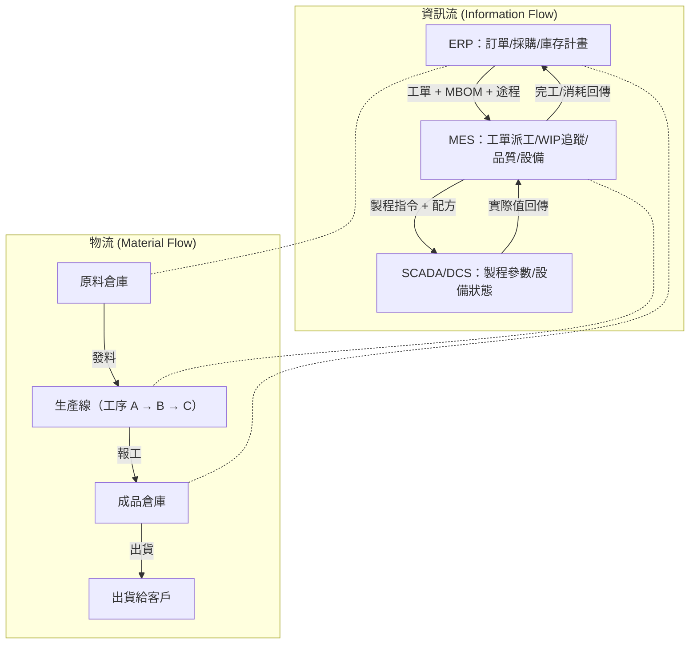
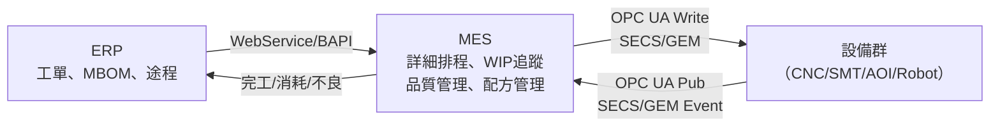
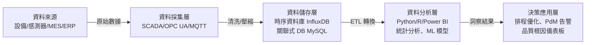

# 中級單元二：生產流程與產品品質優化（L212）

本單元對應官方評鑑主題 **L212**，涵蓋 L21201–L21207，核心在於「以數據驅動的生產流程改善與品質優化」，是中級考試計算題與分析判斷題的高密度區域。

---

## 1. MES 智慧管控全廠生產資訊流及物流（L21201）

### (1) 全廠資訊流架構

智慧工廠的本質是「實體物流」與「數位資訊流」同步流動：

**核心觀念**：任何物流動作（領料、投料、移轉、入庫）都必須有對應的資訊流記錄，否則 ERP 庫存帳與實體庫存就會出現「帳實不符」。

### (2) 全廠物流管控重點

| 物流節點 | MES/ERP 對應功能 | 常見問題與防錯措施 |
| :--- | :--- | :--- |
| **原料入庫** | 採購入庫單（GR） | 收料時掃描批號確認規格，避免收錯料 |
| **生產領料** | 工單發料（Issue to WO） | 依 MBOM 用量核對領料數量，超領警報 |
| **工序移轉** | MES Move Out/In | 刷讀工件條碼確認工序順序，防止跳站 |
| **成品入庫** | 完工入庫（GI to FG WH） | 品質放行後才能轉正式成品庫存 |
| **出貨揀料** | 銷售出庫（Sales Issue） | FIFO 原則先進先出，條碼確認批號 |

---

## 2. MES 與設備整合之基本概念（L21202）

### (1) 設備整合的三個層次

| 整合層次 | 說明 | 技術 |
| :--- | :--- | :--- |
| **資料採集整合** | 設備狀態、製程參數、計數器上傳至 MES | Modbus → 閘道器 → OPC UA → MES |
| **配方管理整合** | MES 根據工單品種，自動向設備下載對應配方參數版本 | SECS/GEM Recipe Management；OPC UA Write |
| **事件與警報整合** | 設備故障、警報觸發後，MES 自動開立維修工單並通報 | SECS GEM Event Report；MES Alarm Management |

### (2) 整合架構圖（ERP → MES → 設備）

---

## 3. 生產管理巨量資料收集、分析、管理與應用（L21203）

### (1) 工廠大數據的數據管線（Data Pipeline）

### (2) 時序資料的特性與分析方法

製造現場的感測數據屬於「時序資料（Time Series Data）」，有其特殊分析需求：

| 分析目標 | 方法 | 應用案例 |
| :--- | :--- | :--- |
| **趨勢偵測** | 移動平均（Moving Average）、EWMA | 主軸振動值 30 天緩慢上升趨勢 → 預排保養 |
| **異常偵測** | $3\sigma$ 管制界限、Isolation Forest | 迴焊爐溫度突然尖峰 → 觸發警報 |
| **相關性分析** | 皮爾森相關係數（Pearson r） | 刮刀壓力 vs. 焊點高度：r = −0.78（負相關） |
| **預測** | 線性回歸、ARIMA、LSTM | 預測設備剩餘可用壽命（RUL） |

### (3) 中級考試常考：相關係數解讀

$$r = \frac{\sum(X_i - \bar{X})(Y_i - \bar{Y})}{\sqrt{\sum(X_i-\bar{X})^2 \cdot \sum(Y_i-\bar{Y})^2}}$$

| $r$ 範圍 | 解讀 |
| :--- | :--- |
| $0.7 \le r \le 1.0$ | 強正相關 |
| $0.3 \le r < 0.7$ | 中度正相關 |
| $-0.3 < r < 0.3$ | 無顯著相關 |
| $-0.7 < r \le -0.3$ | 中度負相關 |
| $-1.0 \le r \le -0.7$ | 強負相關 |

---

## 4. 生產排程優化之基本概念（L21204）

### (1) 排程問題的複雜度

生產排程（Scheduling）是 NP-hard 問題，隨工單數量和設備數量增加，最優解計算時間爆炸性增長。因此實務上多採用啟發式演算法（Heuristics）或遺傳演算法（Genetic Algorithm）。

### (2) 約束理論（Theory of Constraints, TOC）與瓶頸管理

約束理論（Goldratt 提出）的核心：**整個系統的產出取決於瓶頸（Bottleneck / Constraint）**。

**五步驟（Focusing Steps）**：
1. **找出瓶頸**（Identify）：找到產能負荷率最高的工序。
2. **充分利用瓶頸**（Exploit）：瓶頸不能有任何閒置，優先確保瓶頸持續運行。
3. **其他工序服從瓶頸**（Subordinate）：非瓶頸工序依照瓶頸節奏投料，避免在瓶頸前堆積 WIP。
4. **提升瓶頸產能**（Elevate）：若利用率已最大化，再投資擴充瓶頸（加班、增設備）。
5. **找出新瓶頸（惰性防止）**（Repeat）：舊瓶頸解除後，新瓶頸會在其他地方出現，持續迭代。

**鼓-緩衝-繩（Drum-Buffer-Rope, DBR）排程**：
- **鼓（Drum）**：瓶頸的生產節奏決定全線節拍。
- **緩衝（Buffer）**：瓶頸前設置時間緩衝（Time Buffer），保護瓶頸不因前段異常而斷料。
- **繩（Rope）**：以繩子概念控制投料速度，不超過瓶頸速度，避免 WIP 在非瓶頸累積。

### (3) 常見排程指標計算

**例題**：有三張工單，需在同一台機台上依序加工：

| 工單 | 處理時間（天） | 交期（天後） |
| :---: | :---: | :---: |
| A | 3 | 5 |
| B | 2 | 4 |
| C | 4 | 7 |

計算各排程規則下的**最大延遲天數**：

**SPT（最短處理時間）排序**：B(2天) → A(3天) → C(4天)
- B 完工第 2 天，交期第 4 天 → 提前 2 天
- A 完工第 5 天，交期第 5 天 → 準時
- C 完工第 9 天，交期第 7 天 → **延遲 2 天**

**EDD（最早交期）排序**：B(4) → A(5) → C(7)
- B 完工第 2 天 → 提前 2 天
- A 完工第 5 天 → 準時
- C 完工第 9 天 → **延遲 2 天**

→ 本例兩種規則最大延遲相同。實際多工單多機台情況下差異更大，考試通常用多個工單比較。

---

## 5. 生產線平衡與改善（L21205）

### (1) 線平衡率計算

$$\text{線平衡率（LBR）} = \frac{\sum_{i=1}^{n} CT_i}{n \times CT_{\max}} \times 100\%$$

其中 $CT_i$ 為各工站的週期時間，$CT_{\max}$ 為所有工站中最大的週期時間（瓶頸工站），$n$ 為工站數。

**平衡損失率** = 1 − LBR = 浪費佔比。

**例題**：五個工站的週期時間分別為 12, 15, 10, 15, 8（秒），求線平衡率。

$$LBR = \frac{12+15+10+15+8}{5 \times 15} = \frac{60}{75} = 80\%$$

→ 平衡損失率 = 20%，顯示有改善空間，應聚焦減少工站 3（10 秒）和工站 5（8 秒）的等待時間，或將部分工作移至非瓶頸工站。

### (2) 線平衡改善策略

| 策略 | 說明 |
| :--- | :--- |
| **工序再分配** | 將瓶頸工站（CT 最大）的部分工作移至輕載工站 |
| **增加資源** | 瓶頸工站增加人力或設備 |
| **作業改善** | 消除瓶頸工站中的動作浪費（Motion Waste） |
| **調整節拍時間** | 若 $TT$ 固定，驗證每個工站 $CT \le TT$ |

---

## 6. 生產品質要因分析（L21206）

### (1) 統計假設檢定的邏輯

中級比初級更深入品質分析，需能說明假設檢定的應用場景：

| 情境 | 使用方法 | 目的 |
| :--- | :--- | :--- |
| 比較兩組製程（A vs. B）的平均值差異是否顯著 | t 檢定（t-test） | 確認製程改善是否真的有效，而非隨機變異 |
| 比較多組製程的平均值 | 變異數分析（ANOVA） | 找出哪個因子對品質影響最大 |
| 分析多個因子對品質的交互作用 | 實驗設計（DOE / Taguchi Method） | 最小化實驗次數找到最佳製程窗口 |

### (2) 製程能力 Cpk 的深化應用

$$C_p = \frac{USL - LSL}{6\sigma}, \quad C_{pk} = \min\left(\frac{USL - \mu}{3\sigma},\ \frac{\mu - LSL}{3\sigma}\right)$$

| $C_{pk}$ 值 | 製程能力評估 | 建議行動 |
| :--- | :--- | :--- |
| $\ge 1.67$ | 優秀，六西格瑪水準 | 維持現況，可考慮放寬檢驗頻率 |
| $1.33 \le C_{pk} < 1.67$ | 良好，符合多數工業標準 | 維持並持續監控 |
| $1.0 \le C_{pk} < 1.33$ | 勉強可接受 | 加強管制，縮短量測周期 |
| $< 1.0$ | 製程能力不足，必然有超規 | 立即進行改善（縮小變異 or 調整均值）|

**Cp vs Cpk 的區別**：$C_p$ 只看變異寬度，不管有無偏心；$C_{pk}$ 同時考慮變異與均值偏移。若 $C_p > C_{pk}$ 表示製程有偏移，改善優先是「將均值移回中心」。

---

## 7. 即時生產資訊之收集與應用（L21207）

### (1) 即時儀表板設計原則

中級考試可能要求評斷某個 KPI 儀表板的設計合理性：

| 設計原則 | 說明 |
| :--- | :--- |
| **目標對象明確** | 操作員看工站即時良率；管理層看全廠 OEE 趨勢 |
| **刷新頻率適當** | 設備狀態：秒級；生產進度：分鐘級；品質趨勢：小時級 |
| **警戒線明顯** | 超過目標閾值時顯示紅色，正常為綠色 |
| **可鑽取（Drill-Down）** | 從工廠總覽 → 產線 → 工站 → 單台設備，逐層追蹤 |
| **行動導向** | 顯示問題的同時，提供建議動作或直接連結至工單/設備頁 |

### (2) OEE 六大損失與改善對應

$$OEE = \text{稼動率} \times \text{效能率} \times \text{品質率}$$

| OEE 三元素 | 對應的六大損失 | 改善工具 |
| :--- | :--- | :--- |
| **稼動率** ↓ | ① 設備故障停機、② 換模換型時間 | TPM 自主保養；SMED 快速換模 |
| **效能率** ↓ | ③ 短暫停機（空轉）、④ 速度減低 | 清除感測器污染；參數再優化 |
| **品質率** ↓ | ⑤ 製程不良品與廢品、⑥ 開機期間良率損失 | SPC 管制；首件確認；防呆 |

**OEE 計算例題**：
- 計畫工時 = 8 小時（480 分鐘）
- 停機時間 = 60 分鐘（故障 40 分＋換模 20 分）
- 理想節拍時間 = 0.5 分鐘/件
- 實際產出 = 700 件（含不良品）
- 不良品 = 35 件

$$\text{稼動率} = \frac{480-60}{480} = 87.5\%$$
$$\text{效能率} = \frac{700 \times 0.5}{420} = 83.3\%$$
$$\text{品質率} = \frac{700-35}{700} = 95.0\%$$
$$OEE = 87.5\% \times 83.3\% \times 95.0\% \approx 69.2\%$$

→ 低於世界級標準 85%，稼動率和效能率都需改善。
