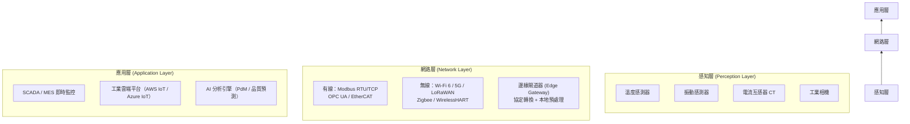

# 中級單元三：智慧製造設備與製程管理（L221）

本單元對應官方評鑑主題 **L221**，涵蓋 L22101–L22105，從物聯網原理、CPS 架構到設備大數據分析，是中級考試 L22 科目的基礎理論層。

---

## 1. 物聯網（IoT）基本原理（L22101）

### (1) IoT 架構三層模型

工業物聯網（IIoT）的數據流動遵循三層架構：

### (2) IIoT 與消費級 IoT 的差異

| 比較維度 | 工業 IIoT | 消費級 IoT |
| :--- | :--- | :--- |
| **即時性要求** | 確定性低延遲（< 10ms）；工廠控制不允許丟包 | 允許較高延遲（秒級） |
| **可靠性** | 99.99% 可用性；容錯設計 | 偶爾斷線可接受 |
| **資安標準** | IEC 62443 工業資安；OT/IT 隔離 | 基本加密 |
| **通訊協定** | OPC UA、SECS/GEM、Profinet、EtherCAT | MQTT、HTTP、Bluetooth |
| **設備壽命** | 10–30 年，需向後相容 | 3–5 年更新迭代 |

### (3) 邊緣運算（Edge Computing）的角色

不是所有數據都需要上傳雲端；邊緣層在本地完成：

| 邊緣功能 | 說明 | 效益 |
| :--- | :--- | :--- |
| **協定轉換** | Modbus → OPC UA → MQTT | 讓老設備也能接入現代平台 |
| **資料預處理** | 濾波、降採樣、特徵提取（如 FFT） | 減少上傳頻寬 90% 以上 |
| **本地即時決策** | 異常觸發本地警報，不依賴雲端延遲 | 確保響應時間 < 100ms |
| **斷線緩衝** | 網路中斷時本地儲存，恢復後補傳 | 確保數據完整性 |

---

## 2. 網宇實體整合（CPS）基本原理（L22102）

### (1) CPS 5C 架構

網宇實體系統（Cyber-Physical System, CPS）的 5C 架構描述數據從物理世界到虛擬決策的完整路徑：

| 層次 | 英文 | 功能 | 工廠案例 |
| :--- | :--- | :--- | :--- |
| **C1** | Connection | 感測器連線，採集原始數據 | 振動感測器接入 IIoT 閘道器 |
| **C2** | Conversion | 數據標準化與特徵提取 | 時域振動訊號 → FFT 頻域特徵 |
| **C3** | Cyber | 建立數位模型（Digital Twin） | 設備健康指數（Health Index）模型 |
| **C4** | Cognition | 知識層，生成洞察與決策建議 | 預測「此設備將在 72 小時內需要保養」 |
| **C5** | Configuration | 行動層，將決策回饋至實體設備 | 自動調整製程參數；派發預防保養工單 |

### (2) 數位雙生（Digital Twin）的三種應用類型

| 類型 | 說明 | 應用案例 |
| :--- | :--- | :--- |
| **設備雙生（Equipment Twin）** | 複製單台設備的物理行為 | 監控 CNC 主軸健康狀態；預測刀具壽命 |
| **產線雙生（Production Line Twin）** | 模擬整條生產線的物料流與瓶頸 | 新產品導入前進行虛擬試跑（Virtual Commissioning），找出瓶頸工序 |
| **工廠雙生（Factory Twin）** | 全廠能源、物流、排程的虛擬模型 | 評估工廠佈局調整的影響；最佳化能源消耗 |

---

## 3. 自動設備管理與維護基本概念（L22103）

### (1) 維護策略選擇矩陣

中級考試要求能根據設備特性選擇適合的維護策略：

| 維護策略 | 說明 | 適用情境 | 主要優/缺點 |
| :--- | :--- | :--- | :--- |
| **事後維護（BM, Breakdown Maintenance）** | 等設備故障後才修復 | 低重要性、備品充足、故障後果小 | 成本低但停機影響大 |
| **預防性維護（PM, Preventive Maintenance）** | 依固定時間或週期執行保養 | 設備故障模式規律、有明確維護區間 | 可能過度保養浪費資源 |
| **狀態維護（CBM, Condition-Based Maintenance）** | 依設備監測到的狀態指標（如振動/溫度）決定保養時機 | 可安裝感測器持續監測的設備 | 依數據決策較準確 |
| **預測性維護（PdM, Predictive Maintenance）** | 以 AI/ML 預測剩餘壽命，在失效前安排保養 | 高價值關鍵設備；數據量充足 | 預測準確度高，但建模成本高 |

**RCM（以可靠性為中心的維護）**：系統化地分析每個設備失效模式，選擇最合適的維護策略組合。

### (2) MTBF 與 MTTR 的計算與應用

$$MTBF = \frac{\text{總運作時間}}{\text{故障次數}}, \quad MTTR = \frac{\text{總修復時間}}{\text{故障次數}}$$

$$\text{設備可用度（Availability）} = \frac{MTBF}{MTBF + MTTR}$$

**例題**：某設備一個月（720 小時）內發生 4 次故障，累計修復時間 12 小時，求 MTBF、MTTR 及可用度。

$$MTBF = \frac{720 - 12}{4} = 177\ \text{小時}$$
$$MTTR = \frac{12}{4} = 3\ \text{小時}$$
$$\text{可用度} = \frac{177}{177+3} = 98.3\%$$

---

## 4. 智慧製造之設備管理與維護基本概念（L22104）

### (1) 智慧設備管理系統（CMMS / EAM）

**CMMS（Computerized Maintenance Management System）**與 MES 整合的關鍵：

| 功能 | 說明 |
| :--- | :--- |
| 維護工單管理 | 由 MES 設備異常自動觸發，或依保養計畫自動開立 |
| 備品庫存管理 | 關鍵零件的安全庫存管理，避免停工等待備品 |
| 保養紀錄 | 每次保養項目、更換零件、技術員 ID 完整記錄 |
| 成本追蹤 | 各設備的年度維護成本分析，支援換機決策 |
| KPI 儀表板 | MTBF、MTTR、PM 完成率、緊急維修占比 |

### (2) 設備健康指數（Equipment Health Index, EHI）

以加權評分方式將多個監測參數整合為單一健康分數（0–100）：

$$EHI = \sum_{i=1}^{n} w_i \cdot \text{Score}_i$$

各參數的評分（Score）依照「偏離正常基線的程度」而降低；$w_i$ 為各參數的重要性權重。

**例如**：主軸振動加速度正常基線 = 1.5 m/s²，目前值 = 2.8 m/s²，偏離嚴重 → 振動評分較低，拖低整體 EHI。

---

## 5. 生產工程巨量資料即時收集、分析、管理與應用（L22105）

### (1) 製程參數大數據的應用場景

| 應用場景 | 輸入數據 | 分析方法 | 輸出結果 |
| :--- | :--- | :--- | :--- |
| **良率預測** | 各工序製程參數、設備狀態 | 邏輯回歸、隨機森林 | 預測本批成品不良率 |
| **製程視窗優化** | 歷史配方參數 × 品質結果 | 回應曲面法（RSM）、DOE | 找到最佳製程窗口 |
| **設備故障預測** | 振動、電流、溫度時序數據 | LSTM、隨機森林、SVM | 預測下次故障時間 |
| **能耗分析** | 各設備電流/電壓/功率 | 迴歸分析、異常偵測 | 識別能耗異常設備，節能改善 |

### (2) 數據品質管理

大數據分析的前提是「數據品質」，工廠數據常見的品質問題：

| 問題類型 | 原因 | 解決方法 |
| :--- | :--- | :--- |
| **缺值（Missing Value）** | 感測器離線、網路中斷 | 線性插值或以前後時間點的平均值填補；標記缺值區段 |
| **異常值（Outlier）** | 感測器雜訊、電磁干擾 | $3\sigma$ 方法或 IQR 法識別後標記剔除 |
| **時間偏移（Time Skew）** | 設備時鐘未同步 | 強制 NTP 對時；或用相對時間戳記補正 |
| **單位不一致** | 不同設備供應商格式不同 | 建立數據字典（Data Dictionary），統一換算至 SI 單位 |
