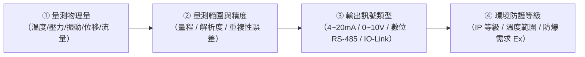
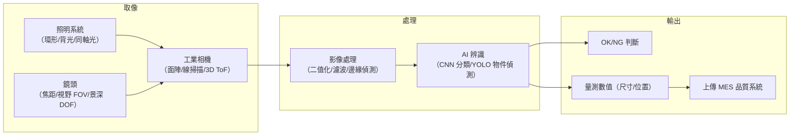
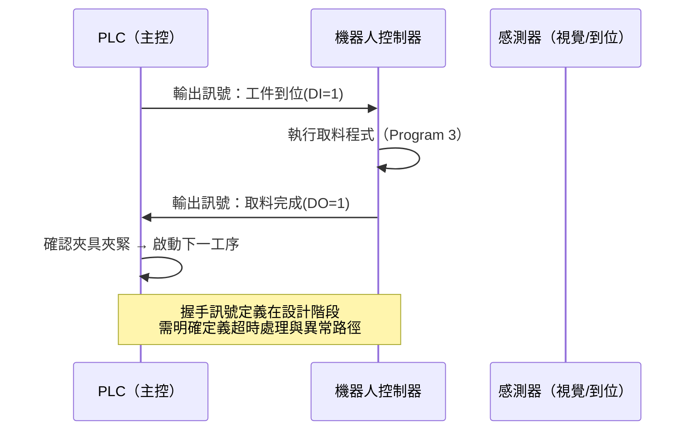
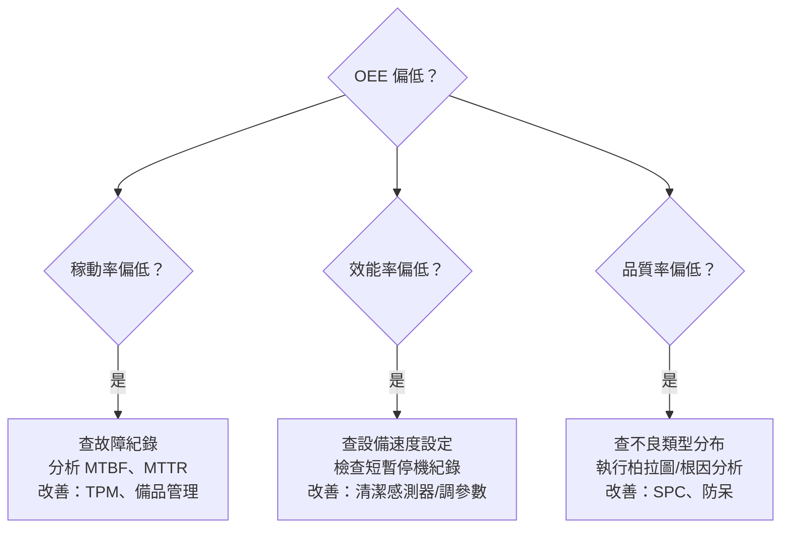

# 中級單元四：管控介面知識與智慧設備操作（L222 + L223）

本單元對應官方評鑑主題 **L222**（L22201–L22206）與 **L223**（L22301–L22302），涵蓋感測器、機器視覺、機器人、通訊建構、智慧型控制，以及智慧設備的操作知識與效率指標辨識。

---

## 1. 感測器導入工業應用（L22201）

### (1) 工業感測器選型四要素



### (2) 常用工業感測器對照表

| 量測量 | 感測器類型 | 輸出型式 | 工廠典型應用 |
| :--- | :--- | :--- | :--- |
| 溫度 | PT100 電阻溫度計（RTD） | 電阻（轉 4~20mA） | 迴焊爐溫區、冷卻水溫度監測 |
| 溫度 | 熱電偶（Thermocouple, K/J型） | mV 電壓 | 高溫爐體、注塑機料管溫度 |
| 壓力 | 壓阻式壓力感測器 | 4~20mA | 液壓系統壓力、氣壓供給 |
| 振動 | MEMS 加速度規（Accelerometer） | 4~20mA / 數位 | 旋轉機械故障診斷（PdM） |
| 位移/位置 | 線性編碼器（Linear Encoder） | 數位脈衝（A/B/Z相） | CNC 機台軸位置回饋 |
| 流量 | 電磁流量計 | 4~20mA | 冷卻水流量、化學品流量 |
| 液位 | 超音波液位感測器 | 4~20mA | 料槽液位、水塔液位 |

### (3) 4~20mA 電流訊號的優勢

工廠長距離信號傳輸多用 4~20mA，而不是電壓：
- **抗雜訊**：電流環對線路電阻不敏感，適合數十至數百公尺配線。
- **斷線偵測**：正常 ≥ 4mA；若讀到 0mA 代表斷線（非量測值為 0），可立即報警。
- **線性對應**：4mA = 量程 0%；20mA = 量程 100%，線性換算簡單。

---

## 2. 機器視覺導入工業應用（L22202）

### (1) 機器視覺系統架構



### (2) 打光方式對應檢測需求

| 打光方式 | 適合檢測項目 | 原理 |
| :--- | :--- | :--- |
| **環形正向光** | 表面刮傷、印刷品質、顏色缺陷 | 光從前方平均照射，反光缺陷顯示暗斑 |
| **背光（Backlight）** | 輪廓尺寸量測、異物、孔洞 | 物件剪影清晰，適合邊緣偵測 |
| **同軸光（Coaxial）** | 高反射面（金屬/PCB 鍍錫）刮傷 | 光與鏡頭同軸，消除高光飽和區域 |
| **斜向低角度光（Dark Field）** | 表面微小凸起、焊點高度 | 缺陷邊緣反光形成明亮高光點 |
| **結構光 / 雷射輪廓（3D）** | 零件高度量測、焊錫量、翹曲 | 三維點雲重建，量測高度差 |

### (3) AI 視覺與傳統影像處理的比較

| 比較項目 | 傳統規則式（Rule-Based） | AI 深度學習（CNN） |
| :--- | :--- | :--- |
| 開發方式 | 人工設計特徵提取演算法 | 大量標注圖片訓練模型 |
| 適用缺陷類型 | 規則形狀、固定位置的缺陷 | 複雜紋理、不規則缺陷、多類別 |
| 換線換型影響 | 需重新調參數 | 新品種需重新訓練或 Fine-tuning |
| 誤判風險 | 規則明確時誤判少 | 訓練數據不足時假陰性率（漏檢）上升 |

> **考試重點**：AI 視覺最大的風險是**漏檢（False Negative）**，不是誤殺（False Positive）。因為漏檢會讓不良品流到客戶，危害遠大於誤殺導致的良品被扣留。

---

## 3. 機器人整合製造基本概念（L22203）

### (1) 機器人與 PLC 的整合模式



**握手訊號（Handshaking）設計要點**：
1. 每個動作都需要「請求（Request）+ 確認（Acknowledge）」雙向訊號。
2. 設定逾時計時器，超時未收到確認訊號需觸發警報並停機，而非繼續執行。
3. 急停（E-Stop）訊號需獨立接線，不能只靠通訊指令。

### (2) 工業機器人的主要應用領域

| 應用 | 典型機器人類型 | 關鍵技術需求 |
| :--- | :--- | :--- |
| **焊接（點焊/弧焊）** | 六軸關節型 | 焊縫追蹤、熱變形補償 |
| **噴塗** | 六軸 + 七軸 | 離線編程、等距噴塗路徑 |
| **搬運/碼垛** | 四軸並聯 + 六軸 | 視覺引導取放（Bin Picking） |
| **精密組裝** | SCARA / Cobot | 力控插入、螺絲鎖附扭矩控制 |
| **CNC 上下料** | 六軸 + 協作型 | 與 CNC 電氣握手、安全區域 |

---

## 4. 設備電腦化管控系統通訊建構技術（L22204）

### (1) OT 網路分區架構（Purdue Model）

工業控制網路需依照 Purdue 參考模型進行網路分區，防止 IT 層威脅直接影響 OT 控制層：

```
┌─────────────────────────────────────────────────────┐
│  Level 4/5：企業 IT 網路（ERP/Email/Internet）       │
├───────────────── 非軍事區 (DMZ) ───────────────────┤
│  Level 3：工廠資訊層（MES/SCADA 伺服器/歷史資料庫）  │
├───────────────── 防火牆 ───────────────────────────┤
│  Level 2：控制層（HMI/SCADA 工作站）                 │
├─────────────────────────────────────────────────────┤
│  Level 1：設備控制層（PLC/DCS/CNC 控制器）           │
├─────────────────────────────────────────────────────┤
│  Level 0：現場設備（感測器/執行器/機器人）            │
└─────────────────────────────────────────────────────┘
```

**分區安全原則**：
- Level 3 與 Level 2 之間必須有防火牆，禁止上層直接存取下層控制網段。
- 跨層資料交換應透過「資料二極體（Data Diode）」或 DMZ 中轉，只允許單向資料流（由 OT 向上傳），防止惡意指令由 IT 側注入控制層。
- 工業網路禁止直接連接 Internet；遠端維護只能透過 VPN + MFA（多因素認證）進入。

### (2) 工業乙太網路協定比較

| 協定 | 主要應用 | 即時性 | 特色 |
| :--- | :--- | :--- | :--- |
| **Modbus TCP** | PLC ↔ SCADA | 非即時（輪詢） | 最普及，設置簡單 |
| **EtherCAT** | 多軸伺服控制 | 極高即時（< 100µs） | 適合精密同步多軸運動 |
| **PROFINET** | 西門子設備生態 | 即時（RT）/高即時（IRT） | 廣泛用於工廠自動化 |
| **OPC UA over TSN** | 跨層統一通訊 | 依 TSN 網路組態 | 工業 4.0 標準整合介面 |

---

## 5. 智慧型控制應用基本概念（L22205）

### (1) PID 控制基礎

PID（Proportional-Integral-Derivative）是工廠最普及的閉迴路控制演算法：

$$u(t) = K_p e(t) + K_i \int_0^t e(\tau)d\tau + K_d \frac{de(t)}{dt}$$

其中 $e(t) = \text{設定值（SP）} - \text{量測值（PV）}$ 為誤差。

| 項目 | 作用 | 過大的副作用 |
| :--- | :--- | :--- |
| $K_p$（比例增益） | 快速反應當前誤差 | 持續震盪（Oscillation）、穩態誤差 |
| $K_i$（積分增益） | 消除穩態誤差 | 積分飽和（Integral Windup）、過衝（Overshoot）|
| $K_d$（微分增益） | 預測趨勢，抑制過衝 | 對雜訊敏感（Noise Amplification） |

**應用案例**：迴焊爐溫區使用 PID 控制，SP = 240°C，PV = 238°C，誤差 = 2°C → PID 計算輸出功率，加熱至目標溫度後維持穩定。

### (2) 進階智慧控制方法

| 控制方法 | 適用情境 | 相對 PID 的優勢 |
| :--- | :--- | :--- |
| **模型預測控制（MPC）** | 多變數耦合製程；有物理約束的系統 | 可同時優化多個變數，並滿足製程約束 |
| **模糊控制（Fuzzy Control）** | 數學模型難以建立的製程 | 依專家知識制定規則，不需精確數學模型 |
| **強化學習（RL）** | 動態環境中需要自適應的控制 | 透過環境互動學習最優策略 |
| **Run-to-Run（R2R）** | 批次生產（半導體/電池）中批次間漂移 | 依前批結果調整下批參數，補償系統漂移 |

---

## 6. 智慧製造管控介面管理與維護（L22206）

### (1) HMI 介面設計原則（ISA-101 標準）

工業 HMI（Human-Machine Interface）設計遵循 ISA-101 標準，核心是「降低操作員認知負擔，提升異常辨識速度」：

| 設計原則 | 說明 |
| :--- | :--- |
| **低飽和度配色** | 正常狀態用灰色/中性色；異常用醒目警示色（紅/黃）；避免花哨配色分散注意 |
| **資訊層次化** | 總覽頁 → 區域頁 → 設備頁，層層鑽取，不在一個頁面堆砌所有數據 |
| **警報優先管理** | 警報需分級（Critical/High/Medium/Low）；Critical 必須在 15 秒內確認 |
| **一致性操作** | 相同動作（如啟動/停止）在所有頁面位於相同位置，減少誤操作 |
| **狀態顯示優先** | 先讓操作員「看懂現在發生什麼」，再決定「做什麼操作」 |

### (2) 管控介面的日常維護事項

| 維護項目 | 頻率 | 重點 |
| :--- | :--- | :--- |
| HMI 軟體版本管理 | 每次更新 | 備份設定檔；更新後測試所有關鍵頁面 |
| 通訊連線健康監測 | 每日 | 確認 OPC UA/Modbus 連線數量與成功率 |
| 歷史資料庫維護 | 每月 | 清理過期數據；確認磁碟空間充足 |
| 帳號權限稽核 | 每季 | 移除離職人員帳號；驗證權限最小化原則 |
| 網路資安掃描 | 每年 | 確認 OT 網路無未授權設備接入 |

---

## 7. 智慧製造設備操作知識（L22301）與效率指標辨識（L22302）

### (1) 智慧製造設備操作的標準化流程

相較於初級（知道設備能操作），中級需能說明智慧設備的操作規範與異常處理邏輯：

| 操作階段 | 關鍵步驟 |
| :--- | :--- |
| **啟機前確認** | 確認工單號 / 品種 / 配方版本；點檢夾具/模具狀態；確認料號批號正確 |
| **首件確認** | 生產第一個工件後，依 SOP 執行尺寸量測與外觀檢驗；MES 記錄確認結果 |
| **生產監控** | 定期查看 HMI 顯示的製程參數趨勢；達警戒值前主動介入 |
| **異常停機** | 發現異常立即停機 → 安燈通報 → 隔離可疑在製品 → 等待工程師到場 |
| **換線換型** | 依換型 SOP 更換模具/配方；換型後重新執行首件確認 |
| **停機保養** | 依保養計畫執行清潔、潤滑、點檢；保養完成記錄到 CMMS/MES |

### (2) 智慧設備效率指標辨識（L22302）

中級需能從多組數據中快速識別哪個指標異常並找出對應損失類型：

| 計算指標 | 公式 | 異常時的診斷方向 |
| :--- | :--- | :--- |
| **稼動率（Availability）** | $\dfrac{\text{計畫工時}-\text{停機時間}}{\text{計畫工時}}$ | 低 → 故障次數多（MTBF 短）或修復時間長（MTTR 長）|
| **效能率（Performance）** | $\dfrac{\text{實際產量} \times \text{理想節拍}}{\text{實際運作時間}}$ | 低 → 設備速度降低（慢速損失）或短暫停機頻繁（空轉損失）|
| **品質率（Quality）** | $\dfrac{\text{良品數}}{\text{實際產量}}$ | 低 → 製程不良率高 或 開機暖機期間品質損失 |
| **OEE** | 三項相乘 | 任一項低於目標即影響 OEE，需逐項拆解診斷 |

**OEE 診斷流程**：



> **中級考試重點**：OEE 數字本身不重要，重要的是能「拆解分析」找出哪個元素拖累了 OEE，並對應到正確的改善行動。
