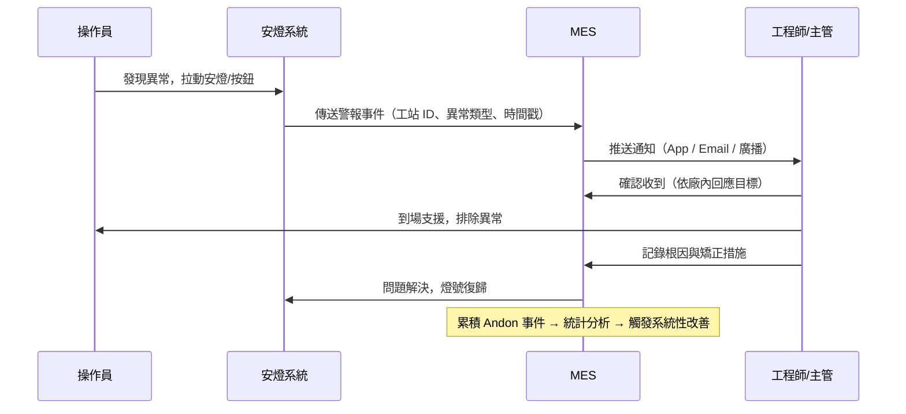
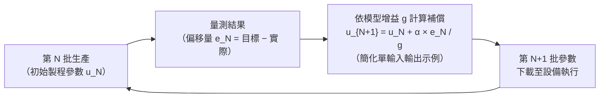

# 中級單元六：智慧工廠技術綜觀、現場管理與 MES 實務（L21103–L21105）

對應官方評鑑主題 **L211**，本單元涵蓋 L21103（智慧工廠技術綜觀）、L21104（智慧化現場管理基本原理）、L21105（智慧製造執行系統生產實務），從技術框架到現場應用的完整鏈。

---

## 1. 智慧工廠技術綜觀（L21103）

### (1) 工業 4.0 九大技術支柱

| 技術支柱 | 中文 | 在智慧工廠的關鍵應用 |
| :--- | :--- | :--- |
| **Big Data & Analytics** | 工業大數據 | 設備 PHM、製程品質相關分析、排程優化 |
| **Autonomous Robots** | 自主機器人 | Cobot 人機協作、AGV/AMR 物流自動化 |
| **Simulation** | 虛擬模擬 | 數位雙生驗證、Virtual Commissioning 虛擬試產 |
| **Horizontal/Vertical Integration** | 水平/垂直整合 | MES↔ERP 垂直；跨廠供應鏈水平 |
| **Industrial IoT** | 工業物聯網 | 設備數據採集、邊緣運算、雲端平台 |
| **Cybersecurity** | 工業資安 | OT/IT 隔離、IEC 62443 標準、網路分區 |
| **Cloud** | 雲端運算 | 跨廠數據匯聚、彈性算力擴展 |
| **Additive Manufacturing** | 積層製造 | 備品件隨需製造、快速原型驗證 |
| **Augmented Reality** | 擴增實境 | 維修導引疊加、操作員 SOP 顯示 |

### (2) 智慧工廠成熟度模型

下表是本教材用於規劃改善路徑的示意分層，並非所有評估框架共用的官方等級名稱：

| 層次 | 特徵 | 關鍵技術 |
| :--- | :--- | :--- |
| **L1 數位化** | 基礎設備數據採集，基礎 MES | SCADA、基礎 MES、條碼追蹤 |
| **L2 可視化** | 即時 KPI 看板、全廠 OEE 可視 | IIoT 平台、即時分析儀表板 |
| **L3 可分析** | 歷史挖掘、品質根因、設備 PdM | 大數據分析、ML 模型、PHM |
| **L4 可優化** | AI 排程、自適應製程控制、R2R | AI/ML 閉迴路、Auto-APC |
| **L5 自主決策** | 自學習、異常自主處理 | 強化學習、數位雙生閉環 |

> **考試判讀重點**：具備資料連線不代表已能自主決策；推進分析與優化時，須先確認資料品質、製程穩定性及可執行的回饋機制。

---

## 2. 智慧化現場管理基本原理（L21104）

### (1) Andon（安燈）系統的閉迴路管理

**評量重點**：Andon 的價值不在「亮燈」，在於後續的**快速回應 → 根因記錄 → 統計觸發改善**閉迴路。

### (2) 現場目視化管理四層次

| 層次 | 工具範例 | 管理目標 |
| :--- | :--- | :--- |
| 基礎目視化 | 5S 標示、地板區域線、料號標籤 | 任何人立即辨識「正常 vs. 異常」 |
| 狀態目視化 | 安燈燈號、設備狀態顯示板 | 即時掌握現場運作狀態 |
| 績效目視化 | 生產看板（計畫 vs. 實際）、OEE 儀表板 | 團隊即時掌握目標達成 |
| 問題解決目視化 | 8D 問題追蹤板、Kamishibai 稽核板 | 改善進度透明，防止問題遺忘 |

### (3) 現場標準化作業（SOP）管理

智慧化現場的 SOP 管理要求：
- **版本控制**：工站顯示當前核准版本 E-SOP；離線或紙本版本須有受控發放與作廢程序，不能假設系統能防止所有舊版流通。
- **防錯連鎖**：操作員必須在 MES 上確認閱讀 SOP 後，設備才解鎖啟動。
- **即時更新推播**：工程變更（ECO）核准後，MES 自動推送新版 SOP 至相關工站顯示器，同時廢止舊版。

---

## 3. 智慧製造執行系統生產實務（L21105）

### (1) MES 進階功能對照（初級 vs. 中級認知）

| MES 功能 | 初級認知 | 中級深化 |
| :--- | :--- | :--- |
| 詳細排程 | 能排工單順序 | 有限產能排程（FCS）vs. 無限產能（ICS）；FCS 避免過度承諾 |
| WIP 追蹤 | 能追蹤在製品 | 拆批（Split）/合批（Merge）的適用場景；序號 vs. 批次追蹤選擇依據 |
| 品質管理（SPC） | 有管制圖 | OOC 觸發自動鎖站；APC 閉迴路自動調整製程參數 |
| 設備整合 | 能採集數據 | SECS/GEM 標準介面；配方自動下載（Recipe Management）；警報分類與優先管理 |

### (2) Run-to-Run（R2R）批次比較管制

R2R 是半導體與電子業常用的批次間回饋控制，用於補償系統性製程漂移：

**核心邏輯**：用已完成批次的量測結果，估計漂移並補償下一批參數；可使用 EWMA 平滑估計，也可採其他控制模型。上圖假設局部模型有效且增益方向已知，並非所有製程皆可直接套用。SPC 仍負責辨識異常，不能概括成「只在整批後檢查」；發現特殊原因時，應先處置原因，再決定是否調參。

**考試判讀重點**：R2R 的優點是「主動預防漂移」，適用條件是每批有穩定量測回饋點；若量測雜訊過大，學習率 α 需降低以避免過度修正（過衝）。

### (3) FCS vs ICS 排程差異

| 項目 | 有限產能排程（FCS） | 無限產能排程（ICS） |
| :--- | :--- | :--- |
| 產能考量 | 考慮設備實際可用性、人力限制 | 假設產能無限，只依優先順序排列 |
| 承諾限制 | 納入產能限制，但仍受工時、日曆、物料與模型準確性影響 | 需要後續產能驗證，否則可能過度承諾 |
| 計算複雜度 | 高（NP-hard 問題，需啟發式演算法） | 低 |
| 適用場景 | 瓶頸明確、交期要求嚴格 | 初期規劃、快速估算 |

## 4. 公告試題導向：功能歸屬與現場閉迴路

**對照 L21 第 1–3、11、17、21、27、32、42、49 題。** MES 的主軸是生產執行及資料處理，與 ERP 交換工單、實績與消耗；導入 MES 不會自動取代企業財務、採購與整體營運規劃，也不保證良率立即上升。讀選項時要分辨「提供資訊與支援決策」和「已取得授權並驗證的自動控制」。溫度計讀值是感測；從歷史讀值找故障前兆才涉及資料分析／探勘，CSV 則是資料格式。

**原創小題**：缺料造成原工單延後，系統先改工單優先序，再派搬運車補料。前者對應例外管理與工單管理，後者對應物料搬運管理；流體閥門的開關指令則屬設備／製程控制，不能只因它位於某工作站就歸入工作站排程。

現場看板應呈現計畫、實績、差異、異常責任人與處置狀態。「已通知」不等於「已排除」；復歸後還要驗證品質及供料恢復。對照第 4 題，活動排序以安全、品質、交期、成本、士氣（SQDCM）判讀；趕產量不能跳過必要安全與品質確認。

### 試題判讀與選項辨析

**職責先於系統名稱。** L21 第 1、2 題均公告 A：ERP 管企業資源與營運計畫，MES 管現場執行、資料及實績，兩者交換資料，不能宣稱互相全面取代。第 17 題（B）以人員工時、RFID、條碼為現場資料來源，上一批售價不是本題的生產採集項目；但不代表跨系統分析永遠不能使用價格。第 21 題（B）問資源短缺後的例外處理與工單重排，第 27 題（A）問閥門控制，判斷層級不同。第 42 題公告 A；WMS 仍可與 MES 整合，不能由此推成「MES 不可連 WMS」。

**先量測，再分析，最後驗證改善。** 第 3 題（C）的單次溫度讀值屬感測，第 5 題（D）的 CSV 是文字資料格式；SQL Server／Oracle 是資料庫平台，C# 是程式語言，可支援分析流程，並非三種探勘演算法。第 11 題（C）不能把「具備即時監控」推成「良率立即提高」。第 14 題公告 C 是常用技術的相對分類，區塊鏈並非絕對不能用於製造追溯；第 20 題公告 B 著重傳統性能品質控制與自省、預測、自重組等進階能力的比較，品質控制並未因此變得不重要。

**看板必須連到管理行動。** 第 4 題（C）以 SQDCM 判優先順序；第 10 題（D）的 PDCA 不應只檢查可見表象，還要驗證原因、對策與再發防止。第 32 題（D）顯示計畫、實績與異常，屬製造狀態可視化；第 48、49 題（皆 D）涵蓋設備、供料、停線及數量資訊，不能把「裝了一塊螢幕」當成現場閉迴路完成。

**自動化與智慧化看是否有感知及回饋。** 第 44 題公告 C 將自動供料排除於該題的智慧應用；固定時序供料確可能只是自動化，但依 WIP、料況及異常動態調整的供料也可屬智慧製造。作答保留公告字母，實務辨識則查輸入、規則、授權及執行結果，不能一律把所有自動供料列為非智慧應用。

## 深度研讀：把智慧化投資落到改善責任與效益驗證

### 建立可比較的改善基線

智慧化專案應先寫出「要減少哪一種損失、由誰處理、如何證明改善」。設備連線率是能力指標，資料完整率是品質指標，平均異常回應時間是流程指標，良品產出與損失工時則接近結果指標。只有連線率提高，不能直接宣稱交期或獲利改善。比較前後時須記錄產品組合、班次、運轉時數、需求量與設備範圍；較少開機自然可能產生較少故障，卻不代表可靠度提升。

可依「資料可用→人員確實採取行動→損失減少→經濟價值實現」逐層驗收。每一層都應有負責人與失敗回復方式，例如感測器離線由設備人員處理，資料格式錯誤由整合人員處理，警報沒有處置人則是制度缺口。系統能下載配方，也不代表所有配方都可自動改寫；須定義核准權、版本有效期及人工介入條件。

### 原創案例：Andon 事件如何拆成可改善的時間

以下為原創事件與投資假設。某站 08:00 發現異常，08:03 確認接單、08:07 工程師到場、08:15 修復、08:19 品質確認完成、08:20 重新生產。總損失為 20 分鐘，其中通知回應 3 分鐘、到場等待 4 分鐘、修復 8 分鐘、品質驗證 4 分鐘、重啟 1 分鐘。只看「修復 8 分鐘」會漏掉其餘 12 分鐘；只看總停機又無法分辨應改善通知、支援配置或維修方法。

事件狀態可設為開立、已受理、處理中、待品質確認、已結案；每次轉換記錄人員、時間、原因與證據。按下確認只代表有人接受任務，不能把燈號變綠並停止計時。結案需確認設備可運作、可疑品已隔離或處置、首件已依要求驗證；若同一故障短期再發，應連回原事件檢討根因，避免以反覆重啟美化處理速度。此處狀態與時限是教學設計，不是官方系統指定流程。

### 從節省工時到可實現的收益

假設每月 100 次異常，改善前平均損失 24 分鐘，改善後為 18 分鐘，可回收 $100×6=600$ 分鐘，即 10 小時。若該站是瓶頸、每小時可加工 60 件、良率 95%，理論可增加 570 件良品。再假設每件增量貢獻 120 元、每月新增維運費 18,000 元、一次投入 302,400 元，且新增產出全可售出，月淨效益為 $570×120-18000=50,400$ 元，簡單回收期為 6 個月。

若市場每月只多需要 400 件，增量貢獻應以 400 件計，月淨效益降為 30,000 元，回收期約 10.08 個月。若改善站根本不是瓶頸，回收工時可能只減少等待，不能全轉成新增銷售。加班節省、增量產出與避免停機的效益，也要檢查是否重複計算；簡單回收期另未包含資金時間價值、稅務與專案風險。

### 進階練習與解析

**練習 1：故障次數下降就算改善嗎？** 導入前 800 運轉小時發生 40 次故障，導入後 400 運轉小時發生 30 次；故障定義與設備相同。**解析：**故障次數雖少 10 次，但每百運轉小時的故障率由 $40÷800×100=5$ 次升至 $30÷400×100=7.5$ 次，不能以總次數宣稱改善。仍須檢查產品組合、負載與記錄是否變動，再用一致暴露時間比較；此算式是觀察率，不等同已證明因果或統計顯著。

**練習 2：需求不足時如何重估投資？** 延續投資案例，每月只能多售 300 件，其他成本不變，改善工時確實發生在瓶頸。**解析：**月增量貢獻為 36,000 元，扣維運後為 18,000 元，簡單回收期 $302400÷18000=16.8$ 個月。若公司原創專案門檻為 12 個月，此方案不通過該門檻；可縮小建置範圍、降低維運費或提出可驗證的其他效益，再重新計算，不能保留原 6 個月數字當成果。
