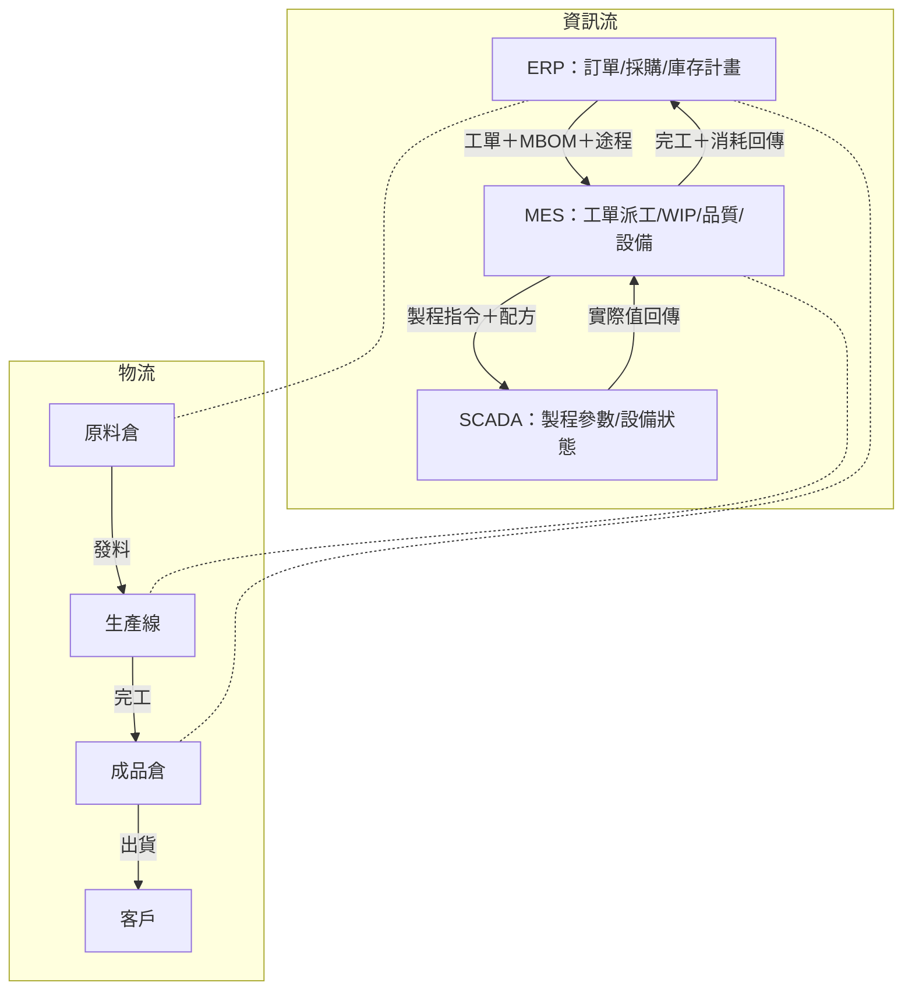
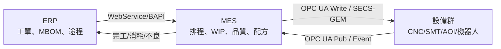

# 中級單元七：MES 全廠管控與生產排程優化（L21201–L21204）

對應官方評鑑主題 **L212**，本單元涵蓋 L21201（MES 全廠資訊流）、L21202（MES 與設備整合）、L21203（生產大數據分析）、L21204（生產排程優化），練習重點是資訊一致性與排程目標的選擇。

---

## 1. MES 智慧管控全廠資訊流及物流（L21201）

### (1) 資訊流與物流同步架構

**帳實不符根因**：任何物流動作（領料/移轉/入庫）未在系統即時記錄，ERP 庫存帳與實體庫存就會偏差。

### (2) 全廠物流管控重點

| 節點 | 對應功能 | 常見防錯措施 |
| :--- | :--- | :--- |
| 原料入庫 | 採購入庫（GR） | 掃描批號確認規格，避免收錯料 |
| 生產領料 | 工單發料（Issue to WO） | 依 MBOM 核對數量，超領警報 |
| 工序移轉 | MES Move Out/In | 刷讀條碼確認工序順序，防跳站 |
| 成品入庫 | 完工收貨／入庫（GR；代碼依系統） | 品質放行後才轉正式成品庫存 |
| 出貨揀料 | 銷售出庫 | FIFO 先進先出，條碼確認批號 |

---

## 2. MES 與設備整合之基本概念（L21202）

### (1) 設備整合三層次

| 層次 | 說明 | 技術 |
| :--- | :--- | :--- |
| **資料採集** | 設備狀態、製程參數、計數器上傳至 MES | Modbus → 閘道器 → OPC UA → MES |
| **配方管理** | MES 依工單品種自動向設備下發對應配方版本 | SECS/GEM Recipe Management；OPC UA Write |
| **事件/警報整合** | 設備故障觸發後，MES 自動開立維修工單並通報 | SECS/GEM Event Report；MES Alarm Management |

### (2) ERP → MES → 設備整合架構

---

## 3. 生產管理巨量資料收集、分析、管理與應用（L21203）

### (1) 工廠大數據管線（Data Pipeline）

### (2) 時序資料分析方法

| 目標 | 方法 | 製造應用案例 |
| :--- | :--- | :--- |
| 趨勢偵測 | 移動平均、EWMA | 主軸振動 30 天緩慢上升 → 預排保養 |
| 異常偵測 | $3\sigma$ 管制界限、Isolation Forest | 迴焊爐溫度尖峰 → 觸發警報 |
| 相關性分析 | 皮爾森相關係數 $r$ | 刮刀壓力 vs. 焊點高度：$r=-0.78$ |
| 預測 | 線性回歸、LSTM | 預測設備剩餘可用壽命（RUL） |

**相關係數解讀**：$|r|$ 越接近 1，線性關聯越強；強弱的分界須依領域判斷。「相關較弱」不等於「統計不顯著」，顯著性還受樣本數與分析假設影響。低線性相關也可能存在非線性關係，相關本身不證明因果。

---

## 4. 生產排程優化之基本概念（L21204）

### (1) 約束理論（TOC）五步驟

約束理論（Goldratt）：**系統產出取決於瓶頸**。

| 步驟 | 行動 | 說明 |
| :--- | :--- | :--- |
| ① 找出瓶頸 | Identify | 找到負荷率最高的工序 |
| ② 充分利用 | Exploit | 減少可避免的瓶頸閒置，保留必要保養與品質確認 |
| ③ 其他服從 | Subordinate | 非瓶頸依瓶頸節奏投料，不超量 |
| ④ 提升產能 | Elevate | 利用率已最大後，才投資擴充 |
| ⑤ 避免惰性 | Repeat | 舊瓶頸消除後找新瓶頸，持續迭代 |

**DBR 排程**：鼓（Drum）= 瓶頸節拍；緩衝（Buffer）= 瓶頸前時間保護；繩（Rope）= 控制投料速度不超過瓶頸。

### (2) 常見排程規則比較

| 規則 | 說明 | 適用目標 |
| :--- | :--- | :--- |
| FIFO（先進先出） | 先到達工單先排 | 公平、無插隊 |
| EDD（最早交期） | 交期最近先排 | 標準單機、工單同時可用等條件下，最小化最大延遲時間 |
| SPT（最短處理時間） | 加工最短先排 | 標準單機、工單同時可用等條件下，最小化平均完成／流程時間 |
| CR（緊急比） | $CR = \text{剩餘交期} \div \text{剩餘加工時間}$；CR < 1 = 已落後 | 即時識別最危急工單 |

**例題**：工單 A 剩餘交期 2天、加工 3天 → CR = 2/3 = 0.67（落後）；工單 B 剩餘交期 5天、加工 2天 → CR = 2.5（寬裕）。應優先排工單 A。

## 5. 公告試題導向：先定目標，再排順序

**對照 L21 第 18、19、25、37、39、50 題。** TOC 追求整體產出，非瓶頸多做但瓶頸未改善，通常只增加 WIP；「每台設備都滿載」不能直接當成最佳排程。半導體與熱鍛造的排程粒度還受製程、換模與加熱批量影響，第 19、25 題的時／日是題設情境，不能推成整個產業固定規範。

**原創小題**：三工單同時可加工，A／B／C 的加工時間為 6／2／4 小時、交期為第 8／5／12 小時，無換線時間。SPT 排 B→C→A，完成時間為 2、6、12，平均 $20÷3=6.67$ 小時；EDD 排 B→A→C，最大延遲為 0。兩者總加工皆 12 小時，因此不能把 SPT 的平均流程時間優勢誤寫成一定提高設備利用率。若有換線、插單或多機台限制，須重新計算。

資料校驗也分層：校驗碼檢查編碼錯誤；狀態規則檢查是否通過必要檢驗；完整性檢查應有資料是否齊全。掃碼成功只能證明讀到代碼，不能證明該批已放行。缺料重排後須同步更新工單版本、物料配送與現場顯示，避免系統順序與實際加工不同。

### 試題判讀與選項辨析

**目標、限制、粒度分三步。** L21 第 37 題（公告 D）包含交期、流程時間與閒置時間；三者可能互相牴觸，排程前要先決定優先級，不能認為同一規則同時使全部指標最佳。第 39 題（C）中的增加投資是決策手段，並非排程本身的效能指標。第 18 題（D）以瓶頸決定系統產出，非瓶頸須配合投料；非瓶頸改善若只是堆更多 WIP，不會直接提高出貨，但若能防止瓶頸缺料或解除其前置限制，仍可能有益，不能把「無影響」擴為所有情境。

第 19 題公告 D，以小時安排晶圓現場；第 25 題公告 C，以日安排須高溫、併批的鍛造。判讀時先找換線成本、批次不可拆性與反應頻率，再選能保留限制的時間粒度。這是該題情境的作答分類，不是「半導體一律只能小時、鍛造一律不能小時」的工程標準；換成廠內詳細派工，仍可能需要更細的事件時間。

**分析方法不等於資料容器。** 第 16 題（A）對照資料驅動、可靠性與混合模型；物件建模可描述軟體結構，單憑這個名稱不能推出故障機率或衰退過程。第 34 題（D）要區分描述既有良率以估設備量，與由歷史、預測、設計知識主動避免顯性及隱性問題；前者有用，只是未充分表達題目所指的主動改善方向。

**資料合法性採多道檢核。** 第 50 題公告 B，因為檢查碼不能適用所有情況。依序核對格式／範圍、料號與設備是否存在、工單及工序狀態是否合法、必要檢驗是否完成，再查事件重複與欄位完整性。正確檢查碼只能支持編碼完整性，不能證明產品真的完成檢驗、資料來源有權限或數量正確；必須搭配業務狀態與對帳證據。

## 深度研讀：有限產能排程與可追溯的事件資料

### 把限制寫成可檢查的條件

有限產能排程至少要有工單釋放時間、工序先行關係、可用設備、加工時間、換線矩陣、班次與停機日曆。每台設備在同一時段只能執行允許的工作，工單也必須等前工序、物料與品質條件滿足後才能開始。若工作不可中斷，就不能把一個 60 分鐘工序拆塞進兩段各 30 分鐘空檔；若可中斷，還須計入重新裝夾與品質確認。目標則要先選定，例如降低最大遲交、加權遲交或在製品，不能事後挑一個有利指標稱作最佳。

排程流程可分為建立可行解、計算交期與負荷、辨認主限制、修改候選解、同步派工。可行解不代表全域最佳解；對複雜多機問題，應比較候選方案並保存未採用原因。人工插單也要留下原排程版本、插單原因與受影響工單，否則事後只看最新順序，無法還原交期落差。

### 原創案例：機台資格與換線會改變排序

以下時間均為從開班起算的分鐘，假設工單同時可用、不可中斷、無搬運等待。M1 可加工 A、B，M2 只能加工 A；兩台起始皆為 A 設定，M1 從 A 換 B 需 20 分鐘。工單 A1 加工 60 分鐘、交期 120；A2 加工 40 分鐘、交期 120；B1 加工 70 分鐘、交期 100。

可行方案是 M1 先換線 0–20，再加工 B1 20–90；M2 加工 A1 0–60、A2 60–100。三張工單均準時，最後完工時間為 100。若看到 A2 最短就先放到 M1 0–40，之後換線 40–60、加工 B1 60–130，B1 將遲交 30 分鐘；M2 即使在 60 分鐘做完 A1 後閒置，也無法承接 B。局部填滿一台機器，可能犧牲唯一合格設備上的急單。

如果 M2 新增 50–80 的保養，A1 原 0–60 方案便不可行。候選排法可改成 M2 先做 A2 0–40，保養後做 A1 80–140，A1 遲交 20 分鐘；這只是可行候選，還應比較加班、替代資格或協商交期。若原資料只存「M2 每班可用 450 分鐘」，沒有保養發生時點，總量負荷通過仍可能排不出實際時序。

### 事件資料須分清事實、傳輸與更正

完工事件建議保留事件 ID、工單、工序、設備、來源發生時間、接收時間、數量意義及品質狀態。事件增量和機台累計計數器不能直接混加；累計值重設也要有重設紀錄。來源時間用於還原作業先後，接收時間用於分析傳輸延遲，晚到資料應標記並依既定規則重算受影響報表，不能改成「收到時剛完工」。數值、狀態與時間可參考 [OPC Foundation 的 DataValue 定義](https://reference.opcfoundation.org/specs/OPC-10000-4/7.11)，但企業仍須另定完工事件的業務語意。

### 進階練習與解析

**練習 1：交期再提前是否有解？** 延續雙機案例，B1 交期改為第 80 分鐘，其他條件不變。**解析：**B1 只能用 M1，且最早須先換線 20 分鐘，再加工 70 分鐘，最早完工為 90，至少遲交 10 分鐘。因此不是換一種排序規則就能解決；必須改變限制，例如確認可否在開班前完成換線、核准其他設備或協商交期。只把派工單日期改成 80 不會創造產能。

**練習 2：重送與更正後的產量？** 同工單收到 E1：合格增量 +8；接著完全相同的 E1 重送一次；E2：針對 E1 更正 −1；E3：另一循環合格增量 +6。假設事件 ID 唯一、負數更正合法且已核准。**解析：**E1 只計一次，E2 是新更正事件而不能因數值為負就丟棄，淨合格數為 $8-1+6=13$ 件。原事件與更正皆須保留，以便重建；若只是直接把目前總數寫成 13，雖然當下數字相同，卻失去更正原因與追溯證據。
