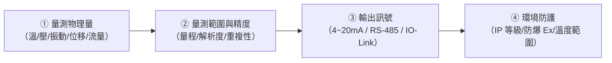
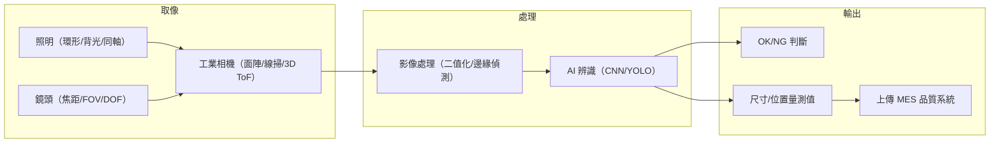
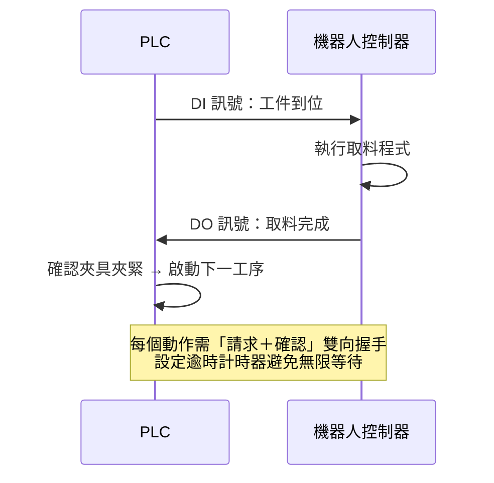

# 中級單元十一：感測器、機器視覺與機器人整合（L22201–L22203）

對應官方評鑑主題 **L222**，本單元涵蓋 L22201（感測器導入工業應用）、L22202（機器視覺導入工業應用）、L22203（機器人整合製造），為智慧工廠感知與執行層的核心。

---

## 1. 感測器導入工業應用（L22201）

### (1) 工業感測器選型四要素

### (2) 常用工業感測器對照表

| 量測量 | 感測器類型 | 輸出 | 典型應用 |
| :--- | :--- | :--- | :--- |
| 溫度 | PT100（RTD） | 電阻→4~20mA | 迴焊爐溫區、冷卻水溫 |
| 溫度 | 熱電偶（K/J 型） | mV 電壓 | 高溫爐、注塑機料管 |
| 壓力 | 壓阻式感測器 | 4~20mA | 液壓/氣壓系統監控 |
| 振動 | MEMS 加速度規 | 4~20mA / 數位 | 旋轉機械 PdM 故障診斷 |
| 位移/位置 | 線性編碼器 | 數位脈衝（A/B/Z 相） | CNC 軸位置回饋 |
| 流量 | 電磁流量計 | 4~20mA | 冷卻水、化學品流量 |

### (3) 4~20mA 電流訊號的優勢

- **抗雜訊**：在電源與負載容許範圍內，線路電阻變化不直接改變量測電流；距離與配線仍須依規格確認。
- **異常偵測**：4 mA 對應量程下限；0 mA 通常表示斷線、失電或其他迴路異常，應查明原因，不能當成零量測值。
- **線性對應**：4 mA = 量程 0%；20 mA = 量程 100%，換算簡單。

---

## 2. 機器視覺導入工業應用（L22202）

### (1) 機器視覺系統架構

### (2) 打光方式與適用檢測對照

| 打光方式 | 適合檢測項目 | 原理 |
| :--- | :--- | :--- |
| 環形正向光 | 印刷品質、表面特徵 | 以角度與顏色建立對比；刮傷效果須試光驗證 |
| 背光（Backlight） | 輪廓量測、異物、孔洞 | 剪影清晰，適合邊緣偵測 |
| 同軸光（Coaxial） | 平整反光面的印字、缺陷 | 光經分光鏡與鏡頭同軸，建立平面與缺陷對比；非保證消除所有反光 |
| 斜向低角度（Dark Field） | 刮傷、微小凸起與邊緣 | 利用散射使缺陷變亮；定量高度需適當 3D 量測 |
| 結構光/雷射輪廓 3D | 焊錫量、高度量測、翹曲 | 三維點雲重建，量測高度差 |

### (3) AI 視覺 vs. 傳統規則式比較

| 項目 | 傳統規則式 | AI 深度學習（CNN） |
| :--- | :--- | :--- |
| 開發方式 | 人工設計特徵提取演算法 | 大量標注圖片訓練模型 |
| 適用缺陷 | 規則形狀、固定位置 | 複雜紋理、不規則、多類別 |
| 換線影響 | 需重新調整參數 | 新品種需重訓或 Fine-tuning |
| 主要風險 | 規則覆蓋不全時誤判 | 訓練數據不足時**漏檢率上升** |

> **考試重點**：漏檢（False Negative）與誤殺（False Positive）須依品質風險及成本共同評估。對重大缺陷應優先控制漏檢，但不能忽略過度誤殺造成的停線、重驗與報廢。

---

## 3. 機器人整合製造基本概念（L22203）

### (1) 機器人與 PLC 握手訊號整合

**握手設計要點**：
1. 每個動作需「Request + Acknowledge」雙向訊號。
2. 設逾時計時器，超時未收到確認需觸發警報並停機。
3. E-Stop 急停須由經驗證的安全迴路或安全通訊實現，不能僅依賴一般 PLC 程式或普通通訊指令。

### (2) 工業機器人主要應用

| 應用 | 典型機器人型 | 關鍵技術 |
| :--- | :--- | :--- |
| 點焊/弧焊 | 六軸關節型 | 焊縫追蹤、熱變形補償 |
| 噴塗 | 六軸 + 七軸 | 離線編程、等距路徑 |
| 高速分揀 | Delta 並聯型 | 視覺引導 Bin Picking |
| 精密組裝 | SCARA / Cobot | 力控插入、扭矩控制 |
| CNC 上下料 | 六軸 + 協作型 | 與 CNC 電氣握手、安全區域 |

### (3) 協作機器人（Cobot）安全條件

Cobot 具備碰撞偵測不等於可以直接移除護欄。實際安全性取決於：
- 末端工具形狀（尖角/刀具仍有危害）
- 速度設定（人機協作區最高速度限制）
- 作業空間設計
- 依 ISO 10218 / ISO/TS 15066 完成風險評估

## 4. 公告試題導向：先定檢測任務，再選硬體

**對照 L22 第 1、2、6、7、14、27–30、32、44 題。** 偏振取像可利用反射與偏振差異協助辨認液體，並非保證對所有透明液體都有效；先用代表性樣品驗證光源、材質與背景。FOV 是取像範圍，WD 是工作距離；景深還受光圈、放大倍率及容許模糊影響，不能只靠「焦距越長」推定景深越大。感測器線性度、解析度、重複性屬不同誤差特性，安裝姿態誤差也須另外評估。

**原創小題**：相機橫向 2,400 像素、FOV 為 120 mm，每像素對應 $120÷2400=0.05$ mm，寬 0.15 mm 的缺陷僅跨約 3 像素。這是取樣尺度估算，不能直接宣稱量測精度為 0.05 mm；還須驗證鏡頭畸變、對比、運動模糊與校正。

ToF、立體視覺與結構光可取得深度，但效果受反光、遮蔽與工作距離限制。第 27、44 題採一般工業應用分類；相機本身確有感光元件，紅外熱像也能測溫，不能將選項分類擴成「相機不是感測器」的通則。機器人選型則核對負載（含夾具）、可達範圍、姿態、節拍及換線成本；大範圍噴塗重視關節靈活性，固定位置精度高不代表能自行處理所有擺放誤差。

### 試題判讀與選項辨析

**量測目標先於相機名稱。** L22 第 1 題（公告 A）選偏振相機，是利用反射偏振差異建立液體對比，不是其他波段永遠看不到液體。第 2 題（C）不能由焦距長便推出景深大；光圈開大、f 值變小通常增加進光量，卻不等於景深增加。第 6 題（B）將點光源與特殊平行照明用途混用，選光時應依反光、陰影與輪廓需求試樣。鏡頭與光圈關係可對照 [Basler 影像品質說明](https://docs.baslerweb.com/optimizing-image-quality)。

第 13 題公告 B，以「工廠內典型應用」排除車流辨識；車流仍是電腦視覺應用，不能理解成相機無法辨車。第 27 題公告 D 將溫度量測與一般可見光視覺分類區別；紅外熱像具測溫應用，須核對波段、校正及發射率。第 44 題公告 A 排除工業相機，但相機包含影像感測器，本章圖中仍列為感知設備，保留分類用語疑義。第 28 題（D）的 ToF 依飛行時間、立體視覺依視差、結構光依投射圖案重建深度，三者不能只用「3D」互相代換。

**電源與保護功能不能混用。** 第 3 題公告 A 對應常見 24 V 控制電壓，許多控制迴路使用 24 V DC，但設備也可能採其他電壓，選型仍看端子及原廠規格。第 8 題（C）以熱絲／熱動原理判斷過載繼電器，其目的為過電流發熱保護，不能把過載保護當作短路保護的替代。可參照 [Schneider 熱過載繼電器說明](https://eshop.se.com/in/blog/post/what-is-a-thermal-overload-relay.html)。第 14 題（A）區分安裝俯仰姿態與元件線性度、解析度、重複性；安裝誤差雖非該題本體分類，仍會影響系統量測。

**機器人選型需同時滿足姿態及換線。** 第 7 題（B）不能把所有工業手臂說成速度慢；快慢應與負載、路徑及精度條件比較。第 29 題（C）少量多樣可能使程式、治具及換線成本超過效益；第 30 題（A）以人形／關節型手臂的姿態與範圍對應噴塗，但還需核對專用規格。第 32 題（D）將固定工件位置、結構式環境、程式化流程相連；固定教點不具備自動容忍任意位置偏移的能力，需額外定位、視覺或力控回饋。

## 深度研讀：取像預算、運動補償與機器人座標鏈

### 把影像需求轉成空間與時間條件

視覺專案可先列最小缺陷、FOV、工件速度、對比與允許漏檢，再推導取樣尺度及曝光限制。物方尺度約為 FOV÷對應方向像素數，缺陷跨幾個像素只是可辨識性的起點；鏡頭解析力、景深、光源穩定、畸變、演算法與校正都會改變結果。若工件不停，曝光期間的物方位移約為速度乘曝光時間，除以每像素尺寸即可估計移動模糊。影像較亮不等於較清楚：加長曝光可能模糊，提高增益可能增加雜訊，開大光圈也會改變景深。

### 原創案例：先算曝光，再追查抓取偏差

假設相機橫向 2,448 像素、FOV 160 mm，工件以 300 mm/s 移動，最小缺陷寬 0.20 mm。本例另假設校正後物平面 X／Y 皆為等比例、每像素對應的毫米尺度相同，因此橫向計算也適用於輸送運動方向；若兩方向尺度不同，須改用實際運動方向的校正尺度。物方尺度為 $160÷2448≈0.06536$ mm/像素，缺陷約跨 3.06 像素。團隊自訂允許曝光位移不超過 0.5 像素，故曝光上限約為 $0.5×0.06536÷300≈0.0001089$ 秒，即 108.9 μs；選 80 μs 時，位移為 0.024 mm，約 0.367 像素。這是原創設計條件，不是所有檢測任務通用門檻。

若 80 μs 的影像過暗，可評估受控照明、鏡頭與觸發同步，再以代表性樣本驗證訊雜比，不能只把曝光拉到 1 ms；後者位移達 0.3 mm、約 4.59 像素，已大於缺陷寬度。相關亮度、曝光與模糊取捨可參考 [Basler 影像品質調整說明](https://docs.baslerweb.com/optimizing-image-quality)。即使採用全域快門也仍會有曝光期間的移動模糊，快門形式不是消除所有運動影響的保證。

再假設相機已校正到同一平面，物方點為 C＝(20,10) mm；到機器人基座的轉換為先逆時針轉 90°，再平移 (100,200) mm。則機器人目標為 $(100-10,200+20)=(90,220)$ mm，不能把像素座標直接當機器人毫米。影像採集到預計抓取相隔 12 ms，若輸送方向恰為基座 +X 且速度恆定，還需補償 $300×0.012=3.6$ mm，目標變為 (93.6,220)。延遲若有波動、工件會滑動或高度不固定，這個平面與定速補償模型就須重新驗證。

### 握手要對應一次明確作業

整合時以工件 ID、作業序號、目標座標版本與有效期限綁定一次請求，再由機器人回覆受理、執行中、完成或失敗。完成訊號應能確認是哪一個序號；如果只用一個長時間維持高電位的完成位元，PLC 可能把上次完成誤認成這次。逾時後先確認目前狀態，不能在未知是否已抓料時盲目重送。工具更換、相機支架移動或定位治具變更，都應觸發座標與作業驗證，而不是沿用舊數值繼續量產。

### 進階練習與解析

**練習 1：輸送加速後曝光還能用嗎？** 沿用 160 mm、2,448 像素與 0.5 像素位移限制，速度升為 450 mm/s，曝光仍為 80 μs。**解析：**允許曝光約 $0.5×(160÷2448)÷450=72.62$ μs；80 μs 位移 0.036 mm，約 0.551 像素，超過本例限制。需縮短曝光並確認亮度，或降低速度／調整經驗證的取像方案。改成更大 FOV 雖可讓位移的像素數變小，卻同時減少缺陷跨越的像素，不能把它當成免費改善。

**練習 2：座標與舊完成訊號如何處理？** 新工件物方點 C＝(30,−5) mm，轉換、速度與 12 ms 延遲同案例；新請求序號為 18，但控制器仍顯示完成序號 17。**解析：**靜態目標為 $(100-(-5),200+30)=(105,230)$，定速補償後為 (108.6,230) mm。序號 17 的完成不能放行第 18 件，應等待 18 的正確回覆或進入逾時處理。即使座標計算正確，握手未確認也不能將工件狀態改成已完成；幾何正確與交易狀態正確是兩道獨立檢查。
