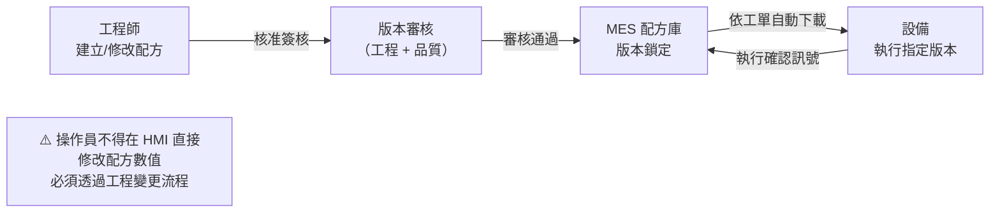
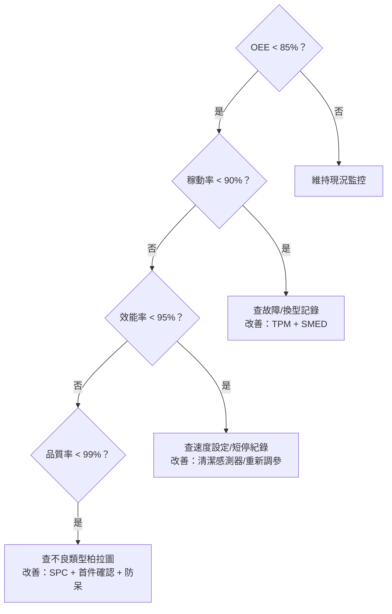

# 中級單元十三：智慧設備操作知識與效率指標辨識（L22301–L22302）

對應官方評鑑主題 **L223**，本單元涵蓋 L22301（智慧製造設備操作知識）與 L22302（智慧設備特性及差異辨識），聚焦智慧設備的標準化操作與效率指標分析診斷。

---

## 1. 智慧製造設備操作知識（L22301）

### (1) 智慧設備標準操作流程

| 操作階段 | 關鍵步驟 |
| :--- | :--- |
| **啟機前確認** | 確認工單號/品種/配方版本；點檢夾具/模具狀態；確認料號批號正確 |
| **首件確認** | 生產第一個工件後，依 SOP 執行尺寸量測與外觀檢驗；MES 記錄確認結果 |
| **生產監控** | 定期查看 HMI 製程參數趨勢；達警戒值前主動介入，不等警報才動作 |
| **異常處理** | 發現異常立即停機 → Andon 通報 → 隔離可疑在製品 → 等待工程師到場 |
| **換線換型** | 依換型 SOP 更換模具/配方；換型後重新執行首件確認，合格才繼續量產 |
| **停機保養** | 依保養計畫執行清潔/潤滑/點檢；保養完成記錄至 CMMS/MES |

### (2) 配方版本（Recipe）管理操作要點

**不可繞過的關卡**：
- 未核准的配方不能下機台。
- 機台上的配方版本號必須與 MES 工單指定版本一致，否則 MES 鎖定不得啟動。
- 每次配方變更須記錄「修改人 + 時間 + 核准依據」。

### (3) 設備操作安全要點

| 安全項目 | 說明 |
| :--- | :--- |
| 上電順序 | 依設備手冊的通電/斷電順序，避免非預期動作 |
| 故障復歸 | 故障排除後，「復歸（Reset）」與「重新啟動（Start）」是不同操作；確認人員離開危險區後再啟動 |
| 維護旁路 | 旁路（Bypass）安全互鎖需受控、限時、留下紀錄，完成後立即解除 |
| 作業許可 | 電氣/高壓/密閉空間維修需發出 Permit to Work，不可單獨作業 |

---

## 2. 智慧設備特性及差異辨識（L22302）

### (1) OEE 三元素計算與診斷

$$OEE = \text{稼動率} \times \text{效能率} \times \text{品質率}$$

| 指標 | 公式 | 偏低的診斷方向 |
| :--- | :--- | :--- |
| **稼動率（A）** | $\dfrac{\text{計畫工時}-\text{停機時間}}{\text{計畫工時}}$ | 故障多（MTBF 短）或修復慢（MTTR 長） |
| **效能率（P）** | $\dfrac{\text{實際產量} \times \text{理想節拍}}{\text{實際運作時間}}$ | 設備慢速損失或短暫停機（空轉）頻繁 |
| **品質率（Q）** | $\dfrac{\text{良品數}}{\text{實際產量}}$ | 製程不良率高或開機暖機損失大 |

### (2) OEE 診斷決策流程

以下門檻為練習用示例，實際依設備、工況及改善目標設定；應同時比較損失規模，不能只修正第一個低於門檻的指標。

### (3) 智慧設備與傳統設備效率差異比較

| 維度 | 傳統設備 | 智慧設備 |
| :--- | :--- | :--- |
| 稼動率監控 | 可能以人工巡視、班報記錄 | 可採自動採集，更新延遲須量測 |
| 效能率監控 | 可能在班後手動計算 | 可提供即時儀表板，仍須一致理想週期基準 |
| 品質率管控 | 可用自主檢查、SPC、末端檢驗 | 可整合線上 SPC／AOI；覆蓋率與漏檢須驗證 |
| 故障預警 | 可有定期點檢及狀態監測 | 可加入 PdM；提前量、漏報與適用失效模式須驗證 |
| 配方管理 | 可用受控手動設定及確認 | 可整合 MES 下載與版控，仍需設備端確認 |

以上是可採用的改善方式，不能僅憑「智慧」名稱保證秒級更新、全檢覆蓋或固定的故障預警提前量。

> **中級考試重點**：OEE 須連同口徑與損失分析解讀，再以「拆解三元素 → 對應六大損失 → 選擇改善工具」建立診斷。減少排產時數不等於改善設備損失。

## 公告試題補強：產能效率與首次良率

| 指標 | 計算方式 | 回答的問題 |
| :--- | :--- | :--- |
| **產能利用率** | 實際產出 ÷ 設計產能 | 實際使用了多少理論產能？ |
| **生產效率** | 實際產出 ÷ 有效產能 | 實際結果達到多少可執行產能？ |
| **最終良率** | 最終合格數 ÷ 投入數 | 重工後有多少成品合格？ |
| **直通率（FPY）** | 首次加工合格數 ÷ 投入數 | 有多少產品一次通過，沒有返工？ |

例如設計產能 8,000 件、有效產能 5,000 件、實際產出 4,500 件，生產效率為 90%，產能利用率為 56.25%。兩種比率回答不同問題，不能互換。多工序產品的整線 CT 由最慢工站決定；多站加工時間相加可計算單件總加工時間，但不等於流水線每隔多久能出一件。完成重工的產品可以列入最終良品，卻不能回填為首次合格品。

### 先辨識時間單位與產出單位

**對照 L22 第 17–19、39–42、48、49 題及 L21 第 28、35 題。** 利用率已知時，設計產能＝實際產出÷利用率；效率則以有效產能為分母。輸送線的出件間隔由「工件間距÷線速度」求得，整線通過時間才是「線長÷線速度」。**原創小題**：間距 0.75 m、線速 1.5 m/min、線長 9 m，理論出件間隔為 0.5 min/件，通過時間為 6 min；兩者皆有時間單位，仍代表不同事件，且工站能力不足時不能照搬輸送帶理論產量。

「人分」是所有人工作時間加總，與整線經過幾分鐘不同。**原創派工題**：目標 150 件、6 站各 1 人，理想出件週期 1 min，效率 90%、平衡率 80%；另有 2% 產品須由 1 人各重工 4 min，且全可修復。基本派工量為 $150×1×6÷(0.9×0.8)=1250$ 人分，加重工 $150×0.02×4=12$ 人分，共 1262 人分。若效率已含平衡損失，則不能重複除平衡率；題設完全修復時，也不能再以首次良率除需求而重複計入損失。

TPS 的可動率關注「需要運轉時能否正常運轉」，稼動率關注需求及排產下的實際使用程度。訂單減少可能使稼動率下降，不能因此刻意降低設備可靠度或把降低 OEE 當成改善。

### 試題判讀與選項辨析

**先辨產能層級。** L22 第 17 題（公告 C）以 $1200÷0.8=1500$ 件反推滿負荷能力；不能再乘 80% 得到較小值。第 40 題（A）效率是 $3600÷4000=90\%$，利用率是 $3600÷6000=60\%$；$4000÷6000≈67\%$ 只是有效對設計產能比，不能冒充實際利用率。數字即使都能算出百分比，仍須標記分子分母。

**時間相同，事件可能不同。** 第 18 題（C）的連續輸送假設下，出件週期 $1\text{ m}÷1\text{ m/min}=1$ min/件；4 m 線長給的是單件通過時間 4 min。第 42 題（B）串聯線由最慢站限制穩態出件，並非各站平均；第 49 題（C）以需求求 $8×3600÷480=60$ 秒/件，是 TT，不是已量得的機台 CT。第 41 題（B）另以 $TT=9.6$ 分鐘與總作業 72 分鐘求至少 8 站，不能把「每站指定一步驟」誤當作必須 10 站，也不能保證下限就能合法排完。

**人分不等於經過時間。** 第 19 題（B）有 8 站各 1 人，理想 1 min/件；依題意把效率與平衡率視為不同損失，基本派工為 $200×1×8÷(0.9×0.9)=1975.31$ 人分。不良可完全修復，重工另加 $200×0.01×5=10$ 人分，合計 1985.31，選最接近的 1990。不能省略 8 人、不能再除 99% 把同一品質損失重複膨脹；若現場的「長期效率」已含線平衡或重工，此分解就需重定義。題目只要求總派工估算，尚不能證明瓶頸與重工人員日曆一定足夠。

**需求利用與設備可用分開改善。** 第 48 題（A）重視 TPS 的可動率，即需要設備時是否能正常運轉；接單不足造成稼動率低，不等同設備不可靠。應維持需要時可用、按實際需求排產，再分解停機、慢速及品質損失，不能為增加利用率而先做無需求的庫存。

## 深度研讀：混產品效率、瓶頸負荷與操作驗證

### 多產品彙整前先固定權重

不同產品理想週期不一樣時，不能用總件數乘任意一個產品 CT，也不宜直接平均每批 OEE。先保存每個生產區段的計畫生產時間、運轉時間、理想週期、總數與首次合格數，再選定報表口徑。本節主表採 [Vorne 多產品 OEE FAQ](https://www.oee.com/faq/) 的彙整方式：A 為總運轉時間÷總計畫時間，P 為各產品「理想週期×總數」加總÷總運轉時間，Q 為總合格數÷總數，再計算 A×P×Q。這種 Q 以件數加權，不能悄悄改成按產品工時加權後仍聲稱是同一口徑。

### 原創案例：相同資料可以回答不同問題

以下是同一設備兩個不重疊生產區段，時間皆為分鐘，合格數指首次通過且未重工的件數。A 產品計畫時間 300、運轉 240、理想 CT 0.5 min/件、總數 400、合格 380；B 產品計畫時間 180、運轉 180、理想 CT 1 min/件、總數 160、合格 144。各 CT 是題設理想基準，不能用本班實測平均速度代替。

總計畫為 480、運轉為 420，總理想加工時間為 $400×0.5+160×1=360$。因此 A＝87.5%，P＝$360÷420≈85.71\%$，Q＝$(380+144)÷560≈93.57\%$，彙整 OEE 約為 70.18%。逐段 OEE 則為 A 的 $380×0.5÷300≈63.33\%$，B 的 $144×1÷180=80\%$；簡單平均為 71.67%，無法代表上述彙整公式，因為兩段時間與產品結構不同。

若另問「本班良品所對應的理想加工工時占計畫時間多少」，答案為 $(380×0.5+144×1)÷480=69.58\%$。它與主表的 70.18% 不同，原因是兩產品 CT 與良率不同，對良品採用的權重也不同。兩種問題須分別命名與揭露公式；單一產品時熟悉的簡式，不能未加說明就延伸成所有混線彙整都必然相同。改善前後若產品組合大幅變動，更應保留逐產品結果再比較。

### 從設備數字回到產線可交付量

設備 OEE 高不代表整線可以準時交貨，因為投料、工站資格、在製品緩衝與下游能力仍可能限制產出。混線更適合先把每產品需求乘各站工時，得到工作中心的負荷分鐘，再與同期間有效時間比較。瓶頸負荷超過 100% 時，改善其他輕載工站可能只增加等待與庫存；若瓶頸發生變化，則需重新檢查整體流動。提升性能前也要確認沒有以超出核准製程窗口的方式增加速度，否則良率與設備負擔可能惡化。

操作驗證可用三份證據連接：工單要求的產品與配方版本、設備實際執行版本、首件與量產品質結果。換型完成畫面不能取代這三者一致；機台計數器重設、同件重工再過站及報廢更正也須留紀錄。若報表出現 P 大於 100%，應先查理想 CT、並行模穴、產量倍數及時間分類，而不是先把 P 截成 100% 掩蓋資料問題。驗證範圍應涵蓋一個完整換型與異常復歸過程，不能只截取運轉最順的幾分鐘。

### 進階練習與解析

**練習 1：同產品兩班怎麼彙整？** 同產品、相同理想 CT 的兩班，計畫時間分別為 100、300 分鐘，OEE 分別為 90%、50%，其首次合格與時間口徑一致。**解析：**兩班完全有效生產時間相當於 90 與 150 分鐘，合計 240；總 OEE 為 $240÷400=60\%$。直接平均得到 70% 會讓短班擁有過大權重。此處能依計畫時間加權，是因單產品簡式及底層定義一致，不代表可任意平均不同混線公式。

**練習 2：提高快站速度能補交期缺口嗎？** 需求 P 120 件、Q 80 件；工站 1 每件 P/Q 分別需 1/2 分鐘，工站 2 為 2/1 分鐘，各有 300 分鐘可用，無換線與其他損失。**解析：**站 1 負荷為 $120+160=280$，站 2 為 $240+80=320$，缺口在站 2 的 20 分鐘。提高站 1 速度不能移除這個限制。若有未承諾且合格的 P 成品 10 件，改生產 P 110、Q 80，兩站負荷降為 270、300，總量才可行；但仍須檢查先行流程與交期時序，不能只靠這張負荷表保證實際準時。
