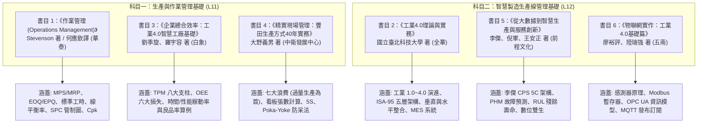

# 官方學習資源與六大參考書目對照導讀

本文件以經濟部產業發展署 iPAS [官方學習資源專區](https://ipd.nat.gov.tw/ipas/certification/SPE/learning-resources)已保存的 115 年第一次公告試題、術科樣題及參考書目為依據，對映至工作區的各考科筆記單元。

---

## 一、 官方公告最新試題下載清單

官方已釋出 115 年第一次初級與中級公告試題，以及考科三術科樣題。以下檔案已下載至本資料夾，可作為題型與教材範圍的對照；單次試題不代表未來命題比例或題目預測：

| 評鑑科目代碼 | 科目名稱 | 本機參考檔案 | 對應核心研讀筆記 |
| :--- | :--- | :--- | :--- |
| **L11** | **生產與作業管理基礎** | `115年第一次初級智慧生產_L11_生產與作業管理基礎_公告試題.pdf` | [從科目一單元一開始](../科目一_生產與作業管理基礎/01_生產管理基本概念.md)，研讀單元 1–6 |
| **L12** | **智慧製造生產線管理基礎** | `115年第一次初級智慧生產_L12_智慧製造生產線管理基礎_公告試題.pdf` | [從科目二單元一開始](../科目二_智慧製造生產線管理基礎/01_智慧製造概論與ISA95架構.md)，研讀單元 1–6 |
| **L13** | **智慧生產與管理實務** | `官方樣題_考科3_智慧生產與管理實務_實作器材及評分標準與答題參考.pdf` | [工時量測與 VSM](../科目三_術科實作準備/01_生產管理與流程實作.md)、[MES 操作](../科目三_術科實作準備/02_智慧製造現場管理實作.md) |
| **L21** | **智慧製造生產與作業管理之實務應用** | `115年第一次中級智慧生產_L21製造生產與作業管理之實務應用_公告試題.pdf` | [從中級單元五開始](../中級_智慧製造工程師/05_生產管理實務與精實管理.md)，對應 L211–L212 |
| **L22** | **智慧製造之設備與製程管理之實務應用** | `115年第一次中級智慧生產_L22智慧製造之設備與製程管理之實務應用_公告試題.pdf` | [從中級單元九開始](../中級_智慧製造工程師/09_物聯網與CPS基本原理.md)，對應 L221–L223 |

---

## 二、 官方列示六項參考書目研讀對照

官方學習資源頁明示書目僅供應考方向參考，並非考試用書。可用它們補足定義、案例與計算原理；以下章節與考點是本教材的研讀對照，不代表官方保證的出題來源、頁碼範圍或唯一解法。來源：[官方學習資源頁](https://ipd.nat.gov.tw/ipas/certification/SPE/learning-resources)。

### 1. 《作業管理 (Operations Management 12e)》
* **作者**：William J. Stevenson（何應欽 譯，華泰文化出版）
* **定位**：**科目一（L11）的絕對核心聖經**，涵蓋 60% 以上的計算題。
* **重點章節**：
  * 第 10 章〈工作設計與工作衡量〉：馬錶測時法、評比係數、寬放率（外加 vs 內含）、標準工時（ST）計算。
  * 第 11 章〈位置與設施佈置〉：產品導向 vs 程序導向佈置、節拍時間（TT）、流水線平衡率（LE）與平衡損失率（BD）演算法。
  * 第 12、13 章〈存貨管理與 MRP/ERP〉：EOQ/EPQ 公式推導與總成本曲線、安全庫存（SS）、再訂購點（ROP）、MRP 階層展開矩陣與淨需求運算。
  * 第 9 章〈品質管制與製程能力〉：休哈特管制圖判定、製程能力指數（$Ca, Cp, Cpk$）計算與評價標準。

### 2. 《工業 4.0 理論與實務》
* **作者**：國立臺北科技大學（全華圖書出版）
* **定位**：**科目二（L12）的骨幹架構書**。
* **重點章節**：
  * 工業 4.0 總體藍圖與德國「智慧工廠（Smart Factory）」戰略。
  * 垂直整合（工廠內部現場至 ERP）與水平整合（端到端價值鏈網路）。
  * ISA-95 企業控制金字塔（Level 0 現場設備至 Level 4 商業營運）。
  * 製造執行系統（MES）在車間排程、派工、追溯與品質收集之實作角色。

### 3. 《企業總合效率：工業 4.0「智慧工廠」的基礎》
* **作者**：劉季旋、羅宇容（白象文化出版）
* **定位**：橫跨科目一與科目二的設備管理指標專門書。
* **重點章節**：
  * 全面生產管理（Total Productive Maintenance, TPM）的推進步驟與自主保全七階段。
  * 設備六大損失（故障、換模調校、瞬停空轉、速度低減、暖機開機不良、製程不良）。
  * 整體設備效率（Overall Equipment Effectiveness, OEE）多維度推算與世界級製造業標竿（World-Class OEE $\ge 85\%$）拆解。

### 4. 《精實現場管理：豐田生產方式資深顧問親授 40 年現場管理實務》
* **作者**：大野義男（財團法人中衛發展中心出版）
* **定位**：精實生產、現場改善（Kaizen）與單件流實戰。
* **重點章節**：
  * 豐田生產方式（TPS）的核心靈魂：徹底杜絕浪費（Muda）。
  * 現場七大浪費（TIMWOOD）逐項深度案例，說明為何「過量生產」為萬惡之首。
  * 後拉式生產（Pull System）與實體看板（Kanban）作業流通規範。
  * 現場防呆（Poka-Yoke）機構設計實例與 5S 目視化管理。

### 5. 《從大數據到智慧生產與服務創新》
* **作者**：李傑（Prof. Jay Lee）、倪軍、王安正（前程文化出版）
* **定位**：網宇實體系統（CPS）與故障預測和健康管理（PHM）理論源頭。
* **重點章節**：
  * CPS 5C 架構體系：Connection（連接）$\to$ Conversion（轉換）$\to$ Cyber（網路/數位雙生）$\to$ Cognition（認知）$\to$ Configuration（配置執行）。
  * 設備剩餘使用壽命（Remaining Useful Life, RUL）推估模型。
  * 旋轉機械振動特徵分析（FFT 頻譜轉換、均方根值 RMS、峰度指標）。
  * 由事後維修（RTF）、預防性維護（PM）進化至預測性維護（PdM）之技術躍遷。

### 6. 《物聯網實作：工業 4.0 基礎篇》
* **作者**：廖裕評、陸瑞強（五南圖書出版）
* **定位**：現場資料採集、硬體感測元件與通訊實體層。
* **重點章節**：
  * 工業感測元件特性（熱電偶/RTD、壓電振動規、光電開關、近接感測器、比流器）。
  * 序列通訊與工業網路：RS-485 差動訊號、Modbus RTU 與 Modbus TCP 暫存器對照。
  * OPC 統一架構（OPC UA）節點空間（NodeSet）與資訊安全機制。
  * 訊息佇列遙測傳輸（MQTT）Broker 代理伺服器、主題（Topic）設計與 QoS 等級。

---

## 三、115 年第一次公告試題對照與教材優化

以下題號依各 PDF 題目順序整理。題目通常跨越數個能力指標；此表用來安排複習，不代表官方命題比例，也不以背選項取代理解。

### L11｜生產與作業管理基礎

| 題號 | 回到教材單元 | 複習時要會做的事 |
| :--- | :--- | :--- |
| 1、5 | 單元三：物料管理 | 拆開 EPQ 的生產／整備／持有成本；辨認批量增大時持有成本與訂購／整備成本的變化，避免把總相關成本說成單調增減。 |
| 2–4、6、9–15、28–30 | 單元一：生產管理 | 由需求策略選 MTS/MTO；說明 MPS 決策、時間欄柵、排程方向與有限／無限負荷的差異；辨識流程／產品／固定位置佈置、甘特圖與 DRP 用途。 |
| 16–20、26–27 | 單元二、三：流程與物料 | 從 EBOM 對照 MBOM 的製造與組裝順序；用低階編碼安排 MRP 展開；分清毛需求、淨需求、可用庫存、已排程到貨與前置時間平移。 |
| 7–8、22–23、31–32、35–39 | 單元四：工業工程 | 計算 TT、正常時間與 ST；找出最大 CT 瓶頸；分清工站 CT、流程時間與生產能力，並以工作研究和人因原則提出改善。 |
| 21、24–25 | 單元二、四：流程與作業方法 | 用 ECRS 分析搬運／操作步驟；確認 SOP 有可執行的步驟、工具及安全要求，且符合現場設備能力與節拍。 |
| 33–34、40 | 單元六：精實與績效 | 由停機、換線與等待辨認改善方向；分清良率、直通率與勞動損失指標；以流程時間或增值比率檢查 JIT 改善效果。 |
| 41–50 | 單元五：品質管理 | 選擇合適管制圖；解讀樣本數對 p 圖界限的影響；分清管制界限與規格界限，並辨認散佈圖、魚骨圖、品質成本與 TQM 的用途。 |

### L12｜智慧製造生產線管理基礎

| 題號 | 回到教材單元 | 複習時要會做的事 |
| :--- | :--- | :--- |
| 1–3、15 | 單元一、六：架構與 MES | 說明 ERP、IT、OT、MES 的職責與資料方向；辨認 Level 3 現場營運資訊如何連接企業計畫和設備控制。 |
| 4–6、39–40 | 單元二、五：感測與設備 | 依量測目的選感測器；振動異常先查設備／感測器與安裝狀態；理解原點復歸和六軸機器人的用途，以及 AGV/AMR 的物流角色。 |
| 7–11、16–17、34、38 | 單元五、六：現場管理與 MES | 由監控指標找對模組；分清電子看板、設備警報、預測保養與日報欄位；知道 MES 支援製造追蹤與管制，但不直接負責產品設計。 |
| 12–14、18–22 | 單元二、三：介面、IoT 與邊緣運算 | 區分感知、網路、應用層；辨識設備介面規格、相機傳輸距離與常見無線技術；說出邊緣運算降低延遲、就地分析與斷線緩衝的理由。 |
| 23–27、32 | 單元三：AI 與機器視覺 | 分清相關與因果；描述監督／強化學習的基本回饋；先查資料品質再談模型；說明電腦視覺如何由影像推斷場景與缺陷。 |
| 28–31 | 單元四：CPS 與數位雙生 | 按 Connection → Conversion → Cyber → Cognition → Configuration 排列 5C；分清資料轉換與連線採集，並理解異常時的決策與回饋閉環。 |
| 33、35–37、41–50 | 單元五、六：維護、精實與設備績效 | 分清反應／預防／預測維護；計算 OEE；辨認稼動率、性能效率、最終良率與直通率，並將低指標對應到停機、速度或品質損失。 |

### L13｜智慧生產與管理實務（術科樣題）

官方樣題把考科三分成兩個各占總分 50% 的實作主題：L131「生產與作業管理實作」及 L132「製造生產線管理實作」。L131 要準備現場工時量測、VSM 與計算／說明題；樣題列出工時量測 10%、VSM 30%，其中 VSM 評量流程時間（PT）、週期時間（CT）及圖形。量測題另要求各站觀測值落在標準答案 ±10 秒內。

L132 是 MES 上機操作，包含 10 個依序相連的任務。每題完成後都要截取完整桌面，確認題目括號指定的欄位出現在畫面，再貼到 Word；說明題直接輸入答案。前題狀態會影響後題，應按題目順序完成並逐題保存證據。樣題對 Word 檔名同時出現「考試通知碼」與「准考證編號」兩種說法，實際應以當次准考證、考場指示與監考人員公告為準，入場後先核對命名規則。

### L21｜智慧製造生產與作業管理之實務應用

| 題號 | 回到教材單元 | 複習時要會做的事 |
| :--- | :--- | :--- |
| 1–5、11–17、20–21、27、34、42、44、48–50 | 中級單元五至七 | 連結智慧工廠、精實管理、MES 模組與生產資料；辨認 MES 能做的追蹤／派工／監控，及大數據應用方向、資料來源、完整性與校驗。 |
| 6、28–30、33、45 | 中級單元八 | 計算線平衡、OEE、瓶頸日產能、人機配比與班次有效工時；先扣除休息、用餐、保養與故障，再依效率或良率調整。 |
| 7–10、22、32、36、38、40–41、43 | 中級單元五、六 | 辨認拉動／推動、看板、標準作業、PDCA、目視化、七大浪費與代工模式；把改善目標連到需求節拍與實際流動。 |
| 18–19、25、37、39 | 中級單元七 | 分清 TOC 約束與小排程；依題目績效目標選排程規則，並辨認排程時間粒度、交期與換模成本的限制。 |
| 23–24 | 中級單元五、七 | 掌握存貨政策與 EOQ 的假設，分清訂購、持有、短缺及整備成本。 |
| 26、35 | 中級單元八 | 拆解 OEE 三要素與六大損失，辨認指標錯誤敘述並回到時間、速度、品質資料驗算。 |
| 31、46–47 | 中級單元八 | 用 RPN 的嚴重度、發生度、檢出度排序風險；以檢驗資料、4M／魚骨圖及管制圖驗證原因。 |

### L22｜智慧製造之設備與製程管理之實務應用

| 題號 | 回到教材單元 | 複習時要會做的事 |
| :--- | :--- | :--- |
| 1–3、6、8、10、13–14、44 | 中級單元十一、十二 | 依檢測物與視野選相機、鏡頭、光源和感測器；辨認控制電壓、過載保護、設備資料採集元件與介面規格。 |
| 4–5、20–23、31、35、38、45 | 中級單元九、十二 | 分清 IoT 與 Internet、CPS 資料閉環和交換格式；辨識 MQTT QoS、雲端服務責任及高負載下邊緣串流處理。 |
| 7、11–12、29–32、39 | 中級單元五、十一、十三 | 依工件、負載、路徑與定位條件選機器人構型；辨認產品／製程型態、CAD 基本用途、機器人定位依賴與產線適配。 |
| 9、22、24、36、43、50 | 中級單元十、十三 | 分清事後、預防、狀態與預測維護的觸發依據；能說明故障後果、停機時間和資料不足對維護決策的影響。 |
| 15–16、25–28、33–34、46–47 | 中級單元九至十一 | 說明智慧製造核心、資料前處理、AI／ML、CPS 與視覺感測的關係；先檢查資料品質與模型用途，再判斷分析方法。 |
| 17–19、40–42、49 | 中級單元八、十三 | 由設計／有效產能和實際產出計算利用率、效率；用最大工站 CT 求整線節拍／產能，依作業時間和淨可用時間估算工作站或人力。 |
| 37、48 | 中級單元五、十三 | 分清 MES 監控和 TPS 精實指標；把設備操作、品質與生產資訊放回現場管理流程判讀。 |

### 計算題統一檢核順序

1. **先統一時間單位與可用時間**：扣除休息、用餐、計畫停機等題目明示的時間，再計算節拍或人力；不要把班表時間直接當淨生產時間。
2. **物料需求逐階展開**：父階需求乘 BOM 用量得到子階毛需求，再依題目扣除可用庫存並納入已排程到貨／安全庫存，最後依前置時間回推發出期。
3. **生產線先找限制工站**：整線 CT 受最慢工站限制；理論產能約為淨可用時間除以瓶頸 CT，線平衡率則看各站工時總和相對於「站數 × 瓶頸 CT」的比例。
4. **設備效率先分清分母**：OEE = 稼動率 × 性能效率 × 品質率；產能利用率以設計產能為分母，生產效率以有效產能為分母。重工後良品數可能提高最終良率，但不會改變直通率。
5. **標準工時先辨認寬放定義**：正常時間 = 平均觀測時間 × 評比係數。寬放若以正常時間為基底採外加法，ST = NT × (1 + A)；若 A 定義為標準時間中的比例，ST = NT ÷ (1 − A)。應依題目／教材明示的定義計算。
6. **品質題先問資料要回答什麼**：管制圖看製程隨時間是否穩定，規格界限看產品是否符合要求；散佈圖看兩變數關係，魚骨圖整理可能原因，不能把相關直接當成因果。

官方公告試題以檢核能力為目的。本教材保留題目 PDF 作為原始參考，複習應練習重新推導和解釋選擇理由，不以公開答案字母代替學習。

### 公告答案與驗算條件需要分開記錄

L21 第 28 題（PDF 第 5–6 頁）的公告答案為 C（約 67%）。將 100 秒／台視為理想週期、良品 450 台、計畫生產時間取 1200 分鐘時，$OEE=450×100÷(1200×60)=62.5\%$；若維護仍計入計畫生產時段、分母取 1230 分鐘，約為 60.98%。這是教材的條件式驗算，並非主辦更正。完整時間分類與公告差異見[中級單元八](../中級_智慧製造工程師/08_線平衡品質要因與即時資訊.md)，計算原理可對照 [Vorne OEE 說明](https://www.oee.com/calculating-oee/)。

L21 第 6 題以公告 90 秒代入線平衡率，得到約 84.92%，題設 85% 需按近似值解讀。遇到這類情況，要保留原始數據、單位、取整方法與假設；不能因答案字母已公開，就反過來修改通用公式。

要將上述考點轉成計算與情境演練，請接續使用[115 年試題導向實戰練習](./115第一次試題導向實戰練習.md)。題目為原創練習，附推導與答案檢核，不屬於官方試題。

## 四、從試題判讀進入各章深度研讀

建議先讀各學科章節的「試題判讀與選項辨析」；術科則先讀「樣題判讀與作答證據」。前者將實際題號連到必要觀念、判斷步驟及誤選原因，後者把公開評分與操作要求轉成可檢查的產出。遇到概念不熟，回到本章前面的定義與圖表，再做計算與整合案例。

23 個學科章節均保留「深度研讀」區塊，將原理、完整輸入、計算或判斷、管理行動與驗證串成案例，並各附兩題進階練習解析。下列是案例入口；在 PWA 章節目錄選取相應標題，即可定位內容。這些案例與練習為教材原創，示例門檻、成本與工作條件均須按各章假設使用。

| 科目 | 深度案例入口 | 研讀後要能回答 |
| :--- | :--- | :--- |
| 科目一 | [多期 MRP](../科目一_生產與作業管理基礎/03_物料管理概論.md)、[交期承諾](../科目一_生產與作業管理基礎/01_生產管理基本概念.md) | 總量足夠但到貨過晚、或 ATP 足夠但瓶頸無空檔時，能否承諾交期？ |
| 科目二 | [AI 門檻與複判容量](../科目二_智慧製造生產線管理基礎/03_人工智慧AI與機器視覺檢測.md)、[採樣與斷線補傳](../科目二_智慧製造生產線管理基礎/02_工業物聯網IIoT與通訊協定.md) | 指標最好或頻寬表面足夠的方案，為何仍可能不可用？ |
| 術科 | [測時與產能改善](../科目三_術科實作準備/01_生產管理與流程實作.md)、[事件帳與結案證據](../科目三_術科實作準備/02_智慧製造現場管理實作.md) | 平均工時、品質狀態與畫面紀錄如何共同支持結論？ |
| 中級 L21 | [有限產能排程](../中級_智慧製造工程師/07_MES全廠管控與生產排程優化.md)、[先行關係與品質](../中級_智慧製造工程師/08_線平衡品質要因與即時資訊.md) | 理論站數及負荷表何時不足以證明方案可執行？ |
| 中級 L22 | [視覺與座標鏈](../中級_智慧製造工程師/11_感測器機器視覺與機器人整合.md)、[混產品效率](../中級_智慧製造工程師/13_智慧設備操作與效率指標辨識.md) | 空間、時間、品質與產品組合的計算口徑是否一致？ |

研讀順序為：先自行推導 → 對照解析定位差異 → 改變一項假設重算 → 說明需要的現場驗證。若缺少必要資料，先指出缺項與可能影響，不以自行猜測的數字填補證據。

## 五、公告答案與完整觀念如何一起使用

四科公告試題各 50 題，教材以每題一個主要研讀章節建立對照；中級題目也可能跨 L21／L22 主題，主要章節是本教材的複習安排，並非主辦單位的逐題命題分類。一次試題的題數分布不代表下次命題比例，公告答案也不應被擴寫成所有情況都成立的工程定律。

| 需要分開的兩件事 | 具體對照 | 正確學習方式 |
| :--- | :--- | :--- |
| 公告選項與品質原理 | L11 第 45、48、49 題涉及管制圖規劃、品質成本及 TQM 用語 | 保留公告答案供原題核對；另按活動目的判品質成本，保留 CTQ、全員參與與事實決策等完整概念，詳見[品質管理章](../科目一_生產與作業管理基礎/05_品質管理與統計製程管制.md) |
| 題內比較與介面能力 | L12 第 13 題比較相機介面連接線長 | 不將題內排序視為所有線材、延伸器及型號的固定上限，詳見[AI 與機器視覺章](../科目二_智慧製造生產線管理基礎/03_人工智慧AI與機器視覺檢測.md) |
| 公告結果與可重現計算 | L21 第 28 題的時間分類及 OEE／設備使用率名稱 | 留下分母、理想週期假設及推導；公告差異不是自行修改公式的理由，詳見[線平衡與品質章](../中級_智慧製造工程師/08_線平衡品質要因與即時資訊.md) |
| 題目分類與實際產品能力 | L22 第 27、37、44 題涉及熱像測溫、MES 架構及工業相機分類 | 不推成「熱像不能測溫」「MES 必須封閉」或「相機不含感測器」，詳見[感測與視覺章](../中級_智慧製造工程師/11_感測器機器視覺與機器人整合.md)及[通訊與介面章](../中級_智慧製造工程師/12_通訊建構智慧控制與介面管理.md) |
| 公開範例與實際術科題組 | L13 公開工單結案示例及十題連續操作規範 | 不虛構其餘九題的完整題目或固定按鍵路徑；逐題核對對象、前置狀態、結果與答卷證據，詳見[MES 實作章](../科目三_術科實作準備/02_智慧製造現場管理實作.md) |

複習一題至少說清楚三件事：題目給了哪些條件、所選答案為何符合本題、改變哪項條件後不能直接沿用。若公告措辭與一般原理存在落差，教材會保留公告字母並標示邊界；這些說明是教材核對註記，不是主辦更正或官方釋疑。
