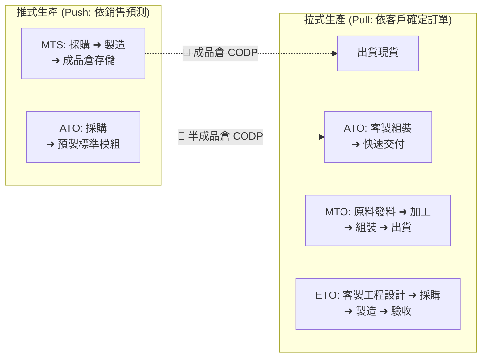
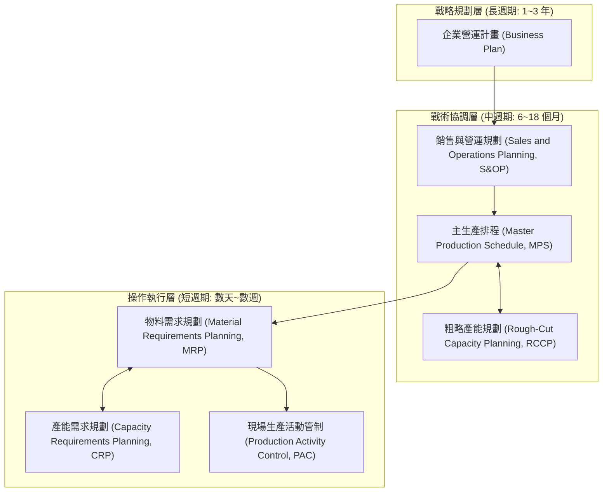
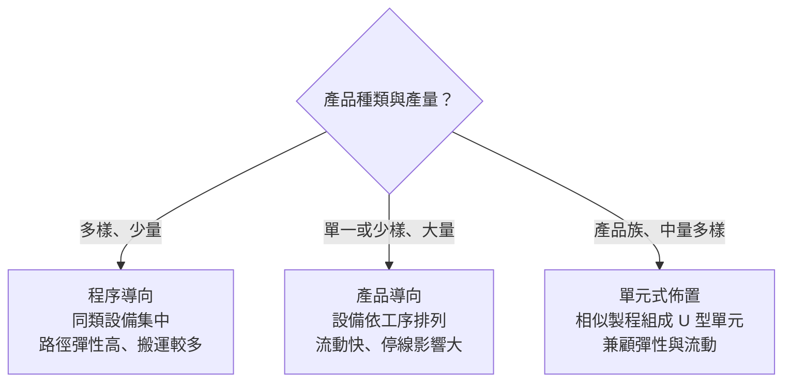
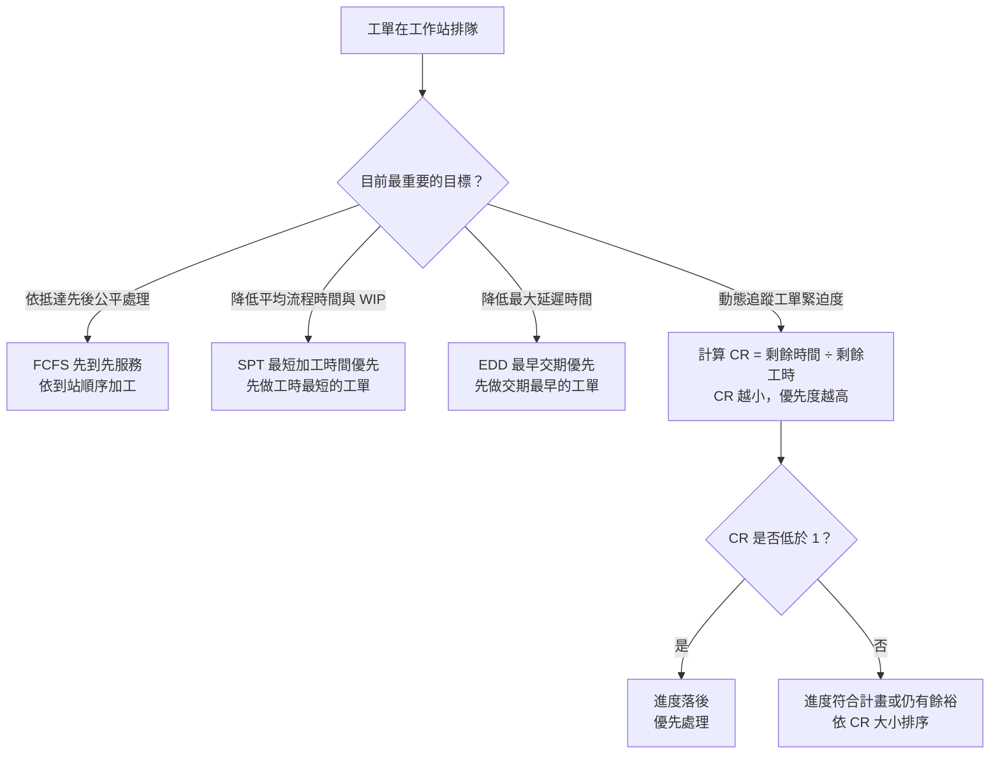
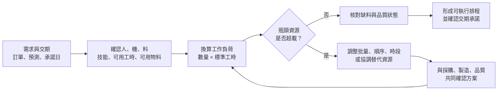

# 單元一：生產管理基本概念

<figure class="unit-visual">
  
  <figcaption>3D 單元總覽<strong>圖解重點：</strong>以庫存解耦點辨識備貨、接單生產與最終組裝；上方規劃層連結需求、S&amp;OP、MPS 與產能檢核，說明排程如何轉為現場可執行的承諾。</figcaption>
</figure>

## 1. 生產型態分類與解耦點 (Decoupling Point)

生產型態決定了製造企業的供應鏈響應速度、庫存成本與排程複雜度。解耦點（Customer Order Decoupling Point, CODP）是客戶訂單切入生產供應鏈的臨界點。解耦點之前屬於依賴預測的推式（Push）生產，解耦點之後轉為由訂單驅動的拉式（Pull）生產。

  

    🎯 供應鏈製造五大工序與解耦點 (CODP) 圖像化對照圖
  

  

    橘色區域代表【預測驅動·推式生產 (Push)】，綠色區域代表【訂單驅動·拉式生產 (Pull)】，紅色標籤標示客戶訂單切入點 (CODP)。
  

  

    
生產型態

    
① 研發設計

    
② 原料採購

    
③ 零件加工

    
④ 模組組裝

    
⑤ 倉儲出貨

  

  

    
ETO 研發訂購

    
🎯 CODP拉式設計

    
客製採購

    
單件加工

    
專屬組裝

    
現場安裝

  

  

    
MTO 訂單生產

    
標準設計

    
🎯 CODP原料倉

    
依單加工

    
依單組裝

    
出貨交付

  

  

    
ATO 裝配生產

    
模組設計

    
安全備料

    
標準模組庫存

    
🎯 CODP組裝倉

    
快速出貨

  

  

    
MTS 存貨生產

    
大量設計

    
批量採購

    
量產加工

    
整機組裝

    
🎯 CODP成品倉

  

| 生產型態 | 完整英文名稱與縮寫 | 解耦點 (CODP) 位置 | 核心特徵 | 代表產品範例 |
| :--- | :--- | :--- | :--- | :--- |
| **存貨生產** | Make to Stock (MTS) | 成品倉庫 (Finished Goods) | 根據歷史銷售預測生產，交期最短，庫存積壓風險高 | 民生消費品、標準規格被動元件 |
| **裝配生產** | Assemble to Order (ATO) | 半成品/模組庫存 (Sub-assembly) | 預先備妥標準模組，接單後進行最終組裝，兼顧交期與客製化 | 個人電腦、客製化伺服器 |
| **訂單生產** | Make to Order (MTO) | 常見於原料／加工前，依企業備料政策而異 | 接單後啟動製造；通用原料可預先備妥，減少預製成品積壓，但仍有取消訂單與呆料風險 | 工業專用機、重型機械 |
| **研發訂購** | Engineer to Order (ETO) | 研發設計端 (Engineering Design) | 依據客戶特定工程規範從頭設計並製造，生命週期長 | 晶圓廠無塵室工程、客製化產線 |

---

## 2. 生產規劃層級體系

生產規劃並非單一排程動作，而是跨越戰略、戰術到操作層面的多階層控制閉迴路。

### (1) 銷售與營運規劃 (Sales and Operations Planning, S&OP)
S&OP 是企業高階主管平衡市場端需求（行銷、銷售）與供應端能力（生產、採購、財務）的中期規劃程序。產出為產品家族（Product Family）的總體生產計畫（Aggregate Production Plan, APP），通常以月或季為規劃單位。

### (2) 主生產排程 (Master Production Schedule, MPS)
MPS 將總體生產計畫拆解為特定「最終品項（End Item）」在各時段（Time Bucket，通常以週或天為單位）的具體生產數量與完成日期。
* **MPS 的主要輸入**：客戶已確認訂單、市場預測需求、期初庫存量、安全庫存設定。
* **可用承諾量（Available to Promise, ATP）**：
  供業務端評估是否能承接緊急插單之數量。第一時段 ATP 公式：
  $$\text{ATP}_1 = \text{期初庫存} + \text{MPS 產出量} - \sum \text{下一個 MPS 產出前的所有客戶訂單}$$
  後續時段（有 MPS 產出者）ATP 公式：
  $$\text{ATP}_t = \text{MPS}_t - \sum \text{該產出期至下一產出期前的客戶已確認訂單}$$

### (3) 粗略產能規劃 (Rough-Cut Capacity Planning, RCCP)
在 MPS 確定前，先行驗證瓶頸工作站（Critical Work Center）或關鍵資源（如昂貴加工機台、具備特定技術之關鍵技術員）是否具備足夠工時。若 RCCP 顯示超載，則必須反饋修正 MPS 的生產批量或排程時段。

---

## 3. 生產組織與車間佈置 (Plant Layout)

車間佈置決定物料移動路線、搬運浪費與在製品積壓水準：

**辨識口訣：**看「設備如何分組」而非只看廠房外型；功能分區是程序導向，按加工順序排成線是產品導向，按相似零件製程組成小單元是單元式。

* **程序導向佈置（Process Layout / 功能性佈置）**：
  * 將同類型的機器設備集中在同一區域（例如車床區、銑床區、熱處理區）。
  * 適用情境：少量多樣（High-Mix, Low-Volume, HMLV）生產型態。
  * 優缺點：可支援多種加工路徑；若批量、派工與移轉未協調，較易增加搬運、在製品（WIP）與製造前置時間，並非所有製程別工廠都必然高庫存。
* **產品導向佈置（Product Layout / 流水線佈置）**：
  * 按照產品加工工序由前至後排列專用設備（如汽車裝配流水線）。
  * 適用情境：大批量少樣（Low-Mix, High-Volume, LMHV）生產型態。
  * 優缺點：在工序平衡及供料穩定時，有利於減少搬運、在製品與製造前置時間；串接工序的單站故障可能影響全線，產品變更也可能需要調整專用設備。
* **單元式佈置（Cellular Layout / 群組技術 Group Technology, GT）**：
  * 依據零件相似的形狀與工藝特徵將設備組成 U 型生產單元（U-shaped Cell）。
  * 優勢：結合程序導向的彈性與產品導向的高效率，縮短換線作業時間（Changeover Time），利於實踐單件流（One-Piece Flow）。

### 115 年第一次公告試題：用情境辨識策略與佈置

**對應 L11 第 3、4、6、9、10、12–15 題。**低價格策略優先處理標準化、流程效率及單位成本；產品組合常變時，彈性則來自換線能力、模組設計與可替代資源。客製化需求增加而成品庫存積壓，可評估 MTO；若以預測提前完成標準成品，則屬 MTS。生產方式要配合需求與交期，不能只因添購自動化設備就判成 MTS 或 MTO。

**固定位置佈置**是產品／服務對象不易移動，由人員、工具到現場作業，例如大型船舶與重症病床照護。醫院可同時存在功能分科的製程別佈置與病床端的固定位置作業，因此辨識混合佈置時，要分別指出兩部分的運作方式。產品別產線因工序串接，單站故障較容易影響全線；製程別可能有替代設備，卻通常較難排程，不能把「路徑彈性高」誤當成「不需設備保養」。混線生產則須檢查不同車型的工時差異，避免局部負荷破壞節拍與同步。

**自我檢核：**同一款零件的加工途程已由工程端核定，現場要決定三批工作的先後，能否任意改變工序順序？**答案：**不能。批量、開工時點及工作順序屬排程決策；途程中的技術先行關係屬限制條件，需經製程審核後才可變更。

---

## 4. 派工法則 (Dispatching Rules) 與生產控制

在生產活動管制（Production Activity Control, PAC）階段，多項工單在同一機台排隊等待加工時，採用不同派工法則將直接影響平均流程時間、延遲率與在製品數量：

> **考題快選：**在單機、工作同時可用、不可中斷且無相依換線等基本條件下，問「平均流程時間最短」選 SPT；問「最大延遲時間最小」選 EDD。問「依到達順序」選 FCFS；問「剩餘時間與工時比值」選 CR，並由小到大排優先順序。

1. **先到先服務（First-Come, First-Served, FCFS）**：依據工單抵達工作站順序依序加工，對客戶最公平，但無法縮短平均流程時間。
2. **最短加工時間優先（Shortest Processing Time, SPT）**：
   * 優先加工所需作業工時最短的工單。
   * 特性：在上述單機基本條件下，可最小化平均流程時間；觀察期間與其他條件相同時，也有利於降低平均在製品數量。
   * 缺點：加工時間長的工單可能面臨長期停滯（飢餓現象）。
3. **最早交期優先（Earliest Due Date, EDD）**：
   * 優先加工交貨承諾日期最早的工單。
   * 特性：能最有效降低**最大延遲時間（Maximum Lateness）**。
4. **臨界比法則（Critical Ratio, CR）**：
   動態衡量工單緊迫程度之比值：
   $$\text{CR} = \frac{\text{剩餘可用時間}}{\text{剩餘加工時間}} = \frac{\text{交期日期} - \text{目前日期}}{\text{剩餘預估總工時}}$$
   * 若 $\text{CR} < 1.0$：剩餘時間不足以容納目前估計的剩餘工時，有逾期風險；可調整資源或方法後重新評估，不能直接宣稱必然逾期。
   * 若 $\text{CR} = 1.0$：工單進度恰好按計畫進行。
   * 若 $\text{CR} > 1.0$：工單進度超前或寬裕，優先權低。

---

## 職能基準對照與實務解說

## 進階延伸：從需求到可執行的生產承諾

### 規劃層級的輸入、決策與回饋

| 層級 | 主要輸入 | 核心決策 | 必須回饋的限制 |
| :--- | :--- | :--- | :--- |
| S&OP | 需求預測、訂單、庫存、財務目標 | 產品族群的月度供需與資源平衡 | 產能、供應風險、預算 |
| MPS | 已核准的 S&OP、訂單、期初庫存 | 成品／主要品項的週期數量與時點 | 物料可用量、批量、凍結區 |
| MRP | MPS、BOM、庫存、到貨與前置時間 | 各階物料的計畫訂單 | 採購／製造前置時間、良率、批量 |
| PAC | 已釋放工單、途程、現場狀態 | 工作中心派工與工序追蹤 | 實際產能、設備停機、品質隔離 |

這些層級不是單向逐級下達。現場回報的設備故障、良率下降或缺料會改變可承諾量（Available-to-Promise, ATP）；規劃人員應將限制回饋至 MPS，必要時再重新平衡 S&OP。ATP 的基本觀念是：未被既有訂單承諾的可用供給，不能把同一批庫存或產能重複承諾給不同客戶。

### 情境推演：插單是否能承諾？

某週需求為 500 件，期初可用成品 80 件，已排定生產 450 件，既有訂單承諾 420 件。若不考慮時段差異，期末可供新訂單量為 80 + 450 − 420 = 110 件。新客戶要求 130 件時，仍短少 20 件；不能只因總產能看似足夠便直接答應。還要逐時段檢查瓶頸工作中心負荷、關鍵物料到貨日與換線損失。可行方案包括拆單交付、調整其他訂單時點、加班或外包，並將成本與交期風險交由有權責者核准。

### 派工規則的使用邊界

SPT 有利於降低單機平均流程時間，但可能讓長工單飢餓；EDD 可降低最大延遲時間，卻不必然使每張訂單準時；FCFS 公平直觀，卻忽略交期與工時差異。CR 是動態優先度，更新頻率與剩餘工時估計品質會影響排序。實務上先確認績效目標，再選規則；派工規則無法補救錯誤途程、錯誤工時或未回報的停機。

### 自我檢核

1. 需求變動發生在下週，應先檢查哪個計畫層級？若影響產品族供需，為何不能只改現場派工？
2. 插單量小於總剩餘產能，仍可能無法承諾的兩個原因是什麼？

**判讀要點：**近期品項與數量通常先檢視 MPS／ATP；總量、產品組合或資源政策改變時需回到 S&OP。剩餘產能若不在正確時段或非瓶頸所需資源，仍無法形成有效承諾。

### 深度應用：從 MPS 承諾量到瓶頸產能

假設期初可用成品 150 件，第 1 週 MPS 安排 300 件，第 1 至第 3 週已確認訂單共 220 件，下一次 MPS 收貨在第 4 週，則第 1 週 ATP 為 $150 + 300 - 220 = 230$ 件。ATP 是可再承諾的數量，不等於 MPS 全數可自由銷售；已確認訂單必須先扣除。

接著以關鍵工作中心檢核可執行性：若 MPS 需求 450 件、該站標準工時每件 0.6 小時，所需工時為 270 小時；兩台設備每天可用 8 小時、每月 20 天，扣除保養與換線後可用率為 75%，可用產能為 $2 × 8 × 20 × 0.75 = 240$ 小時，負荷率為 $270 ÷ 240 = 112.5\%$。此排程超載，應回饋調整批量或時段，或提出經確認的加班、替代設備方案後再承諾交期。

**延伸判讀：**S&OP 平衡產品家族層級的需求與供應；MPS 將其細化為最終品項與時段；RCCP 驗證瓶頸產能；ATP 回答「還能接多少訂單」。這四個答案彼此相關，但不能互相替代。

本章對應 MPM3117-001v3 的 **T1.1 確認人、機、料如期**與 **T1.2 檢核標準工時合理性**。排程必須以人力、機台、物料與標準工時的現況校正；關鍵資源不足時，應調整批量、順序或替代資源並跨部門協調，不能在未驗證能力前承諾交期。

### 任務拆解：把排程變成可執行承諾

職能基準的 P1.1.1 要求「有效掌握人、機、料等狀態，彈性調配計畫，以如期生產」。實務上應先建立同一計畫期間的需求、可用產能、物料可得性與限制條件：需求不是只有預測，還要區分已確認訂單與可調整需求；產能不是設備額定速度，而是扣除班次、保養、換線、良率及人員技能後的可用能力；物料也要區分可用、待驗、隔離與在途狀態。

建議依序完成「確認需求與交期 → 檢查關鍵物料與前置時間 → 比對瓶頸工作中心負荷 → 檢核標準工時與實際條件 → 形成調整方案 → 與採購、製造、品質共同確認」。此流程對應 K01 生產管理、K02 物料管理、K03 產品知識，以及 S01 生產計畫、S02 跨部門溝通與 S03 檢核標準工時能力。

**判讀關鍵：**額定產能不等於可用產能，帳面庫存也不一定是可投產物料。只有人力技能、設備時段、物料狀態與標準工時都核實後，排程才是可承諾的計畫。

### 現場產出與判讀

可交付的結果不應只有一張排程表，至少還要能說明：哪些工單在凍結區、哪個工作中心是限制資源、缺料或待驗品會影響哪些日期、以及超載的處置選項與負責人。若主排程顯示能生產，但關鍵機台負荷、物料可用量或標準工時未同步驗證，這只能算是「計畫假設」，不能當成可承諾交期。

### 常見誤區

* 將額定產能直接當成可用產能，忽略保養、換線與人員技能。
* 只以帳面庫存判定可生產，忽略待驗、隔離或版本不符的物料。
* 以急單逐筆覆蓋原排程，卻未評估對既有承諾與瓶頸負荷的連鎖影響。

### 公告試題補強：排程穩定、產能與配銷

主生產排程設定**時間欄柵（Time Fence）**，是為了保護近期已承諾的計畫：凍結區的變更需嚴格核准，較遠期仍可依新需求調整。前向排程由可開始日往後推算完工日；後向排程由交期回推最晚開工日。排程方向不會自動解決產能限制。

無限負荷排程先排工作、未限制工作中心容量，可能把大量工單同時指派給瓶頸站而造成延遲；有限負荷排程則把可用工時納入安排。甘特圖用來檢查各工作中心的時段與負荷；DRP 處理的是配銷網絡中的成品庫存補充與配送時程，與工廠內 MRP 展料不同。

### 試題導向練習：派工目標必須分開驗證

**對應 L11 第 11、28–30 題。**原創情境：三張工單同時於時點 0 到站，加工時間 A＝6、B＝2、C＝3 小時，交期分別為 6、12、13 小時；單機加工、不插單、不換線。SPT 順序為 B→C→A，完工時間為 2、5、11，平均流程時間為 6 小時，但 A 延遲 5 小時。EDD 順序為 A→B→C，完工時間為 6、8、11，平均流程時間約 8.33 小時，三單均未逾期。這說明平均流程時間與交期績效是不同目標；SPT 不會在所有指標上都優於 EDD。

**操作檢核：**依序寫出排序、累積完工時間，再用「完工時間－交期」求延遲量；提早完成的負值不要當成逾期。若題目問逾期時間，則取 $\max(0,\text{完工時間－交期})$。

### 試題判讀與選項辨析：先辨認決策層級

以下代號是 **115 年第一次 L11 公告答案**；判讀重點以該題條件為限。先圈出題目要解決的問題，再判斷選項是否處於相同決策層級，不以看到 ERP、自動化或彈性等關鍵字就選答案。

| 題號／公告答案 | 必要知識與判斷步驟 | 常見誤選理由 |
| :--- | :--- | :--- |
| 2／A | MPS 將需求轉成具體品項、數量與時點；先分辨「生產計畫」和「人員排班」。 | 把班表、付款或廠房設計當成 MPS 的主要產出。MPS 提供品項與日期基礎，詳細工序開工仍須由途程與排程展開。 |
| 3／B；4／C | 先找訂單切入點：接單後啟動製造對應 MTO；依預測預製成品對應 MTS。 | 把大量生產、JIT 或零庫存當成訂單履行策略。MTO 不代表完全沒有原料庫存，MTS 也不代表不可採拉動補充。 |
| 6／B；10／C | 低價競爭優先看標準化及流程效率；需求多變且重視彈性，則看換線、產品轉換與資源調配能力。 | 以產品種類最多作為低成本的直接方法，或以控制庫存代替反應不同需求的能力。 |
| 9／D | 已知製程途程下，排程主要決定批量、何時做及哪批先做；技術工序順序是既定限制。 | 把「工作順序」與「製程順序」視為同一件事。若工程允許替代途程，須先確認核准條件，不能自行調換。 |
| 11／D | 甘特圖可表達工作／資源的時間與負荷；比較 SPT、EDD 時須先說明績效目標。 | 看到 SPT 可縮短平均流程時間，便推成它在所有交期指標上都較好；服務作業也可能使用排程。 |
| 12／A；13／B | 看實際作業對象是否移動及設備如何分組。醫院可同時有功能分科與床邊作業；串聯產線較易因單站故障擴大停線。 | 只靠產業名稱判定單一佈置，或把製程別的路徑彈性與產品別的連鎖停工風險混在一起。各型態仍都需要適當保養。 |
| 14／B；15／C | 混線時核對車型工時與工序同步；比較製造和服務時，分清實體產出可存放與服務多在提供時消費。 | 認為有智慧設備就能自動維持節拍，或把一般服務特性誇大成所有服務完全不能預製任何內容。 |
| 28／B；29／A | 時間欄柵控制哪些期間可改；有限／無限負荷控制是否納入容量；前向／後向則是推算時間的方向。 | 每天無限制更新 MPS 可能增加擾動；前向排程或排程軟體本身不會自動消除瓶頸超載。 |
| 30／A | 看管理對象：DRP 協調配銷節點的成品補充與配送時程；MRP 展開製造物料需求。 | 把投資回收、年度預算或單筆訂單狀態追蹤當成 DRP 的主要功能。 |

## 深度研讀：把 MPS、ATP 與有限產能合成一個交期承諾

### 庫存平衡為何不能代替交期驗證

一個時段的期末預計可用量（PAB）由物量守恆得到：

$$PAB_t=PAB_{t-1}+MPS_t-D_t$$

其中 $D_t$ 是依企業預測耗用規則形成的需求，不是把同一筆預測與訂單重複相加。以下案例採簡化的逐週規則 $D_t=\max(F_t,O_t)$；跨週預測耗用、訂單取消與欠交結轉須由實際系統另行處理。PAB 是規劃平衡，ATP 則只問供給扣除既有承諾後還能承諾多少；未成交預測不能直接當成已接訂單扣 ATP。

離散 ATP 把一次 MPS 收貨到下一次收貨前視為供給區間。首區間加期初可用存量，其後只加入該次 MPS；區間內訂單要扣完整，因為沒有新的收貨可補。這也說明某週沒有 MPS，不代表該週完全不能交貨，而是由前次供給支應。實務若出現負 ATP，需依系統規則檢查前期餘量與供給可挪用性，不能直接將負數改成零掩蓋重複承諾。

### 整合案例：40 件急單應承諾哪一天

**輸入與假設：**同一品項期初有 40 件合格、未保留成品；安全庫存為零，沒有其他到貨。表中 MPS 是該週交貨截止前可用的成品收貨量。第 1 週已凍結，不能任意改排；所有既有訂單都不得延期。

| 項目（件） | 第 1 週 | 第 2 週 | 第 3 週 | 第 4 週 |
| :--- | ---: | ---: | ---: | ---: |
| 預測 F | 60 | 30 | 50 | 20 |
| 已確認訂單 O | 70 | 40 | 60 | 30 |
| MPS | 100 | 0 | 120 | 0 |
| PAB | 70 | 30 | 90 | 60 |
| 離散 ATP | 30 | — | 30 | — |

第 1 週 ATP 為 $40+100-70-40=30$；第 3 週 ATP 為 $120-60-30=30$。急單 40 件要求第 2 週交貨，已排供給只能再承諾 30 件，不能拿第 3 週的 30 件填補較早的交期。若要加做 10 件，須進一步做可承諾能力（CTP）檢核。

第 2 週瓶頸站有 12 小時可用，既有工作已占 9 小時；本例已確認剩餘 3 小時可在本週交貨截止前連續排入同一批次，且操作資格與先行工作皆符合要求。新批設定需 1 小時、每件加工 0.25 小時，所有 10 件材料均可於開工前到齊，且檢驗、包裝與下游時段已確認。新增可用的 3 小時只能容納 $\lfloor(3-1)/0.25\rfloor=8$ 件。因此在目前條件下可承諾第 2 週 38 件、第 3 週 2 件。若客戶堅持 40 件同交，須先取得可執行的額外 0.5 小時瓶頸資源並核准改排，再更新 MPS、ATP 與訂單；不能先答應、後找產能。

**管理行動：**保留原訂單承諾，將急單拆成具日期的兩筆交付，記錄使用了哪段庫存與新增能力。材料到貨、瓶頸工時、品質放行任一條件失效時，要回到同一承諾紀錄重算，避免業務與現場各保留一份互相矛盾的版本。

### 邊界與敏感度：剩餘工時不是剩餘件數

若同樣的 3 小時必須生產兩個不同規格，各自設定 1 小時，只剩 1 小時加工，合計最多 4 件；不能沿用單批的 8 件。若剩餘時段切成兩段，且設定必須連續、工單不可中斷，也可能無法把碎片工時直接加總。有限產能檢核應保留資源行事曆、技能、換線矩陣和作業先行關係；總工時足夠只是必要條件。供給即使存在，若尚在待驗或版本不符，也不能納入可交貨 ATP。

承諾也要管理資料時效。同一時間兩位業務若各看到 30 件 ATP，不能各承諾 30 件；第一筆承諾應立即保留相應供給，後一筆要重新查核。可用「查詢計畫版本與時間 → 確認數量及日期 → 保留供給 → 登錄訂單 → 再查剩餘可承諾量」形成紀錄，避免查詢與接單之間被其他交易占用。訂單取消時則須解除原保留，但不代表已採購的專用材料或已排工時都能立即收回。不同系統的即時或批次 ATP 更新方式有差異；例如 [Oracle 的 ATP 說明](https://docs.oracle.com/cd/A60725_05/html/comnls/us/mrp/atp.htm)指出計畫快照與重算時間會影響可見結果，使用教材公式時也應先確認資料截止點與實際系統的承諾規則。

### 進階練習與解析

**練習一：材料只剩 5 件可用，急單能否仍交 38 件？**其餘條件同案例。

**解析：**新增產出同時受瓶頸能力 8 件與物料 5 件限制，取較小值 5；故第 2 週最多交 $30+5=35$ 件，餘 5 件待第 3 週。要承諾 38 件，至少還要讓 3 件材料在投料前可用，且不能挪用既有工單的保留量。

**練習二：只有第 2 週預測升至 90 件，已確認訂單仍為 40 件，ATP 與 PAB 如何改變？**

**解析：**按本例簡化耗用規則，第 2 週 PAB 為 $70-90=-20$，第 3、4 週依序為 40、10 件，表示預測供需計畫需修正；離散 ATP 仍為 30、30，因已承諾訂單未變。兩個結果回答不同問題：不能用正 ATP 宣稱預測供給充足，也不能把未成交的 90 件全數當成確定承諾。應先確認預測可信度及耗用規則，再決定是否增排或調整安全庫存。
