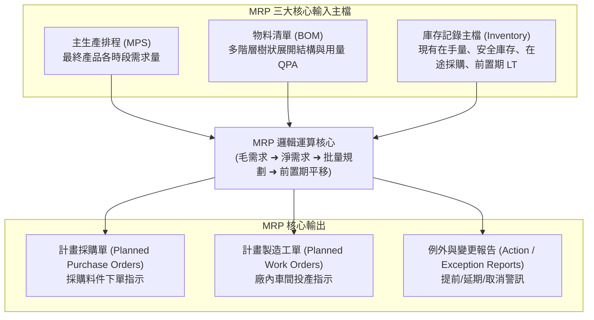
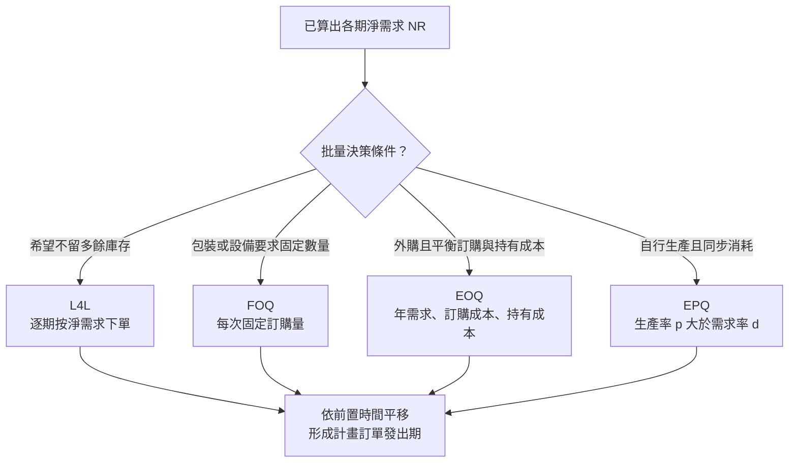
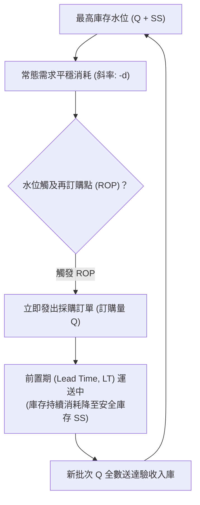
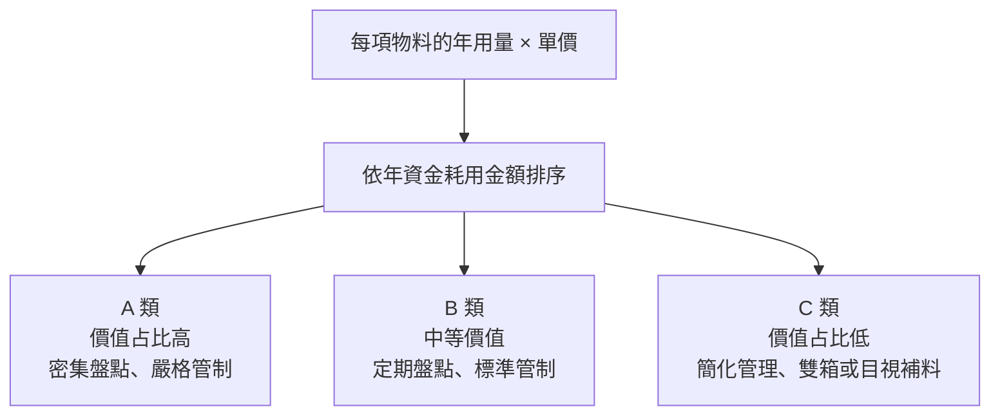

# 單元三：物料管理概論

<figure class="unit-visual">
  
  <figcaption>3D 單元總覽<strong>圖解重點：</strong>由成品需求向下展開物料需求，經庫存、到貨與安全庫存計算淨需求；同時觀察供應、現場倉、線邊超市、WIP 與出貨的受控流動。</figcaption>
</figure>

## 1. 物料需求規劃 (MRP) 展開邏輯

物料需求規劃（Material Requirements Planning, MRP）是根據主生產排程（Master Production Schedule, MPS）、物料清單（Bill of Materials, BOM）及庫存主檔（Inventory Records），推導出各種原物料與零組件在各時段的「淨需求量」與「採購/生產工單發出日期」。

### (1) MRP 三大輸入與核心輸出
* **三大輸入主檔**：
  1. **主生產排程（MPS）**：驅動整個 MRP 系統的引擎，定義最終成品各時段的需求量。
  2. **物料清單（BOM）**：定義產品階層、組裝隸屬關係與單機用量。
  3. **庫存主檔（Inventory Record File）**：包含現有庫存量、安全庫存設定、已下達採購單預計到貨量、採購或生產前置時間（Lead Time）。
* **核心輸出**：
  * **計畫採購單（Planned Purchase Orders）**：提供採購人員下發給供應商。
  * **計畫工單（Planned Work Orders）**：提供生管人員發放至工廠車間製造。
  * **變更例外報告（Exception Reports）**：提醒提早催料、延後交期或取消訂單。

### (2) MRP 表格推導核心演算法
在標準 MRP 矩陣時段運算中，各項數值之關聯公式如下：

1. **預計在手庫存量（Projected On-Hand Inventory, POH）**：
   $$\text{POH}_t = \text{POH}_{t-1} + \text{SR}_t + \text{PORec}_t - \text{GR}_t$$
   其中：
   * $\text{GR}_t$ 為第 $t$ 期毛需求（Gross Requirements）
   * $\text{SR}_t$ 為第 $t$ 期已排程到貨量（Scheduled Receipts，即已發出採購或在途工單）
   * $\text{PORec}_t$ 為第 $t$ 期計畫訂單到貨量（Planned Order Receipts）
2. **淨需求量（Net Requirements, NR）**：
   當期預期庫存不足以支應毛需求與安全庫存（Safety Stock, SS）時產生：
   $$\text{NR}_t = \max(0, \text{GR}_t + \text{SS} - \text{POH}_{t-1} - \text{SR}_t)$$
3. **前置時間平移（Lead Time Offsetting）**：
   $$\text{PORel}_{t - \text{LT}} = \text{PORec}_t$$
   將計畫訂單接收量（Planned Order Receipts）向前平移前置時間（Lead Time, LT），得到計畫訂單發出量（Planned Order Releases, PORel）。

---

## 2. 批量訂購法 (Lot-Sizing Rules)

當 MRP 計算出淨需求後，依據不同批量法決定發出訂單之數量：

* **逐批法（Lot-for-Lot, L4L）**：
  * 淨需求多少就下單多少，各期結束時庫存水位為零（不計安全庫存）。
  * 適用環境：昂貴品項、易過期原料、JIT 環境；缺點為若固定訂購成本或換模成本極高時不經濟。
* **固定訂購量法（Fixed Order Quantity, FOQ）**：
  * 每次訂購量固定為 $Q$（如包裝規格整箱、棧板單位）。
* **經濟訂購量（Economic Order Quantity, EOQ）**：
  * 平衡年訂購成本與年持有成本之理論最佳解：
    $$\text{EOQ} = \sqrt{\frac{2DS}{H}}$$
    其中 $D$ 為年需求量、$S$ 為每次訂購成本、$H$ 為每件每年的庫存持有成本。
* **經濟生產批量（Economic Production Quantity, EPQ / ELS）**：
  * 適用於自行生產且「一邊生產、一邊被後端消耗」的情境（生產率 $p >$ 需求率 $d$）：
    $$\text{EPQ} = \sqrt{\frac{2DS}{H \left(1 - \frac{d}{p}\right)}}$$
    此時最大庫存水準為：
    $$I_{\max} = Q \left(1 - \frac{d}{p}\right)$$

**易混淆：**EOQ 假設一次訂購後到貨；EPQ 適用於生產與消耗同時進行，因此最大庫存會低於整批生產量。

---

## 3. 安全庫存 (SS) 與再訂購點 (ROP)

在面對需求不確定或供應商前置時間波動時，設置安全庫存可防止缺貨（Stockout）：

* **需求隨機但前置時間固定時**：
  每日需求服從常態分配，平均值為 $\bar{d}$，標準差為 $\sigma_d$，採購交期固定為 $L$ 天。在指定的服務水準（Service Level，對應常態分配臨界值 $Z$）下：
  $$\text{SS} = Z \times \sigma_d \times \sqrt{L}$$
  $$\text{ROP} = (\bar{d} \times L) + \text{SS}$$
  *單尾常態服務水準的 $Z$ 值對照*：
  * 服務水準 90% $\to Z = 1.28$
  * 服務水準 95% $\to Z = 1.65$
  * 服務水準 99% $\to Z = 2.33$

* **前置時間隨機但每日需求固定時**：
  每日需求固定為 $d$，前置時間服從常態分配，平均值為 $\bar{L}$，標準差為 $\sigma_L$：
  $$\text{SS} = Z \times d \times \sigma_L$$
  $$\text{ROP} = (d \times \bar{L}) + \text{SS}$$

---

## 4. 現場倉與在製品 (WIP) 管理機制

現場物料流轉與財務結轉必須高度同步，避免帳實不符（BOM 虛減或在製品堆積）：

### (1) ABC 存貨分類法
運用柏拉圖 80/20 法則（Pareto Principle）依據品項的「年資金耗用總金額（年用量 $\times$ 單價）」進行分級管制：

分類依據是**年資金耗用金額**，不是單價高低，也不是品項數量；分級後才配置不同的管理頻率。
* **A 類物料**：品項數佔約 10~15%，佔總庫存價值 70~80%。實施嚴格嚴密盤點、連續盤存制、低安全庫存。
* **B 類物料**：品項數佔約 20~30%，佔總庫存價值 15~20%。實施定期盤點與標準管制。
* **C 類物料**：品項數佔約 50~60%，佔總庫存價值僅 5~10%。採用雙箱法（Two-Bin System）或目視管理，可備置較多安全庫存以精簡管理工時。

### (2) 倒扣料 (Backflushing) 機制
在高速大量裝配線（如 SMT 表面黏著產線或家電組裝），若每組裝一顆電阻或螺絲均逐筆手動報工扣料，現場行政成本將難以承受。
* **倒扣料邏輯**：作業員在工單完工下線時，MES/ERP 依據完工成品數量，對照該成品之製造物料清單（MBOM），自動由現場線邊倉庫存中「批次扣除」理論用量的子件庫存。
* **實施前提**：MBOM 單機用量（QPA）必須極度精準、現場不良報廢必須及時刷讀輸入，否則系統帳面庫存將迅速失真。

### (3) 存貨績效指標
* **存貨週轉率（Inventory Turnover Ratio, ITO）**：
  衡量企業庫存變現或去化速率之指標：
  $$\text{ITO} = \frac{\text{銷貨成本 (Cost of Goods Sold, COGS)}}{\text{平均存貨金額 (Average Inventory)}}$$
* **存貨週轉天數（Days of Inventory Outstanding, DIO）**：
  $$\text{DIO} = \frac{365}{\text{ITO}}$$
  DIO 越低代表資金滯留在原物料與在製品的時間越短，現金轉換循環（Cash Conversion Cycle, CCC）越健康。

---

## 職能基準對照與實務解說

## 進階延伸：MRP 計畫如何轉成可靠的現場供料

### MRP 的假設與資料敏感度

MRP 依主生產排程、BOM、庫存紀錄與前置時間計算時段需求；它假設資料足以描述供需，並不會自行知道供應商延遲、報廢或臨時停線。BOM 用量、庫存準確度、料件有效日期、已下單未交量或前置時間錯誤，都會沿多階展開傳播。計畫訂單是建議，不等同已核准採購單或已釋放製令。

### 逐期淨需求範例

某料件期初可用庫存 35 件，第 1、2、3 週毛需求為 20、30、25 件；第 2 週有已排定到貨 10 件，安全庫存為 5 件，採固定批量 40 件，前置時間 1 週。第 1 週需求後預計可用 15 件，高於安全庫存，無須補貨；第 2 週若不新增供給，可用量將降至 −5 件，為維持 5 件安全庫存，淨需求為 10 件，因此規劃收貨 40 件。由於前置時間為 1 週，應在第 1 週下單。第 3 週扣除需求後預計可用 10 件。實際表格要明確區分「計畫收貨」與「計畫下單」，批量規則可能使收貨量大於淨需求。

### 庫存分類與補貨政策不能混為一談

ABC 分類依年耗用金額等管理重要度分層，適合決定盤點與審查頻率；XYZ 可按需求波動性補充分群。分類本身不會自動決定安全庫存。高價但需求穩定的料件與低價但停線影響大的料件，需分別評估資金成本、缺料風險、替代性與供應恢復時間。

### 交易閉環與差異追查

收料、上架、領料、退料、移轉、報廢與盤點調整均應保留料號、批號／序號、數量、儲位、時間與操作者。倒扣料以完工數及標準用量推估耗用，適合流程穩定且耗用可預期的情境；若有大量替代、重工或損耗，須用實際領退料或定期差異校正，否則帳面庫存會逐漸失真。

### 自我檢核

1. 計畫訂單收貨日為第 5 週、前置時間 2 週，預計下單週為何？
2. 為何高 ABC 等級不必然代表安全庫存一定最高？

**判讀要點：**第 3 週下單；ABC 衡量價值重要度，安全庫存還取決於需求與供應波動、服務水準及缺料後果。

### 深度應用：逐期推算淨需求與發料時點

以下示例採逐批法（L4L）、前置時間 1 週、安全庫存 5 件；期初可用量 10 件，第 2 週有已排程到貨 5 件：

| 週別 | 毛需求 GR | 已排程到貨 SR | 計畫到貨 PORec | 期末預計庫存 POH |
| :--- | ---: | ---: | ---: | ---: |
| 第 1 週 | 12 | 0 | 7 | 5 |
| 第 2 週 | 16 | 5 | 11 | 5 |
| 第 3 週 | 8 | 0 | 8 | 5 |

第 1 週淨需求為 $12 + 5 - 10 = 7$；第 2 週先納入前期結存 5 與已排程到貨 5，淨需求為 $16 + 5 - 5 - 5 = 11$。第 3 週淨需求為 $8 + 5 - 5 = 8$。由於 LT 為一週，三筆計畫到貨要各自向前平移一週形成訂單發出時點；第 1 週需求所需的訂單須在計畫期開始前發出。

### 延伸管理：庫存交易與現場實物一致

收料、驗收、上架、領料、退料、補料、移轉、報廢與完工扣料，都應留下品號、數量、批號／效期、儲位、品質狀態、時間及交易人。帳面存在不代表可供工單使用：待驗、隔離、保留及版本不符的數量須從可用量中區隔。盤點差異應追查交易與單位換算根因，再更正資料，不以直接改帳取代調查。

本章對應 **T1.3 管理在製品（WIP）及現場倉**。依 P1.3.1，庫存管理須同時掌握數量與品質狀態；可用、待驗、隔離與不良品不可混為同一可用量，才能避免 MRP、補料與派工做出錯誤判斷。

### 職能任務：讓庫存數字可用於決策

P1.3.1 要求確實掌控在製品與現場倉的數量及品質。這表示每一筆存量至少要能回答「是什麼料、在哪裡、屬於哪個批次／版本、目前品質狀態為何、能否用於哪張工單」。MRP 計算的可用量若混入待驗、隔離、保留或過期物料，雖然帳面上有存貨，現場仍會發生缺料或錯料。

作業時可採「交易即時紀錄、狀態清楚區隔、例外即時處置、定期循環盤點」四項控制。收料、領料、退料、報廢、轉站與完工都應更新位置和狀態；盤點差異則應從交易、批次、儲位、單位換算與品質判定追查原因，而非只把帳面數量改正。

### 服務水準與資金的取捨

安全庫存與 ROP 是服務水準的緩衝工具，不是解決供應不穩定的唯一方法。設定時應看需求變異、前置時間變異、缺料成本與持有成本；對效期料還需加上 FEFO、批次追溯與報廢風險。A 類高年使用金額物料通常要較密集盤點與管理，但不代表所有 A 類都應無限制增加庫存。

### 常見誤區

* 只看「總庫存」而未扣除待驗、隔離、保留與版本不符數量。
* 以提高安全庫存掩蓋供應商交期、報工或庫位資料不準確的根因。
* 在現場倉將不同批次、品質狀態或效期的物料混放。

### 公告試題補強：EPQ 成本與多階 BOM 淨需求

EPQ 的總成本敘述可能包含生產成本、整備／設置成本與庫存持有成本；在傳統 EPQ 最佳批量推導中，若單位生產成本固定，通常比較的是會隨批量改變的整備與持有成本。批量增加會提高平均庫存與持有成本，但會減少每年整備次數；不能把兩項成本或總相關成本混成同一個單向關係。

多階 BOM 題先把每一父項的**實際需生產量**乘以單位用量，合併同一子件需求，再扣除該子件可用庫存與有效到貨。例：A 尚需生產 40 件、每件用 2 個 C；B 扣除現有成品後尚需生產 25 件、每件用 3 個 C；C 可用 100 個，則 C 毛需求為 $40×2+25×3=155$，淨需求為 55 個。若有安全庫存或已排程到貨，須按題目資料加入計算，並依各階前置時間回推訂單發出週。

需求日期錯置時，先檢查 MPS 版次、BOM 用量、庫存狀態及前置時間，再重跑 MRP；把安全庫存設為零或把多階料件合併成單一品項，都會掩蓋資料問題。

### 115 年第一次公告試題：低階編碼、需求來源與批量成本

**對應 L11 第 1、5、16、18、26、27 題。**同一零件若在不同 BOM 路徑的第 1 層與第 3 層出現，低階編碼取最深的第 3 層。MRP 要等各母項需求都展開、彙總後，再對該零件計算一次淨需求；它是安排計算順序的編碼，不是倉庫儲位或零件分類。需求來源追溯（pegging）則回答「這筆需求由哪張上階計畫訂單產生」，可用來判斷母項改期會影響哪些子件。

**原創時間推演：**第 6 週要完成 P 共 30 件，每件用 2 個自製 M；M 可用庫存 10 件，沒有在途、安全庫存或批量限制。P 提前期 1 週，須第 5 週開始製造，因此 M 毛需求 60 件發生在第 5 週；M 淨需求 50 件。M 提前期也是 1 週，計畫於第 4 週發出 50 件工單。若每件 M 用 3 個 C，且 C 可用 20 個，則 C 第 4 週毛需求為 $50×3=150$、淨需求為 130 個。**子件需求是由母項的計畫訂單發出量與投料時點推算，不能一律跟著最終成品第 6 週展料，也不能對已庫存的 10 件 M 再重複產生 C 需求。**

固定年需求 $D$、每次訂購／整備成本 $S$、每件年持有成本 $H$ 時，EOQ 的年相關成本為 $DS/Q+HQ/2$。批量 Q 加倍，年訂購成本減半、年持有成本加倍，兩者合計通常不是單向等比例變動。EPQ 將平均庫存改為 $Q(1-d/p)/2$，前提是生產率 $p>d$，且兩者時間單位相同；固定單位生產成本 $c$ 對應的年生產成本 $Dc$ 不因 Q 改變。公告第 5 題的「總庫存成本」宜留意其用語：正比關係適用於此模型的年持有成本，不能擴張成含訂購成本的總相關成本。

**自我檢核：**遮住上例答案，先在紙上畫出第 4、5、6 週，再填入各階「發出／收貨／需求」。若算出 C 毛需求 180 個，請回頭檢查是否忘記先扣 M 庫存。

### 試題判讀與選項辨析：先淨算母項，再展開子項

| 題號／公告答案 | 必要知識與判斷步驟 | 常見誤選理由 |
| :--- | :--- | :--- |
| 1／D | EPQ 的總成本可包含生產、設置及持有；求最佳批量時，再區分哪些成本隨 Q 改變。 | 只因固定單位成本不影響最佳 Q，就將生產成本排除於所有「總成本」定義之外。 |
| 5／A | 固定需求下，先分開年持有成本 $HQ/2$ 和年訂購成本 $DS/Q$；Q 增加時前者上升、後者下降。 | 將選項「總庫存成本」擴張成兩者合計，再誤記為總相關成本必與 Q 正比。公告 A 保留，正比敘述限於模型的持有成本口徑；原題用語不足以支持更廣的通則。 |
| 16／D | 同一料件低階碼取出現的最深層，等全部母項需求彙總後才淨算該料件。 | 看見「編碼」就選儲位、盤點或資料存取成本，而未辨明它在 MRP 中的計算順序用途。 |
| 18／B | 需求來源追溯回答哪個母項需要它；前置時間將需求日回推至發出日；批量規則再決定實際補入量。 | 合併不同品項或清空安全庫存，只會刪掉限制；追溯本身也不能代替正確的前置時間與批量設定。 |
| 26／C | 先扣 B 成品庫存：尚需生產 $60-25=35$；C 毛需求 $80×2+35×5=335$，再扣 C 可用量 160，淨需求為 **175**。 | 直接以需求 60 展開 B，重複採購庫存 B 內已含的 C；或把 B 的 25 件直接當成 25 個 C 扣除，忽略單位用量。 |
| 27／B | 關鍵線索是需求「時間」錯置，優先核對 MPS 是否及時更新，再檢查各階需求與前置時間。 | 只提高安全庫存可遮住短缺，卻不修正時間資料；數量錯誤和日期錯誤不宜混成同一診斷。 |

**計算落筆順序：**母項需求 → 母項可用成品抵減 → 母項計畫生產量 → 各子件毛需求合計 → 子件可用量抵減 → 批量及前置時間。題目未提供損耗、安全庫存或到貨，勿自行補入數值。

## 深度研讀：多期 MRP 的批量、前置時間與需求來源追溯

### 從守恆式推導每期必須做的三個決策

MRP 先算當期缺口，再套批量規則，最後平移發出期。若安全庫存為 SS、前期預計庫存為 $I_{t-1}$、本期已排程到貨為 SR，則淨需求為 $\max(0,GR_t+SS-I_{t-1}-SR_t)$。淨需求不一定等於實際計畫收貨量：若每批須為 Q 的整倍數，則

$$PORec_t=Q\left\lceil\frac{NR_t}{Q}\right\rceil,\qquad I_t=I_{t-1}+SR_t+PORec_t-GR_t$$

因此同樣需求總量，發生週別或批量規則改變，就可能改變庫存峰值與下單時點。表格中的安全庫存是應維持的期末底線，不是每週再消耗一次的需求；已發出訂單也不能因重跑 MRP 就當成不存在。以下為確定性教學模型，假設用量、收貨與工時可靠，無報廢、替代料、產能限制及停工日；現場還要做產能與供應確認。

### 整合案例：同一子件同時出現在兩個 BOM 階層

**完整輸入：**現在是第 0 週，可在本週下單；表列第 1–6 週。同一期收貨假設在該期投料前已可用，週內先後差異不另建模。P 第 4 週需求 45 件、第 6 週需求 55 件；其他週為零。每個 P 用 2 個 M，並直接用 1 個 C；每個 M 再用 3 個 C。

| 品項 | 期初可用 | 安全庫存 | 提前期 | 批量規則 | 已排程到貨 |
| :--- | ---: | ---: | :--- | :--- | :--- |
| P | 5 | 0 | 1 週 | 逐批訂購 L4L | 無 |
| M | 15 | 0 | 1 週 | 50 件整倍數 | 無 |
| C | 90 | 20 | 2 週 | 100 個整倍數 | 第 2 週 80 個 |

**先算 P。**第 4 週扣掉期初 5 件，計畫收貨 40 件、於第 3 週發出；第 6 週再收 55 件、於第 5 週發出。故 M 毛需求不是 90、110 件的成品交貨週，而是 P 發出週的 80、110 件。

| M 的規劃（件） | 第 1 週 | 第 2 週 | 第 3 週 | 第 4 週 | 第 5 週 | 第 6 週 |
| :--- | ---: | ---: | ---: | ---: | ---: | ---: |
| 毛需求 GR | 0 | 0 | 80 | 0 | 110 | 0 |
| 淨需求 NR | 0 | 0 | 65 | 0 | 75 | 0 |
| 計畫收貨 | 0 | 0 | 100 | 0 | 100 | 0 |
| 期末預計庫存 | 15 | 15 | 35 | 35 | 25 | 25 |
| 計畫發出 | 0 | 100 | 0 | 100 | 0 | 0 |

**再彙總 C。**M 的兩筆 100 件工單在第 2、4 週發出，各產生 300 個 C；P 的直接用料則在第 3、5 週產生 40、55 個 C。C 的低階編碼須取最深層，等兩條路徑展開後再合併淨算，不能各路徑分別扣掉同一份 90 個庫存。

| C 的規劃（個） | 第 1 週 | 第 2 週 | 第 3 週 | 第 4 週 | 第 5 週 | 第 6 週 |
| :--- | ---: | ---: | ---: | ---: | ---: | ---: |
| 毛需求 GR | 0 | 300 | 40 | 300 | 55 | 0 |
| 已排程到貨 SR | 0 | 80 | 0 | 0 | 0 | 0 |
| 淨需求 NR | 0 | 150 | 0 | 290 | 45 | 0 |
| 計畫收貨 | 0 | 200 | 0 | 300 | 100 | 0 |
| 期末預計庫存 | 90 | 70 | 30 | 30 | 75 | 75 |
| 計畫發出 | 0 | 300 | 100 | 0 | 0 | 0 |

C 第 2 週的 200 個須於第 0 週發出，故未出現在表內第 1–6 週的發出列。核對總量：$90+80+600-695=75$，與末期庫存一致。若把三筆計畫發出量錯加成只有 400，就會漏掉規劃視窗之前的 200 個。

### 追溯、反例與管理行動

例如 C 第 4 週毛需求 300 個，來源是第 4 週發出的 M 工單 100 件；追到上階，可再找到第 5 週 P 投料需求。這條 pegging 關聯用來定位改期影響，不代表每個料號都只能配一張客戶訂單，因為批量餘量也會支援後續需求。

若今天其實已是第 1 週，C 的第 0 週計畫發出便成為過期建議；不能把日期默默改成今天，仍宣稱第 2 週準時。應向供應商確認急件、檢查合格替代料或回饋 P 的交期。MRP 算出的數量正確，不等於供給在時間上可行。若 M 改採 L4L，M 收貨會是 65、110 件，少產 25 件；C 毛需求也會少 75 個，但 C 自己的百個批量還會造成另一層取整，不能直接認定採購恰好少 75 個。

執行建議前還要分清「新下單、提前、延後、取消」。如果原訂單只需提前交貨，另外新增同量採購卻未處理原單，下一期就會過量。排程人員應以供應訂單編號核對目前承諾日、建議日、凍結／保留狀態及供應商回覆，再更新需求與收貨，而不是只盯表格末期存量。規劃視窗也要長於累積提前期；只看成品近期交貨、略過視窗之前的子件發出，會讓缺料看似突然發生。MRP 的展料、改期建議及無限產能假設，可對照 [Oracle MRP 說明](https://docs.oracle.com/cd/E26401_01/doc.122/e48795/T478564T478850.htm)，實際執行仍需另外驗證產能。

### 進階練習與解析

**練習一：C 的既有 80 個改到第 3 週到貨，其他不變，總採購量與最早發出量如何改變？**

**解析：**第 2 週 NR 為 $300+20-90=230$，收貨取整為 300，期末 90；第 3 週加到貨 80、扣需求 40，期末 130；第 4 週 NR 為 $300+20-130=190$，收貨 200、期末 30；第 5 週仍收 100，期末 75。總計畫收貨仍為 600，但第 0 週須發出 300，較原本多 100；第 2 週發出則降為 200。總量相同不能掩蓋早期缺料與資金時點差異。

**練習二：維持原到貨與 M 批量，只把 C 改成 L4L，可減少多少期末庫存？**

**解析：**第 2、3、4、5 週收貨依序為 150、40、300、55，合計 545；每次缺口僅補到安全庫存 20，期末為 20。相對原 600 個收貨、期末 75，少採購並少留庫存 55 個。是否值得採 L4L，還要比較增加訂單／運輸作業的成本及供應商可行性，不能只因庫存較少就判成唯一最佳政策。
