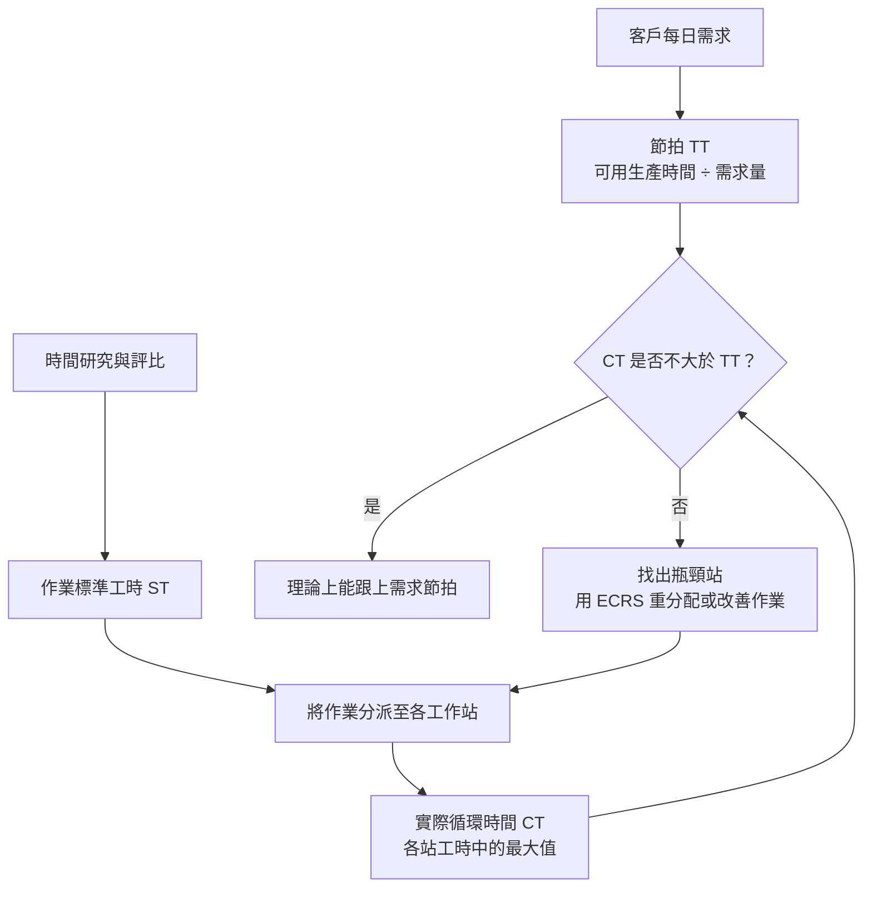
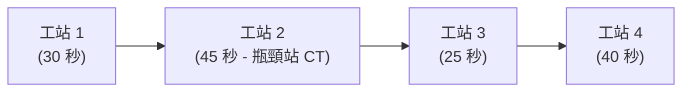

# 單元四：工業工程概論與標準工時

<figure class="unit-visual">
  
  <figcaption>3D 單元總覽<strong>圖解重點：</strong>比較有效與多餘動作，搭配夾治具、工位配置與時間量測；下方工作站負荷表現瓶頸、循環時間與線平衡改善的關係。</figcaption>
</figure>

## 1. 動作研究與動作經濟原則

工業工程（Industrial Engineering, IE）之基礎為方法工程（Methods Engineering）。法蘭克與莉蓮·吉爾布雷斯（Frank & Lillian Gilbreth）創立了動作研究（Motion Study），將人工作業解構成 17 個基本動素（Therbligs）。

### (1) 17 個基本動素分類
* **第一類：有效動素（Effective Therbligs）**：推進作業進展，不可任意刪減，但可設法簡化。包含：伸手（Reach）、抓取（Grasp）、移物（Move）、放手（Release）、使用（Use）、裝配（Assemble）、拆卸（Disassemble）、檢驗（Inspect）。動作研究的「有效」不等於精實觀點下每個動作都為顧客增值。
* **第二類：輔助動素（Semi-effective Therbligs）**：減緩作業進度，應盡量消除。包含：尋找（Search）、選擇（Select）、定位（Position）、預置（Pre-position）、持住（Hold）。
* **第三類：非直接作業動素**：包含思考（Plan）、遲延（Unavoidable Delay）、故延（Avoidable Delay）、休息（Rest for Overcoming Fatigue）。應減少可避免的等待與臨場猶豫；不可避免延誤與恢復疲勞的必要休息須合理安排，不可一律當成應刪除的浪費。

### (2) 動作經濟原則 (Principles of Motion Economy)
三大範疇是設計高效率人工工位之準則：
1. **關於人體之運用**：
   * 雙手應同時開始並同時完成動作。
   * 除休息時間外，雙手不應同時閒置。
   * 雙臂動作應呈對稱、反向且同時進行。
   * 動作級次應盡量降至最低（優先使用手指與手腕動作，避免轉身或全身彎腰）。
2. **關於工作場所之佈置**：
   * 工具與物料應放置於固定位置，以便形成手部肌肉記憶。
   * 工具、物料及操作按鈕應放置在正常作業範圍（Normal Working Area）內。
   * 採用重力餵料盒（Gravity Feed Bins）與落料機構，實現「重力墜送（Drop Delivery）」。
3. **關於工具與設備之設計**：
   * 盡量利用夾具或腳踏控制器解除手部持住（Hold）負擔。
   * 將兩種以上工具合併為複合工具（如附十字與平頭之雙頭起子）。

---

## 2. 馬錶時間研究與標準工時計算

時間研究（Time Study）旨在訂定合格作業員在正常工作速度與作業條件下，完成特定作業單元所需的時間標準。

### (1) 正常時間 (Normal Time, NT) 與評比技術 (Rating)
觀測時間（Observed Time, OT）受被測人員主觀快慢影響，必須藉由速度評比（Speed Rating）校正至標準水準（一般以 100% 代表正常速度）：

$$\text{NT} = \text{OT} \times \frac{\text{Rating Factor (\%)}}{100\%}$$

*西屋評比法（Westinghouse System）*的四項評估構面為：熟練度（Skill）、努力度（Effort）、工作環境（Conditions）、一致性（Consistency）。

### (2) 寬放率 (Allowance Rate) 與標準工時 (ST) 推導
作業員在工作期間必然會經歷生理需求、肉體與精神疲勞，以及非人為可控之微小偶發中斷。標準工時（Standard Time, ST）必須納入寬放時間（Allowance Time）。

寬放時間區分為四大類：
1. **私事寬放（Personal Allowance）**：喝水、上洗手間、擦汗（通常設定為 3~5%）。
2. **疲勞寬放（Fatigue Allowance）**：依作業姿勢、負重重量、光線與高溫環境動態調整。
3. **程序延誤寬放（Delay Allowance）**：等待天車就位、刀具正常磨耗更換。
4. **政策寬放（Policy Allowance）**：新進人員培訓期寬放。

#### 標準工時兩種計算方式辨析
* **外加法（Markup / Basis on Normal Time）**：寬放率以「正常時間」為基底計算：
  $$\text{ST} = \text{NT} \times (1 + \text{Allowance Rate})$$
* **內含法（Total Time Basis / Basis on Standard Time）**：寬放時間佔整體「標準工時」之特定百分比：
  $$\text{ST} = \frac{\text{NT}}{1 - \text{Allowance Rate}}$$

  

    
⏱️

    

      <h3 class="infographic-title">標準工時 (Standard Time, ST) 組成結構圖解</h3>
      
觀測時間 (OT) ➜ 評比校正 ➜ 正常時間 (NT) ➜ 寬放補正 ➜ 標準工時 (ST)；下圖為流程示意，區塊寬度不代表百分比，評比可能使時間增加或減少。

    

  

  

    

      
觀測時間 (OT)

      
評比校正

      
寬放時間 (AT)

    

    

      

        

        <strong>觀測時間 (OT)</strong>: 現場所測量未經修正的秒數
      

      

        

        <strong>正常時間 (NT)</strong>: $\text{OT} \times \text{Rating Factor}$ (熟練度/努力度)
      

      

        

        <strong>寬放時間 (AT)</strong>: 私事(3~5%) + 疲勞 + 程序延誤 + 政策
      

    

  

---

## 3. 生產線平衡 (Line Balancing) 與瓶頸改善

生產線平衡追求流水線上各工站負荷均勻化，消弭站與站之間的等待與在製品壅塞。

**三個時間不要混為一談：**ST 是單項作業的標準時間；TT 由客戶需求決定；CT 由現場最慢工站決定。

  

    
📊

    

      <h3 class="infographic-title">生產線工站負荷與平衡損失視覺化分析</h3>
      
瓶頸工站 (Bottleneck) 決定整體產線循環時間 (Cycle Time, CT)

    

  

  

    

      

        

          

          
30s

        

        WS1 (裁切)
      

      

        

          
45s ⚠️

        

        WS2 (瓶頸站)
      

      

        

          

          
25s

        

        WS3 (組裝)
      

      

        

          

          
40s

        

        WS4 (檢測)
      

    

  

### (1) 關鍵指標公式
* **節拍時間（Takt Time, TT）**：配合市場客戶需求步調所計算之理論節拍：
  $$\text{TT} = \frac{\text{每日淨有效生產時間}}{\text{每日客戶需求量}}$$
* **循環時間（Cycle Time, CT）**：相鄰產品完成的時間間隔。對每站單一資源、無停機且達穩定流動的串聯產線，其理論 CT 受最慢工站限制：
  $$\text{CT} = \max(\text{各工站標準時間}) = \text{WS}_2 (45 \text{ 秒})$$
* **理論最少工作站數（Theoretical Minimum Workstations, $N_{\min}$）**：
  $$N_{\min} = \left\lceil \frac{\sum_{i=1}^{n} \text{各作業單元時間}}{\text{CT}} \right\rceil$$
* **線平衡率（Line Balancing Efficiency, LE）**：
  $$\text{LE} = \frac{\sum_{i=1}^{K} \text{ST}_i}{K \times \text{CT}} \times 100\%$$
  其中 $K$ 為實際工作站總數，$\text{ST}_i$ 為第 $i$ 工作站之標準工時。
* **平衡損失率（Balance Delay, BD）**：
  $$\text{BD} = 100\% - \text{LE} = \frac{K \times \text{CT} - \sum \text{ST}_i}{K \times \text{CT}} \times 100\%$$

### (2) 數值範例
某裝配線共有 4 個工作站，工時分別為：$\text{WS}_1 = 30$ 秒、$\text{WS}_2 = 45$ 秒、$\text{WS}_3 = 25$ 秒、$\text{WS}_4 = 40$ 秒。
* 總作業工時 $\sum \text{ST} = 30 + 45 + 25 + 40 = 140$ 秒。
* 瓶頸站 $\text{CT} = 45$ 秒。
* 線平衡率 $\text{LE} = \frac{140}{4 \times 45} = \frac{140}{180} \approx 77.78\%$。
* 平衡損失率 $\text{BD} = 100\% - 77.78\% = 22.22\%$。

### (3) ECRS 改善四大原則
改善瓶頸站與提升線平衡率之思考順序：
1. **Eliminate（消除）**：該動作或工步能否直接去除？（如不必要的二次包裝或重覆檢驗）。
2. **Combine（合併）**：能否將工站 1 與工站 3 的微小作業合併至同一工位，精簡人力？
3. **Rearrange（重排）**：調換作業工序順序，將瓶頸站部分工步分流至前置或後置站點。
4. **Simplify（簡化）**：設計專用治具（Jig & Fixture）或導入氣動工具，加速瓶頸工步。

---

## 職能基準對照與實務解說

## 進階延伸：標準工時的建立、用途與限制

### 測時樣本與作業條件

時間研究應先把工作拆成可辨識、可重複的作業元素，記錄產品規格、操作者訓練狀態、設備、方法、批量與環境條件，再觀察多個週期。異常停機、缺料或返工不應不加辨別地混入正常週期平均；同時也不能只挑最快週期作為標準。評比是對觀測速度相對於正常速度的判斷，評比者間差異會直接影響正常時間，因此需有訓練與定期校準。

### 寬放率公式要先辨識定義

若寬放以正常時間為基礎，常見寫法為 ST = NT × (1 + A)；若寬放率定義為標準時間中的比例，則 ST = NT ÷ (1 − A)。兩者的 A 定義不同，題目未指定時應先辨認教材或企業採用慣例，不可混用。寬放需反映個人需求、疲勞與不可避免延誤，並須依工序與工作條件合理設定。

### 產能與線平衡的連結

節拍時間 TT = 可用生產時間 ÷ 客戶需求量，表示為滿足需求平均每件可用的時間；它不是機台實際加工時間。瓶頸站 CT 高於 TT 時，現有配置無法穩定達到需求速度。改善可從重新分配作業、平行站、治具改善、降低換線或移除非增值步驟著手；但須檢查技能、品質檢查點、設備安全與站間緩衝。理論最少工作站數為總作業時間除以目標週期時間後向上取整，實際配置還受先行關係限制。

### 情境推演：需求升高後重新定線

每日可用時間 420 分鐘，需求 210 件，TT = 2 分鐘／件。若三站工時為 1.2、2.3、1.4 分鐘，第二站是瓶頸，不能因平均工時低於 TT 就認定線體達標。可嘗試把第二站可分割作業移至第一或第三站，或設置平行工位，並以實際良品產出、等待與安全作業確認改善效果。

### 自我檢核

1. ST、TT、CT 分別描述什麼？哪一個由客戶需求推導？
2. 線平衡率上升但良品產出不變，可能還有哪些限制未被解決？

**判讀要點：**ST 是標準作業所需時間，TT 由可用時間與需求決定，CT 是實際工序週期；品質、停機、缺料、換線或瓶頸仍可能限制產出。

### 深度應用：由觀測時間推導標準工時

假設同一作業單元五次觀測時間為 0.48、0.50、0.52、0.49、0.51 分鐘，平均觀測時間 OT 為 0.50 分鐘。評比係數為 110%，則正常時間 NT 為 $0.50 × 1.10 = 0.55$ 分鐘。若寬放率為 15%：

* 外加法以 NT 為基底：$ST = 0.55 × (1 + 0.15) = 0.6325$ 分鐘。
* 內含法把寬放時間視為 ST 的比例：$ST = 0.55 ÷ (1 - 0.15) ≈ 0.6471$ 分鐘。

題目若只說「寬放率 15%」而未說採哪種定義，需依題目／教材約定確認計算式；不可把外加率與內含率直接互換。實務標準還需記錄作業方法、設備、材料、品質要求及量測日期，方法改變後應重新驗證。

### 延伸應用：把工時標準轉成每日產能

若有效生產時間為 420 分鐘、每日需求 600 件，TT 為 $420 ÷ 600 = 0.7$ 分鐘／件。若瓶頸站 CT 為 0.75 分鐘／件，產線無法跟上需求節拍；即使其他站都更快，瓶頸仍限制整線產出。改善後的目標不是讓每站都忙滿，而是將作業分配和標準工時重新平衡，使瓶頸 CT 不高於需求 TT，同時確認品質、安全及必要休息條件。

本章支援 **T4.3 配合新產品、新材料與新機台導入之測試生產**。新設備或方法變動後，不能直接沿用舊標準工時；應在品質、安全與作業條件穩定後，重新確認方法、量測時間與寬放，並以受控程序更新標準。

### 職能任務：以量測支持量產條件

T4.3 的目的不只是「試出能不能做」，而是確認量產時的 BOM、製程參數、設備能力與作業方法能穩定達成產品標準。標準工時是排程、成本、產能與績效的共同基礎；若它建立在尚未穩定的試作方法、單一熟練操作者或不安全的動作上，後續所有計畫都會被誤導。

進行時間研究前，應先確認作業方法、設備狀態、工件規格、量測起訖點與樣本代表性；觀測後依評比得到正常工時，再依適用的寬放規則求得標準工時。導入新機台時，還要重新確認 setup、run、檢驗、搬運與異常處置所需時間，而不是只引用設備型錄的理想速度。

### 改善與驗證的閉環

線平衡、動作經濟與 ECRS 是改善手段，驗證指標則應同時包含節拍、瓶頸負荷、品質、安全與人因負荷。例如縮短一個工站的工時後，仍要確認是否把工作轉移至下游、是否增加姿勢風險、首件是否符合規格，以及新方法是否已被納入受控作業文件。

### 常見誤區

* 把單次最快紀錄直接當作標準工時。
* 將寬放率用來遮掩方法不穩定、設備故障或不必要等待。
* 只追求工作站平均工時一致，卻忽略工序先後關係與需求節拍。

### 115 年第一次公告試題：先辨識時間，再驗證瓶頸

**對應 L11 第 7、8、21–23、31、32、35、36、39 題。**標準工時先將平均觀測時間乘評比係數得到 NT，再加寬放時間；不能把觀測時間與評比百分比直接相加。公告第 36 題的五次觀測平均為 1.10 分鐘，NT 為 $1.10×1.05=1.155$；採外加寬放 15% 得 $1.155×1.15=1.32825≈1.33$ 分鐘，與公告選項相符。內含法會得到約 1.36 分鐘，顯示同一個「15%」必須先確認分母。本章不據此推定所有未註明定義的題目都採外加法。

瓶頸比較先把秒／件、分／件、件／小時換成同一口徑。原創例：三站產能依序為 12、15、20 件／小時，穩態整線上限是 12 件／小時；第一站改善成 16 後，上限變成第二站的 15，不能宣稱整線增加到 16。又如不可拆分的作業時間為 4、7、5 分鐘，重新分站的理論最短 CT 下限為最長單一作業的 7 分鐘；它不同於現有配置中整站作業總時間的最大值。先行關係及資源限制仍可能使實際 CT 高於此下限。

**操作檢核：**先算 TT＝可用時間／需求，再算目前瓶頸 CT，確認 CT 是否大於 TT；改善後必須重新找瓶頸。用「可用時間／CT」算的是穩態理論產量，若題目另給空線起始、首件通過時間、換線或停機，還要扣除相應影響。動作改善則先依 ECRS 查刪除、合併、重排、簡化的機會，再比較雙手動作及正常伸及範圍；縮短工時仍須維持品質、安全與合理休息。

**自我檢核：**本例第一站改善後，若再把第三站從 20 提升至 25 件／小時，整線上限會變嗎？**答案：**仍為 15 件／小時，因第二站尚未解除限制。

### 試題判讀與選項辨析：單位、限制與改善後的新瓶頸

| 題號／公告答案 | 必要知識與判斷步驟 | 常見誤選理由 |
| :--- | :--- | :--- |
| 7／A | 同一週可用 40 小時、需求 800 件，TT 為 $40/800=0.05$ 小時／件，即 3 分鐘／件。 | 顛倒成 20 件／小時後卻仍標「小時」；速率與每件時間互為倒數，單位要一併改。 |
| 8／A；35／C；36／C | 先平均觀測，再乘評比得到 NT，最後加寬放。第 36 題採外加法得 1.32825 分鐘，約 1.33。 | 把評比係數直接加進分鐘，或未先平均就對個別極值計算。百分比相同但分母不同，外加與內含不可混用。 |
| 21／A | ECRS 是刪除、合併、重排、簡化；先確認工作是否必要，再考慮如何更快執行。 | 遇到低效率先購置工具簡化，使原本可刪除的搬運或重複動作被保留下來。 |
| 23／B | 不可再分割的作業元素中，最長者構成最短 CT 的下限；接著檢查先行關係與分站可行性。 | 以最短元素、平均值或總時間作為單站 CT 下限。總時間可用於估最少站數，不能與最長元素互換。 |
| 31／C；32／C | 常用工具置於正常伸及範圍，雙手合理同步；工作研究用觀察和分析建立更合理、有效率的方法。 | 為增加桌面空間而把工具放遠，或把方法改善誤當作追求人體極速、全面自動化或個人績效打分。 |
| 22／D；39／B | 全站換為相同速率或時間單位，找最慢站，再逐案重算改善後的整線上限。 | 只看被改善站的百分比，或以最快站估整線產能；瓶頸改善後下一慢站會接手限制。 |

**第 22 題的比較依據：**四站換為件／小時依序為 6、10、8、5，限制在丁。只提高甲、乙或丙仍受丁的 5 限制；丁由 12 分／件降為 10 分／件後，甲與丁同為 6 件／小時，因此整線理論上限由 5 提高為 6，而非其他站的 8 或 10。

**第 39 題的改善界線：**四站單件時間的最大值為 C 的 15 分鐘，480 分鐘的穩態理論量為 32 件。即使 C 改善至 10 分鐘以下，B 仍需 10 分鐘，未改善 B 前整線上限不超過 48 件；不能只寫「改善瓶頸」就直接推得 60 件。若從空線開工計有限班次的實際完成數，還須考慮首件通過時間，與此穩態上限分開。

## 深度研讀：工作抽樣、測時與可行的線平衡設計

### 工作抽樣估比例，連續測時估作業時間

工作抽樣在隨機時點觀察工作狀態。若 n 次獨立觀察中有 x 次等待，等待比例估計為 $\hat p=x/n$；在二項分布可用常態近似時，標準誤為 $\sqrt{\hat p(1-\hat p)/n}$，約 95% 信賴區間可用 $\hat p\pm1.96SE$。它反映抽樣不確定性，不代表每一班都必定落在區間內。觀察時點若總在整點、只看某位熟手，或多次觀察緊鄰而高度相關，公式就可能低估不確定性。

例如跨班隨機觀察 600 次，有 150 次等待，估計 25%，標準誤約 1.77 個百分點，區間約 21.54%–28.46%。這不代表寬放應設 25%；等待可能包含可改善缺料、故障及必要休息，應先分層。測時則記錄可重複作業的歷時，評比調整成正常時間，再加入定義清楚的寬放。兩種方法互補：前者找損失分布，後者建立方法與時間標準。二項比例近似及小樣本限制可參考 [NIST 比例信賴區間](https://www.itl.nist.gov/div898/handbook/prc/section2/prc241.htm)。

### 整合案例：理論需要兩站，為何原方法要三人

**完整輸入與假設：**單一產品，作業必須依 A→B→C→D，不可拆分、不可跨站交錯；同站可連續執行相鄰作業，每人操作一站，無額外搬運與平行設備限制。淨可用時間每天 390 分鐘、需求 390 件。A、C、D 正常時間為 30、24、20 秒。B 的五次觀測為 24、25、26、24、26 秒，評比係數 112%；四項作業均採以正常時間為基礎的外加寬放 12%。所有時間為練習假設，實務需另確認代表性。

本例 390 分鐘已扣固定休息與計畫停機；12% 只補尚未另外扣除的作業內合理寬放。同一段休息或延誤不能先從每日可用時間扣掉，又完整加進標準工時，否則會重複降低估計產能。

**第一步，建立共同時間基礎。**B 平均觀測為 25 秒，正常時間為 $25×1.12=28$ 秒。標準時間如下，不能只替 B 加寬放、其餘卻使用正常時間比較。

| 作業 | 正常時間（秒） | 標準時間（秒） |
| :--- | ---: | ---: |
| A | 30 | 33.60 |
| B | 28 | 31.36 |
| C | 24 | 26.88 |
| D | 20 | 22.40 |
| 合計 | 102 | 114.24 |

**第二步，求需求節拍及數量下限。**$TT=390×60/390=60$ 秒／件；理論最少站數為 $\lceil114.24/60\rceil=2$。但若分成兩個連續區段，A 單獨時後段需 80.64 秒；A+B 已需 64.96 秒，超過 60；再多放 C 只會更長。因此兩站沒有可行分組，數學下限不能當作已完成的設計。

**第三步，給出可執行方案。**先分為 A、B+C、D 三站，工時為 33.60、58.24、22.40 秒，CT 為 58.24 秒，可跟上需求；平衡率為 $114.24/(3×58.24)≈65.38\%$。低平衡率是觀察線索，不能因此刪除必要檢驗或直接撤一人。

**第四步，改方法後重新驗證。**若定位治具經試行證實可使 B 的正常時間減少 6 秒，且品質、姿勢及安全條件維持，B 新 ST 為 $22×1.12=24.64$ 秒。可改成 A+B＝58.24 秒、C+D＝49.28 秒的兩站，總 ST 為 107.52 秒，平衡率約 92.31%。CT 仍為 58.24 秒，主要成果是用兩個工作位置滿足原需求，而不是宣稱產出速度增加。人員能否轉任其他工作、培訓與換班是否可行，須納入落地計畫。

### 敏感度與驗證：不要用最佳單次值代替標準

治具若只在熟手的單次觀測節省 6 秒，還不能立即更新標準；應固定方法與品質條件，涵蓋代表性人員及批次重測。新增的治具取放、維護與檢查也要計入相關工序。外加寬放 12% 等價於標準時間內含比例 $0.12/1.12≈10.71\%$；不能把同一數字 12% 改放到分母，否則每個作業時間都會被再次放大。若方法尚不穩，擴大寬放不會替代根因改善。

人工作業與自動加工混合時，還要用人機作業圖確認重疊區間。若每循環裝卸夾料 8 秒、自動加工 32 秒、整理前一件 10 秒，而整理可完整放在自動加工期間，穩態循環為 $8+\max(32,10)=40$ 秒，不是把所有時間加成 50 秒；人的工作內容仍合計 18 秒。若整理必須等本件加工完成才能開始，或同一雙手還要服務其他機台，重疊假設便不成立。估人力時看人工負荷，估單機出件時看事件先行關係與設備週期，兩者不可用同一個加總答案取代。

### 進階練習與解析

**練習一：工作抽樣希望 95% 區間半寬不超過 3 個百分點，先導等待比例為 25%，約需幾次？**

**解析：**由 $e=1.96\sqrt{p(1-p)/n}$ 移項得 $n\ge1.96^2p(1-p)/e^2$。代 $p=0.25,e=0.03$ 得約 800.33，向上取整為 801 次，須扣除無效觀察後仍達此數。若完全不知道比例，以最保守的 $p=0.5$ 估算需 1,068 次；這是規劃近似，不是保證任何相依或偏差抽樣都達到精度。

**練習二：改善後需求增為每天 450 件，兩站方案還可行嗎？若增一站如何分？**

**解析：**新 TT 為 $390×60/450=52$ 秒；兩站 CT 58.24 秒大於 TT，無法在原工時跟上。可分 A、B、C+D 三站，時間為 33.60、24.64、49.28 秒，CT 49.28 秒低於 52，穩態理論產能約 $23,400/49.28≈474.84$ 件／天。仍須把啟動、缺料與良率等題目另列損失納入，不能將理論餘裕當成無條件交期保證。
