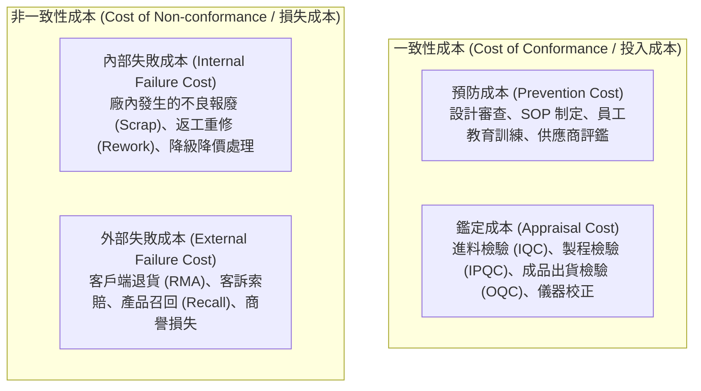
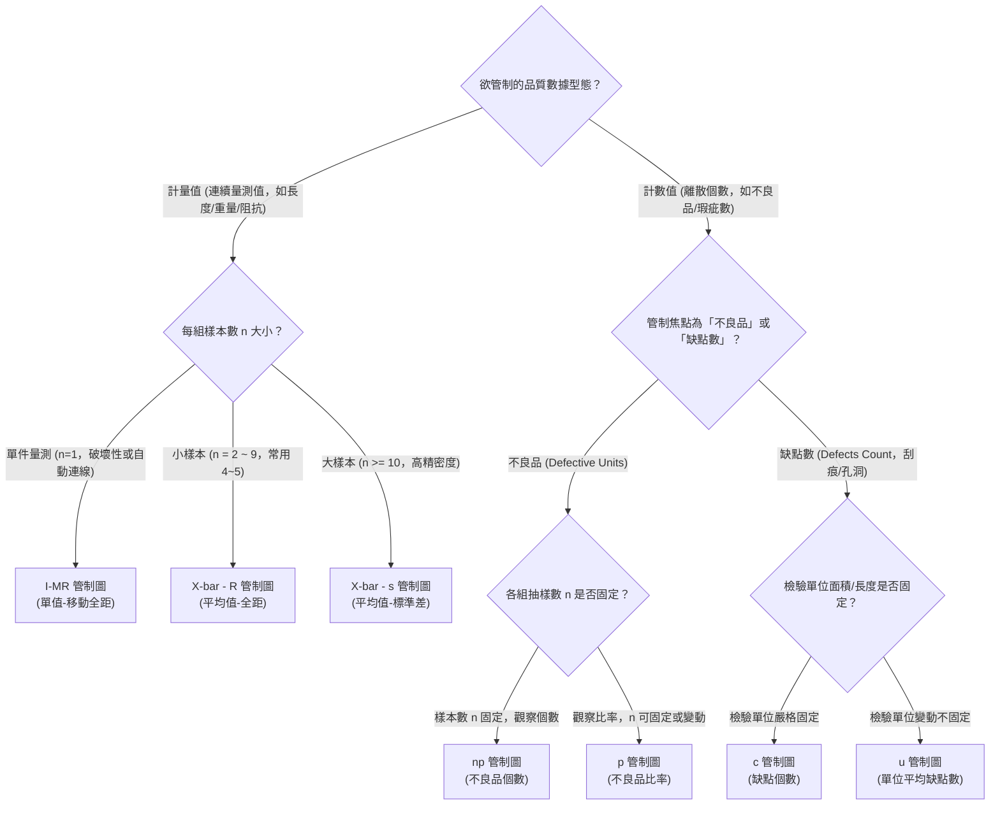
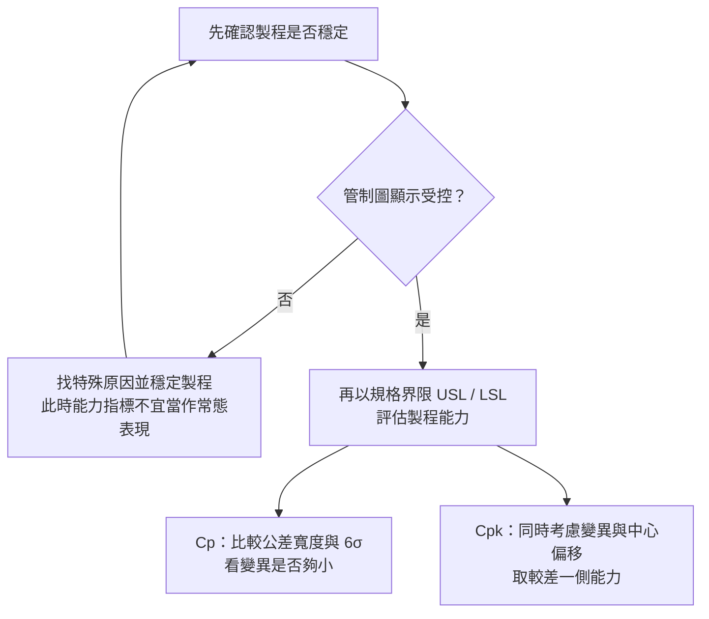
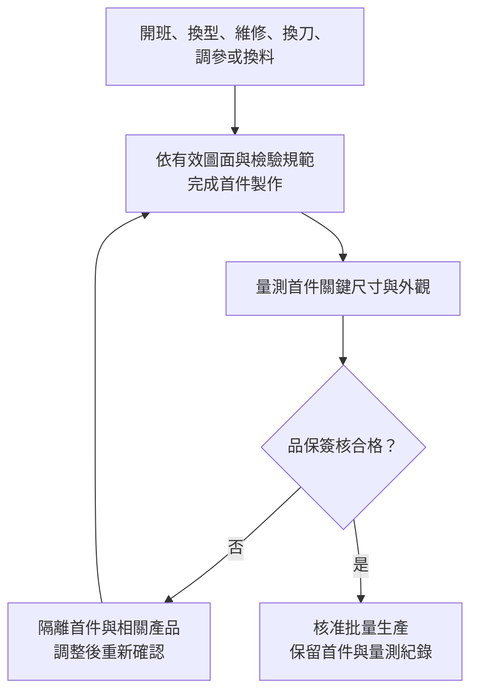

# 單元五：品質管理與統計製程管制

<figure class="unit-visual">
  
  <figcaption>3D 單元總覽<strong>圖解重點：</strong>將預防、量測/鑑定到不良隔離連結 PAF 品質成本；受控與異常訊號、能力分布與首件檢驗，對照 SPC、特殊原因及 Ca/Cp/Cpk 判讀。</figcaption>
</figure>

## 1. 品質成本 (Cost of Quality, COQ) 模型

現代品質管理強調「品質是製造出來的，不是檢驗出來的」。費根堡（Armand V. Feigenbaum）提出的 PAF 模型將品質成本區分為四大類：

有效的預防措施有機會降低內部與外部失敗成本；應以總品質成本及不良損失的實際變化確認成效，不能假設任何預防支出增加都必然使總成本下降。

---

## 2. 統計製程管制 (SPC) 與管制圖原理

沃爾特·休哈特（Walter A. Shewhart）指出，製程變異來自兩種原因：
* **偶然原因（Common Causes / 逢機原因）**：系統固有、由無數微小隨機因子累積而成（如環境濕度微幅飄移、原料批次容差），在統計上呈現穩定受控狀態。
* **異常原因（Special Causes / 指派原因）**：由外在突發變異引起（如刀具斷裂、夾具鬆脫、作業員拿錯零件料號），使製程失控（Out of Control），須依反應計畫排查、保全產品；必要時停機。

### (1) 管制圖選型判定
管制圖由中心線（Center Line, CL）、管制上限（Upper Control Limit, UCL）與管制下限（Lower Control Limit, LCL）組成，界限通常設定為 $\pm 3\sigma$。

| 數據類型 | 管制圖名稱 | 適用情境與樣本特徵 |
| :--- | :--- | :--- |
| **計量值 (Variable)** | $\bar{X}-R$ 管制圖 | 樣本數 $n$ 較小（通常 $n=4 \sim 6$），以極差 $R$ 估算變異，計算快速 |
| **計量值 (Variable)** | $\bar{X}-s$ 管制圖 | 樣本數 $n \ge 10$，改用樣本標準差 $s$ 估算離散度，統計效能高 |
| **計量值 (Variable)** | $I-MR$ 管制圖 | 單值-移動極差，適用於破壞性檢測或自動化單件連續量測（$n=1$） |
| **計數值 (Attribute)** | $p$ 管制圖 | 「不良率（Fraction Nonconforming）」；$n$ 可固定或變動，變動時依各組 $n_i$ 計算界限 |
| **計數值 (Attribute)** | $np$ 管制圖 | 各組樣本大小 $n$ 嚴格固定時的「不良品個數」 |
| **計數值 (Attribute)** | $c$ 管制圖 | 固定檢驗面積/體積/單位內的「缺點數（Defects count）」，如鋼板表面刮痕數 |
| **計數值 (Attribute)** | $u$ 管制圖 | 檢驗面積或單位不固定時的「單位平均缺點數」 |

### (2) 管制圖失控判準 (Nelson Rules 核心準則)
依事先選定的判讀規則，管制圖出現下列特徵時表示有失控訊號，應依反應計畫確認原因及產品風險，決定隔離、調整或停機：
1. 任何 1 點落在 $\pm 3\sigma$ 管制界限（UCL 或 LCL）之外。
2. 連續 9 點落在中心線（CL）的同一側（代表中心點已漂移）。
3. 連續 6 點持續上升或持續下降（代表趨向性磨損或溫度累積）。
4. 連續 14 點上下交錯交替跳動（代表不同批次原料或兩班作業員交替干擾）。

---

## 3. 製程能力分析 (Process Capability)

製程能力評估「受控狀態下之製程，其產出品質滿足工程規格公差的能力」。工程公差範圍由規格上限（Upper Specification Limit, USL）與規格下限（Lower Specification Limit, LSL）決定，公差寬度 $T = \text{USL} - \text{LSL}$，規格中心值 $\mu = \frac{\text{USL} + \text{LSL}}{2}$。

### (1) 製程準確度 (Capability of Accuracy, Ca)
衡量樣本平均值 $\bar{X}$ 偏離規格中心值 $\mu$ 的程度：

$$\text{Ca} = \frac{\bar{X} - \mu}{T / 2} \times 100\%$$

* 以下 Ca 分級僅為教材示例，實際門檻依客戶與控制計畫訂定：
  * $|\text{Ca}| \le 12.5\%$：A 級（優良，中心無明顯偏移）。
  * $12.5\% < |\text{Ca}| \le 25\%$：B 級（正常，應檢討模具定位）。
  * $25\% < |\text{Ca}| \le 50\%$：C 級（偏移較大，應評估風險與調整）。
  * $|\text{Ca}| > 50\%$：D 級（偏移嚴重，依反應計畫保全產品、確認與調整）。

### (2) 製程精密度 (Capability of Precision, Cp)
衡量製程產出數據本身的離散寬度（$6\sigma$）相較於規格公差寬度（$T$）之充裕程度，不考慮中心偏移：

$$\text{Cp} = \frac{\text{USL} - \text{LSL}}{6\sigma}$$

* 解讀示例，是否允收仍須依客戶要求及資料條件判斷：
  * $\text{Cp} \ge 1.33$：公差相對散布較有餘裕，仍須確認中心位置及 Cpk。
  * $1.00 \le \text{Cp} < 1.33$：餘裕較小，不能僅憑 Cp 宣告量產合格。
  * $\text{Cp} < 1.00$：模型估計的 $6\sigma$ 散布寬於公差，規格外風險較高；不是每一批或每一件必定不良。

### (3) 綜合製程能力指數 (Process Capability Index, Cpk)
兼顧準確度（中心偏移）與精密度（數據離散）之綜合指標：

$$\text{Cpk} = (1 - |\text{Ca}|) \times \text{Cp} = \min\left( \frac{\text{USL} - \bar{X}}{3\sigma}, \frac{\bar{X} - \text{LSL}}{3\sigma} \right)$$

> **判讀區別：**管制界限由製程資料估計，用來判斷穩定性；規格界限由設計或客戶訂定，用來判定產品是否符合要求。製程穩定是解讀能力指標的前提。

* 實務可見 1.33、1.67 等 Cpk 門檻，但它們不是適用所有產品的統一允收標準，須依客戶、風險與控制計畫使用。Cpk 也不能在未說明分布、中心偏移及長短期假設時，直接換成固定的 PPM 不良率。

---

## 4. 首件檢驗 (First Article Inspection, FAI)

首件檢驗是現場防止大批量報廢最重要的防線。

* **觸發時機**：
  1. 每個工作班次交接初次開工時。
  2. 更換產品型號或生產批次時。
  3. 機台設備大修、更換刀具或更換主要模具後。
  4. 調整關鍵製程參數（如射出壓力、爐溫曲線）後。
  5. 更換關鍵原物料供應商批次時。
* **執行重點**：通常量測前 3~5 件產品，嚴格依據檢驗規範（Inspection Standard）比對所有尺寸公差與外觀特徵，經品保人員（IPQC）簽核認可後方能啟動批量生產。

---

## 職能基準對照與實務解說

## 進階延伸：由量測資料形成品質反應

### 先確認量測系統，再判讀製程

製程能力分析以前提為量測系統能分辨製程變異。量具解析度不足、校正逾期、操作方法不一致或量測偏差，可能令管制圖與 Cp／Cpk 得出誤導結論。量測系統分析（MSA）可檢視偏倚、線性、穩定性及重複性／再現性（Gage R&R）；改善順序通常先處理量測可信度，再判斷製程穩定與能力。

### 管制界限與規格界限的區別

管制界限由製程資料的統計特性估計，用來監視製程是否出現特殊原因；規格界限由設計、客戶或法規要求訂定，用來判斷產品是否符合要求。製程穩定不代表符合規格，符合規格的少量樣本也不代表製程穩定。能力指標 Cp 衡量規格寬度相對於製程散布，Cpk 同時考量中心偏移；這些指標應在合理穩定且資料條件適用時使用。

### 計數型圖表的選擇

不良率可用 p 圖，樣本大小固定或變動皆可，變動時須按各組樣本量計算界限；若樣本大小固定且希望直接看不良品數，可考慮 np 圖。缺點數若檢查單位大小固定，可用 c 圖；檢查單位大小變動時可用 u 圖。缺點數與不良品數是不同概念：一件產品可能有多個缺點，但在不良品率統計中通常只計為一件不良品。選圖時先確認資料型態、抽樣單位與樣本大小是否固定。

### 異常反應的閉環

訊號超出管制界限或呈現非隨機型態時，先保護客戶與在製品、確認量測及資料來源，再依時間、設備、材料、方法、人員或環境分層追查特殊原因。確認原因後採取矯正措施，驗證改善持續性，必要時更新控制計畫、作業標準與訓練。單純刪除異常點或重算界限，可能掩蓋問題；只有找到可說明的特殊原因並符合程序，才考慮排除資料。

### 自我檢核

1. 製程穩定但 Cpk 偏低，代表什麼可能性？
2. 每次抽檢數量不同且資料為不良品比例，應優先考慮哪一類管制圖？

**判讀要點：**穩定但能力低可能表示自然變異過大或製程中心偏移；樣本量變動的不良率資料通常用 p 圖。

### 深度應用：穩定性與能力要分兩步判讀

某尺寸規格為 9.90～10.10 mm，製程平均值為 10.03 mm、標準差為 0.02 mm。則 $Cp = (10.10 - 9.90) ÷ (6 × 0.02) ≈ 1.67$；$Cpk = \min((10.10 - 10.03)/(3 × 0.02), (10.03 - 9.90)/(3 × 0.02)) ≈ 1.17$。Cp 顯示變異相對公差有餘裕，但 Cpk 因平均值偏向規格上限而較低。改善時要辨認是中心偏移還是波動過大，對應調機校正或降低特殊變異。

這個解讀成立的前提是製程在觀測期間穩定。先用管制圖辨識特殊原因，再用規格界限與能力指標評估能力。管制界限不能拿來當產品允收界限；即使所有樣本都在規格內，也不能據此證明製程長期穩定。

### 延伸管理：品質成本與反應計畫

品質成本分為預防、鑑定、內部失敗與外部失敗。加強預防及製程監控可能增加前端投入，卻有機會降低返工、報廢、退貨與客訴；評估改善應比較同一產品範圍和期間的總成本，不只比較單一檢驗費。出現失控訊號或 FAI 不合格時，先依反應計畫停線／隔離、確認影響批次及原因，完成矯正與再驗證後才恢復放行。

本章對應 **T3.2 監控生產線之良率與故障退回並收集及分析品質數據**。P3.2.1 強調即時檢驗、蒐集與分析品質資料，以領先指標及早辨識異常、界定影響範圍並阻止不良擴大；管制圖與能力指標應服務於這個閉環，而非只做報表。

### 職能任務：從檢驗結果走向即時控制

P3.2.1 要求確實執行品質檢驗、即時收集與分析數據，掌握生產線品質領先指標。完整的品質閉環是「依規格量測 → 判定製程是否受控 → 依反應計畫處置 → 界定受影響產品 → 驗證對策 → 回饋標準」。因此，良率是結果指標；異常趨勢、首件確認、關鍵參數漂移與重工率等，往往更早提供改善訊號。

資料收集前應先定義 CTQ、量測方法、抽樣頻率、產品／機台／班別等分層欄位及異常反應。管制圖的界限是依製程數據推估的行為界限，不等於產品規格界限；Cp／Cpk 是製程能力資訊，也不應在量測系統、製程穩定性未確認前孤立解讀。

### 現場判讀範例

若管制圖出現超界點，先確認量測與資料登錄，再依反應計畫保全產品、檢查製程條件與追查特殊原因。若不良集中在特定設備或班別，應以人、機、料、法、環、測分層驗證，而非直接歸咎個人。對已出貨風險，追溯資料還須能界定受影響批次與處置狀態。

### 常見誤區

* 為了讓圖表「正常」而刪除異常點或任意調整管制界限。
* 把管制內誤認為必然符合規格，或把 Cp 高誤認為製程已置中。
* 首件不合格仍先量產，事後才以篩選取代製程修正。

### 公告試題補強：p 圖界限與品質工具選用

p 管制圖的中心線是平均不良率 $\bar p$，每組樣本數為 $n$ 時，標準差為 $\sqrt{\bar p(1-\bar p)/n}$；因此樣本數增加，UCL 與 LCL 會往中心線收窄，反映比例估計更精確。若計算出的 LCL 小於 0，實務上取 0。管制界限依穩定製程資料估計，不可直接用產品規格上下限代替。

七大品管工具要依問題選：查檢表蒐集分類資料、散佈圖檢視兩變數關係、魚骨圖列出待驗證的可能原因、管制圖追蹤時間序列中的穩定性。魚骨圖提出的是假設，不是根因證明；散佈圖顯示關聯，也不能單獨證明因果。品質成本題則分清預防、鑑定、內部失敗及外部失敗成本。

### 115 年第一次公告試題：從統計訊號走到正確決策

**對應 L11 第 41–50 題。**在相同平均不良率下，p 圖的樣本數變為 4 倍，抽樣標準差和未截斷的界限半寬會減為一半；不是產品規格突然變嚴，也不是不良率自動下降。初始管制圖須先定義品質特性、合理分組、樣本大小與頻率，蒐集能代表日常運作的資料，再估計界限、查證特殊原因並建立後續反應計畫。不能只為不影響產速而任取少量資料，也不能刪掉超界點讓圖形看似受控。受控表示在既定條件下變異較可預期，仍有隨機波動，不能保證每件結果確定或都符合規格。

**原創工具判讀：**想知道溫度與尺寸是否有關，先畫散佈圖；想列出尺寸超差的可能原因，用魚骨圖；想找哪類缺陷占主要損失，用柏拉圖；想看尺寸隨時間是否漂移，用管制圖。散佈圖看似正相關時，還要排除不同機台、材料或產品混在一起的影響，不能直接宣稱提高溫度必然造成尺寸增加。

品質成本依**支出的目的及不良發現時點**判斷：建立訓練與預防制度屬預防；為確認符合性而檢驗、測試屬鑑定；出貨前的報廢、重工屬內部失敗；客戶退貨、保固屬外部失敗。公告第 48 題將多種活動寫在同一選項，應留意其用語口徑，不將「所有品質管制程序」直接歸入同一類。TQM 則以顧客滿意、全員參與、流程與持續改善為基礎；團隊參與決策仍須由資料與分析支持，不能以多數決取代驗證。此處通用原理可對照 [ASQ 品質成本](https://asq.org/quality-resources/cost-of-quality)與 [ASQ TQM](https://asq.org/quality-resources/total-quality-management)說明。

**自我檢核：**「教育訓練、出貨測試、廠內重工、保固維修」依序是哪四類？**答案：**預防、鑑定、內部失敗、外部失敗。再用一句話說明：管制內為何不等於合格？因管制界限描述製程行為，規格界限描述顧客／工程要求，兩者來源與用途不同。

### 試題判讀與選項辨析：統計判斷與公告答案的界線

| 題號／公告答案 | 必要知識與判斷步驟 | 常見誤選理由 |
| :--- | :--- | :--- |
| 41／B | 固定平均不良率時，比較 $\sqrt{\bar p(1-\bar p)/n}$：n 增加，未截斷的界限半寬縮小。 | 把抽樣精度提高說成製程不良率下降或產品規格變嚴；若 LCL 已截為 0，須區別理論半寬與實際顯示寬度。 |
| 42／D；44／A | 受控仍有共同原因的隨機波動；初始界限要由有代表性的合理分組資料估計、檢查與驗證。 | 認為 SPC 可讓未來每件結果確定，或只為不打擾生產就任取少量資料。找到並矯正特殊原因後才按程序處理資料，不能逢超界就刪點。 |
| 43／C；46／B；47／B | 先辨問題：品質現場分析選適合工具；兩連續變數的關係用散佈圖；可能原因展開用魚骨圖。 | 把查檢表當相關分析，或把魚骨圖列出的原因當成已證實根因；有關聯也不等於因果。 |
| 48／A；50／C | 先看支出目的，再看不良於交付前或後發現；訓練／制度預防、符合性檢查鑑定、廠內不良內部失敗、客戶端不良外部失敗。 | 僅以部門、設備名稱或「品質」字樣分類。同一筆品管程序費用可能要依工作目的拆分，不能整包歸入一類。 |
| 49／C | 分清全員參與和決策依據：TQM 支持跨部門參與，但決策須以事實、分析和顧客要求支持。 | 為配合答案而推論團隊合作不屬 TQM，或反過來認為多數同意便足以證明改善有效。 |

**三題須保留的用語限制：**已核對 PDF 第 9 頁的完整題目與答案欄，以下代號並非文字抽取錯位。

- **第 45 題公告 A：**題面未交代品項已被預先指定，故不能據此得出「使用管制圖不必決定監控哪個品項／品質特性」。可確定要規劃圖種、樣本大小與頻率；完整實務仍須先定義監控對象、量測方法及合理分組。本教材保留公告答案，不替題面補上未提供的前提。
- **第 48 題公告 A：**檢查、測試等符合性評估本身確可屬鑑定成本；「品質管制程序」涵義較廣，須依實際工作目的分類。不能因公告選 A，就把所有檢驗設備或測試費改列成預防成本。題中的資料蒐集／分析與問題解決，也同樣須看其預防、鑑定或失敗處理目的。
- **第 49 題公告 C：**僅憑該詞不能推論團隊參與一律不正確；[ASQ 的 TQM 說明](https://asq.org/quality-resources/total-quality-management)同時包含全員參與及依事實決策。公告答案應與通用原理分別保存，不能將「不用團隊」當成 TQM 的學習結論。

管制圖初始資料、界限用途及重新估計的限制，可對照 [NIST 管制圖說明](https://www.itl.nist.gov/div898/handbook/pmc/section3/pmc32.htm)；品質成本判別依[ASQ 品質成本分類](https://asq.org/quality-resources/cost-of-quality)的活動目的檢核。

## 深度研讀：從 MSA、SPC 到能力分析與反應計畫

### 三道判斷的順序與公式來源

量測系統分析（MSA）先問資料能否辨識製程，SPC 再問製程是否穩定，能力分析最後比較穩定分布與規格。校正有效不能代替重複性、再現性、偏倚、解析度與時間穩定性的確認。以互相獨立的誤差成分為簡化模型，量具重複性與人員再現性的變異數相加，因此

$$\sigma_{GRR}=\sqrt{\sigma_{repeat}^2+\sigma_{reprod}^2}$$

不能把兩個標準差直接相加。$6\sigma_{GRR}/(USL-LSL)$ 表示量測散布相對公差的比例，與 $\sigma_{GRR}/\sigma_{total}$ 的分母不同，不可混稱同一種 GRR 百分比。適用門檻需依產品風險、客戶及用途核定；本節不以任何百分比作通用合格線。研究設計與變異來源可參考 [NIST Gauge R&R](https://www.itl.nist.gov/div898/handbook/mpc/section4/mpc4.htm)。

對固定大小的合理子組，組內全距平均值可估計短期標準差 $\hat\sigma_w=\bar R/d_2$。平均值圖使用平均值的抽樣變異，而非單件標準差直接畫界限，故 $UCL_{\bar X}=\bar{\bar X}+A_2\bar R$。能力指數則用單件散布的 $6\sigma_w$ 與規格比較。這正是「每件合格、平均值仍失控」可以同時發生的原因。

### 整合案例：同一張報表，應先處理哪個問題

**完整輸入與假設：**尺寸單位 mm，LSL＝9.90、USL＝10.10。量具研究涵蓋代表性工件與操作員，先得到重複性標準差 0.006、再現性 0.008，兩成分在模型中視為獨立。改進定位與操作方法後，分別降為 0.003、0.004；其他偏倚與校正檢核已完成。量測適用性須由本案品質負責人核准，不能只由下列比率宣告通過。

**第一步，量測改善確認。**原 $\sigma_{GRR}=0.010$，其六倍散布占公差 $0.060/0.200=30\%$；改善後為 0.005，占 15%。數字顯示量測散布降低，但不同目的的量測是否足夠，仍需連同誤判風險判斷；也不能把改善量具後較窄的分布全當成製造方法改善。

**第二步，建立穩定基線。**使用改善後量具，跨正常生產條件蒐集 25 組、每組連續 5 件；已確認組內／組間安排合理、沒有失控訊號及明顯非常態。給定 $\bar{\bar X}=10.040$、$\bar R=0.04652$。本例取 $d_2=2.326,A_2=0.577,D_3=0,D_4=2.115$，得 $\hat\sigma_w=0.020$；平均值圖界限約為 10.01316、10.06684，R 圖上限約 0.0984、下限 0。常數與基本建圖式可對照 [NIST 平均值及全距圖](https://itl.nist.gov/div898/handbook/pmc/section3/pmc321.htm)。

**第三步，能力評估。**$Cp=0.20/(6×0.020)=1.667$，但 $Cpk=\min[(10.10-10.04)/0.060,(10.04-9.90)/0.060]=1.000$。散布相對公差不算寬，均值卻偏向上限；直接購買更精密設備未必是第一個對策。若製程允許且經驗證，先改善置中可能更有效。此數字是樣本估計，不能當作保證的未來良率。

**第四步，處理新訊號。**第 26 組為 10.055、10.065、10.075、10.085、10.095，五件均在規格內，但平均 10.075 超過平均值圖 UCL，全距 0.040 仍在 R 界限內。應先確認量測與登錄，再依反應計畫保全自最後已知正常檢查點起的相關批次，調查刀具、定位、材料或參數變動，驗證首件及後續趨勢後恢復。不能為讓第 26 組「合格」便立即重算較寬界限，也不應繼續套用舊能力值描述已偏移的製程。

### 邊界與敏感度：能力不是一個脫離時間的分數

若資料混合兩台不同均值機台，合併直方圖可能遮掩各自的變化；若資料自相關、非常態或只有單邊規格，應採合適方法，而非硬套雙邊常態模型。組內標準差與全部資料的整體標準差也不可隨意交換，應註明估計方式與期間。不能從觀測變異中任意扣除 GRR，藉此把 Cpk 調高；量測與製程模型、獨立性及不確定性都要有依據。穩定及常態等條件可參考 [NIST 製程能力](https://itl.nist.gov/div898/handbook/pmc/section1/pmc16.htm)。

換料、換刀或方法改善之後，若有意改變製程，應將新舊資料分開保存，先驗證新條件的穩定性，再依核准程序建立新基線。更新界限的理由是製程已受控地改變，不是單純因為有超界點。反應計畫需寫明誰確認量測、誰決定產品隔離範圍、誰核准恢復，以及如何證明對策持續有效；只有一張管制圖而沒有這些責任與時間紀錄，無法形成可追查的品質控制。

### 進階練習與解析

**練習一：標準件認證值為 10.000，量具多次量測平均 10.012，重複標準差僅 0.003；是否可因重複性好而忽略偏倚？**

**解析：**估計偏倚為 $10.012-10.000=+0.012$ mm，與重複性散布是不同問題。讀值很集中仍可能整體偏高，使接近規格邊界的產品被誤判。應確認標準件不確定度、量測環境及校正模型，依核准程序修正並驗證；不能擅自把所有讀值減 0.012 而不留校正與適用範圍紀錄。

**練習二：比較兩個已驗證穩定的新方案。方案甲均值調至 10.000、標準差仍 0.020；乙均值仍 10.040、標準差降為 0.015，哪個 Cpk 較高？**

**解析：**甲 Cp 不變仍 1.667，置中後 Cpk 也為 $0.100/0.060=1.667$。乙 Cp 為 $0.200/0.090=2.222$，但 Cpk 只有 $0.060/0.045=1.333$。甲的 Cpk 較高，說明改善偏移與改善散布不同；選擇還需比較成本、可維持性及客戶規格，不能只按 Cp 最大者決策。
