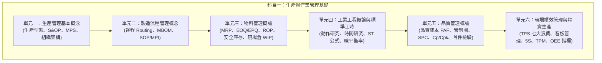

# 科目一：生產與作業管理基礎 (Foundations of Production and Operations Management)

依據經濟部產業人才能力鑑定標準（職能基準代碼：**MPM3117-001v3**），本科目著重評量傳統製造營運、生產管制與工業工程（Industrial Engineering, IE）基礎理論與實務運算能力。

## 115 年度初級評鑑範圍對照

本教材依 [115 年度智慧生產工程師能力鑑定簡章（官方）](https://www.ipas.org.tw/api/proxy/uploads/certification/SPE/115%E5%B9%B4%E5%BA%A6%E6%99%BA%E6%85%A7%E7%94%9F%E7%94%A2%E5%B7%A5%E7%A8%8B%E5%B8%AB%E8%83%BD%E5%8A%9B%E9%91%91%E5%AE%9A%E7%B0%A1%E7%AB%A0%28%E5%88%9D%E3%80%81%E4%B8%AD%E7%B4%9A%29_20251229140907.pdf) 的 L11 主題加深說明，以下案例與計算是學習示例，不是官方試題。

| 官方評鑑主題 | 本教材對應 | 擴充重點 |
| :--- | :--- | :--- |
| L111 生產管理基本概念：生產計畫、組織、控制、統籌 | 單元一 | MPS／ATP、產能負荷與交期承諾整合案例 |
| L112 製造流程管理：途程、MBOM、標準作業程序 | 單元二 | BOM 用量展開、MLT、工程變更與文件版次案例 |
| L113 物料管理：MRP、WIP／現場倉、物料進出 | 單元三 | 逐期淨需求推算、LT 平移與收發料狀態管理 |
| L114 工業工程：工作研究、標準工時、稼動率／良率／效率 | 單元四；單元六補充 | 測時推導、TT／CT、產能和設備效率判讀 |
| L115 品質管理：管制圖、品質分析與管制、品質成本 | 單元五 | SPC 與能力分析分流、Cpk 計算和反應計畫 |
| 跨主題延伸：精實與現場改善 | 單元六 | 看板數量、OEE、MTBF／MTTR 與改善成效 |

官方簡章列出 L111–L115 五項 L11 評鑑主題；單元六以精實、TPM 與 OEE 作為現場管理及效率分析的延伸研讀內容。

---

## 評鑑單元架構

---

## 單元學習文件清單

1. [01_生產管理基本概念.md](./01_生產管理基本概念.md)：解析備貨型生產（Make to Stock, MTS）、訂單型生產（Make to Order, MTO）與裝配型生產（Assemble to Order, ATO）差異，以及銷售與營運規劃（Sales and Operations Planning, S&OP）與主生產排程（Master Production Schedule, MPS）。
2. [02_製造流程管理概念.md](./02_製造流程管理概念.md)：途程表（Routing Sheet）定義、工程物料清單（Engineering BOM, EBOM）轉換製造物料清單（Manufacturing BOM, MBOM）邏輯、作業指導書（Manufacturing Process Instruction, MPI）與標準作業程序（Standard Operating Procedure, SOP）。
3. [03_物料管理概論.md](./03_物料管理概論.md)：物料需求規劃（Material Requirements Planning, MRP）毛需求與淨需求推演、經濟訂購量（Economic Order Quantity, EOQ）、再訂購點（Reorder Point, ROP）、安全庫存（Safety Stock, SS）與現場在製品（Work in Process, WIP）管制。
4. [04_工業工程概論與標準工時.md](./04_工業工程概論與標準工時.md)：馬錶時間研究、評比技術（Rating Factor）、內含與外加寬放率（Allowance Rate）計算標準工時（Standard Time, ST）、節拍時間（Takt Time, TT）、循環時間（Cycle Time, CT）與生產線平衡率（Line Balancing Efficiency）。
5. [05_品質管理與統計製程管制.md](./05_品質管理與統計製程管制.md)：預防-鑑定-失敗（PAF）品質成本模型、計量值管制圖（$\bar{X}-R$）與計數值管制圖（$p, c$）、製程能力指標（$Ca, Cp, Cpk$）與首件檢驗（First Article Inspection, FAI）。
6. [06_精實生產與現場績效管理.md](./06_精實生產與現場績效管理.md)：豐田生產系統（Toyota Production System, TPS）七大浪費判定、看板拉動系統（Pull System）、防呆機制（Poka-Yoke）、全面生產維護（Total Productive Maintenance, TPM）與整體設備效率（Overall Equipment Effectiveness, OEE）拆解。

## 依 115 年第一次 L11 公告試題安排複習

公告試題把概念辨識、情境判斷與計算混在同一份卷內。建議按以下題號回到教材練習；題號是學習索引，不代表下一次命題比例。

| 試題題號（主要對照，合計 50 題） | 優先教材 | 可檢核的學習目標 |
| :--- | :--- | :--- |
| 2–4、6、9–15、28–30（14 題） | [單元一／M11101](./01_生產管理基本概念.md) | 依情境說明策略、MPS 與派工的層級差異，分辨佈置、欄柵、容量與 DRP 管理對象。 |
| 17、19–20、24–25、38（6 題） | [單元二／M11102](./02_製造流程管理概念.md) | 以用料、工序和操作要求選擇文件；檢核 SOP 可執行性，區分流程時間、CT 與產出速率。 |
| 1、5、16、18、26–27（6 題） | [單元三／M11103](./03_物料管理概論.md) | 區分總成本和隨批量變動的成本；先淨算母項再展料，解釋低階碼及需求日期錯置。 |
| 7–8、21–23、31–32、35–36、39（10 題） | [單元四／M11201](./04_工業工程概論與標準工時.md) | 正確換算 TT、ST 與瓶頸產能，說明 ECRS、人因與最短 CT 下限，重算改善後的新限制。 |
| 41–50（10 題） | [單元五／M11202](./05_品質管理與統計製程管制.md) | 根據資料型態與問題選圖，按活動目的分類品質成本；保留第 45、48、49 題公告答案與原理差異。 |
| 33–34、37、40（4 題） | [單元六／M11203](./06_精實生產與現場績效管理.md) | 區分故障與換線損失，依相同時間層級判讀工時，回推設計產能並解釋 WIP 週轉。 |

六章均有「試題判讀與選項辨析」，按實際題號說明判斷步驟和誤選原因；以上只指定主要章節，跨章知識仍可互相參照，並非重新宣稱官方命題分類或下次出題比例。做計算題時，先寫清楚單位、題目給定的可用時間與公式，再代入數值；標準工時題要先確認寬放率採外加或內含定義。公告題的逐科對照與計算檢核表見[官方學習資源與參考書目導引](../歷屆試題與解題技巧/官方學習資源與參考書目導引.md)。

接著可練習[試題導向實戰練習中的 L11 題組](../歷屆試題與解題技巧/115第一次試題導向實戰練習.md#l11生產與作業管理基礎)，以 MRP、標準工時、p 管制圖和瓶頸產能驗證計算步驟。

## 各章深度研讀任務

每章的「深度研讀」以原創整合案例連接推導、決策與驗證，並附兩題進階練習解析。先遮住答案完成計算，再改動一項條件，說明原結論是否仍成立；案例中的成本、門檻與供給條件均須按其明示假設使用。

| 章節 | 深度研讀重點 | 應能提出的判斷 |
| :--- | :--- | :--- |
| [生產管理](./01_生產管理基本概念.md) | MPS、預計可用量、ATP、有限瓶頸產能 | 需求預測改變與實際接單如何分別影響庫存及交期承諾？ |
| [製造流程](./02_製造流程管理概念.md) | BOM 版次、生效序號、途程與在製品處置 | 工程變更後哪些工件需改版、補料、重工或隔離？ |
| [物料管理](./03_物料管理概論.md) | 六週多階 MRP、整倍批量、LT 與需求來源 | 數量正確但下單日期已過時，應如何回饋上階計畫？ |
| [工業工程](./04_工業工程概論與標準工時.md) | 工時與抽樣條件、先行關係、平衡可行性 | 理論人數或工作站下限，為何不一定是可執行配置？ |
| [品質管理](./05_品質管理與統計製程管制.md) | 量測可信度、管制訊號、能力與反應計畫 | 何時可以計算能力、何時要先處理量測或製程失控？ |
| [精實與績效](./06_精實生產與現場績效管理.md) | 限制站、WIP、看板與改善效益 | 減少庫存、提高平衡率與增加可交付量是否為同一件事？ |

檢核答案時，同時看公式與單位、假設、資料品質、可行限制及行動後的驗證。只算出一個百分比，仍不足以說明應採取哪項管理措施。
