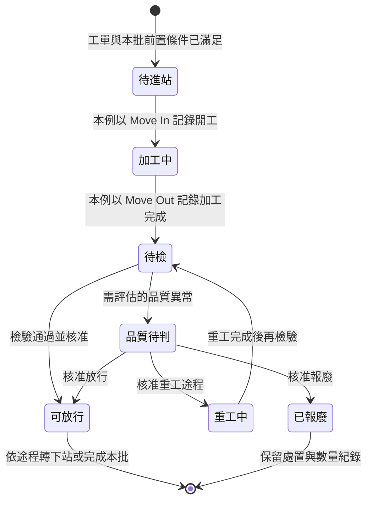
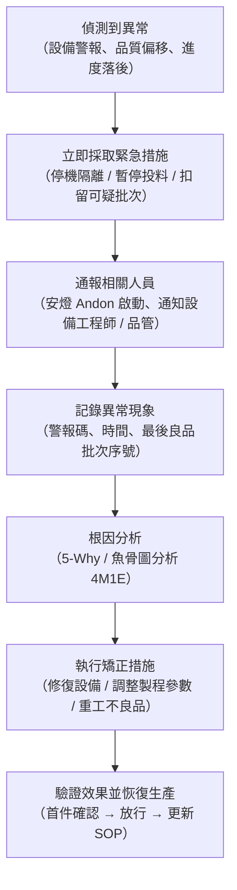

# 單元一：生產管理與流程實作（L131）

本單元對應官方評鑑主題 **L131**，涵蓋 L13101–L13103。官方樣題第 5–6、9 頁的直接要求是現場測時、填寫 VSM 與計算／說明作答；本章先釐清觀測事件與時間口徑，再用原創情境整合工單、產能及在製品判讀。

---

## 1. 生產管理與流程規劃（L13101）

### (1) 依生產型態選擇正確的規劃模式

以下是生產流程規劃的能力練習，用情境判斷生產型態及規劃方式，不代表公開樣題另有這組完整題目：

| 給定情境特徵 | 判斷生產型態 | 規劃模式重點 |
| :--- | :--- | :--- |
| 標準產品需求量大且穩定、客戶要求快速交貨 | MTS（備貨型） | 依銷售預測建 MPS → MRP 展料 → 批量生產後存成品倉 |
| 客戶要求交期明確，但接單後才生產 | MTO（訂單生產型） | 收到訂單 → 開生產工單 → MRP 展料 → 依途程加工 |
| 有標準模組可預製，接單後快速組裝 | ATO（裝配型） | 預製半成品模組倉 → 接單後快速組裝 → 縮短交期 |
| 完全客製化，每筆訂單產品都不同 | ETO（設計型） | 接單後才設計、採購、生產，前置時間最長 |

### (2) 生產批流轉與工單狀態分開判讀

下圖是原創的生產批加工狀態示意，並非指定 MES 的按鈕路徑或工單狀態字典。同一工單可有多個生產批，某批重工不表示整張工單都處於同一加工狀態；實作時先認清畫面顯示的是哪個層級。

品質扣留只是待判，不能直接等同重工或報廢。本批完成也不等於工單已結案；官方樣題的工單結案還需在生產批末站完工後執行，再查到該工單的 Close 狀態。ERP 是否已收到結果則是另一項核對。

**Move In / Move Out 操作重點**：
- **Move In**：記錄該系統定義的進站事件及操作員、設備；是否同時代表實際開工，要依系統事件定義確認，不能把排隊進站自動當成開始加工。
- **Move Out**：記錄該系統定義的出站／工序完成事件及數量；扣留、報廢與重工可能另有交易，不可假設所有 MES 都用同一出站按鈕處理。
- Move Out 時間 − Move In 時間是本次進出站的歷時，可能含等待、暫停或檢驗。題目若問淨加工工時，還要依事件紀錄扣除非加工區間；多次重工進出站要逐次辨認，不能直接取第一個進站與最後一個出站相減。

### (3) 生產計畫與產能確認

產能整合練習：給定訂單需求量、標準工時與可用機時，判斷是否有產能缺口：

$$\text{需求機時} = \text{訂單數量} \times \text{標準工時（ST）}$$

$$\text{可用機時} = \text{班次工時} \times \text{機台數量} \times \text{稼動率}$$

上式須先把班次工時轉成同一統計期間的計畫生產時間，並確認各機台可互換、工時為設備占用時間。若標準工時含人的寬放或已內含某些損失，不能又以相同損失重複折減機時；多工序與非同質機台要按工作中心分別驗算。

若 **需求機時 > 可用機時**，表示存在產能缺口，需採取以下之一：
1. 加班（延長班次工時）
2. 外包部分工序
3. 與客戶協商延長交期

> **問答題答法**：回答產能問題時，先列出公式與代入數字，再說明差異與建議行動。

---

## 2. 生產監控管理系統操作與應用（L13102）

### (1) MES 監控畫面的關鍵資訊判讀

術科實作中，MES 模擬畫面通常包含以下幾個看板，考生需能快速找到關鍵數字：

| 監控看板類型 | 顯示的關鍵資訊 | 判讀重點 |
| :--- | :--- | :--- |
| **工單進度看板** | 截至當下的計畫累計量 vs. 實際累計量、剩餘工單數 | 完工率 = 實際完工 ÷ 全單計畫量；是否落後要比較同一時點的計畫進度，沒有固定 80% 分界 |
| **設備狀態看板** | 每台設備的即時狀態（Running/Idle/Down/PM） | Down 狀態設備數多 → 影響當班產出；需啟動異常處理流程 |
| **品質即時看板** | 各工序的良率、不良分類柏拉圖 | 某工序良率突然下滑 → 優先調查該站的製程變數與設備狀態 |
| **物料庫存看板** | 各料號的目前庫存量與安全庫存水位 | 某料號低於安全庫存 → 觸發補料或採購需求 |

### (2) 異常情境的標準處理流程

以下以設備異常練習問答的推理結構；流程為教材示例，實際操作仍依現場權限及程序：

### (3) 關鍵生產績效指標（KPI）判讀

| 指標 | 公式 | 判讀條件 | 偏低的可能原因 |
| :--- | :--- | :--- | :--- |
| **稼動率（Availability）** | $\dfrac{\text{實際運作時間}}{\text{計畫生產時間}} \times 100\%$ | 先確認計畫停機與換線是否列入分母 | 故障、換線換型過長等運轉損失 |
| **良率（Yield Rate）** | $\dfrac{\text{良品數}}{\text{投入數}} \times 100\%$ | 依產品規格而定 | 製程異常、材料問題、設備磨損 |
| **OEE（整體設備效率）** | $\text{稼動率} \times \text{效能率} \times \text{品質率}$ | 目標依設備、產品與統計口徑訂定；85% 不能當成所有產業的及格線 | 任一子項偏低均影響 OEE |
| **線平衡率** | $\dfrac{\sum CT_i}{n \times CT_{\max}} \times 100\%$ | 此式假設各站串聯、每站一個工作位置；需另確認需求節拍與品質 | 各站工時不均造成等待浪費 |

---

## 3. 生產系統在製品追蹤管理（L13103）

### (1) WIP 追蹤的核心邏輯

在製品（Work in Process, WIP）追蹤是 MES 的核心功能，目的是隨時掌握每一批工件「在哪個工序、哪台設備、由誰處理、狀態如何」。

**正向追蹤（Forward Traceability）**：由原料 → 製程 → 成品追查，確認「這批原料流向了哪些成品」。
**反向追蹤（Backward Traceability）**：由成品 → 製程 → 原料追查，確認「這批成品用了哪些原料、經過哪些設備」。

### (2) 批次追蹤的主要識別方式

| 識別方式 | 說明 | 適用情境 |
| :--- | :--- | :--- |
| **序號（Serial Number）** | 每個工件一個唯一序號 | 高單價、需個件追蹤的產品（如汽車零組件、醫療器材） |
| **批號（Lot / Batch Number）** | 一批同材料、同製程工件共用一個批號 | 半導體晶片批次、食品批號 |
| **載具識別（Carrier ID）** | 工件放在托盤、料盒或 WIP 載具上，以載具 ID 追蹤整批移動 | 電路板 SMT 生產線、IC 封裝 |
| **條碼/RFID** | 實體標籤，由 MES 刷讀確認工件身份與流轉 | 通用，條碼成本低；RFID 免接觸可高速讀取 |

### (3) 術科實作典型場景：找到問題批次

**情境範例**：
> MES 畫面顯示今日生產的 PCB 成品中，第 15:20–15:45 時段的 200 片完工品良率突然由 98% 跌至 85%（170 片良品），請說明如何透過 WIP 追蹤系統查明原因。

**標準解題步驟**：
1. 從該時段的完工與檢驗紀錄找出不良序號及批號，再依途程回查各站實際進出站時間；不能假設完工與進站發生在同一時段。
2. 反向查詢該批次使用的原料批號與供應商批次（是否有換料？）。
3. 查詢該時段使用的設備 ID 與操作員 ID。
4. 調取該設備在同時段的製程參數記錄（如迴焊爐溫度曲線、印刷機壓力值）。
5. 比對正常時段與異常時段的差異，聚焦差異最大的變數。
6. 扣留可疑批次，通知品管執行加嚴檢驗。

> **問答題答法口訣**：「鎖批次 → 查原料 → 查設備 → 查參數 → 比較差異 → 扣留通報」。

## 官方樣題回扣：工時量測與 VSM 作答

L131 樣題的工時量測要求各站觀測值在標準答案 ±10 秒內；VSM 評量流程時間（PT）、週期時間（CT）與圖形。量測前先確認觀察範圍、工序起訖與計時器正常，按站記錄多次觀測，不抄錄其他考生數值。繪圖前把各站流程時間、CT 與加值時間分開記錄，再依題目提供的流程順序完成現況圖；計算題寫出公式、單位與代入結果。

## 115 年官方樣題導向：從觀測紀錄完成 VSM

對照官方樣題第 5–6、9 頁。樣題將 PT 標為「流程時間」，實際答卷應依題目對起訖的定義填寫；不要只憑縮寫把 PT、站內加工時間、整件前置時間與產線 CT 畫上等號。量測誤差 ±10 秒是該樣題的評分條件，不能當成日常工業測時的通用允收標準。

### 原創測時演練：一件產品的時間線

以下紀錄使用同一件產品，時間單位全為秒。「站內觀測歷時」含該站操作，但不一定全是加值作業；加值須另外依顧客需求與產品轉換內容辨認。

| 工站 | 到站後等待 | 站內觀測歷時 | 其中加值時間 | 出站至下一站移送 |
| :--- | ---: | ---: | ---: | ---: |
| A | 5 | 30 | 24 | 5 |
| B | 10 | 45 | 40 | 5 |
| C | 5 | 25 | 20 | 0 |

1. **畫出現況圖**：A → 在製品／移送 → B → 在製品／移送 → C，分別填上時間及觀測條件，不把等待藏在加值時間中。
2. **計算單件流程歷時**：等待 $5+10+5=20$ 秒，站內時間 $30+45+25=100$ 秒，移送 10 秒，合計 $130$ 秒。
3. **計算加值比率**：加值 $24+40+20=84$ 秒，非加值 $130-84=46$ 秒，加值比率 $84÷130≈64.6\%$。非加值不代表可立即刪除，例如必要檢驗需評估替代方式。
4. **另判產線節奏**：若三站各一人、單件串聯、可重疊生產且沒有額外阻塞／缺料，並假設移送不另占用工站人員或設備，理想瓶頸為 B 站 45 秒／件，並不是三站相加的 100 秒。實測 CT 應由連續工件相同事件的時間差確認；若操作員還須離站搬運，應將占用時間納入資源週期再算。
5. **檢查需求**：淨可用時間 420 分鐘、需求 450 件時，$TT=420×60÷450=56$ 秒／件。理想 CT 45 秒小於 TT；穩態理論產能 $25,200÷45=560$ 件，實際仍要扣除題目另列的啟動、停機與品質損失。

### 自我檢核：改善是否解決交期

若 B 站變成 60 秒／件，其餘條件不變，理論產能為 $25,200÷60=420$ 件，低於需求 450 件。只縮短 A 站不能解除瓶頸；應先調查 B 的工作內容、停機與分工作法，再重新確認先行關係及品質。回答至少交代「限制站、缺口 30 件、改善對象與驗證方式」。

作答前再檢查：同一產品與途程、時間單位、量測起訖、等待／移送、加值判定、CT 與 TT 是否各自有清楚定義。圖與計算若使用不同口徑，即使算術正確也無法支持結論。

## 樣題判讀與作答證據：先辨認測到了哪一段時間

對照官方樣題第 9 頁的原始表格，觀測欄位包含開始、結束、作業與延遲等事件，而 VSM 又分列 PT、CT、等待及加值資訊。先讀答卷欄位與題目定義，再選取觀測值；不能把同一個碼表數字填進所有欄位。

| 樣題要求 | 應如何判讀 | 容易失分的推論 |
| :--- | :--- | :--- |
| 作業時間不得超過標準答案 ±10 秒 | 比較同站、同一起訖的絕對秒差；這是該樣題的評分規則 | 把 ±10 秒改成 ±10%，或把它當測時方法的通用誤差標準 |
| VSM 列為 30%，內列 PT、CT、圖形各 10% | 三項是這個 30% 的拆分；時間與圖形都要對應觀測資料 | 把三個 10% 再加到 30% 上，或以只寫公式取代圖形 |
| 現場自行量測 | 保留站別、起訖、每次觀測及異常說明 | 因為別人的值較整齊而改寫自己的原始資料 |
| 範例流程及空白圖框 | 依當次工站與流程作答；公開文件未提供這場實作的標準工時數值 | 從示意圖的站數或框寬反推答案、假設每次都考相同站數 |

### 原創辨識練習：35 秒、45 秒與 52 秒各代表什麼？

同一件產品 08:00:00 到站，08:00:12 開始操作，08:00:47 操作完成，08:00:52 離站；下一件產品的同站完成事件為 08:01:32。另有觀察證據支持其中 28 秒為加值作業。請先自行區分時間，再核對：

- 本件操作歷時為 35 秒，到站後等待為 12 秒，完成後至離站為 5 秒，本件到站至離站合計 52 秒。
- 這兩件連續完成事件的間隔為 45 秒；它是此一觀測區間的出件間隔，不能只憑一次間隔認證長期穩定 CT。
- 若題目以本件到站至離站為分析邊界，加值比率為 $28÷52≈53.85\%$；若問跨全線前置時間，還缺其他站與站間資料。
- PT 欄究竟要填哪一段，仍須遵循題目對 PT 的定義；35、45、52 秒並非可互換的三個答案。對不同分母求出的比率也不能直接比較。

若某站的標準答案示例為 40 秒，量測 50 秒與標準相差 10 秒，正好在樣題文字的邊界；51 秒則超出。這只是解讀 ±10 秒的原創例子，不是官方公布的實際工站答案。

## 深度研讀：把測時資料轉成可交付的產能方案

### 先判斷資料能否回答問題

測時的起點是定義事件。若 A 站量「拿起工件到放下工件」，B 站卻量「兩件產品離站的間隔」，兩欄雖都用秒，仍不能直接比較。觀測表應同時記錄產品／版次、站別、起訖動作、操作者、設備狀態、批量及異常原因。重複觀測可以看出波動，卻不會自動消除定義不一致或只挑快速時段的偏差。

以下是教學用的五次觀測，不能據此認證長期產能。假設四站各一人、同一產品依 A→B→C→D 加工、站間可重疊生產、單件流且移送不另占工站資源。所有數值都是每件占用工站的秒數。

| 工站 | 觀測 1 | 觀測 2 | 觀測 3 | 觀測 4 | 觀測 5 | 平均工時 |
| :--- | ---: | ---: | ---: | ---: | ---: | ---: |
| A | 52 | 50 | 51 | 53 | 49 | 51 |
| B | 66 | 64 | 65 | 67 | 63 | 65 |
| C | 47 | 48 | 46 | 49 | 45 | 47 |
| D | 55 | 54 | 56 | 53 | 57 | 55 |

若另一次 B 站量到 120 秒，先查是否含缺料、故障、換型或正常作業波動。若要比較正常操作方法，可以把可查證的停機另列為損失；若要估算當班實際產出，該損失仍然存在。不能刪去慢值後，又把計算結果當作包含所有損失的實際能力。

### 完整案例：節拍符合，為何仍會欠交？

客戶每日需要 400 件良品，扣除休息後的計畫生產時間為 450 分鐘。近期平均非計畫停機為 30 分鐘／日，首次合格率為 98%。本例假設不良品報廢或由其他工作站處置，不再回流占用本線瓶頸；若需要在本線重工，須另外計入負荷。性能速度已由觀測 CT 表示，不再額外乘一個重複的速度效率。

1. **先算需求節拍**：$TT=450×60÷400=67.5$ 秒／良品。這個數字由需求及計畫時間決定，不因 B 站目前較慢就任意放寬。
2. **辨認限制站**：最大平均工時在 B，理想整線 CT 為 65 秒。總作業工時 $51+65+47+55=218$ 秒，線平衡率 $218÷(4×65)≈83.85\%$。
3. **先看無損失能力**：$27,000÷65≈415.38$ 件／日。這只是穩態理論值，不能直接承諾可交付 415 件良品。
4. **納入損失且避免重複扣除**：運轉時間為 $450-30=420$ 分鐘，平均良品能力估計為 $420×60÷65×0.98≈379.94$ 件／日，仍低於需求。此處百分比是規劃平均值，不代表每日一定產出整數 380 件。
5. **反推改善要求**：在同樣停機與良率條件下，需滿足 $CT\le420×60×0.98÷400=61.74$ 秒／件。因此「65 小於 67.5」只通過無損失的第一層檢查，還不足以支持交期。

### 比較兩個可實作方案

方案甲利用治具消除 B 的 10 秒重複定位，使 B 降至 55 秒、總工時降至 208 秒。方案乙把 B 最後一段可移轉的 10 秒工作交給 C；該段在剩餘 B 工作之後、原 C 工作之前執行，不違反先行關係。方案乙的 B 為 55 秒、C 為 57 秒，總工時仍是 218 秒。

| 指標 | 改善前 | 甲：消除 10 秒 | 乙：移轉 10 秒 |
| :--- | ---: | ---: | ---: |
| 最大工站 CT | 65 秒 | 55 秒 | 57 秒 |
| 限制站 | B | B、D | C |
| 線平衡率 | 83.85% | 94.55% | 95.61% |
| 同一損失假設的平均良品能力 | 約 379.94 件／日 | 約 449.02 件／日 | 約 433.26 件／日 |

方案乙的平衡率較高，但方案甲的最大 CT 較短、理論能力較大。這說明「平衡率最高」與「產量最高」是不同目標。決策還要比較治具費、訓練、品質風險、人員負荷、需求餘裕及改善能否持續。若未來需求仍為 400 件，不能把全部額外能力直接當成額外銷售收入。

上線前應以小批試跑核對工序先行關係、操作方法、設備與人員共用時間及首件品質；上線後以相同產品組合和時間口徑，追蹤 CT 分布、停機、良率、WIP 及交付表現。標準作業必須把節拍、工作順序與必要在製品一起描述，可參考 [Lean Enterprise Institute 的標準作業說明](https://www.lean.org/lexicon-terms/standardized-work/)。

### 進階練習與解析

**練習一：停機與品質同時惡化。**若停機變成 45 分鐘、首次合格率降至 96%，仍需交付 400 件，工站 CT 的規劃上限是多少？方案乙是否還有平均能力餘裕？

**解析：**運轉時間為 405 分鐘，$CT_{\max}=405×60×0.96÷400=58.32$ 秒／件。方案乙 CT 為 57 秒，平均良品能力約 $24,300÷57×0.96=409.26$ 件／日，僅約 9.26 件餘裕。這是條件式平均估計，波動可能耗掉餘裕；應優先驗證停機改善、品質回復與需求變動，不能只憑平均值保證準交。

**練習二：WIP 減半是否代表流程時間必然減半？**同一產線邊界內，平均 WIP 為 900 件，平均離線量含良品及報廢共 450 件／日。穩定改善後，WIP 降至 450 件，離線量仍為 450 件／日；若離線量反而降至 300 件／日，結果又如何？

**解析：**在系統邊界、產品計數及期間一致的穩態條件下，平均流程時間 $W=L÷\lambda$。改善前 $900÷450=2$ 日；離線量不變時為 $450÷450=1$ 日；離線量降至 300 時則為 $450÷300=1.5$ 日。減少 WIP 不能脫離流率單獨判讀，也不能把某一時點的盤點量當成長期平均。關係式可對照 [MIT 製造系統與供應鏈設計的排隊模型教材](https://ocw.mit.edu/courses/15-763j-manufacturing-system-and-supply-chain-design-spring-2005/568c857501f6785e7b328a3cf3990705_reviw_of_que_mol.pdf)。
