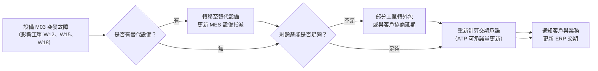
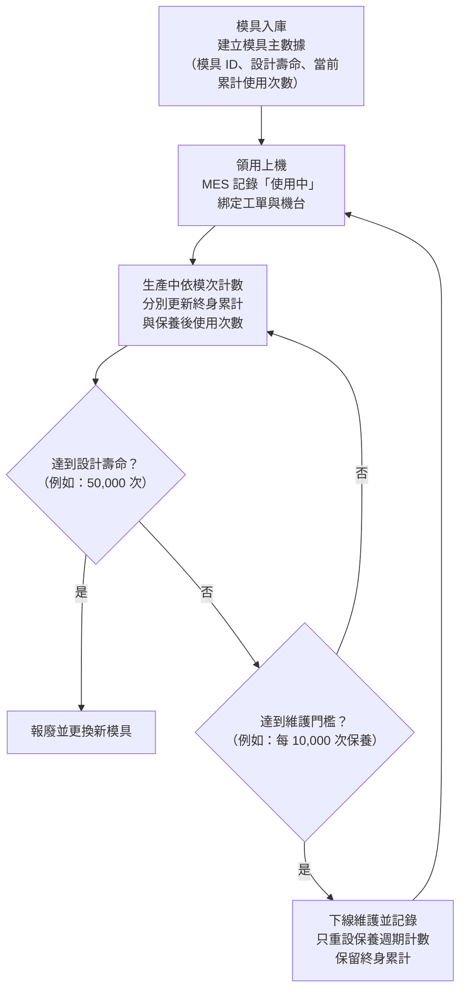
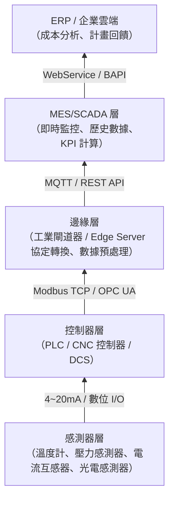

# 單元二：智慧製造現場管理實作（L132）

本單元對應官方評鑑主題 **L132**，涵蓋 L13201–L13204。官方樣題第 8、10 頁明列十題序時連續操作及逐題畫面證據，並以工單結案為範例。本章據此練習「前置狀態 → 操作 → 重新查詢 → 證據保存」，再延伸到批次、設備、資料採集及現場分析。

---

## 1. 生產安排與調節、物料批次管理與生產追溯（L13201）

### (1) 生產安排（Scheduling）與動態調節

以下用多工單、多設備練習生產安排與動態調節，屬評鑑能力的原創情境，不是公開十題的實際題目清單。

**靜態排程規則**（用於判斷排序目標與適用條件）：

| 排程規則 | 說明 | 適用情境 |
| :--- | :--- | :--- |
| **FIFO（先進先出）** | 先到達的工單先排 | 工單交期差異不大時，避免插隊糾紛 |
| **EDD（最早交期優先）** | 交期最近的工單優先 | 在單機、工單同時可用、不搶占等假設下，可最小化最大延遲值；多機或換線限制需另評估 |
| **SPT（最短處理時間）** | 加工時間最短的工單先排 | 在上述單機假設下可降低平均完工／流程時間；不保證急單準交或最佳設備利用率 |
| **CRITICAL RATIO（緊急比）** | $\text{CR} = \dfrac{\text{交期}-\text{目前時間}}{\text{剩餘加工時間}}$，CR < 1 表示交期餘裕不足 | 通常由小到大排；CR < 0 才表示交期已過，且須隨時間與剩餘工作重算 |

**緊急比 (CR) 計算範例**：
> 工單 A：剩餘交期 = 2天，剩餘加工工時 = 3天 → CR = 2/3 = 0.67（依目前條件有遲交風險）  
> 工單 B：剩餘交期 = 5天，剩餘加工工時 = 2天 → CR = 5/2 = 2.5（寬裕）  
> **應優先排工單 A。**

### (2) 動態調節情境：設備突發故障

### (3) 物料批次管理

物料批次管理目的是確保「哪批成品用了哪批原料」的雙向可追溯性：

**批次管理關鍵動作**：
1. **領料時刷讀批號**：從倉庫領料時，MES 記錄原料批號與領料數量。
2. **投料時關聯工單**：將原料批號綁定到生產工單，記錄「哪張工單消耗了哪批原料」。
3. **完工時記錄批次關係**：成品批號與原料批號建立親子關係（Parent-Child Relationship）。
4. **品質異常時快速隔離**：發現某批原料品質問題，可立即正向追查影響哪些成品批次，並下令暫停出貨。

> **術科答題重點**：批次管理可支持隔離、影響範圍判定及召回。缺少可靠追溯時，通常必須擴大調查與隔離範圍；有紀錄仍需驗證批次關聯完整性，不能只憑一筆查詢排除其他受影響產品。

---

## 2. 生產設備與模具管理（L13202）

### (1) 設備主數據管理

MES 中每台設備需建立「設備主數據（Equipment Master）」，作為排程與維護的基礎：

| 欄位 | 說明 |
| :--- | :--- |
| 設備 ID | 唯一識別碼（如 `M-CNC-001`） |
| 設備類型 | CNC 加工機、SMT 迴焊爐、注塑機等 |
| 所屬工作中心 | 對應 MES/ERP 的工作中心代碼 |
| 計畫產能 | 每班可用機時（扣除計畫保養時間） |
| 認證產品 | 該設備被允許生產的產品料號清單（防止錯誤指派） |
| 目前狀態 | Running / Idle / Down / PM / Setup |

### (2) 模具/治具管理（Tool & Fixture Management）

模具和治具是影響品質的關鍵資源，需要追蹤壽命與維護狀態：

**原創模具管理練習**：
> 模具 #T-023 設計壽命 50,000 次，目前已累計 48,500 次，此批工單需生產 2,000 件，請問應如何處理？

**示例答法**：若題目假設每件耗用一模次，則 48,500 + 2,000 = 50,500 > 50,000。剩餘可用 1,500 模次，必須在達上限前安排合格替代模具，或在本批開始前換模；保養不會自動使終身累計歸零。多穴模具的件數與模次不同，須先按模穴數、合格產出及計數規則換算。

### (3) 快速換模（SMED）原則

縮短換模時間的原創問答練習，可依「SMED」（Single Minute Exchange of Die）架構回答：

1. **區分內部作業與外部作業**：內部 = 需要停機才能做；外部 = 機台運行中可預先準備。
2. **外部作業前移**：模具預熱、材料備料、工具擺放，在上一批生產時即完成準備。
3. **內部作業縮短**：用快速夾具取代螺栓鎖附；標準化對位基準點（零點設定）。
4. **精簡步驟**：消除不必要的調整與試跑，採用配方記憶功能一鍵載入。

---

## 3. 即時生產系統與設備機台資訊採集（L13203）

### (1) 資料採集層架構

### (2) 即時資料採集常見問題判斷

以下用資料採集異常練習分層定位，不能只憑單一畫面判定根因：

| 現象 | 可能原因 | 處置方向 |
| :--- | :--- | :--- |
| MES 畫面某設備數據停止更新 | PLC 斷線 / 閘道器當機 / 網路中斷 / 畫面快取 | 比對最後更新時間、資料品質旗標與通訊紀錄，逐層定位；Ping 可達不代表應用連線正常，重啟前確認授權與未送出資料 |
| 數據出現規律性大幅跳動（毛刺） | 感測器接地不良 / 電磁干擾（EMI） | 檢查感測器接線屏蔽；加裝濾波器 |
| 時間戳記比實際事件晚 5 分鐘 | 設備時鐘偏移 / 時區不同 / 傳輸延遲 | 分開比較事件時間與接收時間，再依時間同步程序處理；不能只看延遲就斷言設備時鐘錯誤 |
| 數據有缺漏（間歇性遺失） | 來源未產生 / 斷線 / 緩衝溢位 / 重送處理錯誤 | 以事件序號及各層紀錄找遺失位置；依需要設緩衝／重送。MQTT QoS 1 可能重複，報工仍需事件去重與數量核對 |

---

## 4. 資源分配管理與製程現場實際資訊的分析（L13204）

### (1) 資源分配的四個維度

術科情境可能要求針對「生產落後」做出資源調整，需從四個維度分析：

| 資源維度 | 可調整的手段 | 注意事項 |
| :--- | :--- | :--- |
| **人力（Man）** | 調派跨工站支援、加班、引進臨時人力 | 需確認人員是否具備該工站認證資格 |
| **設備（Machine）** | 指派合格備用機台、評估加班、依核准程序重排可調整的維護窗口 | 須確認機台能力、維護狀態與品質認證，不為追產任意取消必要保養 |
| **物料（Material）** | 加速採購、允許替代料、調整生產順序先跑有料的工單 | 替代料需通過工程審核（ECO） |
| **方法（Method）** | 調整批量大小、改善換模流程、重新平衡產線 | 需工程評估，不可隨意更動製程參數 |

### (2) 現場數據分析：柏拉圖排列

分析不良類別的次數與累計占比，可先使用**柏拉圖分析（Pareto Analysis）**；若題目問根因，還須另有驗證：

**步驟**：
1. 統計各不良類型的發生次數。
2. 由大到小排列，計算各類型的累計百分比。
3. 依實際累計占比與改善目標選重點；80/20 是常見經驗描述，不是每份資料都符合的固定比例。另檢查嚴重度與成本，少量重大失效也可能必須優先處理。

**範例計算**：

| 不良類型 | 發生次數 | 累計次數 | 累計百分比 |
| :--- | :---: | :---: | :---: |
| 焊接空洞 | 120 | 120 | 50.0% |
| 偏位 | 72 | 192 | 80.0% ← **80% 線** |
| 短路 | 30 | 222 | 92.5% |
| 少錫 | 12 | 234 | 97.5% |
| 其他 | 6 | 240 | 100.0% |

→ **結論**：焊接空洞與偏位佔總不良的 80%，為首要改善項目。

### (3) 生產現場的 4M1E 根因分析架構

問答題要求做根因分析時，依 4M1E 架構逐項列舉可能原因，再以數據縮小範圍：

| 面向 | 可能根因舉例 |
| :--- | :--- |
| **人（Man）** | 操作員未依 SOP 執行；夜班人員疲勞；新人訓練不足 |
| **機（Machine）** | 設備磨損、校正失效、治具鬆動 |
| **料（Material）** | 原料批次品質差異、過期材料、儲存條件不符規範 |
| **法（Method）** | SOP 版本錯誤、製程參數設定偏移、溫度曲線未核實 |
| **環（Environment）** | 溫濕度超標、靜電防護不足、震動干擾 |

### (4) 術科綜合情境範例

**情境題**：
> 某 SMT 產線今日第三班（22:00–06:00）焊接良率由日班的 98.5% 降至 94.25%，800 片 PCB 中有 46 片不良，每片只記一個主要不良類型，分為「可見焊接橋接（32片）」和「偏位（14片）」。請依序說明分析步驟與建議措施。

**建議解答架構**：

1. **鎖定問題批次**：先依第三班 22:00–06:00 的完工／檢驗紀錄鎖定不良序號及批次，再依各站實際事件時間回查 Move In/Out，避免只篩當班紀錄而漏掉跨班在製品的前段加工。
2. **4M1E 初步分析**：
   - 人：第三班換了新操作員嗎？（查排班紀錄）
   - 機：迴焊爐在 22:00 之後溫度曲線有偏移嗎？（查設備參數歷史）
   - 料：第三班有換原料批次嗎？（查領料紀錄）
   - 法：SOP 版本與日班相同嗎？
   - 環：廠房溫濕度在夜間是否有變化？
3. **柏拉圖聚焦**：橋接占 $32÷46≈69.6\%$，先檢查錫膏印刷、鋼板開口、貼裝位置與溫度曲線等候選原因；占比高本身不是根因證據。
4. **緊急措施**：扣留可疑範圍並通知品管，依已驗證能檢出該可見缺陷的 AOI 程式複檢。若是不可見內部缺陷，必須另選適合檢測方法，不能一律用 AOI 代替。
5. **矯正措施**：找到可重現的原因後，在核准範圍內修正並確認首件；依風險評估調整點檢頻率，觀察後續批次效果。
6. **長期改善**：依已驗證的製程窗口與異常趨勢設定警戒值，將適當的時間、產品、設備與批號維度加入 MES 報表。

## 官方樣題回扣：MES 序時操作與截圖

官方樣題的 L132 實作有 10 個連續任務。先設定題目指定的使用者，再逐題讀清楚需要完成的系統操作與畫面欄位；完成操作後立即截取**整個桌面**，確認題目以括號標示的資訊完整可見，再貼入 Word。簡答內容輸入同一份答案文件，按規定保存後再進下一題；前題狀態會成為後題輸入，不能把截圖當成操作完成的替代品。

樣題有兩種檔名指示（考試通知碼／准考證編號）。實際作答以當次考試通知和考場公告為準，開考前確認檔名規則、保存位置及是否需要重新開檔；每完成一題就確認截圖和文件已保存。

## 115 年官方樣題導向：完成操作後證明狀態正確

對照官方樣題第 8、10 頁。公開範例具體示範的是「末站完工後執行工單結案，再查詢工單狀態為 Close」；不能據此假設已公開其餘九題的實際順序或介面。練習時使用以下檢核方式套到題目要求，而不是背一組固定按鈕路徑。

| 檢核階段 | 必須確認的資料 | 常見失誤與修正 |
| :--- | :--- | :--- |
| 操作前 | 題號、工單、批號、設備／工序、使用者、指定前置狀態 | 名稱相似時仍以唯一編號辨認，先確認查詢條件 |
| 操作中 | 投入、完成、報廢、在製等數量及狀態轉移是否符合題目 | 超時或畫面未更新時先查交易紀錄，避免反覆送出造成重複報工 |
| 操作後 | 重新查詢相同工單，核對狀態、數量、時間與關聯批次 | 只有成功訊息或按鈕灰化，不足以證明最終狀態 |
| 截圖與保存 | 整個桌面、題目括號指定欄位、題號對應的 Word 位置 | 貼圖後檢查文字可辨識並存檔，不能用前一題畫面冒充本題 |

### 原創操作檢核：同樣完工 96 件，能否結案？

工單計畫 100 件，若系統紀錄良品 96 件、核准報廢 4 件、在製 0 件，各生產批均已完成末站，仍要依該系統規則確認品質放行及其他未結交易後才能執行結案。如果只有良品 96 件、其餘 4 件仍在製，不能把「已完成大部分」當成滿足範例的末站完工條件。結案後重新以同一工單編號查詢 Close，截圖保留可核對的工單編號與狀態。

前題操作會形成後題的輸入。若結果不符預期，先保留當下紀錄，定位缺少的前置資料或不合法狀態；不要靠新增一張替代工單來掩蓋錯誤。樣題第 10 頁另列第九題截圖的補判方式，該方式僅屬樣題評分規則，練習與實際作答仍應逐題留完整證據。

### 自我檢核：把現象、根因與措施分開

給定 120 件投入、12 件不良，其中橋接 8 件、偏位 4 件，且每件只記一個主要不良。良率為 $108÷120=90\%$；橋接占不良件數 $8÷12≈66.7\%$。前者的分母是投入數，後者是不良數。橋接比例高只能指出調查優先順序，根因仍須以人、機、料、法、環的分層比較與驗證確認。

請自行寫出三句答案：「我看到的可查證現象」、「我要驗證的原因與資料」、「暫時隔離措施及恢復生產條件」。只有『調參數／重開機／多加人』而沒有資料與驗證條件，無法說明決策為何有效。

## 樣題判讀與作答證據：系統完成與答卷完成分開檢查

官方樣題第 10 頁的結案範例，要求的是「執行結案後，再到查詢畫面看到該工單的 Close」。因此系統操作、重新查詢與貼入答案卷是三個不同結果；一個成功訊息只能證明其中一部分。

| 作答結果 | 能證明什麼 | 還缺什麼 |
| :--- | :--- | :--- |
| 按下結案，畫面出現成功訊息 | 介面回覆本次操作成功 | 尚須重新查到題目指定工單及 Close 狀態 |
| 查詢出 Close，但畫面是另一張工單 | 被查到的那張工單已結案 | 不能證明本題指定對象完成；應核對唯一編號與篩選條件 |
| 同一工單顯示 Close，只有局部裁切圖片 | 有所需狀態的部分資訊 | 樣題要求整個桌面，並需包含題目括號指定資訊 |
| 整桌面截圖貼入 Word，檔案尚未保存 | 編輯中的答案內容已有圖片 | 尚未確認題號位置、可辨識度、檔名、桌面保存位置及存檔結果 |

### 逐題自問五個問題

1. **對象是否正確？**用題目指定的工單／批次等識別碼核對，不能僅以產品名稱相似判斷。
2. **前置狀態是否成立？**依題目與系統要求確認，不以自行建立的替代工單繞過上一題。
3. **結果是否可重新查證？**重新查詢同一對象；若超時，先查交易結果，再判斷是否需要重試。
4. **本題證據是否齊全？**整個桌面與括號指定資訊都要可見；這份自問清單不代表每題額外要求固定五個畫面欄位。
5. **答卷是否已保存？**圖片在正確題號、文字可辨識，簡答已輸入，且依當次指示完成命名與存檔。

公開樣題的檔名指示本身有「考試通知碼／准考證編號」差異，應在開考前核對當次指示，不能自行認定兩者相同。第九題截圖補判前九題的文字是該樣題的評分安排，並不表示第十題可省略，更不能推論每次考試都允許漏圖。

**原創證據判斷：**若工單已真正 Close，但 Word 貼的是操作前畫面，系統結果與答卷證據仍不一致；應依題目要求重新查詢並保存正確結果，而不是為了重拍而重複執行結案。反之，先前留下 Close 圖片後若後續操作改變狀態，也不能以舊圖片證明目前狀態。練習時把「觀測到的事實、做過的操作、可核對的結果」分開記錄。

## 深度研讀：用事件帳、批次關聯與狀態證據完成 MES 實作

### 先界定一件產品在哪個集合

一張工單可能同時有完工品、重工品、報廢品與尚未加工的在製品。查畫面時必須先問：這欄統計的是獨立產品件數、工序加工次數，還是某次交易量？同一件產品重工一次，會多一筆加工紀錄，卻不會憑空多出一件產品。若把所有 Move Out 數量相加當成完工件數，報表會重複計數。

在本節原創案例中，投入品按一件原料對一件產品計數，不含增減料或數量單位轉換。在同一結帳時點，產品只能落在下列互斥集合之一：

$$\text{投入件數}=\text{已完成良品}+\text{核准報廢}+\text{未完成在製品}$$

重工待處理品屬於未完成在製品；品質待放行的成品則另有「可否入可用庫存／出貨」狀態。系統也可能把品質扣留品列為 WIP，實作前須核對該系統欄位定義。本例將末站已完成但待放行的成品列在完工數，另外記錄放行狀態；這是案例口徑，不是所有 MES 的固定規則。

### 完整案例：240 件工單從投料到結案

工單 `WO-240` 核准投入並處理 240 件，依已核准途程 V3 生產；本例允許經核准的報廢納入製造結案，未另設定必須交付 240 件良品的客戶需求。原料可用 260 件，投入其中 240 件，未領用 20 件仍在原料倉，不能算成這張工單的在製品。投料來源及生產批關聯如下：

| 生產批 | 數量 | 原料批 LA | 原料批 LB | 首次良品 | 需重工 | 首次報廢 |
| :--- | ---: | ---: | ---: | ---: | ---: | ---: |
| G1 | 140 | 140 | 0 | 130 | 8 | 2 |
| G2 | 100 | 10 | 90 | 93 | 5 | 2 |
| 合計 | 240 | 150 | 90 | 223 | 13 | 4 |

**第一步：核對投料與版次。**G1 與 G2 合計投入 240，和本工單領料相同。途程 V4 即使後來發布，也不能默默覆寫本案例已發放工單使用的 V3；要依變更程序判定受影響批次、在製品處置與是否重新放行，保留前後版次與核准紀錄。

**第二步：首輪加工後對帳。**此時 $223+4+13=240$，數量守恆，但 13 件仍在重工流程，工單尚未完成。本例首次合格率為 $223÷240≈92.92\%$；不能先把待重工 13 件全部當良品，也不能把這個比例和不良類別占比混用。

**第三步：重工後仍保留原始履歷。**G1 的 8 件重工中，7 件通過、1 件報廢；G2 的 5 件重工中，4 件通過、1 件報廢。重工紀錄應連回原工件／原批次、原不良原因、重工途程與再次檢驗結果。

| 生產批 | 最終良品 | 最終報廢 | 未完成在製 | 合計核對 |
| :--- | ---: | ---: | ---: | :--- |
| G1 | 137 | 3 | 0 | $137+3=140$ |
| G2 | 97 | 3 | 0 | $97+3=100$ |
| 合計 | 234 | 6 | 0 | $234+6=240$ |

最終良率為 $234÷240=97.5\%$，高於首次合格率，但重工增加的工時、耗材與交期風險仍存在。總加工通過次數可達 $240+13=253$ 次，這不代表產出 253 件成品；OEE、直通率與報工數都須維持清楚的產品及工序邊界。

**第四步：檢查結案前置狀態。**逐批確認末站完成、重工已處置、報廢已核准、品質已放行，並檢查是否尚有未完成交易。數量平衡是必要檢查，卻不能替代品質及流程狀態檢查。結案後重新查詢 `WO-240` 的狀態與數量，再保存題目指定畫面；MES 結案成功與 ERP 已接收回報是兩個可分開核對的結果。若客戶實際要求 240 件良品，234 件仍短少 6 件，須另確認補製與交期，不能把製造結案當成客戶訂單已完成。

### 斷線重送與延遲事件的判讀

本例對每次報工指派事件識別碼，重試使用同一識別碼。例如事件 E03 回報首輪良品 223 件，網路超時後重送 E03，應查明首次是否已成功入帳；同一事件不得再增加 223 件。真正的重工完成是新業務事實，須有新事件及重工次序，不能因工單、批號、工序相同就一律刪掉。

對帳紀錄至少保留事件碼、工單／批號、工序／加工次序、數量、事件發生時間、接收時間與處理結果。若 E04 比 E03 先到，不能把接收順序直接當作實際加工順序；應保留事件並按規則暫掛、補齊或調查，避免出現負在製量及錯誤提前結案。某些 MES 以不同機制達成同樣目的，考場應依現有系統操作，不自行製造測試交易。

### 追溯範圍由紀錄粒度決定

若原料 LA 後續被判定可疑，G1 全部與 LA 有關，G2 也含 LA 10 件。假設 234 件最終良品均未出貨且仍在可控庫存內，而 G2 只有批級投料紀錄，無法指出哪個成品序號用了 LA，就不能直接排除 G2 的 97 件最終良品。因此可能要先扣留 G1 的 137 件加 G2 的 97 件，共 234 件，再透過補充證據縮小範圍；若已有出貨，須另外追查流向並依程序處置。

「可疑原料只有 150 件」不等於「目前最多只需扣留 150 件可辨識成品」。前者是數量資訊，後者還需要原料與成品的一對一關聯。分批、混批、載具轉換與重工都要保留親子關係；事後補一個批號名稱不能取代當時的實際關聯。

### 進階練習與解析

**練習一：重送造成成品數異常。**若最終完成後，首輪良品事件 E03 被重複入帳，畫面變成良品 457、報廢 6、在製 0，應如何定位與修正？

**解析：**$457+6=463$，比投入 240 多 223，恰與 E03 數量相符；這是調查線索，還須比對事件識別碼、工單、批次與交易紀錄。確認重複後，依授權程序以可追溯的沖銷／更正交易處理，保留原記錄及更正理由，再核對庫存與 ERP 回報；不能直接刪去一筆歷史資料，或改投入數使等式表面成立。

**練習二：數量正確，但 G2 品質尚未放行。**假設本案例結案政策要求全批放行，G1 的 137 件已放行、G2 的 97 件仍待覆核，是否可結案及出貨？若 LA 可疑，追溯應查哪些關聯？

**解析：**雖然 $234+6=240$ 且加工在製為 0，G2 的品質狀態仍未滿足結案政策，不能據此結案或將其納入可出貨量；當下已放行量只有 137 件。LA 疑慮另使 G1、G2 都需評估隔離，即使 G1 先前已放行也不能忽略新風險。應由 LA 的領用／投料紀錄正向追至 G1、G2，再追重工、合併、入庫與出貨關聯；後續解鎖或重新放行仍須有核准與畫面證據。
