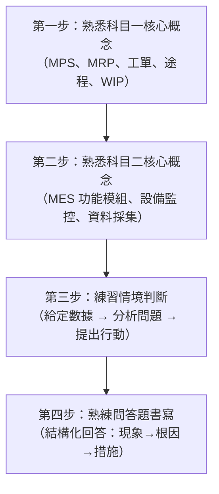

# 科目三：智慧生產與管理實務（術科實作）

依據官方簡章，本考科為初級選考之一，採現場觀察／紙筆作答與 MES 上機實作，考試時間 **4 小時**。以下操作細節依官方「考科 3 智慧生產與管理實務」樣題整理，當次考試仍以准考證與考場公告為準。

## 考試結構

| 題型 | 說明 |
| :--- | :--- |
| **L131 生產與作業管理實作（50 分）** | 現場觀察並量測各站工時，填寫價值流圖（VSM），完成流程時間、週期時間及加值時間相關計算／說明題。 |
| **L132 製造生產線管理實作（50 分）** | 在 MES 模擬系統依序完成操作題與簡答題；每題依題目要求留下畫面證據。 |

## 官方評鑑範圍（L13）

| 評鑑主題 | 評鑑內容代碼 | 評鑑內容 |
| :--- | :--- | :--- |
| **L131 生產與作業管理實作** | L13101 | 生產管理與生產流程之規劃與運作模式 |
| | L13102 | 生產監控管理系統操作與應用 |
| | L13103 | 生產系統在製品追蹤管理 |
| **L132 智慧製造生產線管理實作** | L13201 | 生產安排與調節、物料批次管理與生產追溯 |
| | L13202 | 生產設備/模具管理 |
| | L13203 | 即時生產系統與設備機台資訊採集 |
| | L13204 | 資源分配管理與製程現場實際資訊的分析 |

## 學習文件

1. [01_生產管理與流程實作.md](./01_生產管理與流程實作.md)：對應 L131（L13101–L13103），涵蓋生產型態選擇、工單流轉操作、MES 監控畫面判讀、在製品追蹤邏輯。
2. [02_智慧製造現場管理實作.md](./02_智慧製造現場管理實作.md)：對應 L132（L13201–L13204），涵蓋派工排程、物料批次、設備模具管理、即時資訊採集與資源分析。

## 官方樣題的操作與評分重點

官方樣題將 L131 的工時量測列為 10%，VSM 列為 30%；量測值須落在標準答案 ±10 秒內，VSM 需呈現流程時間（PT）、週期時間（CT）及圖形。樣題另列計算題組與說明題，練習時要將觀察紀錄、公式、代入值和結論寫完整。

L132 包含 **10 題序時連續相關的 MES 操作**。按題目順序執行，每完成一題就截取完整桌面畫面，確認題目括號指定的資訊都在畫面中，再貼到 Word；簡答題直接輸入同一份答案文件。前題資料會供後題使用，因此不要跳題，並在每題完成後檢查畫面與檔案是否保存。

樣題內對 Word 檔名出現「考試通知碼」與「准考證編號」兩種說法；考場作答前先核對當次考試通知與監考人員指示，依現場規則命名。不要預先假設兩者相同。

## 準備策略

> 術科實作考的是**整合應用**，不是單純背名詞。重點是：拿到情境數據後，能正確判讀哪個指標異常、原因在哪個環節、應採取什麼操作或決策。

建議完成[試題導向實戰練習中的 L13 題組](../歷屆試題與解題技巧/115第一次試題導向實戰練習.md#l13生產與管理實務術科)，再依本 README 的官方樣題流程練習工時量測、VSM 表達、MES 連續操作及畫面證據保存。

## 深度研讀與實作產出

兩章另有「樣題判讀與作答證據」區塊，先處理公開文件直接要求的能力，再銜接原創深度案例：

| 官方樣題位置 | 對應章節 | 可自行檢核的學習目標 |
| :--- | :--- | :--- |
| 第 5–6、9 頁：測時、VSM 與評分表 | 生產管理與流程實作 | 區分操作歷時、單件流程歷時及連續出件間隔，讀懂 ±10 秒與 VSM 配分拆項，從原始紀錄完成圖與計算 |
| 第 8、10 頁：十題序時操作與結案範例 | 智慧製造現場管理實作 | 分開檢查指定對象、前置狀態、重新查詢結果、整桌面截圖及 Word 保存，辨認成功訊息與答卷證據的差別 |

兩章的「深度研讀」使用原創資料，先自行計算及寫出操作理由，再對照解析。完成後，至少改變一個條件重算，確認自己掌握的是推理方法，而非記住數字。

| 章節 | 深度主題 | 建議自行完成的產出 |
| :--- | :--- | :--- |
| [生產管理與流程實作](./01_生產管理與流程實作.md) | 測時起訖與資料可信度、瓶頸與損失、兩種改善方案、WIP／流率／流程時間 | 四站觀測表、含停機及良率的產能驗算、改善比較表、條件變動後的交期判斷 |
| [智慧製造現場管理實作](./02_智慧製造現場管理實作.md) | 分批與重工事件帳、數量守恆、品質放行、重送處置及追溯粒度 | 投入至結案的數量帳、批次親子關聯表、事件差異定位、應保存畫面的欄位清單 |

檢核時分開評估「計算是否一致」、「判斷是否有依據」及「證據是否可核對」。數量平衡仍可能存在品質扣留，平均能力足夠仍可能有波動與設備限制；把這些條件寫清楚，才算完成整合應用。
