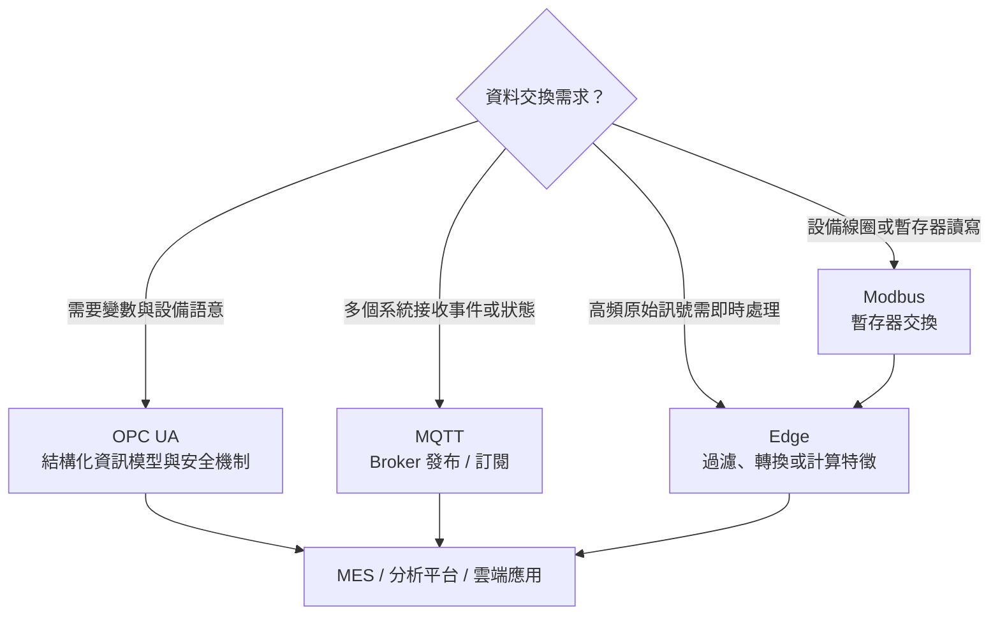
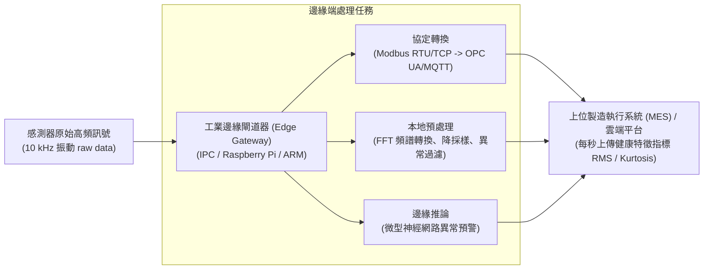

# 單元二：工業物聯網 (IIoT) 與通訊協定

<figure class="unit-visual">
  
  <figcaption>3D 單元總覽<strong>圖解重點：</strong>感測器訊號經現場匯流排、工業網路與邊緣閘道器轉為可信資料；右側分支對照請求/回應、資訊模型、發布/訂閱及斷線緩存補傳。</figcaption>
</figure>

## 1. 工業感測元件分類與選型原則

在工業物聯網（Industrial Internet of Things, IIoT）架構中，感知層負責將實體機台的物理量轉換為電氣訊號。

| 感測物理量 | 感測器類型 | 運作物理原理 | 典型智慧製造應用情境 |
| :--- | :--- | :--- | :--- |
| **振動** | 壓電式加速度規 (Piezoelectric Accelerometer) | 壓電晶體受慣性質量塊擠壓產生微弱電荷，輸出 IEPE/ICP 訊號 | CNC 主軸軸承磨耗監控、沖床撞機防護 |
| **溫度** | 熱電偶 (Thermocouple, 如 K-Type) | 兩種相異金屬接觸點受熱產生的熱電效應（Seebeck Effect） | 回焊爐高溫區、金屬熱處理爐（量測範圍高達 $>1000^\circ\text{C}$） |
| **溫度** | 電阻式溫度感測器 (RTD, 如 Pt100) | 白金電阻值隨溫度變化，可依標準特性曲線換算溫度 | 半導體蝕刻槽、無塵室恆溫水路高精度監測 |
| **物體定位** | 電感式近接開關 (Inductive Proximity Sensor) | 金屬導體進入交變磁場後產生渦電流，使振盪特性改變；不同金屬的感應距離不同 | 沖壓模具下死點確認、轉盤分度定位 |
| **物體計數** | 光電開關 (Photoelectric Sensor) | 透過對射式（Through-beam）或反射式（Retro-reflective）紅外光束阻斷 | 輸送帶流水線產品計數、物料箱到位偵測 |
| **轉速/角度** | 光學編碼器 (Optical Rotary Encoder) | 旋轉光柵碼盤遮斷光束，產生 A/B/Z 相正交脈衝訊號 | 伺服馬達精確角度回授、機械手臂關節軸定位 |
| **用電負載** | 比流器 / 霍爾電流感測器 (Current Transformer, CT) | 依據電磁感應或霍爾效應（Hall Effect）感應導線磁場 | 機台主馬達電流監測、用電能耗碳盤查計算 |

---

## 2. 工業通訊協定：Modbus 與暫存器對應

Modbus 是工業自動化領域歷史最悠久、相容性最廣的串列與網路通訊協定。

### (1) Modbus RTU 與 Modbus TCP 比較
* **Modbus RTU（以 RS-485 差動訊號為主流實體介面）**：
  * 主從架構（Master-Slave）：同一匯流排上僅允許單一主站（Master）發起輪詢（Polling），各從站（Slave）依站號（Node ID）回應。
  * 傳輸格式為純二進位（Binary），封包末端附帶 16 位元循環冗餘檢查碼（Cyclic Redundancy Check, CRC-16）。
* **Modbus TCP（以 RJ-45 工業乙太網為傳輸媒介）**：
  * 主從模式轉為客戶端/伺服器架構（Client/Server），預設監聽連接埠為 **TCP Port 502**。
  * 不使用 RTU 訊框的 CRC，改以 7 個位元組的 MBAP 標頭（Modbus Application Protocol Header）封裝；其中仍有 Unit Identifier，可供閘道器識別後端裝置，不能理解為 TCP 完全沒有裝置識別欄位。欄位定義參閱 [Modbus Organization 官方 TCP/IP 實作指南](https://www.modbus.org/docs/Modbus_Messaging_Implementation_Guide_V1_0b.pdf)。

### (2) Modbus 四大暫存器位址型態

  

    
💾

    

      <h3 class="infographic-title">Modbus 四大暫存器位址空間矩陣</h3>
      
數位開關量 (1-bit) vs 類比數值量 (16-bit) / 唯讀 (RO) vs 讀寫 (RW)

    

  

  

    

      

        線圈 (Coils)
        00001 ~ 09999
      

      

        可讀可寫 (R/W)
        1 位元 (Boolean)
      

      
控制實體數位輸出：啟動馬達繼電器、三色燈亮滅、氣壓缸伸縮動作

    

    

      

        離散輸入 (Discrete Inputs)
        10001 ~ 19999
      

      

        唯讀 (RO)
        1 位元 (Boolean)
      

      
讀取實體開關狀態：急停按鈕 (E-Stop)、光電開關檢知、安全光柵遮斷

    

    

      

        輸入暫存器 (Input Registers)
        30001 ~ 39999
      

      

        唯讀 (RO)
        16 位元 (Word)
      

      
讀取現場即時量測數值：溫度傳送器 (Pt100)、壓力值、馬達即時電流 (CT)

    

    

      

        保持暫存器 (Holding Registers)
        40001 ~ 49999
      

      

        可讀可寫 (R/W)
        16 位元 (Word)
      

      
設定機台運轉參數：溫控設定值 (Set Point)、伺服目標轉速、PID 比例係數

    

  

| 暫存器名稱 | 位址範圍編號 | 資料長度 | 讀寫屬性 | 典型對應現場變數 |
| :--- | :--- | :--- | :--- | :--- |
| **線圈 (Coils)** | 00001 ~ 09999 | 1 位元 (Boolean) | 可讀可寫 (Read/Write) | 啟動馬達繼電器、三色燈亮滅控制 |
| **離散輸入 (Discrete Inputs)** | 10001 ~ 19999 | 1 位元 (Boolean) | 唯讀 (Read Only) | 緊急停止按鈕 (E-stop)、極限開關狀態 |
| **輸入暫存器 (Input Registers)** | 30001 ~ 39999 | 16 位元 (Word) | 唯讀 (Read Only) | 類比感測器即時電壓值、即時溫度讀值 |
| **保持暫存器 (Holding Registers)** | 40001 ~ 49999 | 16 位元 (Word) | 可讀可寫 (Read/Write) | 溫度設定值 (Set Point)、伺服目標轉速 |

---

## 3. 次世代工業通訊標準：OPC UA 與 MQTT

### (1) OPC 統一架構 (OPC Unified Architecture, OPC UA)
傳統 OPC DA（Data Access）依賴微軟 Windows 專有的 DCOM 技術，無法跨平台且缺乏安全性。OPC UA（IEC 62541）已成為智慧製造互聯互通的共通標準：
* **平台無關性**：可原生運行於 Linux、Windows、即時作業系統（RTOS）乃至嵌入式晶片中。
* **豐富的語意資訊模型（Semantic Information Model）**：採用節點空間（NodeSet）結構，資料不僅包含數值（Value），還一併打包時間戳記（Timestamp）、資料品質碼（Status Code）與物件關聯性（Relationships）。
* **內建企業級安全防護**：支援 X.509 數位憑證認證、AES-128/256 傳輸加密與角色授權。

### (2) MQTT (Message Queuing Telemetry Transport)
針對大規模物聯網節點設計的輕量級傳輸協議：
* **發布/訂閱架構（Publish/Subscribe）**：由訊息代理伺服器（Broker）負責解耦訊息發布者（Publisher，如邊緣閘道器）與訂閱者（Subscriber，如 MES/雲端監控儀表板）。
* **主題樹狀路由（Topic Hierarchy）**：如 `factory1/lineA/machine3/vibration`。
* **三種服務品質等級（Quality of Service, QoS）**：
  * **QoS 0（最多交付一次 / At most once）**：發送後不等待確認，有漏包風險，佔用頻寬最小。
  * **QoS 1（至少交付一次 / At least once）**：必須收到 PUBACK 確認，可能產生重複封包。
  * **QoS 2（精確交付一次 / Exactly once）**：在 MQTT 協定交換範圍內，以四步交握完成一次交付語意，開銷較高；不等於跨資料庫交易或斷電後的端到端零損失保證。

**協定辨識：**Modbus 著重暫存器讀寫；OPC UA 著重具語意的工業資料模型；MQTT 著重發布／訂閱訊息傳遞。它們可在同一條資料鏈中分層搭配，不是互斥的單選方案。

---

## 4. 邊緣運算 (Edge Computing) 與通訊閘道器

在現場設備聯網過程中，若將數百台機台以 10 kHz 取樣率擷取的振動與電流原始波形直接上傳雲端，將造成網路頻寬崩潰與雲端儲存費用飆升。

邊緣閘道器（Edge Gateway）的主要職責包括：
1. **異質協議轉換**：將底層傳統 PLC 的暫存器訊號轉譯為 JSON over MQTT 或 OPC UA 節點。
2. **邊緣資料預處理**：執行快速傅立葉變換（Fast Fourier Transform, FFT），計算均方根值（Root Mean Square, RMS）與峰度（Kurtosis），僅回傳特徵值而非全部原始波形。
3. **本地離線快取（Store and Forward）**：當工廠對外網路中斷時，閘道器本機暫存歷史資料，待網路復原後補傳；可保留的中斷長度受容量、持久化、持續產生量及補送頻寬限制，需以對帳確認完整性。

---

## 深度研讀：設計可驗證的採樣、傳輸與補送鏈

### 1. 先定義需要看見的現象，再選採樣率

監控值每秒更新，不代表感測器每秒只採一次。若要看溫度緩慢漂移，低頻更新可能足夠；若要分析振動頻率，原始波形必須以足夠速率取樣，並在數位化前考慮抗混疊濾波。對頻帶受限的訊號，取樣率須高於最高關注頻率的兩倍，實務還要留濾波過渡帶與分析餘裕。這是重建與避免混疊的基本條件，不等於符合兩倍就能完成所有故障診斷。可參考量測設備廠商 [NI 的採樣與抗混疊說明](https://www.ni.com/en/shop/data-acquisition/measurement-fundamentals/analog-fundamentals/anti-aliasing-filters-and-their-usage-explained.html)。

資料表至少應區分原始值、縮放後工程值、單位、來源時間、接收時間、品質狀態與設備識別。以 4–20 mA 對應 0–16 bar 為例，10 mA 對應 $(10-4)÷16×16=6$ bar；若上層誤當為 kPa，數字雖可儲存卻已失去正確意義。量程外數值需依設備診斷規則標記，不能不經確認便當作真實製程極值。

### 2. 整合案例：八台馬達的振動資料如何上傳

**假設與輸入：**每台馬達一個振動通道，關注 0～800 Hz，本案例選 4,000 次／秒、每筆原始樣本 2 bytes，八台同步採集。先不計封包、檔案索引與重傳開銷，原始量為 $8×4,000×2=64,000$ bytes／秒；即 512,000 bits／秒，持續一小時需 230.4 MB，這裡 MB 採十進位一百萬 bytes。若可用上傳頻寬只有 200,000 bits／秒，原始資料不能持續即時全送。

**邊緣策略：**各機每秒計算一次特徵，假設每筆含時間、識別、RMS、峰度與品質旗標共 80 bytes，八台只需 640 bytes／秒，為原始負載的 1%。這只比較負載資料，正式容量還要量測協定、加密與批次封裝開銷。為保留追查能力，另在邊緣循環保存原始波形；異常時凍結指定事件前後區段，而非永久刪除所有原始資料。特徵壓縮降低流量，但可能遺失新故障所需訊息，保留策略必須配合診斷目的。

**斷線容量：**若規劃保留全部原始資料以承受 30 分鐘中斷，最低負載容量為 $64,000×1,800=115.2$ MB。教學設計再保留 50% 容量餘裕，配置至少 172.8 MB 的可用緩衝空間，另行扣除系統與索引需求。這個餘裕是案例假設，不是協定或官方標準。若恢復後在總上傳能力內，分給歷史補送 20,000 bytes／秒的淨頻寬，清完 115.2 MB 需 5,760 秒，即 96 分鐘；前提是即時特徵及其他開銷已另行保留頻寬，不能把總頻寬重複分配。

**決策與驗證：**即時特徵優先、歷史波形限速補送，以免補送再次塞住即時告警。每筆事件保留來源識別、啟動批次與遞增序號，接收端依此去重；不能只用接收時間當唯一鍵。實測拔線 30 分鐘，再檢查缺號、重複數、補送時間、磁碟高水位與告警延遲，並測試重開機後緩衝是否仍存在。只有網路恢復不代表資料已完整恢復。

### 3. 時間戳、品質狀態與傳輸保證的限制

來源時間回答何時量到，接收時間回答何時到平台；兩者差值可用於估計傳輸延遲，但設備時鐘若偏移，差值就不能直接視為網路延遲。跨機台因果分析需先核對對時狀態與時間解析度。狀態固定不變亦不必然代表沒有新量測，應另外觀察序號、心跳與品質旗標。

MQTT 的 QoS 描述訊息交換的交付語意，不保證感測器校準、應用交易正確或永久斷電後零損失；QoS 1 可能重複，QoS 2 也不能自動替跨資料庫扣料實現唯一交易。須搭配持久化設定、緩衝、事件識別與應用去重。相關定義可查 [OASIS MQTT 正式規範](https://docs.oasis-open.org/mqtt/mqtt/v5.0/os/mqtt-v5.0-os.html)。

### 4. 進階練習與解析

**練習一：**四個通道各以 2,000 次／秒採樣，每筆 4 bytes，需抵抗 20 分鐘斷線。不計其他開銷時需多少緩衝？若僅有 30 MB 可用，是否足夠？

**解析：**資料率為 $4×2,000×4=32,000$ bytes／秒；容量為 $32,000×1,200=38.4$ MB，30 MB 不足，且尚未含額外開銷。可增加容量，或依診斷要求調整保留策略；不能為了配合容量而任意降低採樣率，否則可能失去關注頻帶。

**練習二：**設備來源時間比平台快 4 秒，平台顯示接收時間 10:00:02、來源時間 10:00:05，可以說資料倒流或延遲為負嗎？

**解析：**不可直接下結論。先校正已知時鐘差，來源實際時間約為 10:00:01，因此本例推估傳輸約 1 秒；還須考慮對時誤差。原始時間戳與校正依據均應保存，不能直接覆寫來源時間掩蓋問題。

## 職能基準對照與實務解說

### 試題導向：感知、傳輸、分析與商務用途分開判讀

**對應 115 年第一次 L12 公告試題第 2、4、11、18～22 題。**感測器把溫度、壓力或到位狀態轉為控制邏輯可用的輸入；執行元件則實際改變物理狀態。看到「採集」先找感知層，看到「設備間傳遞」找網路／傳輸層，看到「監控、分析與決策」找應用；在包含商務層的模型中，商務層再處理營運規則與價值管理。第 19 題採用含應用、網路、商務層的 IoT 架構語境，勿將它與 OSI 七層模型混用，也勿把「會議層」誤當成該題的有效層名。IoT 可用不同分層模型，答題需先確認題幹採用的版本。

第 20 題在未指定版本的常見情境下，速率排序採 **Wi-Fi ＞ Bluetooth ＞ NFC**。這是該題的概括比較，實際選型仍看版本、距離、耗電、干擾與資料量；近距辨識用 NFC，不代表應拿它連續傳輸多台相機影像。第 18 題列出的感測器、連線與雲端是典型 IoT 組成，聲音辨識是可加上的分析功能；實際工廠亦可用地端平台與邊緣端，雲端並非所有架構的必要條件。

### 試題判讀與選項辨析：資料鏈與架構條件

| 題號 | 必要知識與判斷步驟 | 常見誤選理由 |
| :--- | :--- | :--- |
| 4 | 沿「感測器量測 → 控制邏輯判斷 → 執行元件動作」閱讀，感測器提供輸入資料。 | 把量測與致動混為一談；到位感測器告知位置，真正推動工件的是氣缸、馬達等執行元件。 |
| 11 | 連續資料與系統記錄應能支援趨勢、追溯及改善；至少識別來源、時間、狀態與事件內容。 | 只想到開機時數或網路是否接通，忽略跨事件的分析用途；自動刪除原始資料也無法支援問題追查。 |
| 18 | 反向題：分清採集、連線、資料處理平台等基本組成，與聲音辨識這種特定應用能力。 | 看到功能「智慧」就認為每套 IoT 都必須具備。雲端是題內的典型平台選項，實務可使用地端部署。 |
| 19 | 先確認題目使用 IoT 的分層語境；在其候選名稱中辨認應用、網路、商務層，排除不屬該模型的名稱。 | 將三層 IoT、含商務層的五層模型與 OSI 七層混接。IoT 沒有一個適用所有情境的唯一層數。 |
| 20 | 題內未給版本，採常見概括速率順序 Wi-Fi、Bluetooth、NFC；作答後再區分速率、距離與功耗。 | 用最遠傳輸距離或最低功耗排序，卻沒有回答資料速率；也可能把概括排序誤當成跨所有版本的定律。 |
| 21 | 邊緣 AI 把部分推論移近資料來源，主要價值是減少往返延遲、原始資料傳送與即時處理等待。 | 把「放到邊緣」理解成增加雲端負載或擴充儲存；運算位置與硬碟容量不是同一件事。 |
| 22 | 依動詞辨層：「量到、讀取、辨識」是感知採集；「送出」是傳輸；「推論、決策」才是分析應用。 | 因感測器具備處理晶片，就把感知層的主要任務改判為全廠決策或雲端共享。 |

**條件改寫練習：**若相機在地端完成推論，只送缺陷結果到 MES，是邊緣處理減少傳輸；若仍把每張影像全部上傳，再等待遠端結果，僅多裝一台閘道器並不能證明延遲已降低。比較時要量測整條路徑，而非只看設備名稱。

**原創小題：**相機每秒產生大量影像，現場只需立刻判斷瑕疵並上傳結果，首要改善方案是增加雲端容量，還是部署邊緣推論？**答案：先評估邊緣推論。**靠近資料源可減少往返延遲與原始影像傳輸，對應第 21 題；仍須保留抽樣影像、模型版本、事件時間與處置結果，讓第 11 題所要求的追溯及後續優化有可靠依據。

## 進階延伸：從感測器到可用資料的工程鏈

### 訊號調理與工程單位

感測器輸出需經量程、接線、隔離、取樣與轉換，才能成為工程值。以 4–20 mA 表示 0–100 °C 為例，12 mA 對應 50 °C；若採樣結果超出量程、訊號中斷或超過合理變化速率，應標記為無效／可疑資料，而不是當作真實極值。數位量測亦須確認位元順序、暫存器位址、資料型態、縮放係數與單位。

### 通訊選型的取捨

Modbus 簡單、設備支援廣，但資料語意與型別慣例常需由整合方約定；OPC UA 可提供資訊模型、安全與互通機制，部署複雜度較高；MQTT 以 Broker 和主題進行發布／訂閱，適合鬆耦合事件傳遞，但需規劃主題命名、服務品質、保留訊息與離線緩存。協定名稱本身不能保證即時性或可靠性，還要看網路拓撲、負載、更新週期與失聯處理。

### 資料品質與時間同步

分析前檢查缺值、重複、延遲、跳變、單位與時間戳。不同設備時鐘若未同步，可能把原因與結果排序顛倒；事件資料宜保留設備時間及接收時間，並記錄時區與同步狀態。邊緣閘道器可做協定轉換、緩存、篩選與基本告警，但需監控緩存容量、資料補送、憑證與韌體更新。

### 分層診斷順序

通訊異常可依序檢查供電與接線、實體鏈路、網路連通、協定參數、暫存器／節點定義、資料轉換與上層應用。每一層保留可觀測的狀態、錯誤碼與最後成功時間，能避免把感測器故障誤判為 MES 問題。

### 自我檢核

1. 4–20 mA 量程為 0–200 °C，讀值 8 mA 對應幾度？
2. MQTT 發布成功但訂閱端未收到資料，至少應檢查哪兩個環節？

**判讀要點：**8 mA 對應 25% 量程，即 50 °C；檢查主題／訂閱權限與 Broker 連線、QoS／離線策略等設定。

### 深度應用：把感測訊號轉成可判讀的工程值

假設 4–20 mA 壓力感測器量程為 0–10 bar，PLC 讀得 12 mA，線性換算為 $(12-4) ÷ (20-4) × 10 = 5$ bar。正式採集還需同時保存量程、單位、校正狀態、設備 ID、取樣時間與品質旗標；只保存數字「5」無法判斷是 5 bar、5 kPa，或是通訊中斷後的舊值。

### 延伸判讀：通訊異常的分層檢查

感測值固定不動時，依序檢查感測器供電與量程、PLC I/O 映射、暫存器位址／資料型態、通訊連線、閘道器轉換、時間戳更新與上層儲存。Modbus 多暫存器資料還要依設備文件確認字組順序及縮放規則；不得只為了讓數字合理就任意交換位元組。

MQTT QoS 1 保證至少送達一次，因此接收端可能收到重複訊息；若用於事件紀錄或扣料，應使用事件 ID 或冪等處理避免重複執行。OPC UA 與 MQTT 都不會自動保證感測器校正正確或資料符合製程語意，資料模型與治理仍須由系統設計者定義。

本章對應 **T2.6 遠端管理與智慧製造生產線**，包括即時管理產線參數與運作。資料蒐集不只求數量：需能辨識來源、時間、量測意義及品質，並保有斷線補傳與存取管制，才能使遠端監控成為可靠的管理依據。

### 職能任務：把訊號變成可相信的產線資料

P2.6.1 要求在智慧製造環境中透過遠端方式管理產線作業，並維持效率及良好產能。遠端管理的基礎是資料鏈路可信：感測器量到的物理量要有單位、量程、校正與安裝脈絡；傳輸資料要有設備識別、時間戳記、品質旗標與通訊狀態；上層系統則要知道該資料是監控、分析、追溯還是控制用途。

協定選擇應由設備能力、資料型態、即時性、可靠度、資安與整合需求決定。Modbus 常適合設備暫存器資料交換；OPC UA 可提供結構與語意較完整的資訊模型；MQTT 的發布／訂閱模式有利於大量狀態訊息分送。沒有單一協定可自動解決資料治理、資安或現場安全問題。

### 端到端資料檢查

可用「感測器 → 控制器／閘道器 → 網路 → 資料平台／MES → 儀表板或分析」逐段驗證。當數據突變、固定不動或斷線時，先分辨量測、供電、設備狀態、通訊、轉換與儲存何者失效；不可在未查明前直接把離群值當作設備故障或直接刪除。

### 常見誤區

* 只記錄數值，未保留單位、時間、來源與品質狀態。
* 將 IT 網路與控制網路無差別互通，未規劃權限、分區與例外處置。
* 把 Store-and-Forward 視為萬無一失，卻未驗證緩存容量、補傳順序與重複資料處理。
