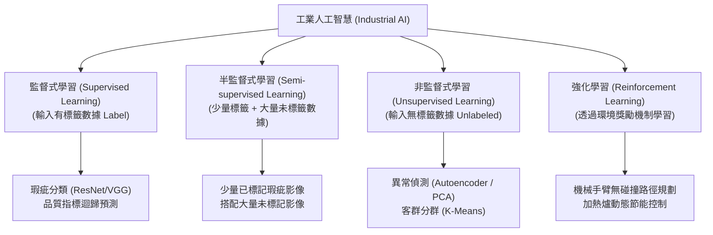
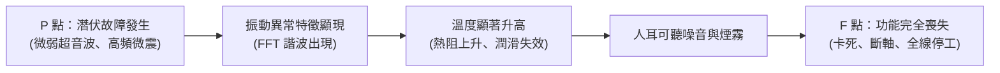

# 單元三：人工智慧 (AI) 與機器視覺檢測

<figure class="unit-visual">
  
  <figcaption><span class="unit-visual__eyebrow">3D 單元總覽</span><strong>圖解重點：</strong>光源、鏡頭、工業相機與瑕疵分流表現 AOI 與 AI 分類；馬達振動頻譜、風險曲線與維護路徑，連結 PdM、P-F 間隔與漏檢/過檢風險。</figcaption>
</figure>

## 1. 人工智慧在製造領域的學習範式

人工智慧（Artificial Intelligence, AI）在智慧製造中主要用於缺陷檢測、製程參數最佳化與設備故障預測。



* **監督式學習（Supervised Learning）**：利用輸入與已知目標值訓練；目標是瑕疵類別時為分類，目標是連續的尺寸、溫度或壽命數值時為迴歸。
* **半監督式學習（Semi-supervised Learning）**：以少量已標註資料搭配大量未標註資料訓練，適用於瑕疵標註成本高、但可取得大量產線影像的情境。
* **非監督式學習（Unsupervised Learning）**：在工廠良品率達 99.9% 時，不良品樣本極度稀缺（資料不平衡 Data Imbalance），可利用自動編碼器（Autoencoder）以大量「正常良品數據」訓練特徵重構模型。當重構誤差（Reconstruction Error）高於閥值時即判定為異常。

---

## 2. 自動光學檢測 (AOI) 與深度學習

自動光學檢測（Automated Optical Inspection, AOI）結合光學成像、精密機械平台與影像處理演算法，協助檢測或在經驗證的任務範圍內取代部分人工目檢；不確定案例仍需安排複判。

### (1) 光學硬體架構選型
* **工業相機選型**：
  * **面陣相機（Area Scan Camera）**：一次曝光擷取矩形二維畫面，適用於靜態或步進式拍照（如 PCB 基板點檢）。
  * **線陣相機（Line Scan Camera）**：一次僅擷取一條像素線，配合旋轉或連續平移機構連續曝光合成超高解析度長條圖，適用於滾筒鋼板、紡織品、連續卷軸（Roll-to-Roll）檢測。
* **光源照明技巧**：
  * **同軸光（Coaxial Light）**：光線經分光鏡沿鏡頭軸線照射工件，可利用平整反射面與缺陷的反射差異形成對比；是否適合劃痕檢測須以材質、角度及缺陷樣本試拍確認。
  * **背光源（Backlight）**：自物體背後打光形成剪影，凸顯外輪廓邊緣，適合量測零件外徑尺寸與孔徑。
  * **低角度環形光（Low-Angle Ring Light）**：側向低角度照射，強化表面浮雕文字、雷雕條碼與微小凹陷陰影。

### (2) 傳統機器視覺 vs 深度學習視覺

| 比較構面 | 傳統規則型機器視覺 (Rule-Based Vision) | 深度學習機器視覺 (Deep Learning / CNN) |
| :--- | :--- | :--- |
| **主要演算法** | 邊緣檢測（Sobel/Canny）、二值化門檻（Otsu）、樣板匹配（Template Matching） | 卷積神經網路（CNN）、YOLO 物件偵測、U-Net 語意分割 |
| **適用任務** | 精確幾何尺寸量測（公差 $\pm 0.01\text{ mm}$）、定位引導 | 複雜紋理背景下的微小刮傷、污漬、崩角與裂紋分類 |
| **適應力** | 依規則與成像穩定性而定，需驗證光照及表面變異 | 可從代表性樣本學習變異，但對未涵蓋的光照、材質或形變仍可能失效 |

### (3) 品質檢測關鍵考核指標

```mermaid
flowchart LR
  subgraph "實體真實狀態 (Ground Truth)"
    DEFECT["瑕疵品 (Defect)"]
    GOOD["良品 (Good)"]
  end

  subgraph "AOI 系統判斷結果"
    PRED_DEFECT["判定為瑕疵"]
    PRED_GOOD["判定為良品"]
  end

  DEFECT --> |正確檢出| PRED_DEFECT
  DEFECT -.->|❌ 漏判 (Underkill / FN)<br/>致命客訴風險！| PRED_GOOD

  GOOD --> |正確放行| PRED_GOOD
  GOOD -.->|⚠️ 過殺 (Overkill / FP)<br/>增加人工覆檢工時| PRED_DEFECT
```

* **漏檢（Underkill / False Negative, FN）**：將不良品誤判為良品，可能導致客訴與外部失敗成本；應依缺陷嚴重度訂定驗收標準，高風險缺陷需搭配複核或其他防錯措施。
* **過檢（Overkill / False Positive, FP / 誤殺）**：將合格良品誤判為瑕疵品。過檢率過高會導致重檢（Re-check）工時暴增與不必要的報廢返修成本。

---

## 3. 預測性維護 (PdM) 與振動頻譜分析

預測性維護（Predictive Maintenance, PdM）依託實體狀態監測（Condition Monitoring），在設備即將失效前執行精準維護。

### (1) P-F 間隔曲線 (P-F Interval)
P-F 曲線描述設備從「潛伏故障可偵測點（Potential Failure, P）」到「功能性喪失停機點（Functional Failure, F）」的退化歷程：



PdM 的目的即是在 P 點與振動顯現期及早介入，將「非計畫性突發停機」轉化為「計畫性利用換班時間維修」。

### (2) 旋轉機械振動頻譜分析基礎
透過快速傅立葉變換（FFT）將時域訊號轉換為頻域頻譜圖，對應轉軸轉速基頻（$1\times\text{RPM}$）：
* **轉子不平衡（Unbalance）**：頻譜在 $1\times$ 轉速基頻處出現極高振幅峰值。
* **軸承對心不良（Misalignment）**：頻譜在 $2\times$ 諧波處出現顯著峰值，並伴隨軸向振動過大。
* **滾動軸承（Rolling Element Bearing）損傷**：依據幾何結構產生特定軸承缺陷特徵頻率：
  * 外環通過頻率（Ball Pass Frequency Outer Race, BPFO）
  * 內環通過頻率（Ball Pass Frequency Inner Race, BPFI）
  * 滾動體自轉頻率（Ball Spin Frequency, BSF）
  * 保持架旋轉頻率（Fundamental Train Frequency, FTF）

---

## 深度研讀：把分類分數轉為可執行的品質決策

### 1. 正類、分母與決策門檻必須先約定

以下以「瑕疵」為正類：TP 是檢出的瑕疵、FN 是漏掉的瑕疵、FP 是被誤攔截的良品、TN 是正確放行的良品。召回率 $TP÷(TP+FN)$ 回答瑕疵找回多少；精確率 $TP÷(TP+FP)$ 回答攔截品中有多少真的不良；準確率 $(TP+TN)÷N$ 則容易被大量良品主導。若把正類改成良品，指標名稱不變但現場含義改變，報表須明確標示。

模型輸出的分數不必然是校準後的瑕疵機率。調整門檻會改變攔截數，卻不會修補漏標、影像模糊或訓練資料缺少某種缺陷的問題。門檻選擇須同時看漏檢代價、複判能力及各缺陷類別；若一個總體門檻掩蓋少見但嚴重的缺陷，應分層分析。門檻應在驗證資料上選擇，再用未參與選擇的測試資料估計效果，不能反覆看測試分數直到挑出最好結果。

### 2. 整合案例：最便宜的門檻為何未必可上線

**假設與輸入：**獨立驗證批次有 5,000 件，經可靠複判確認 100 件瑕疵、4,900 件良品；分數越高越像瑕疵。每漏檢一件的平均損失假設為 500 成本單位，每誤攔截一件良品為 3 單位，其他共同成本暫不計。所有被攔截品均須人工確認，一班最多處理 200 件。

| 門檻 | TP | FN | FP | TN | 待複判數 | 估算差異成本 |
| :--- | ---: | ---: | ---: | ---: | ---: | ---: |
| 0.80 | 80 | 20 | 25 | 4,875 | 105 | $20×500+25×3=10,075$ |
| 0.65 | 92 | 8 | 75 | 4,825 | 167 | $8×500+75×3=4,225$ |
| 0.50 | 96 | 4 | 140 | 4,760 | 236 | $4×500+140×3=2,420$ |

0.80 的準確率為 $(80+4,875)÷5,000=99.1\%$，召回率卻僅 80%；0.50 的準確率降為 97.12%，召回率提高到 96%，精確率則為 $96÷236≈40.68\%$。因此只挑最高準確率會選錯風險方向。成本最低的 0.50 需要複判 236 件，超過本案例 200 件容量；在這三個候選中，0.65 是成本較低且符合容量的方案，但不代表已找到所有可能門檻中的全域最優值。

**決策：**先確認 8 件漏檢的缺陷種類與客戶要求是否容許，再決定採用 0.65、增加複判產能，或對特定缺陷加入第二種檢測。不能以「平均成本較低」直接放行不符合品質要求的產品。若漏檢成本或瑕疵比例改變，也需重算；這些成本是假設輸入，並非固定業界標準。

**驗證：**以不同日期、原料批次與光源條件的保留測試集確認結果，並在上線初期保留人工抽驗。記錄模型、門檻、相機設定與複判結果，按缺陷類別追蹤 FN／FP 及積壓量。觀察到漏檢時先查成像、標註與製程條件，再決定重訓或調門檻。只比較整體準確率，可能看不見某一類缺陷已完全失效。

### 3. 資料分割與漂移判讀的反例

同一工件連拍十張照片，應視為同一群組，避免相近影像分散到訓練與測試。若要估計未來月份效果，還要考慮按時間切分；若目標是新設備，測試應涵蓋未見設備。資料標準化、特徵選擇及門檻調整都應只使用適當訓練／驗證資料，避免把測試答案間接帶入。可參考 [scikit-learn 官方交叉驗證與群組切分說明](https://scikit-learn.org/stable/modules/cross_validation.html)。

分數分布改變可能來自光源老化，也可能是產品真的變差；未取得真實標籤前，不能僅憑分數位移判定模型失效。另一方面，分數分布看似相同也不代表召回率不變。漂移監控應結合輸入影像品質、製程變更、抽驗標籤與分層指標，而非只設一條平均分數警戒線。

門檻與模型也應分開版本管理：同一模型改門檻，攔截量就可能大幅改變，因此不能只保存模型檔。比較新舊方案時固定測試資料、真實標籤與成本假設，再記錄差異；若新方案只在光源良好的白班改善，夜班漏檢卻增加，不能用合併平均掩蓋。上線後累積的新標籤可用於後續訓練，但應另保留未使用的驗證批次，避免每次更新都使用同一套「熟悉的考卷」。

### 4. 進階練習與解析

**練習一：**測試 2,000 件，真實瑕疵 60 件；系統檢出 54 件瑕疵並誤攔 18 件良品。求 FN、TN、召回率、精確率與準確率。

**解析：**FN＝$60-54=6$，真實良品 1,940 件，TN＝$1,940-18=1,922$。召回率＝$54÷60=90\%$；精確率＝$54÷72=75\%$；準確率＝$(54+1,922)÷2,000=98.8\%$。98.8% 不能掩蓋仍有 10% 瑕疵漏檢，且這只是該測試樣本的估計。

**練習二：**同一資料集的門檻 X 有 FN＝12、FP＝20；門檻 Y 有 FN＝5、FP＝120。每件誤攔成本為 2，其他條件相同，漏檢成本超過多少時，Y 的差異成本較低？

**解析：**設每件漏檢成本為 $c$，比較 $5c+120×2<12c+20×2$，得到 $c>200÷7≈28.57$。等於此值時兩者成本相同；仍需另外核對複判容量與缺陷風險，成本不等式不能取代可行性檢查。

## 職能基準對照與實務解說

### 試題導向：先辨識學習目標，再檢查資料與成像條件

**對應 115 年第一次 L12 公告試題第 13、23～25、27、32 題。**有已知目標數值的迴歸屬監督式學習；不能因輸出不是類別就誤判成非監督式。線性迴歸可用最小平方法擬合，但加入過多參數可能擬合到訓練雜訊。決策樹可依溫度、壓力、振動等多個特徵逐節點分支，並非只能使用單一維度。強化學習則需要獎勵函數引導行動；獎勵若只鼓勵產量、未限制品質與風險，可能學到不適合現場採用的策略。

資料偏差、過度擬合與資料洩漏都會破壞模型對新資料的可信度。第 25 題特別限定「本地電腦訓練」：當資料及運算均在本地、無需連線取數時，網路穩定性通常不直接改變模型準確性；若改成雲端訓練或遠端資料來源，則須重新判讀條件。電腦視覺的目的在於理解景物與任務資訊，像素數量、顏色分布只是可使用的特徵或中間步驟。

相機介面亦屬本章的硬體基礎：第 13 題公告答案採線長由長到短為 **GigE、Camera Link、USB 3.0**。這是題內的概括比較，並非三種介面各有不變的最大線長；延伸器、主動／光纖線材、傳輸模式與特定產品規格都會改變可用距離。選型需同時核對解析度、幀率、觸發同步、頻寬及線長。

### 試題判讀與選項辨析：學習方式與視覺任務

| 題號 | 必要知識與判斷步驟 | 常見誤選理由 |
| :--- | :--- | :--- |
| 13 | 先辨識題目比較的是「連接線長度」，公告排序為 GigE → Camera Link → USB 3.0；再檢查工程應用有無指定線材或延伸方案。 | 以頻寬排名代替距離排名，或把題內排序誤寫成所有型號均適用的固定公尺數。 |
| 23 | 反向題：以已知目標數值配對輸入來擬合，是監督式迴歸；最小平方法可用於線性迴歸，參數過多也可能過度擬合。 | 誤以為監督式只能輸出類別。另須區分關聯與因果，迴歸關係本身不證明改變某參數必然造成品質變化。 |
| 24 | 強化學習依行動後的獎勵學習策略，因此須定義獎勵訊號／函數；製造任務還應限制碰撞、超溫及品質風險。 | 將分類模型需要大量人工標籤的流程套到強化學習，或以固定規則列盡所有情境，忽略互動學習。 |
| 25 | 先保留「資料與運算都在本地」前提，再比較模型泛化問題與外部連線問題；此時網路穩定性通常不直接改變預測準確性。 | 漏讀本地前提，套用雲端取數中斷的情境；資料偏差、洩漏及過度擬合則確實會使結果失真。 |
| 27 | 視覺的任務目的是從影像取得可用的場景理解，如物件、位置與關係；像素或顏色統計只是中間處理。 | 把容易量測的像素數當最終目的，或把影像轉文字這一項應用當作全部電腦視覺的定義。 |
| 32 | 反向題：整棵樹可以依不同節點使用多個特徵；例如先判斷溫度，再判斷振動。單一節點測一個特徵，不等於整棵樹只能輸入一維資料。 | 將節點的單一條件誤推成模型的單一維度；「容易理解」也不表示深樹永遠簡單或訓練耗時固定。 |

**工程核對來源：**[Basler USB 3.0 傳輸說明](https://www.baslerweb.com/en-us/learning/data-transmission-usb-3-0/) 說明被動、主動及光纖方案的距離差異；其例子也顯示 USB 並非一律限於 3 公尺。[scikit-learn 決策樹文件](https://scikit-learn.org/stable/modules/tree.html) 提供多特徵分類範例及過度擬合限制。這些資料用於限定技術適用條件，不更動公告答案。

**原創小題：**把同一工件的連續近似影像隨機分到訓練與測試集，測試分數很高，能否證明跨批次有效？**答案：不能。**近似樣本洩漏可能高估效果，應以獨立工件或批次切分，再確認新班別、產品與照明條件下的表現。

## 進階延伸：模型指標必須連到現場成本

### 建立可用的訓練資料

影像或感測資料需依產品型號、設備、批次、光源、班別與缺陷類別保留來源；標註規範要定義缺陷邊界、嚴重度與不確定案例的處置。訓練、驗證與測試資料應避免同一批次或近似影像洩漏到不同集合，否則測試表現可能過度樂觀。新產品、新材料、鏡頭更換或環境照明改變，都可能造成資料分布漂移。

### 混淆矩陣與門檻選擇

在瑕疵檢測中，漏檢（False Negative）可能讓缺陷流到客戶，過檢（False Positive）則增加人工複判與停線成本。準確率在良品遠多於不良品時容易掩蓋漏檢，因此應同時看召回率、精確率、每件複判時間、漏檢成本與不同缺陷類別表現。判定門檻應依風險設定；高風險缺陷可採較高召回並搭配二次確認。

### 從模型輸出到品質閉環

推論結果應保留模型版本、信心分數、相機／光源設定、產品序號與後續人工判定。低信心樣本可導向人工複核；若模型持續誤判某類產品，先確認資料與設備條件，再評估重新標註與再訓練。模型更新需經離線評估、影子測試或小批量驗證，並準備回退版本，不能未驗證即替換量產判定。

### PdM 的維護決策

預測性維護要比較預警提前量、誤報率、漏報率及維護成本。感測器異常或工況改變可能造成虛假告警；將模型輸出直接轉成停機命令也可能帶來額外損失。實務上以維修工單閉環：告警、確認、檢修、故障模式記錄、模型結果回饋，逐步驗證預測是否能改善可用率。

### 自我檢核

1. 瑕疵比例僅 0.2%，模型準確率 99.8% 是否足以證明可上線？
2. 換新光源後漏檢增加，應先考慮模型本身或資料／成像條件？

**判讀要點：**不能只看準確率，須看少數類別召回率、成本與代表性測試；光源改變會造成成像分布漂移，需先確認影像條件與資料品質。

### 深度應用：從混淆矩陣看 AOI 漏判與過殺

假設抽驗 1,000 件，其中真實瑕疵 50 件；AOI 判為瑕疵 70 件，其中 40 件確為瑕疵、30 件是良品，另有 10 件瑕疵被判為良品。此時召回率（Recall）為 $40 ÷ (40+10)=80\%$，代表瑕疵中仍有 20% 漏判；精確率（Precision）為 $40 ÷ (40+30)≈57.1\%$，代表被攔截品中有相當比例需要複判。調降判定門檻通常會提高召回率，但也可能增加過殺；量產前應依漏判與複判成本設定門檻並以代表性批次驗證。

### 延伸應用：把 PdM 訊號變成維護行動

振動 RMS 上升是狀態訊號，不是單獨的故障結論。需比對轉速、負載、感測器安裝位置、頻譜特徵與歷史基線，排除換產品、換治具或感測器鬆動等原因；確認劣化趨勢後，再建立檢查／維修工單、安排可用停機時段，並於維修後確認指標回到可接受範圍。模型或警報只提出風險線索，仍需依現場安全與設備維護程序判斷。

本章對應 **T2.7 蒐集／分析智慧製造數據、落實精實管理與節能減碳**。AI 或 AOI 結果應結合現場脈絡、標註品質與驗證資料判讀，再提出可執行的預防或改善措施；模型輸出是決策證據的一部分，不能取代品質、安全或維護程序。

### 職能任務：由資料分析提出可落實改善

T2.7 的 P2.7.1 至 P2.7.3 要求蒐集與運用生產數據、提出改善方案並落實成效。因此 AOI 或預測模型的交付不應只是一個準確率數字，而要能連結產品、批次、設備、時間、影像或感測特徵，以及實際的品質／維護結果。這能支持 K17 巨量資料蒐集方法、S14 分析、S18 資訊科技應用與 S21 製程改善建議。

AI 導入應以明確問題開始，例如降低特定瑕疵漏檢、提早辨識軸承劣化或縮短異常判讀時間。接著定義可接受的錯誤型態與成本、蒐集代表性資料、建立一致標註規則、分離訓練與驗證資料，並在產品、照明、材料或製程改變時重新評估。模型上線後也要監測資料漂移與處置結果。

### 從判定到現場行動

若 AOI 產生不良判定，系統應有清楚的隔離、複核、返工或升級流程；若 PdM 顯示劣化，應結合趨勢、現場檢查與維護工單決定處置。模型若直接取代品質放行或安全決策，卻沒有驗證、監控與人工升級機制，便超出其可被信任的範圍。

### 常見誤區

* 只用單一準確率評價模型，未看漏檢、誤殺及其現場成本。
* 因訓練資料表現良好就直接上線，未以新批次、不同照明或不同設備資料驗證。
* 把 AI 異常訊號視為根因，未回到設備、材料、方法與品質事實確認。
