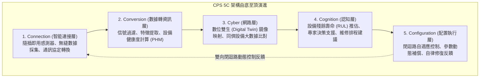
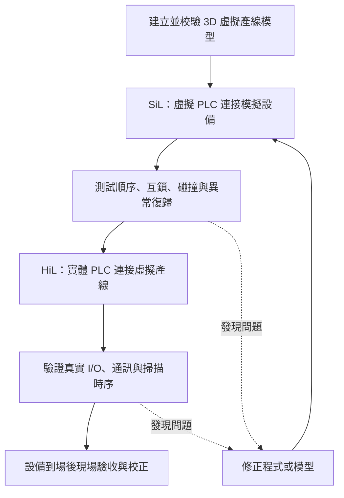

# 單元四：網宇實體系統 (CPS) 與數位雙生

<figure class="unit-visual">
  
  <figcaption>3D 單元總覽<strong>圖解重點：</strong>實體產線與透明鏡像產線以雙向資料柱相連，表現數位雙生同步與回控；單向/雙向箭頭用以分辨數位影子與數位雙生，右側為虛擬除錯情境。</figcaption>
</figure>

## 1. 網宇實體系統 (Cyber-Physical Systems, CPS) 架構

網宇實體系統（Cyber-Physical Systems, CPS）將計算、網路和物理環境融合，利用量測、模型、分析及受控回饋支援現場運作。傳統自動化本來也可包含 PID 等閉迴路控制；CPS 的重點是進一步整合跨設備資料與運算決策，讓實體物理世界（Physical World）與虛擬運算世界（Cyber World）互動，不能以「傳統自動化一定是開迴路」區分。

### 李傑教授（Prof. Jay Lee）提出的 CPS 5C 架構體系

  

    
🪜

    

      <h3 class="infographic-title">CPS 5C 智慧化金字塔階梯架構</h3>
      
由實體感知至虛擬建模，再由認知決策閉迴路反饋配置實體控制

    

  

  

    

      
5C

      

        
Configuration (配置執行層) - 閉迴路自律控制

        
將認知決策反饋至現場機台 PLC/CNC，自動補償磨耗、自我調節參數與自律容錯

      

      閉環反饋執行
    

    

      
4C

      

        
Cognition (認知層) - 專家決策與殘餘壽命預測

        
推估設備殘餘使用壽命 (RUL)，自動生成維修工單優先順序與停機風險評估

      

      智慧決策支援
    

    

      
3C

      

        
Cyber (網路虛擬層) - 數位雙生與同儕群聚對比

        
為實體建立高保真度數位孿生體 (Digital Twin)，跨機台水平性能基準比對 (Fleet Benchmarking)

      

      虛擬鏡像映射
    

    

      
2C

      

        
Conversion (數據轉資訊層) - 特徵提取與健康評估

        
時頻特徵提取 (FFT/RMS/Kurtosis)，將原始物理波形轉化為軸承劣化度與機台健康指標

      

      特徵工程清洗
    

    

      
1C

      

        
Connection (智能連接層) - 隨插即用與精確採樣

        
工業感測器無縫佈設、各廠牌通訊協定轉譯 (Modbus/OPC UA/MQTT)、時鐘精確同步

      

      底層數據採集
    

  

1. **Connection（連接層）**：解決現場機台「如何連線」，包含感測器安裝、工業通訊協定配置與資料同步採樣。
2. **Conversion（轉換層）**：將原始電氣信號轉化為工程有意義的指標（如將高頻振動電流轉化為軸承劣化指標）。
3. **Cyber（網路層）**：在虛擬運算中心為每一台實體機台建立虛擬孿生體，並執行多機台之間的水平效能基準比對（Benchmarking）。
4. **Cognition（認知層）**：結合機器學習模型，產出維修優先級排程建議與風險診斷圖表。
5. **Configuration（配置層）**：將決策反饋發送回底層 PLC 或 CNC 控制器，實現刀具磨耗自適應進給補償，達成無人化閉環自律控制。

---

## 2. 數位雙生 (Digital Twin) 的演進與三級形態

數位雙生（Digital Twin）是物理實體在虛擬空間中的高保真度（High-Fidelity）多物理量、多尺度動態鏡像模型。

### 數位模型、數位影子與數位雙生的資料流差異

* **數位模型（Digital Model）**：實體與數位模型之間**完全沒有直接的自動資料交換**。例如工程師在電腦中繪製的 3D CAD 圖，圖面修改不會自動連動機台，機台狀態也不會自動回饋到圖面。
* **數位影子（Digital Shadow）**：實體對象的數據**自動單向流向數位模型**，但模型的分析結果不自動反向控制實體機台。例如僅取數、更新模型而不回寫的監控案例；不能僅看到 SCADA 名稱就判定，因 SCADA 亦可能具備控制能力。
* **數位雙生（Digital Twin）**：在此依資料流區分的模型中，實體與虛擬模型具備**自動資料同步與受控雙向互動**。更新頻率須符合用途；分析結果是否自動回寫設備，仍依權限、驗證與安全限制決定，不能將「最佳參數」解讀為可任意覆寫機台暫存器。

---

## 3. 虛擬除錯 (Virtual Commissioning, VC)

在傳統新產線建設流程中，機構工程師、電控工程師必須等待所有機械硬體加工組裝完畢後，才能開始在現場撰寫並調試 PLC 程式與機器手臂點位。一旦發生機構干涉撞機或邏輯錯誤，將造成重大零件報廢與工期延宕。

### 虛擬除錯流程與優勢

**易考差異：**SiL 使用虛擬控制器；HiL 使用實體控制器。兩者都在實際產線投入運轉前測試，但 HiL 能再驗證實體硬體與 I/O 互動。

1. **軟體在環（Software-in-the-Loop, SiL）**：在純電腦軟體環境中，將虛擬 PLC 模擬器與 3D 物理引擎（如 Siemens Tecnomatix、Rockwell Emulate 3D）串聯，測試控制邏輯。
2. **硬體在環（Hardware-in-the-Loop, HiL）**：將現場將實際使用的實體 PLC 控制箱，透過工業網路（Profinet / EtherNet/IP）連接到執行 3D 運動仿真的伺服器，直接驗證真實硬體 I/O 掃描時序。
* **主要效益**：提前發現控制、時序及碰撞問題，減少現場反覆試錯；實際節省時間與可涵蓋風險取決於模型品質、測試範圍與設備複雜度，應以專案實測確認。

---

## 深度研讀：模型校驗、虛實偏差與受控回饋

### 1. 把校準、驗證與控制分開

校準是用資料估計模型參數，例如修正輸送速度或固定等待時間；驗證則用未參與校準的資料，確認模型在指定用途與範圍內是否足夠準確。反覆修改參數直到同一批量測完全吻合，只證明對該批資料擬合得好，不能證明換產品後仍正確。控制則是把模型輸出轉成真實動作，需要另外規範權限、範圍、速率及失效處理。

驗收準則應先依用途訂定。例如產能估算可接受的時間誤差，未必足以支援防碰撞。除了平均誤差，還要看最大誤差、偏差方向及特定工況；平均為零可能只是正負錯誤相互抵銷。模型的適用負載、速度、產品與資料新鮮度必須可查，超出範圍應標示不可直接採用，而不是讓畫面持續顯示精確數字。

數位雙生的可信度需連結驗證、確認及不確定性，亦可參考 [NIST 製造業數位雙生可信度研究](https://www.nist.gov/publications/credibility-consideration-digital-twins-manufacturing)。以下數字與驗收門檻均為教學案例輸入，不是該研究或任何標準的通用門檻。

### 2. 整合案例：輸送模型如何通過驗證並安排調整

**假設與輸入：**某輸送機在固定速度下，模型以負載 $L$（kg）估算單次作業時間 $t=2+0.2L$ 秒，僅供 5～15 kg 的產能規劃。校準樣本在 5、10、15 kg 的實測時間分別為 3.1、4.1、5.1 秒，原模型估計 3、4、5 秒，三筆皆低估 0.1 秒，因此把固定時間項校準為 $t=2.1+0.2L$。

另取未參與校準的 8、12 kg 樣本，實測為 3.75、4.45 秒，校準模型預測為 3.70、4.50 秒；兩筆絕對誤差皆 0.05 秒，平均絕對誤差 MAE＝0.05 秒。本案例事先約定的規劃用途驗收條件為單筆誤差不大於 0.10 秒，因此這兩筆通過；樣本仍少，還要補測班別、速度及環境條件，不能據此宣稱任何工況都有效。

**資料與產能決策：**當 10 kg 負載的作業時間從基準 4.1 秒持續升到 4.6 秒，先確認負載、時間量測、傳動與停等事件。若每天可用 14,400 秒，單以循環時間估算的理論次數由 $14,400÷4.1≈3,512$ 降至 $14,400÷4.6≈3,130$，差約 382 次；這尚未扣除其他停機與品質損失。若模型仍用 4.1 秒排程，便會高估當日供給。

**受控回饋：**假設工程已在受控試驗中確認某速度設定每增加 1 單位，時間約減少 0.05 秒，且本次允許範圍為設定值 40～44、每次最多增加 1 單位。系統想把 4.6 秒恢復到 4.1 秒，線性推算需增加 10 單位，明顯超過允許範圍，不能直接下發。可依已核准的試驗規則先調 1 單位，觀察時間、電流與品質；若不符合預期，就回退並調查，而不是繼續加速追數字。此處敏感度與限制都是教學假設，非通用機械參數。

**驗證閉環：**每次調整保留模型與配方版本、原值、新值、原因、執行時間、回讀確認及後續量測。資料過期、負載不明或通訊失聯時，停用自動建議或回到預先核准的安全處置；配置層的自主性建立在明確條件上。影子模式可先只產生建議，對照實際結果，確認偏差及例外後再開放有限自動回饋。

### 3. 虛擬除錯的反例與邊界

模擬中護門一開設備就停，不能證明真實安全迴路的配線、反應時間與失效行為正確；模型可能只是把「護門開」直接轉成理想停機。虛擬除錯應刻意加入訊號延遲、感測器卡住、握手逾時及復歸等情境，再把未涵蓋條件交給現場驗收。SiL／HiL 能提早發現問題，但驗證範圍取決於模型與測試設計，不存在通用的風險排除百分比。

### 4. 進階練習與解析

**練習一：**三筆未參與校準的實測時間為 6.0、7.0、8.0 秒，模型預測為 5.8、7.0、8.2 秒。平均誤差是否足以判定模型很好？若本案例要求每筆絕對誤差不超過 0.15 秒，結果如何？

**解析：**預測減實測的平均誤差為 $(-0.2+0+0.2)÷3=0$，但 MAE 為 $(0.2+0+0.2)÷3≈0.133$ 秒，最大絕對誤差為 0.2 秒；兩筆超過 0.15 秒，因此不通過所訂條件。平均偏差為零只表示誤差抵銷，不能代表每筆都準確。

**練習二：**回饋建議把設定值由 50 改到 56，允許範圍為 48～54，每次最多變動 2；目前量測資料已超過本案例允許的新鮮度。可否先改到 52 再觀察？

**解析：**不能只檢查步長。雖然 52 符合範圍及單次變動限制，但資料已過期，回饋的前置條件不成立。應先取得可信現況，再重算；若其後仍需調整，亦須依核准程序分步執行、回讀與觀察，不能把飽和截斷當成完整安全設計。

## 職能基準對照與實務解說

### 試題導向：用動詞定位 5C 層級與應用條件

**對應 115 年第一次 L12 公告試題第 28～31 題。**依序記住 **Connection → Conversion → Cyber → Cognition → Configuration**，再把題幹動詞放進流程：「採集與傳輸」在連接層；「萃取特徵、健康評估、劣化趨勢」在資訊挖掘／轉換層；「跨機台彙整比較」在網路層；「理解風險、提出決策」在認知層；「回饋調整與執行補救」在配置層。第 28 題的陷阱是把非接觸式採集與傳輸當成資訊挖掘；資料已取得後的健康分析，才是將資料轉成資訊的工作。

第 30 題判斷 CPS 應用時，應找實體狀態與計算決策有互動的系統。數位孿生、智慧電網及自動駕駛可形成這類互動；區塊鏈本身是記錄與信任機制，僅有分散式帳本不能證明具備 CPS 的實體回饋。第 31 題所說的自主性，是在事先定義的目標與允許範圍內採取補救，並非遇到所有異常一律關機，亦非每次都等待人工；超出控制範圍或資料失效時，仍需依預定規則降級、停機或升級處理。

### 試題判讀與選項辨析：5C 順序與自主性邊界

| 題號 | 必要知識與判斷步驟 | 常見誤選理由 |
| :--- | :--- | :--- |
| 28 | 反向題：先問資料是否已採到。接入／傳輸屬 Connection；把資料轉成健康指標、劣化趨勢等才是 Conversion。 | 因為採集後能做分析，就把採集本身放入資訊挖掘層；「非接觸式」是採集方式，不會改變其層級。 |
| 29 | 依資料成熟度重建 Connection → Conversion → Cyber → Cognition → Configuration，再對回題內代號，公告順序為乙戊丁丙甲。 | 只背五個中文名的排列，或因 Cyber 有「網路」就把它移到感測連線之前，混淆與 IoT 網路層的語境。 |
| 30 | 找「實體對象、量測、計算、回饋」的互動：智慧電網、自動駕駛及與實體連結的數位孿生可形成 CPS。 | 將任何數位技術都當 CPS；區塊鏈可支援追溯，但帳本技術本身不具備對實體製程的量測與回饋閉環。 |
| 31 | 題目已給具自主性的資料驅動系統，應辨認在既定目標及允許範圍內執行補救的配置／回饋功能。 | 將自主性縮成只告警或永遠等人工；相反地，也不能把題內「最佳」理解成對任何未知失控都保證找出全域最優措施。 |

**用同一事件串聯：**量到主軸振動是連接，換算健康指標是轉換，與同型機群比較是 Cyber，呈現維護風險供決策是認知，依已核准規則減載才是配置。若回饋命令超出驗證範圍，應依預定規則停止自動調整並升級處理；這不否定 CPS 的自主能力，而是界定它能承擔的任務。

**原創小題：**系統已算出主軸健康指標，接著比較同型機台基線，最後依核准規則降低負載，這三步屬哪幾層？**答案：Conversion、Cyber、Configuration。**健康指標是資料轉資訊，群體比對屬虛擬網路整合，實際受控回饋才屬配置；若中間只是供人員判讀的維護建議，則屬 Cognition。

## 進階延伸：數位模型如何保持可信

### 模型範圍與保真度

數位雙生不是單一 3D 圖，而是與特定實體資產、產品或流程保持資料連結、可在指定用途下更新的模型。用途決定所需保真度：產能規劃可能重視流程時間與緩衝，控制驗證則需精確描述 I/O、互鎖及動態行為。模型越複雜不一定越有用；需記錄假設、適用範圍、版本與驗證證據。

### 同步、校準與驗證

虛實同步需界定資料來源、更新頻率、時鐘、缺值處理與狀態對應；模型參數則以量測或歷史資料校準，並用未參與校準的情境驗證。設備改造、控制程式更新或產品流程變更後，需評估模型是否仍有效。若感測資料延遲或品質不佳，模型輸出也應標記不確定性，不可呈現為精確現況。

### 虛擬除錯的範圍

虛擬除錯可在設備製造或停線前測試 PLC／機器人程式、I/O 對應、順序控制與碰撞風險，降低現場試錯時間；它不能取代實體安全驗證、電氣檢查、風險評估與正式驗收。需保留測試案例、程式版本、模擬結果、未涵蓋條件及現場差異清單。

### 閉迴路控制的權責

分析系統可提出設定值建議，但若要自動寫回控制器，必須定義允許範圍、速率限制、互鎖、人工覆核、失聯預設值與回退方式。關鍵安全控制仍由具確定性與驗證機制的控制層執行。依風險由影子模式、人工核准、小範圍自動調整逐階導入。

### 自我檢核

1. 一套離線 3D 設備模型為何不一定是數位雙生？
2. AI 建議參數直接寫入 PLC 前，至少應定義哪些防護？

**判讀要點：**須與具體實體及資料更新保持關聯才符合雙生的核心特徵；需有範圍限制、互鎖、核准／回退與失聯處置。

### 深度應用：以主軸軸承說明 CPS 5C

以 CNC 主軸軸承監測為例：**Connection** 蒐集振動、轉速與負載；**Conversion** 將原始波形轉為 RMS、頻譜等特徵；**Cyber** 將單機資料和同類設備、維修履歷及產品批次關聯；**Cognition** 比較基線並判斷是否需要檢查；**Configuration** 在核准權限與安全限制內安排維護、調整參數或回饋控制。若感測器校正、設備型號或工況沒有對齊，跨機台比較就可能產生錯誤結論。

### 延伸驗證：模型與實體的同步責任

數位模型由人員更新；數位影子有自動單向資料流；數位雙生則具備實體與模型間的自動雙向互動。雙向連線提高了調整能力，也提高錯誤參數回寫實體設備的風險。上線前應確認資料延遲、模型誤差、權限、上下限、人工核准與失聯時的安全狀態；模型或設備改版後需重新校驗，而不是沿用舊驗證結果。

本章以 **T2.7 的資料蒐集、分析與改善落實**為應用情境。數位雙生可比較改善方案與預先驗證控制互動，但結論受模型範圍、資料同步與假設限制；使用前後都須以現場資料校驗，不能將未驗證的模擬當成實體結果。

### 職能任務：建立可驗證的虛實改善循環

數位雙生的實務價值在於讓資料、模型與現場改善形成閉環，而不是建立一個外觀逼真的 3D 畫面。可先界定單一高價值問題，例如瓶頸設備的異常診斷、產能調整或控制邏輯驗證；再明確定義模型邊界、輸入資料、假設、校驗指標與可採用的決策範圍。這與 T2.7 的資料蒐集、分析及提出可落實改善方案直接相連。

CPS 的 5C 架構可幫助理解資料如何由連接（Connection）、轉換（Conversion）、網路化整合（Cyber）、認知（Cognition）到配置／回饋（Configuration）。各層的資料品質與責任不同：原始感測器失準、時間不同步或模型參數過期，都會使後續分析與自動處置失去可信度。

### 模型驗證與變更管理

使用數位模型比較兩方案時，必須保持資料期間、模型版本、輸入假設與績效指標一致；結果產生後應以現場量測或受控試驗校驗。虛擬試車能降低上線前的控制與時序風險，但不取代實體設備的安全驗證、品質確認與現場驗收。

### 常見誤區

* 未定義問題與驗證標準就大量蒐集資料或建模。
* 將數位影子、單向監控與可雙向控制的數位雙生混為一談。
* 模型與現場不同步時仍以模型結果作為唯一決策依據。
