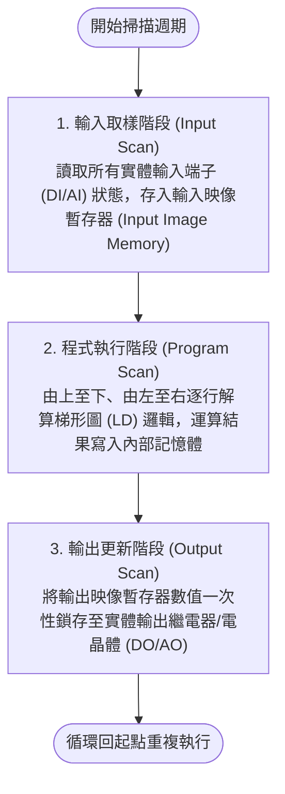
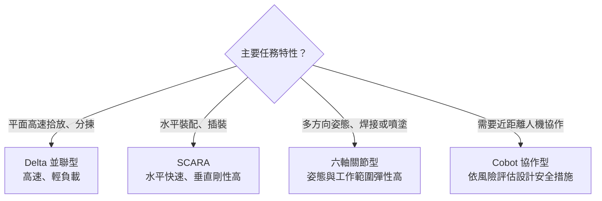
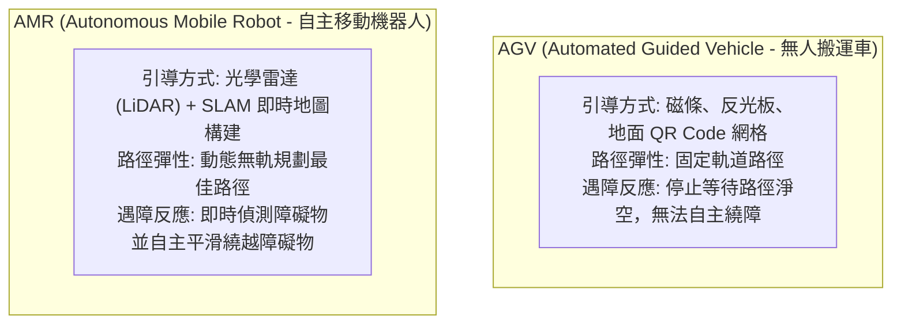
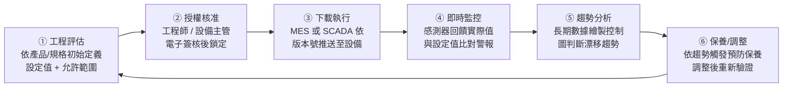
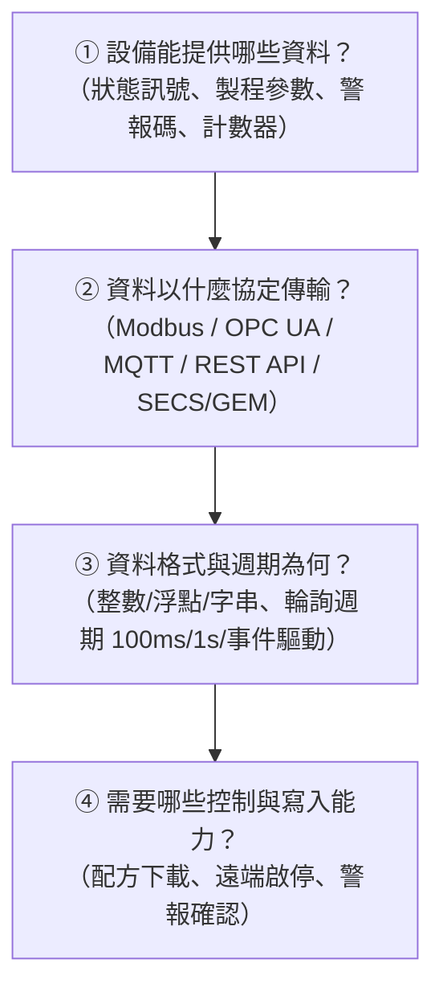
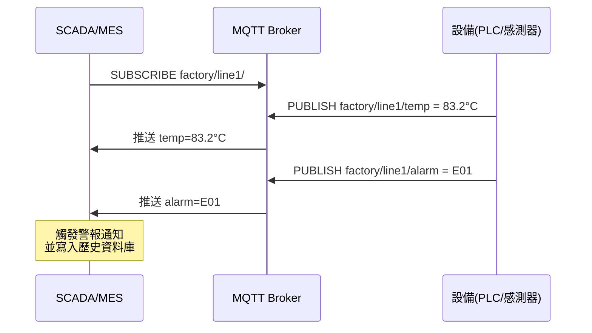

# 單元五：智動化生產設備與傳送系統

<figure class="unit-visual">
  
  <figcaption>3D 單元總覽<strong>圖解重點：</strong>中央 PLC 顯示輸入、邏輯、輸出循環；機器人關節與工具中心點呈現座標概念，固定路徑車與光達自主移動車則對照 AGV、AMR/SLAM 與車隊調度。</figcaption>
</figure>

## 1. 可程式化邏輯控制器 (PLC) 運作原理

可程式化邏輯控制器（Programmable Logic Controller, PLC）是現場自動化控制的核心，專為工業環境設計；實際耐受條件仍需核對設備等級與安裝規範。

### (1) PLC 掃描週期三部曲 (PLC Scan Cycle)
PLC 採用循環週期掃描（Cyclic Scan）機制，一個掃描週期通常在 1~50 毫秒（ms）內完成：

*特點*：在程式執行階段中，即使實體輸入訊號發生瞬間彈跳，輸入映像暫存器數值保持不變，直至下一個掃描週期才會更新，確保控制邏輯執行的時序一致性。

### (2) IEC 61131-3 五大標準程式語言

| 語言名稱 | 英文全名與縮寫 | 語法型態 | 適用領域 |
| :--- | :--- | :--- | :--- |
| **梯形圖** | Ladder Diagram (LD) | 圖形化語言 | 模擬傳統繼電器電路圖，電控維修人員最易理解，市佔率最高 |
| **功能區塊圖** | Function Block Diagram (FBD) | 圖形化語言 | 類似積木電路與邏輯閘，適合訊號處理、PID 閉迴路控制 |
| **結構化文字** | Structured Text (ST) | 高階文字語言 | 類似 Pascal / C 語法，適合複雜數學計算、陣列搜尋與配方解析 |
| **循序功能圖** | Sequential Function Chart (SFC) | 圖形化架構 | 以步（Step）與轉換（Transition）描述狀態機，適合步進工序控制 |
| **指令集** | Instruction List (IL) | 低階文字語言 | 類似組合語言，已逐漸被 IEC 新版標準淘汰 |

---

## 2. 工業機器人分類與運動坐標系

### (1) 工業機器人機構構型選型

| 機器人構型 | 自由度 (軸數) | 結構運動特徵 | 最佳製造應用情境 |
| :--- | :--- | :--- | :--- |
| **SCARA 機器人** | 4 軸 (選擇順應性裝配機械手臂) | 垂直方向剛性極強，水平 $X-Y$ 面具備選擇性柔順順應能力 | 電子業插件（Through-Hole）、螺絲鎖附、小型零件快速拾放 (Pick & Place) |
| **六軸關節型機器人** | 6 軸 (Articulated Robot) | 模擬人類手臂肩、肘、腕關節，空間姿態靈活度最高 | 汽車車體點焊/弧焊、複雜曲面噴塗、CNC 鍛造上下料 |
| **並聯 Delta 機器人** | 3~4 軸 (蜘蛛型並聯機器人) | 驅動馬達固定於頂部靜平台，動平台極輕量化，加速度極高 | 食品糖果包裝、製藥業超高速分揀（每分鐘達 120 次以上） |
| **協作型機器人 (Cobot)** | 依機型而異，常見 6~7 軸 | 可支援特定協作功能；感測、速度及力限制能力依機型與工作站設計而異 | 人機協同裝配、實驗室取放；是否需要護欄須評估工具、工件與完整工作站風險 |

**選型重點：**先看工作空間、速度、負載、定位精度與人機安全需求，再選構型；協作型不代表任何情境下都可免除安全評估。

### (2) 機器人三大關鍵坐標系
* **關節坐標系（Joint Coordinate System）**：以個別馬達關節軸轉動角度（度數或弧度）表示，用於單軸寸動點檢。
* **世界坐標系（World / Base Coordinate System）**：以機器人基座幾何中心為原點 $(0, 0, 0)$ 的三維笛卡爾直角坐標系。
* **工具中心點（Tool Center Point, TCP）**：以安裝於手臂末端法蘭面上的夾爪、焊槍尖端或吸盤幾何中心定義的動態坐標系。程式運動軌跡的插值計算皆以 TCP 為基準點。

---

## 3. 車間自動化物流傳送：AGV 與 AMR

內部物流是消除「搬運浪費」的利器，現代工廠正由傳統軌道導引進化為無軌自主移動。

### (1) 導航技術技術指標比較
* **磁導引 AGV**：在車間地面鋪設磁條。建置成本低，但車間地面變更維護極其繁瑣，地面破損易引發脫軌。
* **二維條碼網格 AGV**：地面黏貼 QR Code 矩陣，車載向下鏡頭校正定位。適合密集高層貨架電商倉儲（如 Kiva 系統）。
* **雷射反光板 AGV**：利用車載旋轉雷射掃描車間立柱上的特定反光貼紙三角定位，定位精度高達 $\pm 5\text{ mm}$。
* **SLAM 自然導航 AMR**：利用同步定位與建圖（Simultaneous Localization and Mapping, SLAM）技術，結合車載輪速計、慣性測量單元（IMU）與安全光達，不需破壞現場地面環境即可在 3D 空間自主建圖導航。

### (2) 車隊調度管理系統 (Fleet Management System, FMS)
當車間有數十台 AMR 同時運行時，FMS 系統扮演交通警察角色：
1. **路徑無死鎖規劃（Deadlock-Free Path Planning）**：防止多台無人車在窄道相向對峙。
2. **電量管理與自動回充（Auto-Charging）**：當電量低於安全門檻（如 20%）且無待執行搬運任務時，自動導航至充電樁快充。
3. **與 MES/WMS 整合**：由 MES 下發叫料指令，FMS 分派距離最近之空閒 AMR 前往立體庫取料並送料至機台接駁口。

---

## 職能基準對照與實務解說

## 進階延伸：自動化設備的安全與整合邊界

### PLC 掃描與輸入輸出時序

典型 PLC 依序讀取輸入、執行程式、更新輸出並處理通訊／診斷；輸入變化可能要等到下一次掃描才被程式讀取。掃描時間、濾波、通訊延遲及輸出元件反應共同影響實際響應。高速計數或精確定位通常需使用專用功能模組。故障復歸應有明確條件，避免上電或通訊恢復後設備意外自動啟動。

### 機器人工作站整合

機器人與 PLC 需明確定義握手訊號，例如安全就緒、工件到位、程式選擇、循環完成與故障復歸；訊號需具備逾時與異常路徑。工具中心點、基座座標、工件座標與安全區域校準錯誤，可能造成定位偏差或碰撞。程式變更後須依程序驗證速度、路徑、夾治具與周邊設備互鎖。

### AGV／AMR 與物流任務

車隊調度需考量路線容量、交會點、電量、載具識別、電梯／門禁介接與人車混流規則。AGV 常沿預設路徑導引，AMR 可依環境感知規劃路徑，但兩者的實際自主程度取決於設備設計與場域設定。導航方式不會免除交通管制、速度限制、急停與人員訓練。

### 安全功能與復歸

急停、護門、光柵與安全掃描器等保護裝置應依風險評估設計，安全控制不得只靠一般應用程式或上位網路。排除故障後，復歸與重新啟動應是不同且可辨識的操作，避免人員仍在危險區時設備突然動作。維護旁路需受控、限時並留下紀錄。

### 自我檢核

1. PLC 通訊恢復後設備自動運轉可能造成什麼風險？
2. AMR 能自行繞障是否表示現場不需要人車動線管理？

**判讀要點：**可能造成非預期啟動與人員傷害；自主導航不能取代速度、區域、交會與人員管理。

### 深度應用：設備操作、參數與簡易保養

自動設備交接或換型時，依作業規範確認設備識別與工單、治具／模具、產品配方及版本、互鎖與安全裝置、警報狀態，再依核准程序確認首件。設備參數至少應可追溯設定值、允許範圍、實際值、產品／配方版本、修改人、修改時間與核准依據；未經核准不得以放寬警報或繞過互鎖來維持產出。

預防保養依時間、循環數或製造商規範安排清潔、點檢、潤滑及耗材更換；狀態監測則分析溫度、振動、電流等趨勢，協助調整檢查時機。兩者可併用：發現異常後先依安全程序停機或隔離，再記錄現象、告警碼與已執行處置；涉及電氣、壓力或防護裝置的維修交由具資格人員處理。

### 延伸判讀：協作機器人仍要做風險評估

協作功能描述設備具備特定的人機互動能力，不表示移除護欄後就自然安全。實際風險取決於末端工具、工件尖角、速度、力、作業空間、周邊設備與人員流程；須依適用規範完成風險評估、設定安全功能並驗證急停與復歸。AGV／AMR 也需確認路權、人車交會、充電區、失聯停車與手動復歸程序。

本章對應 **T2.3 定期檢測生產設備之重要參數**。依 P2.3.1，操作人員須依步驟保養、進行簡易異常排除並遵守環境及電氣安全要求。點檢值要配合警戒範圍、趨勢與通報流程，不能以調高門檻或略過紀錄取代處置。

### 職能任務：把設備點檢做成早期預警

P2.3.1 的重點是依機台操作步驟進行保養、簡易故障排除與安全要求。點檢表不應只是勾選「已檢查」：每個關鍵項目要有正常範圍、量測方法、頻率、責任人與超限反應。例如壓力、溫度、振動、潤滑、護罩與安全互鎖，都需依設備功能與風險定義可觀察的標準。

操作人員可執行的自主保養包括清潔、目視檢查、基本潤滑、簡單功能確認與異常通報；涉及電氣、機械安全、程式變更或超出授權範圍的維修，則須依資格與程序升級。這對應 K10 機台功能與特性、K11 保養程序，以及 S12 保養、S13 簡易排除和 S27 參數與故障歷史的預知保養能力。

### 智動化系統的整合判讀

PLC、機器人與 AGV／AMR 的資料與控制必須以安全為界。PLC 掃描、互鎖與警報支援受控動作；機器人換治具後要重新校正及測試；AMR 雖能以 SLAM 導航，仍須規劃速度、區域、障礙物偵測、人車協作與死鎖處理。任何遠端監控或自動調度都不可取代實體安全措施。

### 常見誤區

* 為減少警報而未評估就永久關閉警示或調高門檻。
* 把操作員點檢與專業維修混為一談，忽略授權與安全程序。
* 機器人程式、治具或 PLC 邏輯變更後，未做版本、備份、測試與復歸確認。

---

## 4. 自動設備參數管理（L12104）

自動化設備的製程品質高度依賴參數的正確性與可追溯性。參數管理是從「設定」到「預測性維護回饋調整」的完整生命週期。

### (1) 設備參數的四大類型

| 參數類型 | 說明 | 典型範例 |
| :--- | :--- | :--- |
| **工藝配方參數（Recipe Parameter）** | 與產品製程直接相關，不同產品品種有不同配方版本 | SMT 迴焊爐各溫區設定溫度、印刷機刮刀壓力與速度、CNC 主軸轉速與進給率 |
| **機台維護基準參數（Maintenance Threshold）** | 設備健康監測與檢查依據，超限需進一步確認原因 | 主軸振動、冷卻液溫度與供氣壓力；本節練習假設振動門檻為 $2.5\ \text{m/s}^2$，不是通用設備標準，實際依量測條件與設備規範訂定 |
| **環境控制參數（Environmental Parameter）** | 廠房環境對製程品質的影響因子 | 無塵室溫濕度（如 $22\pm1\,^{\circ}\text{C}$、RH $50\pm5\%$）、潔淨度（ISO Class 7）、靜電防護接地阻值 |
| **安全互鎖參數（Safety Interlock）** | 設備安全防護的觸發條件，不得擅自修改 | 光柵安全距離、急停迴路訊號、超壓洩壓閥整定值、過電流保護 CT 比 |

### (2) 參數生命週期管理流程

### (3) 參數紀錄必須包含的七大欄位

參數變更若未留下完整紀錄，一旦發生異批品質差異便無法溯源：

| 欄位 | 說明 | 不可缺少的原因 |
| :--- | :--- | :--- |
| 設定值（Set Point） | 目標控制值 | 確認當時下達的目標 |
| 允許範圍（Tolerance / Spec Limit） | 上下規格限（USL / LSL） | 超限時觸發警報 |
| 實際值（Actual Value） | 感測器即時量測回傳值 | 判斷製程是否受控 |
| 產品/配方版本（Recipe Version） | 對應哪個品種的第幾版配方 | 避免新版覆蓋舊版而追不回來 |
| 修改人（Modified By） | 進行參數變更的操作者帳號 | 責任歸屬與異常追查 |
| 修改時間（Timestamp） | 變更發生的精確時間戳記 | 與品質異常時間軸比對 |
| 核准依據（Approval Reference） | 工程變更單 ECR/ECO 編號或核准簽名 | 未授權修改的防護機制 |

### (4) 預測性維護（PdM）關鍵監測參數

預測性維護（Predictive Maintenance, PdM）透過長期蒐集設備運行數據、建立健康基線，提前預判故障，避免非計畫停機：

| 設備類型 | 監測參數 | 常用感測器 | 健康退化早期警訊 |
| :--- | :--- | :--- | :--- |
| **旋轉機械**（馬達、泵、風扇） | 振動頻譜（振動加速度 $a$、速度 $v$、位移 $d$）、軸承溫度 | 加速度規、振動感測器（MEMS） | 1× RPM 基頻幅值上升→不平衡；軸承特徵頻率（BPFO/BPFI）出現→滾珠磨損 |
| **液壓/氣壓系統** | 工作壓力 $P$、油溫、流量 | 壓力傳感器、流量計 | 壓力波動加大→閥件洩漏；溫度升高→油液劣化 |
| **電氣設備**（VFD 變頻器、馬達） | 電流諧波、溫升、絕緣電阻 | 電流互感器（CT）、熱像儀 | 電流不平衡→繞組局部短路；溫升異常→冷卻失效 |
| **CNC 主軸** | 主軸電流（切削扭矩代理）、振動、工具壽命累積 | 主軸電流感測器 | 電流上升→刀具磨損；振動頻率偏移→主軸軸承退化 |

> **考試判讀重點**：PdM 的邏輯是「數據趨勢 → 預測剩餘壽命（RUL）→ 提前安排窗口停機保養」，目標是在設備「快要壞但還沒壞」的時機點介入，既不浪費資源（相較定期保養），又避免突然失效（相較事後維修）。

### (5) 自我檢核

1. 操作員發現目前迴焊爐溫度比設定值低 3°C，直接在 HMI 上調高設定值，這樣做有什麼風險？
2. PdM 系統顯示主軸振動值從三個月前的 $1.8\ \text{m/s}^2$ 升至 $2.4\ \text{m/s}^2$，此時應採取什麼行動？

**判讀要點**：①未經工程核准自行改配方版本，可能造成品質批次偏移且無法溯源；②振動接近預設門檻（$2.5\ \text{m/s}^2$），應提前安排預防性保養，檢查軸承潤滑與動平衡，不能等警報觸發才處理。

### 公告試題補強：異常處置、維護策略與設備任務

**對應 115 年第一次 L12 公告試題第 5～6、8～10、12、14、17、26、33、35、39～40 題。**題目提供「異常振動」且要求在作業系統、機械結構、網路與介面間選擇時，先朝機械結構檢查，如鬆動、對心、軸承、傳動與固定狀態；現場仍應先遵守停機與隔離程序，並排除感測器安裝或工況改變造成的假異常。原點復歸（Homing）建立已知參考位置，支援後續定位；它不等於故障復歸，也不會直接提高加工速度。

維護策略要看觸發條件：故障後處理是 FAF；按日曆或循環數安排是定期預防保養；持續監測並預測劣化、提早安排處置則符合 IMS 的 PAP。預測系統未告警，不代表設備沒有問題：模型未涵蓋該故障、資料傳輸中斷或錯誤操作造成突發損壞，均可能使預警失效。關鍵參數持續漂移時，即使未超限，也應確認量測可信度、製程影響與維護需求；只校正畫面上的數字不能消除真實劣化。

HMI 是人員監控與操作設備的窗口，介面整合則需事先約定資料、格式、通訊與版本。六軸關節型機器人適合多方向姿態任務；AGV／AMR 主要執行物料領用與轉運，其派車紀錄可支援追蹤，但不因此成為品質管理系統。

### 試題判讀與選項辨析：設備任務、維護與介面

| 題號 | 必要知識與判斷步驟 | 常見誤選理由 |
| :--- | :--- | :--- |
| 5 | 先辨識動作對象：AGV／AMR 移動物料，主要任務是領用與轉運；生產追蹤及品質監督是可與之整合的管理用途。 | 因搬運紀錄可追蹤，就把派車設備的主要職責改判成全廠生產執行跟蹤。 |
| 6 | 在題內四類候選中，異常振動首先指向機械結構；按程序停機／隔離後檢查固定、對心、軸承及傳動，並核對感測安裝。 | 看見設備有電腦便先改作業系統或網路設定；也不可從一個振幅就直接斷定某個零件已壞。 |
| 8 | 「防患於未然」須有故障前的監測、風險辨識與處置；要看是否在事件發生前改變風險。 | 將事後檢討當作預警，或只靠增加人力、發放手冊就認為已建立設備異常監控。 |
| 9 | 逐項檢查「能否偵測此故障、資料有無送達、是否有突發誤操作」；三者都可能造成預警未出現。 | 將無告警直接等同模型正常，或把所有漏警都歸因於模型，忽略通訊及現場使用條件。 |
| 10 | 反向題：量測偏移可能是感測失準，也可能是真實製程／設備劣化；先查原因與品質影響，再依核准流程處置。 | 只把數值調回標準便宣告沒有品質影響；校正量測系統、改顯示值與修復設備不是同一種動作。 |
| 12 | HMI 把設備狀態、警報及受權操作呈現給人員，核心是監控與控制的互動窗口。 | 將「介面」當作 AI 訓練、能源供應或維修本體；有按鈕也不代表任何人都能改配方或遠端啟動。 |
| 14 | 整合前建立資料格式、通訊方式、命名與介面需求，再管理版本及驗證責任，才能減少對接歧義。 | 將自由命名、每台重寫或不留版本當成彈性；這會提高整合及追查成本，不能以內部使用為由省略。 |
| 17、33、35 | 用三層記憶 IMS：第 17 題辨認 PAP 策略；第 33 題辨認持續監測及性能預測；第 35 題辨認支援預測的資料探勘能力。 | 只背 IMS 縮寫，卻混淆維修策略、監測作業與分析技術。固定週期保養可有價值，但不等同依設備狀態預測。 |
| 26 | 題目以工業場域、多關節／多自由度設備描述工業機器人，先看用途及機構功能。 | 因動作像人就判成仿人型，或把所有自動設備都視作服務機器人。 |
| 39 | Homing 建立已知位置參考，供後續定位使用；檢查復歸完成狀態及允許啟動條件。 | 把回原點當加速、故障清除或進維修模式；參考點建立也不會自動校正所有治具與工具誤差。 |
| 40 | 六軸關節型手臂以多軸協調調整空間位置與姿態，適合需要方向變換的任務。 | 將其誤限為平面或堆高用途；自由度高不代表必然達到所有精度、負載、可達性或無碰撞要求。 |

**漏警追查順序：**先保存故障時間、工況與版本，再比對現場感測值、傳輸紀錄、模型輸入及告警輸出，最後確認人員收到與處置情形。未收到通知可能發生在任一段，不能只重訓模型就當作完成改善。

**原創小題：**設備溫升持續增加，工程師把告警上限調高後畫面恢復綠燈，是否完成改善？**答案：否。**這只改變判定條件；須確認冷卻、負載、量測與劣化原因，依核准程序處置，並用維護後數據驗證效果。

---

## 5. 智慧製造設備管控介面基本知識（L12105）

當工廠引進新設備或整合既有設備至 MES/SCADA 系統時，必須能辨識介面需求、制定介面規格書，並確認資料擷取方式，這是設備工程師與 MES 系統整合的核心能力。

### (1) 辨識設備管控介面需求的四個問題

在評估設備能否被智慧化串接之前，須先回答以下四個問題：

### (2) 常見設備管控介面協定比較

| 通訊協定 | 典型應用層 | 主要特性 | 適用情境 |
| :--- | :--- | :--- | :--- |
| **Modbus RTU / TCP** | 設備層（L1~L2） | 簡單暫存器讀寫，主從架構，不含資料語意 | PLC、儀表、老設備改造 |
| **OPC UA** | 製造控制層（L2~L3） | 物件語意模型、資安加密（X.509）、跨平台 | MES↔設備整合、數位雙生資料源 |
| **MQTT** | 工廠資訊層（L3~L4） | 輕量發布/訂閱、適合高頻感測數據、低頻寬耗用 | IIoT 閘道器至雲端/邊緣平台 |
| **SECS/GEM（SEMI E5/E30）** | 半導體設備標準 | 標準化設備通訊、支援配方上傳/下載與事件報告 | 半導體前段製程設備 |
| **REST API（HTTP/S）** | 企業整合層（L4） | 跨系統鬆耦合、JSON 格式、易測試 | MES↔ERP、看板顯示板、行動裝置查詢 |

### (3) 開立設備通訊規格書（Interface Specification）

設備採購或自動化整合時，須向設備供應商提出「設備通訊規格書」，包含以下要素：

| 規格書欄位 | 說明 | 範例 |
| :--- | :--- | :--- |
| **資料點清單（Tag List）** | 需要採集的所有資料點名稱、型別、單位 | `SpindleSpeed`（Float, RPM）；`AlarmCode`（INT16）；`PartCount`（UINT32） |
| **通訊協定與連線方式** | 協定版本、埠號、IP 位置或 COM Port 設定 | OPC UA TCP `opc.tcp://192.168.1.100:4840`；Modbus TCP port 502 |
| **資料刷新週期** | 各資料點的採集頻率需求 | 製程參數每 500 ms；警報訊號事件驅動（Event-Based） |
| **資料格式與精度** | 數值型別、小數位數、字元編碼 | 溫度：`FLOAT32`，精度 $\pm 0.1\,^{\circ}\text{C}$；批號：`UTF-8` 字串最長 32 字元 |
| **控制寫入需求** | 需要由上位系統下寫的控制點 | 配方號碼寫入（Modbus Holding Register 40001）；遠端復歸警報（Coil 00010） |
| **資安與權限** | 讀/寫帳號分層、TLS 加密要求 | OPC UA：讀取帳號 `MES_READ`；寫入帳號 `ENG_WRITE`（需 X.509 憑證） |

### (4) 設備資料擷取方式：輪詢 vs 事件驅動

**輪詢式（Polling）**：上位系統以固定週期主動向設備請求資料。
- 優點：簡單易實作，不依賴設備主動能力。
- 缺點：固定週期可能錯過短暫的警報觸發事件；大量設備同時輪詢產生網路流量峰值。

**事件驅動式（Event / Subscription）**：設備在數值變化或事件發生時主動推送資料。
- OPC UA 可採用「訂閱（Subscription）+ 監視項目（Monitored Item）」機制，依資料變化、狀態與所設定的過濾條件通知；死區（Deadband）是可設定的過濾方式之一。
- MQTT 採用「發布/訂閱（Pub/Sub）」，設備作為 Publisher 向 Broker 主題發布，MES 訂閱主題接收。

### (5) 介面整合常見問題與因應

| 問題現象 | 根本原因 | 因應措施 |
| :--- | :--- | :--- |
| 資料點讀值永遠是 0 或固定值 | Modbus 暫存器地址偏移（0-based vs 1-based） | 確認設備手冊的 Modbus Map，注意 Coil/Holding Register 地址基底差異 |
| OPC UA 連線斷線頻繁 | Keep-alive 超時或憑證過期 | 調整 Session Timeout 設定；更新 X.509 憑證 |
| 時間戳記與工廠時鐘差異數秒 | 設備未同步 NTP 時鐘 | 強制設備透過 NTP 伺服器對時，或在資料點中加入設備端自報時間戳記 |
| 配方下載後設備執行舊版 | 設備本地快取未清除 | 在規格書中明定「配方下載後須等待設備回報版本確認訊號再啟動」 |

> **考試判讀重點**：L12105 考的是「能辨識需求、開立規格、讀懂資料流向」，不要求深度程式撰寫能力。重點在於：**知道要採集什麼、用什麼協定、怎麼驗證資料正確**。

## 深度研讀：控制時序、設備握手與物流能力聯合判斷

### 1. 看得見訊號，不表示來得及完成動作

設備回應時間包含感測器、輸入濾波、控制程式、通訊／輸出模組及機構動作，不能把 PLC 掃描時間直接當作整台機器的反應時間。以下只分析一般生產命令，不用來設計安全停止距離：假設輸入濾波最多 2 ms，PLC 固定 10 ms 一掃描，開頭讀輸入、結尾更新輸出，輸出模組再需 3 ms，機構動作需 20 ms。訊號若剛錯過輸入更新，最不利估算可達 $2+10+10+3+20=45$ ms，包含等下一掃描及該次程式完成的時間。

若輸入脈衝只有 6 ms，可能在兩次輸入取樣間出現又消失；單純把 HMI 畫面更新改快無法補救。可依設備能力採輸入保持、硬體鎖存、高速輸入或合適中斷，再確認去彈跳與解除條件。實際 PLC 支援不同任務、I/O 更新方式與模組延遲，必須查手冊並量測；案例的 45 ms 是假設架構下的估算，不是所有 PLC 的規格。

例如 [Siemens 官方製程映像說明](https://docs.tia.siemens.cloud/r/simatic_s7_1500_et_200mp_manual_collection_enus_20/basic-information/simatic-drive-controller/configuring/process-images-and-process-image-partitions/process-image-overview) 描述其循環程式起始時先輸出再讀輸入，與本節為計算設定的簡化順序不同；這正說明不能未查機型就把教科書的掃描圖當作實際時序。

### 2. 整合案例：裝配站為何常等不到物料

**假設與輸入：**裝配站每分鐘消耗 5 件，每托盤 30 件，因此每 6 分鐘需一托盤，即每小時 10 趟。單台 AMR 每趟取盤 1 分、載貨行駛 2 分、交接 1 分、回程 2 分，循環共 6 分。若忽略充電與交通，能力剛好為 10 趟／小時，沒有餘裕；若有效可派車時間只有每小時的 80%，能力成為 $60×0.8÷6=8$ 趟，僅能補充 240 件／小時，低於需求 300 件。

**資料與決策：**兩台同型車的平均能力為 16 趟／小時，表面上足夠，但仍需檢查窄道、接駁口與充電是否共用；若兩車互相等待，不能直接相加。假設從叫料到補貨完成的最長前置時間為取盤 1 分、載貨 2 分、交接 1 分及最多排隊 2 分，共 6 分，期間需求為 $5×6=30$ 件。再採教學假設的 15 件緩衝量，叫料點為 45 件；因此不能等到只剩一個 30 件托盤才呼叫。

**設備握手：**MES／物流系統發送唯一任務號與目的站，車隊系統回報接單、到站及完成；PLC 只有在托盤識別正確、接駁機構就緒、工作區符合條件時才允許交接。任務「到站」不等於物料已移入線邊庫存，應在交接完成與數量確認後入帳。若完成回報遺失，須查詢原任務狀態，不能直接另開相同送料任務，否則可能多送一盤。

**維護影響：**若交接機構振動逐週增加，可能拉長交接或造成失敗重試。先比較相同負載、速度與量測位置下的趨勢，再查固定、潤滑及傳動，不能只看派車數不足。維修後須同時驗證機械狀態、交接成功率與完整循環時間；僅降低振動數字而送料仍失敗，不算完成改善。

**驗證：**以一班尖峰需求測試叫料到到站、到站到交接、排隊時間及缺料分鐘，分別統計平均與最長值；納入一台車充電、交接失敗、通訊中斷與重複命令。若最長前置時間超過 6 分鐘，應調整車數、路線或叫料點，再重算，而非把案例緩衝值當作永遠適用的常數。

### 3. 反例：復歸、啟動與維修完成不能混用

清除警報只代表警報已復歸，並不代表機構已回原點、工件狀態正確或可安全啟動。原點復歸建立定位基準，也不保證換治具後 TCP 或工件座標正確。復歸後應依程序重新確認設備、物料及互鎖；維修或程式更新後亦需保留版本與驗證紀錄。一般生產用的「Ready」訊號不能自行取代已設計的安全功能。

### 4. 進階練習與解析

**練習一：**一般命令鏈有輸入濾波 1 ms，PLC 週期 8 ms，採本節同樣的輸入／輸出時序，輸出模組 2 ms，機構動作 15 ms。最不利估算為多少？若輸入脈衝僅 4 ms，是否可保證每次看到？

**解析：**估算 $1+8+8+2+15=34$ ms。4 ms 小於週期，且未提供鎖存或高速擷取能力，不能保證取樣。改善須處理輸入擷取機制，而非只加快上位看板；若涉及安全反應，應另依完整安全設計驗證，不能使用這個一般命令算式替代。

**練習二：**某工站每分鐘耗用 4 件，每盤 24 件；補貨最長前置時間 7 分鐘，希望保留 8 件緩衝。叫料點多少？若單車循環 9 分鐘、有效時間為每小時 45 分，平均能力是否足夠？

**解析：**叫料點為 $4×7+8=36$ 件。需求每小時 240 件，即 10 盤；單車只能 $45÷9=5$ 趟，供給 120 件，僅需求一半。增加線邊庫存只能延後缺料，不能消除長期能力不足；需調整物流能力或需求，再驗證排隊與交接限制。
