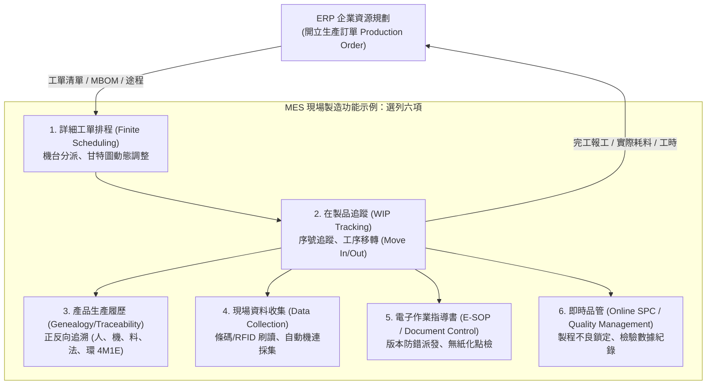
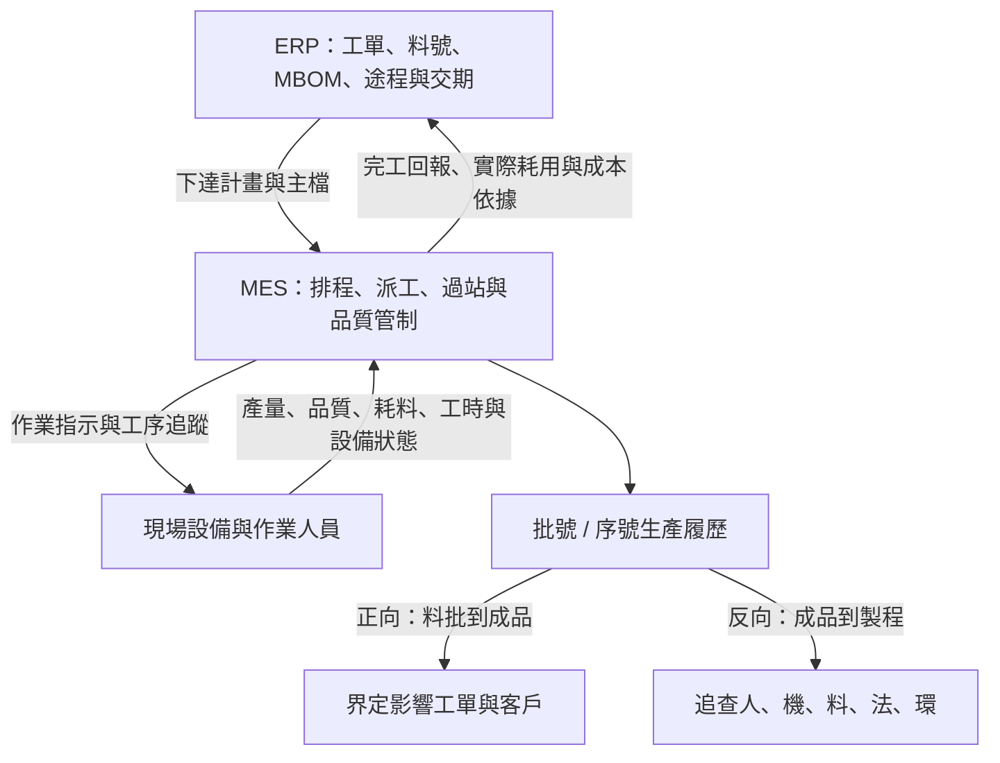

# 單元六：智慧工廠生產模式與 MES 整合

<figure class="unit-visual">
  
  <figcaption>3D 單元總覽<strong>圖解重點：</strong>企業規劃經 MES 對排程、派工、品質、維護與設備下達工單，現場實績再回饋；下方履歷線、條碼/RFID、安燈與問題解決閉環對應追溯、Andon 與 8D。</figcaption>
</figure>

## 1. 製造執行系統 (MES) 核心定位與職能

製造執行系統（Manufacturing Execution System, MES）位於企業控制架構 ISA-95 的 Level 3，專注於從「工單下達」到「成品產出」之間現場活動的最佳化管理。

---

## 2. ERP 與 MES 雙向整合架構

ERP 著眼於「財務、採購、庫存總帳與客戶交付期」，MES 則掌管「車間實體運轉與即時工藝」。兩者缺乏對接將造成生產進度黑箱與財務庫存帳實不符。

### 雙向資料交換接口規範
* **ERP $\to$ MES（向下發布指令）**：
  * **工單主檔（Production Order Master）**：包含工單編號、產品料號、計畫投入數量、要求完工交期。
  * **製造物料清單（MBOM）**：該批工單所需組件之單機用量與替代料清單。
  * **標準工藝途程（Standard Routing）**：標準工序步驟、對應工作中心與額定標準工時（Setup Time, Run Time）。
* **MES $\to$ ERP（向上反饋實績）**：
  * **工序完工報工（Production Confirmation）**：實際產出良品數、不良報廢數。
  * **工時扣帳（Labor & Machine Hours）**：實際消耗之人工工時與機台加工工時，供財務系統計算標準成本與實際成本之製造費用差異（Cost Variance）。
  * **物料消耗結轉（Material Consumption / Backflushing）**：依據實體投入或完工倒扣回傳各批次原料批號，由 ERP 庫存帳正式過帳核銷。

**資料方向快記：**ERP 向下交付計畫與標準；MES 向上回報現場實績。追溯同時要能從料批找受影響成品，也能從成品查回製造條件。

---

## 3. 在製品 (WIP) 追蹤與防錯追溯體系

### (1) 條碼與 RFID 追蹤技術比較
* **一維/二維條碼（1D Barcode / 2D QR Code / Data Matrix）**：
  * 成本極低，常以雷射直接雕刻（Direct Part Marking, DPM）於金屬或 PCB 板上。
  * 限制：屬於光學視距讀取（Line of Sight），須有足夠可視範圍與成像品質，易受表面油污刮損影響；具備相應能力的視覺讀碼器亦可一次辨識多個條碼。
* **無線射頻辨識（Radio Frequency Identification, RFID）**：
  * 分為高頻（HF, 13.56 MHz）與超高頻（UHF, 860~960 MHz）。
  * 優勢：非接觸式穿透讀取、可於數公尺內「批次多標籤同時群讀（Bulk Reading）」、標籤記憶體晶片支援現場動態改寫加工狀態。

### (2) 產品生產履歷與追溯性 (Genealogy & Traceability)
智慧製造要求達到精準的雙向溯源（Bidirectional Traceability）：
* **正向追蹤（Forward Tracking / Where-Used Analysis）**：
  當供應商通報某一批次特定批號（Lot Number）的電容有爆漿缺陷時，MES 能立即清查該批料被組裝進哪幾張工單、目前對應成品的出貨客戶清單，實施精準召回。
* **反向追查（Backward Tracing / Root-Cause Investigation）**：
  當市場端回報某一序號（Serial Number）成品故障，輸入系統即能瞬間展開 4M1E 完整履歷：何時生產、哪位作業員組裝、在哪一台機台加工、各溫區參數數值、所有原物料批號。

---

## 4. 現場異常反應機制：安燈系統 (Andon) 與 8D 程序

### (1) 安燈系統 (Andon System) 燈號定義
安燈源自豐田生產方式，利用可視化三色燈塔與看板迅速通報現場突發中斷：

  

    
🚦

    

      <h3 class="infographic-title">現場安燈系統 (Andon System) 三色狀態燈塔視覺化</h3>
      
及時目視化通報 ➜ 現場快速應變 ➜ 自働化異常隔離

    

  

  

    

      

      <h4 class="andon-status-name">綠燈 (Green): 正常運轉</h4>
      
產線按標準節拍 (Takt Time) 順暢作業中，各工序無缺料、無故障，設備稼動中。

    

    

      

      <h4 class="andon-status-name">黃燈 (Yellow): 預警求援</h4>
      
產線仍運轉但面臨潛在風險：線邊料件低於警戒水位、刀具即將壽命到期、待品檢簽核。

    

    

      

      <h4 class="andon-status-name">紅燈 (Red): 停線警報</h4>
      
發生重大中斷：急停拍下、光柵遮斷、連出 2 件不良。產線強制停機，全員協同排查。

    

  

* **綠燈（Green）**：正常生產運轉中。
* **黃燈（Yellow）**：即將發生異常，請求支援（如缺料預警、刀具即將抵達額定使用壽命、首件檢驗待簽核）。機台仍維持低速運轉，尚未停機。
* **紅燈（Red）**：重大故障發生（如緊急停機按鈕拍下、安全光柵遮斷、連續產出不良品）。機台強制鎖定停止，呼叫維修與品保人員。

### (2) 異常通報升級機制 (Escalation Process)
現代智慧化安燈系統與 MES/行動通訊連動：
* 故障停機發生 0~5 分鐘：現場機台紅燈閃爍，警報聲響，工位觸控螢幕顯示異常代碼。
* 超過 15 分鐘未排查復機：系統透過推播自動發送簡訊/通訊軟體通知產線領班與設備工程師。
* 超過 30 分鐘仍停工：系統自動升級通知製造部經理與廠長，介入資源協調。

### (3) 8D 問題解決法 (Eight Disciplines Problem Solving)
針對經常性或嚴重品質異動，必須依序推動 8D 流程，防止問題重複發生：
* **D1：成立改善團隊**（跨組裝、製程、品保、採購）。
* **D2：問題描述**（以 5W2H 精確定義缺陷特徵與不良率）。
* **D3：實施臨時圍堵措施**（全面清查線上 WIP 與庫存，將疑似不良批次隔離）。
* **D4：根本原因分析**（利用 5 Whys 與魚骨圖尋找根因）。
* **D5：擬定永久對策**。
* **D6：執行並驗證對策有效性**。
* **D7：預防再發與標準化**（更新 SOP、修正 FMEA、落實 Poka-Yoke 防呆）。
* **D8：恭賀團隊**。

---

## 職能基準對照與實務解說

## 進階延伸：MES 的交易閉環與追溯設計

### 工單生命週期與狀態一致性

典型生命週期包含工單下達、排程、派工、開工、報工、暫停／異常、完工與結案。每次狀態轉換需定義操作者或系統、前置條件、時間戳與失敗處理。重複掃碼、網路重送或設備離線可能造成重複報工，因此介接需設計交易識別碼、去重及補送機制。

### 追溯資料粒度

依產品風險決定以批次、序號或載具為追溯單位，並將工單、物料批號、設備、程式／配方版本、操作者、製程參數、檢驗結果與時間關聯。資料保留政策需兼顧客戶／法規要求、查詢速度與容量。若只記錄工單總數，通常無法回答特定序號使用哪一批原料或經過哪個設備參數。

### ERP 與 MES 的責任分工

ERP 通常負責商業訂單、物料與財務層級計畫；MES 負責現場可執行工單、工序狀態、資源與製程履歷。實際系統邊界依企業架構而異，介接前應明確定義工單／料號／單位主檔的權威來源、資料同步方向、回報時點與錯誤佇列責任。雙向介接不代表兩邊可以同時任意修改同一欄位。

### 異常處置與安燈升級

安燈訊號應連結異常類型、位置、時間、責任角色、回應時限及結案原因。優先順序可按安全、品質、設備、物料與交期影響分級；只有顏色燈號而沒有回應與結案紀錄，不足以形成管理閉環。異常結案後可將原因碼與措施回饋至排程、維護或品質系統。

### 自我檢核

1. 現場網路恢復後同一筆報工重送兩次，介接應如何避免重複計數？
2. 要追溯單一序號使用的原料批號與設備配方，需保存哪些關聯？

**判讀要點：**以唯一交易識別碼去重並提供安全重送；需保存序號、工單、物料批號、設備與程式／配方版本及時間關聯。

### 深度應用：工單、批次與製程資料形成閉環

一張工單在 MES 中通常依序經過接收與核對主檔、排程、派工、工序報到、領料／過站、品質檢查、完工報工與結案。每個事件都要連到正確的產品版本、工序、設備、人員、物料批次、時間與品質結果；若工序跳站、物料批號不符或檢驗未放行，系統應依規則攔截或進入受控例外流程，而非只留下告警文字。

### 延伸分析：Run-to-Run 批次回饋

Run-to-Run 控制以一批完成後的實測結果，支援下一批參數決策。例如上一批關鍵尺寸偏離目標時，先檢查量測系統、原料批次、設備狀態與配方版本，再依核准的控制規則計算有限幅度的修正，並追蹤下一批結果。只有在資料品質、製程關係與參數邊界已驗證時才可自動化；若原因不明或超出限制，應停用自動調整並轉人工調查。

MES 分析的完整循環是「收集 → 清理與確認 → 比較批次／設備／工序 → 找出可驗證的差異 → 執行受控改善 → 追蹤品質、產能與交期結果」。資料量大不等於資料可用；缺少時間、批號、單位或版次時，關聯分析可能把不同條件的批次錯誤相比。

本章對應 **T3.1 確認技術文件有效性**及 **T2.4 調查並處理生產線的異常狀況**。依 P3.1.1，文件版次變更要即時確認，避免造成損失；MES 應將工單、有效 SOP/MPI、品質狀態與稽核軌跡連結，使過期文件、錯誤過站或異常處置都能追溯。

### 職能任務：把工單、文件、品質與異常連成同一筆製造事實

MES 的核心不是把紙本表單電子化，而是讓現場執行可即時、可追溯且受控。ERP 下達的生產訂單需在 MES 轉為可執行的工單與工序；每個站點再連結有效版次的 SOP／MPI、適用料件與批次、設備狀態、作業人員、品質規格及報工結果。這同時支援 T3.1 的 K18 文件管理與 S22，以及 T2.4 的異常分析、問題解決能力。

資料交換應定義主檔、交易、狀態、時間與錯誤處理責任。例如 ERP 送來工單、料號、版本與目標數量；MES 回傳完工、耗料、工時、品質與異常結果。若欄位定義或生效版本不同，即使介面技術成功，也可能造成錯料、錯工序或錯誤庫存。

### 異常與文件的受控處理

當工單誤過站、檢驗不合格或引用過期作業指示時，系統應保留原始紀錄，以權限、原因與稽核軌跡進行更正；再依規則隔離、返工、複驗、放行或升級。直接刪除資料、只改紙本或以口頭通知取代受控更正，都會破壞追溯性與品質判定。

### 常見誤區

* 將 MES 誤當成直接控制 PLC 的系統，忽略其製造營運管理定位。
* 電子化文件只有檔案附件，卻沒有版次、生效、權限與工單連結。
* 只記錄不良結果，沒有連結批次、設備、工序、物料與處置結果來支持根因分析。

### 公告試題補強：從看板指標選擇改善方向

**對應 115 年第一次 L12 公告試題第 7、16、34、36～38、41～50 題。**即時顯示時間稼動率與當日工單良率，對應 MES 的 OEE 模組；電子看板支援共享狀態與快速反應，仍須保留資料稽核、更正與異常結案。日報欄位要分清：操作／製程欄對應工序，工號識別執行人員，產品代碼是料號，加工量為實際加工數，不良品個數另欄記錄。不要以工號代替料號，亦不可只留下最終累計而覆寫首次檢驗結果。

OEE 的三個分母分別是負荷時間、實際運轉時間與總產出數。**原創計算：**負荷 450 分鐘、停機 90 分鐘，標準週期 0.5 分鐘／件，產出 600 件、首次合格 570 件，則時間稼動率 $A=360÷450=80\%$，性能稼動率 $P=(0.5×600)÷360=83.33\%$，品質率 $Q=570÷600=95\%$，$OEE=A×P×Q≈63.33\%$。亦可用 $0.5×570÷450$ 交叉驗算。若使用首次合格數作為品質率，重工完成後不可再把它無條件改為 100%，否則會掩蓋品質損失。

低稼動率先查故障、換線、待料等時間損失；低性能先查降速與微停；低品質率則查報廢與返工。第 49 題以低稼動率、較高良率提示頻繁停機或待機；只改善加工精度無法直接補回停機時間。換模換線改善主要減少停機損失，預防保養則以減少突發故障支持生產力。第 45 題提醒相似設備也可能因生產方法與策略而有不同效率；比較前要對齊產品、工況、標準週期、統計期間及停機分類，不能只憑設備新舊或操作者身分推定原因。

第 46 題採最終良品率與直行率比較：100 件中 10 件經重工才合格，最終良品率為 100%，首次直行率為 90%。第 47 題的連續三道作業時間應相加；若三站可同時流水作業，穩態產出節拍另受瓶頸限制，不能混為單件總加工時間。拉式生產由下游實際需求觸發補充；導入 MES 或電子看板本身不會自動把推式排程變成拉式。

### 試題判讀與選項辨析：MES、績效分母與改善方向

| 題號 | 必要知識與判斷步驟 | 常見誤選理由 |
| :--- | :--- | :--- |
| 7 | 同時顯示設備時間稼動與工單良率，應找將時間、產量及品質整合的 OEE 模組。 | 只因報工提供資料就選報工系統，或把單純設備監控當成已計算工單品質績效。 |
| 16 | 反向題：電子看板共享現況、減少人工通報等待，但仍需資料來源、稽核、更正及結案流程。 | 把「減少人工依賴」放大成「全面取消紀錄與稽核」；即時顯示不等於資料必然正確。 |
| 34 | 反向題：MES 支援執行、追溯、品質及換線協調；新產品本體設計主要屬工程研發及 CAD／PLM。 | 因 MES 會使用產品版次或製程文件，就認為它直接設計全新產品；使用工程資料與創建設計是不同責任。 |
| 36 | 稼動、運轉效率與預防保養可分別減少時間／速度損失及突發故障，所以題內三項皆可能支持生產力。 | 只選最熟悉的單一方法；實務仍應核對瓶頸與需求，非瓶頸稼動提高不必然增加全線交付。 |
| 37 | 換模換線改善直接縮短停機設定時間，在相同負荷口徑下提高 Availability。 | 把多機作業的人員配置改善直接當作設備稼動改善，未說明是否真的減少該設備停機。 |
| 38 | 反向題：對照題內日報欄位，分清工序、實際加工量、人員識別及不良個數；產品識別應用料號／產品代碼。 | 只因「工」字就把工號當產品代碼。企業若用工號表示其他識別，需依資料字典讀取，不能只靠欄名猜測。 |
| 41 | 拉式由下游消耗／需求授權上游補充，需有數量與在製限制；電子訊息也可承載拉動訊號。 | 將裝電子看板或改小批量直接等同拉式，卻未改變投產觸發規則。 |
| 42、48 | OEE 先辨三個無因次比率，再相乘：時間稼動率 A、性能稼動率 P、品質率 Q。 | 以時間、速度、件數的原始數值直接相乘，量綱無法構成可比較的效率百分比。 |
| 43 | P 比較實際運轉期間的產出速度與理想／標準速度，公式為理想週期 × 總產出 ÷ 運轉時間。 | 把「有沒有開動」的 A，或「好不好」的 Q 當成速度表現；運轉時間不可再扣一次已歸為速度損失的微停。 |
| 44 | A＝運轉時間 ÷ 預先定義的負荷時間；先固定哪些時段納入生產計畫。 | 把修理時間本身當比率，或以良品數作時間指標；不同班表排除口徑也不能直接比較。 |
| 45 | 公告選擇生產方法／策略差異；它能影響換線、速度及作業損失。工程判讀還須分解 A、P、Q 並核對產品與期間。 | 只憑操作者、設備新舊或所在產線便斷定原因。僅知兩台效率不同，仍不足以證明唯一根因；題內答案是選項判讀方向。 |
| 46 | 保留投入 100 件分母：第一次合格 90 件，重工後最終合格 100 件，因此直行率 90%、最終良品率 100%。 | 將重工 10 件再計為新投入，或因全部修好就把首次品質也改為 100%；額外 10 分鐘是時間損失，不是件數分母。 |
| 47 | 按題內順序加工時間相加，單件總加工時間為 2＋3＋4＝9 分鐘。此處沒有另給評比／寬放資料，不自行追加。 | 將最長站 4 分鐘誤當單件總時間；若三站獨立且可重疊流水，4 分鐘才是理想穩態節拍，首件仍需依序通過。 |
| 49 | 良率 95% 與 A＝60% 分別描述品質和時間；題意主要指向頻繁停機／待機，而非先假設加工精度差。 | 看到效率不佳就一律改善品質，或忽略題目已排除的原料／設計變動。單靠比率仍不能再分辨故障、待料或換線，須查停機明細。 |
| 50 | 即時、可視與異常反應的作用是較快看見並處理問題；需把訊息接到責任人與處置流程。 | 把庫存增加當核心效益，或認為可視化能降低系統整合及品質穩定要求。 |

**兩個必要交叉檢查：**百分比以小數相乘，例如 A＝0.8、P＝0.9、Q＝0.95 時，OEE＝0.684＝68.4%；不是相加或平均。另第 46 題的「最終良品率」口徑，不能不經定義便搬進採首次合格率的 OEE；同一批產品可以最終全部交付，仍保留首次品質與重工時間損失。

## 深度研讀：以數量守恆與事件帳支援追溯及 OEE

### 1. 數量是狀態轉移，不能只把報工列相加

MES 需要區分投入、首次合格、待重工、報廢、已放行與已出貨。待重工轉為合格，是原有數量的狀態改變，不是再次投入；分批與合批亦是身分及關係改變，不會憑空增加總數。應先定義一致的計量單位與統計邊界，才能使用「投入＝合格＋報廢＋仍在製」核對。重量製程、組裝換算或耗損若使用不同單位，必須另列轉換及損耗，不能硬套件數相等。

事件帳保存發生過的事，現況表則由事件推導目前狀態。更正應以受控反向／補正事件保留原因及核准，不可刪掉原始事件，使昨天的查詢結果失去解釋。去重亦需在狀態及數量更新的同一交易邊界內完成，避免「已記錄收到事件，但數量尚未更新」的中斷造成不一致。

### 2. 整合案例：分批、重工、合批與召回範圍

**假設與輸入：**某批投入 480 件，分為 B1 280 件與 B2 200 件；B1 使用原料批 X，B2 使用原料批 Y。首次檢驗 B1 有 270 件合格、6 件待重工、4 件報廢；B2 有 188 件合格、8 件待重工、4 件報廢。因此首次合格 458、待重工 14、報廢 8，合計仍為 480。

重工完成後，B1 的 6 件中 4 件合格、2 件報廢；B2 的 8 件中 6 件合格、2 件報廢。最終 B1 為 274 良品及 6 報廢，B2 為 194 良品及 6 報廢；全批共 468 良品、12 報廢。若把重工的 10 件回收良品再列為「新增投入」，就會虛增成 490 件，破壞守恆。

接著包裝批 M 合併 B1 的 180 件及 B2 的 120 件，共 300 件，剩餘良品分別為 94 與 74 件，$300+94+74=468$。此時原料 X 發出品質警訊：若 M 沒有子序號或可實際識別的分區，雖知其中只有 180 件來自 B1，實物卻可能無法精確分開，需調查並暫控 M 全批 300 件，加上 B1 餘量 94 件，共 394 件。這是可操作的疑似影響範圍，不代表 394 件都已確定不良；若有可靠序號對應，才可評估將範圍縮至 B1 的 274 件。

**重送與決策：**假設 B2 首次報工事件 Q-B2-01 在網路恢復後重送。若以增量直接再加一次，會多出 188 合格、8 待重工與4 報廢，整體多 200 件。接收端應以來源、事件識別及適用生命週期去重，只有第一次有效事件改變狀態；同一識別卻出現不同內容時應保留衝突並待查，不能靜默覆寫。重工完成、合批與出貨則是不同事件，不能只用工單號去重而誤刪合法交易。

### 3. 同一批資料如何計算可比較的 OEE

假設本案例首次加工設備的班次為 480 分鐘，依預先定義口徑排除 30 分鐘休息，負荷時間為 450 分；再發生 50 分鐘停機，運轉 400 分。理想週期 0.75 分／件，首次產出 480 件，則 $A=400÷450≈88.89\%$、$P=0.75×480÷400=90\%$。若品質口徑採首次合格，$Q=458÷480≈95.42\%$，OEE 為 $0.75×458÷450≈76.33\%$。

重工由另一工作站執行，因此其時間不混入原設備本次 OEE；原設備亦不能把外站回收的 10 件直接補進首次合格分子。若誤用最終良品 468 件，會得到 78%，掩蓋約 1.67 個百分點的首次品質損失。若要另報最終交付效率，應另定義名稱、時間及分母。多產品標準週期不同時，應先計各產品理想加工時間，再彙總，不能直接平均各產品 OEE。

**驗證：**用事件帳重建 480 件的每個狀態與分合批關係，確認同一時點不重複存在於兩個庫位；再重送已收事件，結果須保持不變。核對停機時間不重疊、休息排除口徑固定、週期版本有效、首次與重工記錄可區分，才能把績效變動解釋成真實改善。

### 4. 進階練習與解析

**練習一：**一批 360 件分成 210 與 150；最終前批 204 良品、6 報廢，後批 147 良品、3 報廢。合批取前批 120 與後批 80 件，剩餘良品多少？若前批需調查、合批後無法逐件辨識，暫控範圍為何？

**解析：**良品總量 $204+147=351$，合批 200，剩餘 $84+67=151$；$351+9=360$。暫控合批 200 及前批剩餘 84，共 284 件；不能只說暫控來源數量 204 件而忽略實物已混合的可辨識限制，也不能直接把全部後批餘量列入。

**練習二：**負荷 420 分、運轉 350 分，理想週期 0.4 分／件，首次產出 750 件、首次良品 720 件。求 OEE；若同一完工事件被接收兩次，應如何驗證去重？

**解析：**$A=350÷420≈83.33\%$，$P=0.4×750÷350≈85.71\%$，$Q=720÷750=96\%$；OEE＝$0.4×720÷420≈68.57\%$。重送同一事件後，首次產出與良品應仍為 750、720，且留有已處理的回應或接收證據；只看 OEE 恰巧沒變不足以證明去重，因分子分母同時重複時比率也可能掩蓋錯誤。
