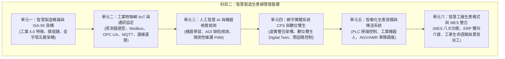

# 科目二：智慧製造生產線管理基礎 (Foundations of Smart Manufacturing Production Line Management)

依據經濟部產業人才能力鑑定標準（職能基準代碼：**MPM3117-001v3**），本科目著重評量工業 4.0 核心技術、工廠物聯網資料採集、機器視覺與人工智慧應用、自動化搬運與設備控制，以及製造執行系統（MES）與企業資源規劃（ERP）的垂直整合能力。

## 115 年度初級評鑑範圍對照

本教材依 [115 年度智慧生產工程師能力鑑定簡章（官方）](https://www.ipas.org.tw/api/proxy/uploads/certification/SPE/115%E5%B9%B4%E5%BA%A6%E6%99%BA%E6%85%A7%E7%94%9F%E7%94%A2%E5%B7%A5%E7%A8%8B%E5%B8%AB%E8%83%BD%E5%8A%9B%E9%91%91%E5%AE%9A%E7%B0%A1%E7%AB%A0%28%E5%88%9D%E3%80%81%E4%B8%AD%E7%B4%9A%29_20251229140907.pdf) 的 L12 主題加深說明。案例用於解釋官方評鑑內容，不代表官方指定的唯一技術或試題。

| 官方評鑑主題 | 本教材對應 | 擴充重點 |
| :--- | :--- | :--- |
| L121 智動化生產管理：ERP/MES、設備特性、保養、參數、介面、現場管理 | 單元一、二、五、六 | ISA-95 責任分層、感測資料鏈、設備參數履歷與保養反應 |
| **L12103** 簡易設備保養（預防性保養/故障排除）| **單元五 §深度應用** | PM/CBM 策略選擇、點檢表設計、自主保養授權範圍 |
| **L12104** 自動設備參數管理（含預測保養參數）| **單元五 §4** | 四大參數類型、七欄位紀錄、PdM 監測參數表、趨勢警戒門檻 |
| **L12105** 智慧製造設備管控介面基本知識 | **單元五 §5** | 介面需求四問、協定比較表、通訊規格書開立、輪詢 vs 事件驅動 |
| L122 智慧製造：IoT、AI、CPS、MES 與製程資料分析 | 單元二、三、四、六 | 資料品質、模型指標、虛實驗證與 Run-to-Run 批次回饋 |
| L123 設備操作實務：設備基本操作及稼動率／良率／效率辨識 | 單元五、六 | 安全互鎖、首件確認、設備狀態及效率指標判讀 |

---

---

## 評鑑單元架構

---

## 單元學習文件清單

1. [01_智慧製造概論與ISA95架構.md](./01_智慧製造概論與ISA95架構.md)：解析工業 1.0 至 4.0 演進、智慧工廠特徵、ISA-95 自動化架構各層職責、垂直整合與水平整合概念。
2. [02_工業物聯網IIoT與通訊協定.md](./02_工業物聯網IIoT與通訊協定.md)：現場常用工業感測器原理（振動、溫度、光電）、RS-485/Modbus RTU 與 Modbus TCP 暫存器機制、OPC 統一架構（OPC UA）資訊模型、MQTT 發布/訂閱（Pub/Sub）架構與工業邊緣閘道器。
3. [03_人工智慧AI與機器視覺檢測.md](./03_人工智慧AI與機器視覺檢測.md)：自動光學檢測（Automated Optical Inspection, AOI）光源與鏡頭配置、卷積神經網路（Convolutional Neural Network, CNN）於瑕疵分類之應用、旋轉機械振動頻譜特徵分析與預測性維護（Predictive Maintenance, PdM）。
4. [04_網宇實體系統CPS與數位雙生.md](./04_網宇實體系統CPS與數位雙生.md)：5C 網宇實體架構（Connection, Conversion, Cyber, Cognition, Configuration）、數位雙生（Digital Twin）虛實同步與虛擬除錯（Virtual Commissioning）。
5. [05_智動化生產設備與傳送系統.md](./05_智動化生產設備與傳送系統.md)：可程式化邏輯控制器（Programmable Logic Controller, PLC）掃描週期機制、工業機器人自由度與坐標系、無人搬運車（Automated Guided Vehicle, AGV）與自主移動機器人（Autonomous Mobile Robot, AMR）導航定位技術（磁條、QR Code、SLAM）。
6. [06_智慧工廠生產模式與MES系統整合.md](./06_智慧工廠生產模式與MES系統整合.md)：製造執行系統（Manufacturing Execution System, MES）核心模組、ERP-MES 雙向資料交換流程（工單下發、BAPI/WebAPI、現場報工）、防錯機制（條碼/RFID）與現場異常安燈（Andon）通報。

## 依 115 年第一次 L12 公告試題安排複習

| 試題題號 | 主章節 | 學習目標與選項辨析 |
| :--- | :--- | :--- |
| 1–3、15 | [單元一](./01_智慧製造概論與ISA95架構.md) | 判斷 ERP／MES／OT 的責任及 IIoT 的連結基礎；分清高速取數與製造營運彙整。 |
| 4、11、18–22 | [單元二](./02_工業物聯網IIoT與通訊協定.md) | 沿感知、傳輸及應用定位資料用途；確認 IoT 分層與無線速率的題內語境，說明邊緣處理降低延遲的條件。 |
| 13、23–25、27、32 | [單元三](./03_人工智慧AI與機器視覺檢測.md) | 區分迴歸、強化學習及多特徵決策樹；檢查本地訓練前提、相機線材限制與視覺任務目的。 |
| 28–31 | [單元四](./04_網宇實體系統CPS與數位雙生.md) | 由資料成熟度還原 5C 順序，區分技術名稱與實體閉環，界定自主補救的允許範圍。 |
| 5–6、8–10、12、14、17、26、33、35、39–40 | [單元五](./05_智動化生產設備與傳送系統.md) | 辨識機器人／搬運任務、HMI 與介面規格；區分 PAP 策略、持續監測、資料探勘、漏警追查及原點復歸。 |
| 7、16、34、36–38、41–50 | [單元六](./06_智慧工廠生產模式與MES系統整合.md) | 選擇 MES 功能與改善方向；核對 A／P／Q 分母、最終良率與直行率、單件總時間與流水節拍。 |

本表將 **50 題各指定一個主章節**，供錯題定位；跨章整合仍依概念互相參照。各章「試題判讀與選項辨析」列出判斷步驟與誤選原因，不以一次公告試題推定考點出現頻率。複習時先自行回答理由，再看表格，並說明改變題內條件後答案是否仍成立。

複習時沿著「感測／設備 → 通訊與邊緣 → MES／現場決策 → 績效回饋」畫出資料流，再判斷題目問的是哪一層的責任。完整題號對照與易混觀念見[官方學習資源與參考書目導引](../歷屆試題與解題技巧/官方學習資源與參考書目導引.md)。

接著可練習[試題導向實戰練習中的 L12 題組](../歷屆試題與解題技巧/115第一次試題導向實戰練習.md#l12智慧製造生產線管理基礎)，演練 ISA-95、CPS、AOI 指標與 OEE 的情境判讀。

## 各章深度研讀任務

每章的「深度研讀」提供完整資料、整合案例、限制條件與兩題進階練習解析。沿著「資料從哪裡來、如何轉成決策、誰有權執行、如何確認結果」閱讀，比單獨背誦設備或軟體名稱更容易掌握系統整合。

| 章節 | 深度研讀重點 | 應能提出的判斷 |
| :--- | :--- | :--- |
| [ISA-95 與整合](./01_智慧製造概論與ISA95架構.md) | 訂單、產品版次、投入、重工、良品與可交付量 | 設備顯示就緒，為何仍可能不得開工或無法交貨？ |
| [IIoT 與通訊](./02_工業物聯網IIoT與通訊協定.md) | 採樣量、頻寬、斷線緩衝與補送能力 | 連線恢復之後，系統是否有餘裕清完歷史積壓？ |
| [AI 與視覺](./03_人工智慧AI與機器視覺檢測.md) | 混淆矩陣、成本、複判容量、資料分割與漂移 | 準確率最高或估算成本最低的門檻，為何不一定能上線？ |
| [CPS 與數位雙生](./04_網宇實體系統CPS與數位雙生.md) | 模型校準、保留資料驗證與受控回饋 | 模型擬合良好，是否代表可以自行改動實體製程？ |
| [智動化設備](./05_智動化生產設備與傳送系統.md) | PLC 掃描時序、握手、叫料點與搬運循環 | 瞬間命令或足夠的平均搬運量，能否保證不漏訊或不停線？ |
| [MES 整合](./06_智慧工廠生產模式與MES系統整合.md) | 分合批、重工、事件去重、追溯與 OEE | 記錄如何同時維持數量守恆、正確品質指標與可查證履歷？ |

完成案例後，改變頻寬、缺陷比例、工作量或品質狀態中的一項，重新判斷方案。解析中的數字是教學輸入，不能直接當成設備規格、客戶允收要求或通用安全門檻。
