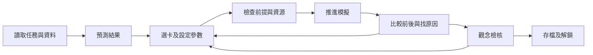
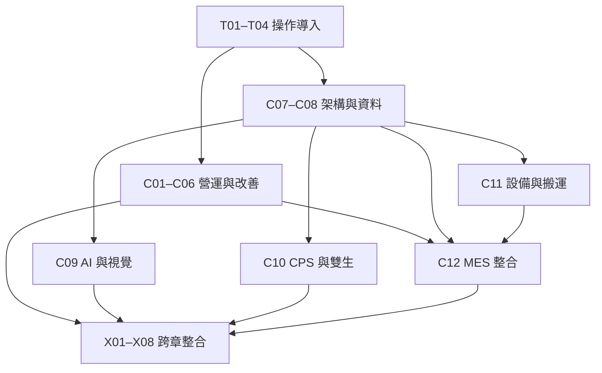

# 遊戲架構

狀態：設計規格。總索引與關數以 [README](README.md) 為準；數值與公式口徑以 [06](06_公式與易錯觀念.md) 為準。

## 1. 玩家目標

玩家是新人智慧生產工程師，從一條小產線接手十二個部門任務，最後能串起「接單、產能、用料、工序、品質、設備、資料、執行及改善」。完成任務的依據是交付結果與決策證據。

玩家在每關應能回答三件事：現場問題在哪裡、自己的措施改變哪個機制、換一組條件後是否仍適用。角色經驗與徽章提供進度回饋，能力判定依操作與觀念證據保存。

## 2. 遊戲主循環



| 階段 | 玩家動作 | 系統呈現 |
| --- | --- | --- |
| 任務簡報 | 讀目標、限制、初始資料 | 必要數據、單位、假設、詞彙提示 |
| 預測 | 選方向、數值範圍或因果鏈 | 記錄預測，不即刻洩漏結果 |
| 決策 | 出牌、選目標、填參數或排列卡牌 | 成本、作用對象、生效時間、限制 |
| 前提檢查 | 補足前置條件或修正操作 | 清楚指出缺少的資料、容量、授權或材料 |
| 執行 | 單步、播放、暫停、加速 | 工件／資料移動、狀態、排隊與事件時間軸 |
| 復盤 | 比較基準與本次方案 | KPI 數值、分母、差異、影響來源 |
| 檢核 | 回答原因、選證據或完成小型遷移 | 錯誤觀念、對應教材與下一步提示 |

教學關可無限重試；倒數計時不影響學習通關。動畫加速只縮短等待，不改模型時間、隨機序列或判分。

## 3. 五種共用操作場景

| 場景引擎 | 主要操作 | 典型章節 |
| --- | --- | --- |
| 生產與物流 | 分配工序、改善工站、釋放物料、調派搬運 | C01、C03、C04、C06、C11 |
| 計畫與文件 | 排序工單、展開 BOM、核對版次、設定交期 | C01、C02、C03、C12 |
| 診斷與品質 | 選圖、分群、看證據、隔離與確認原因 | C05、C06、C09 |
| 資料與架構 | 配對責任、接線、解碼、調整資料契約 | C07、C08、C10、C12 |
| 控制與驗證 | 步進狀態機、驗證模型、受控調參與復歸 | C09、C10、C11、C12 |

所有場景沿用同一套卡牌、任務、事件、結果與學習紀錄介面。概念分類關可用「證據卡排序／關係連線」，實務關則要求操作後的狀態變化；避免把所有內容改成相同的四選一。

## 4. 卡牌與資源的角色

卡牌代表工程措施、規劃政策、檢查程序或資料設定。每張卡必須顯示前提、成本、時間、效果與代價，詳細契約見 [02](02_卡牌與模擬規則.md)。

| 資源 | 單位／意義 | 規則 |
| --- | --- | --- |
| 改善預算 | 教學關使用點數；成本計算關使用明確貨幣 | 不能把點數代入 EOQ 的年度貨幣成本 |
| 模型時間 | 秒、分鐘、班、日或週，依關卡宣告 | 所有到貨、工序及維修都依此時間排程 |
| 行動額度 | 每輪可採取的決策數，預設 2 次 | 屬遊戲限制；關卡可覆寫，必須顯示 |
| 人員／設備容量 | 人數、機台數、可用工時 | 同一資源不能同時被多個作業佔用 |
| 材料／WIP | 指定品號、批次、狀態及數量 | 待驗、隔離、在途不直接等於可用庫存 |
| 證據／權限 | 檢測、核准、有效版次、設備狀態 | 不足時可執行診斷，不能跳過前提釋放生產 |

導入關固定提供必要牌，章節關提供足夠且可解的手牌與有限干擾牌。解鎖的是新決策工具及情境，重複出牌不能疊加成不合理的永久增益。

## 5. 章節進程與先修



此圖代表建議學習依賴，不強迫使用者先完成所有前章才能閱讀新章。每章文件補充需要的具體概念；每個綜合任務列明所需章節。

- 任務旅程：T01–T04 完成後，推薦 C01 與 C07 兩條起點；章內依 L01–L08 推進。
- 自由練習：從教材直達任一核心關，提供先修摘要與缺少概念提示；保留實際完成證據。
- 綜合挑戰：對應先修章八關皆取得一星後開啟正式挑戰；也可先以引導模式體驗，兩種紀錄分開。
- 同一關的變化挑戰使用不同參數或事件順序，保持相同能力目標；不新增關卡編號。
- X08 正式挑戰需十二章皆完成並通過 X01–X07；自由練習仍可預覽其分階段任務。

## 6. 通關、星等與能力證據

每關通關必須同時滿足「必要成果、操作約束、觀念檢核」。達成高產量但錯用分母，或繞過互鎖而交貨，都不能取得該關的完整通關證據。

| 項目 | 定義 |
| --- | --- |
| 一星：理解 | 完成該關全部基本目標與核心原因檢核；允許提示 |
| 二星：改善 | 在一星基礎上達到關卡額外效率／成本／完整性目標 |
| 三星：遷移 | 通過同關未見過的變化情境且未用解答提示；不要求操作速度 |
| 通關率 | 已完成唯一 levelId 數 ÷ 108；重玩、星等與變體不重複累加 |
| 概念能力 | 未練習 → 引導完成 → 獨立完成 → 遷移完成，依 conceptId 記錄 |

二星條件尚未為某關設定時，該關不能自行套「剩餘預算大於零」；內容實作階段必須明訂合理的額外目標。三星不是全站核心覆蓋的前提。

判分可採數值誤差、排序合法性、狀態機路徑、選定證據集合或因果連線。自由文字心得作自評，不以模糊關鍵字或外部 AI 生成結果作唯一通關判定。

## 7. 失敗、提示與復盤

- 非法參數：指出限制並保持原狀，不扣資源；例：對唯讀暫存器出寫入卡。
- 合法但不佳決策：正常產生結果；例：改善非瓶頸工站後整線產能未增加。
- 時限／交期失敗：保留已做決策與結果，顯示最早失敗原因，可回到本輪決策前重試。
- 資料不足：標記無法判定，引導採樣、核對或同步，不能用臆測補成「正確答案」。
- 提示分三層：指出觀察位置 → 提供相關原理 → 展示參考方案。提示使用被記錄，用來區別引導與獨立掌握。
- 復盤固定包含預測、實際、原因、可行替代方案及來源連結。比較方案時使用相同初始狀態與種子。

## 8. 畫面配置

桌面顯示「任務／目標」上列、「場景／證據」中央、「手牌／參數」下列、「事件／解析」側欄。手機以任務、現場、卡牌、結果四個分頁切換，關鍵目標與目前時間固定可見。

```text
┌ 交付目標  預算  模型時間  暫停／單步 ┐
│ 原料 → 工站 A → 工站 B → 檢驗 → 出貨 │
│        排隊、狀態、數值與事件標记     │
├ 基準／本次：產出、成本、品質、WIP ───┤
│ 卡牌：選擇措施 → 選目標 → 設定參數   │
└ 預測與執行   事件紀錄   解析／教材   ┘
```

拖曳操作須有「選卡＋選目標＋確認」按鈕替代。狀態同時使用文字、圖示與顏色；提供減少動態、字級調整、鍵盤操作及螢幕閱讀器可讀的事件摘要。第一個版本採 2D SVG／DOM 呈現，場景與數值模型分離。

## 9. 與現有學習功能串接

教材頁提供「用遊戲理解本章」，任務結果提供「回到本章」及「練習相關題」。既有題庫以 topicCode 對應；需要精確概念時另建 conceptId 對照，不依題目順序推測。

遊戲錯誤記為 misconceptionId 與概念證據，既有 CBT 錯題依 questionId 保存。畫面可並列兩種複習入口，但不能把遊戲失敗捏造成一筆 CBT 考試紀錄。現有考試歷史的百分比也不能充當遊戲掌握度。

瀏覽器單人玩法為完整核心範圍，可利用現有 PWA 架構設計離線遊玩。多人協作可在核心完成後擴充為採購、生產、品質分工，另需房間、同步、權限、伺服器裁決與斷線復原設計，不計入 108 關的已完成能力。
